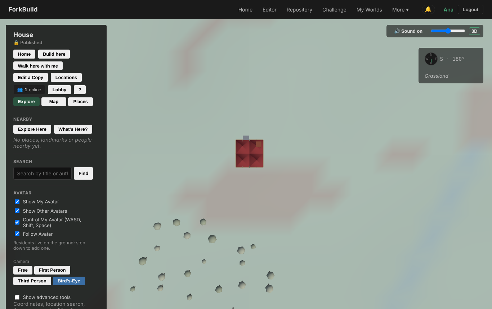
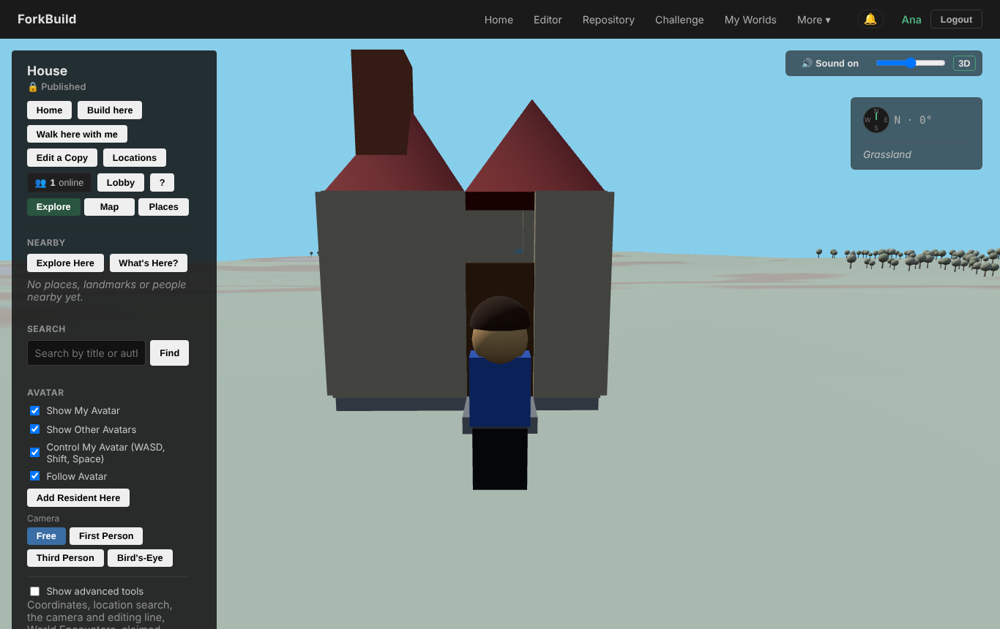
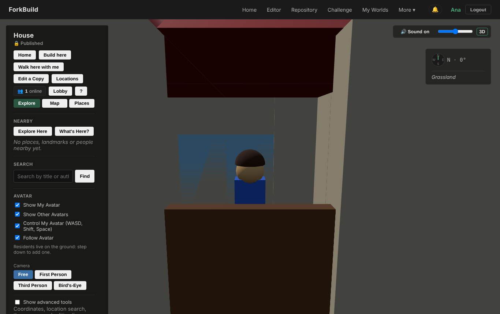
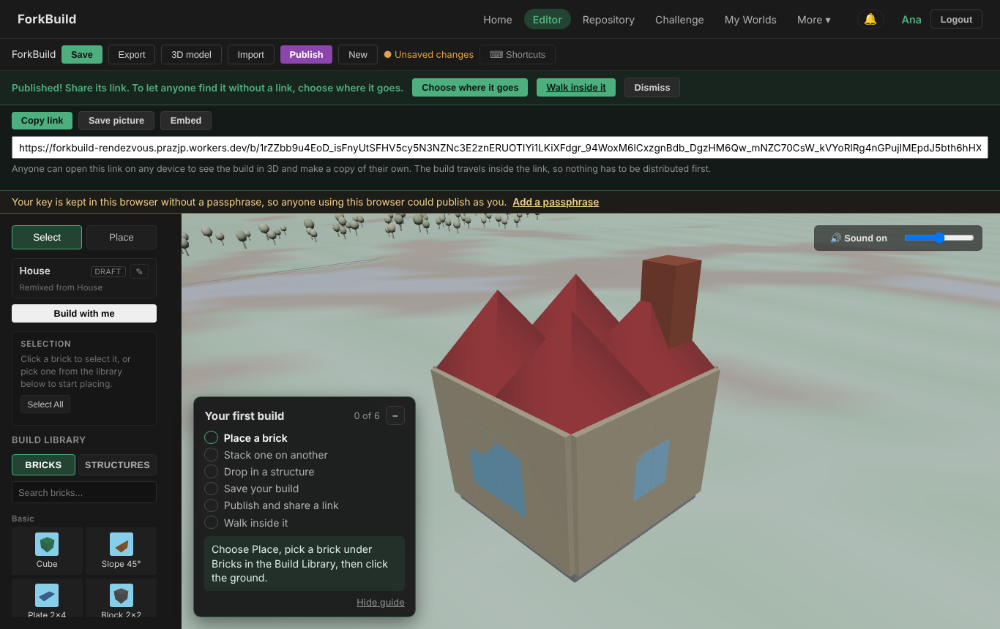

# Creative-direction audit, 2026-10-12

A Game Director's follow-up audit of ForkBuild 1.3.0 plus everything merged up
to 2026-10-12 ("Undo while building together"). The
[audit of 2026-10-11](CreativeDirection-2026-10-11.md) asked whether the
vision is coherent and whether the game delivers it. This one asks what has
changed since then, and what still stands between the fantasy and a player.
It doesn't repeat findings that have since been fixed.

This is a review, not a decision record. [Pillars.md](../Pillars.md) still
wins. Whatever is adopted from here goes into the roadmap the usual way.

## Verdict

**The vision is coherent, and the single-player version of it now works end
to end. The multiplayer half still rests on things a newcomer doesn't have:
a wallet, a crowd, and somewhere to meet.**

In one day the project shipped all three releases the last audit asked for
(Step inside, Make it yours, Build with me), with Undo while sharing and
co-builder credits as well. It was disciplined work: every milestone is
traced to a finding, and nothing off-pillar slipped in. I played the loop
from scratch in a browser (Home, then *Try it now*, Publish, *Walk inside it*)
and it holds together: the door swings, the avatar walks in, and the
first-build guide reaches its sixth step.

Playing it also shows where the fantasy still breaks. Each of the three
beats now works for **one player with a link**. Each fails for **a player
among other players**:

1. **"Anyone can remix it" needs a browser wallet.** A build reaches anyone
   who doesn't hold its link only if it is sent to Nostr, Arweave, Steem or
   Blurt, and every one of those needs an extension or account a newcomer
   won't have. Without one, the Repository, the challenge's entries, the
   plaza, "remixed N times" and remix notifications never see the build.
2. **"Lives in a world" has no neighbours.** Builds land on a 2.5 km grid by
   hash, and World View streams 100 units around you. Until a few thousand
   builds exist, every build stands alone in an empty field.
3. **"Walk inside" reaches a room nobody can see.** You can walk through the
   door now, but the room is about three bricks wide, empty, and the camera
   stays outside in the wall.

None of these needs a new system. Findings 1 and 2 are where the next
release should go, and they are the launch blockers. Finding 3 is a polish
pass.

## What changed since 2026-10-11

| 2026-10-11 recommendation | State | Notes |
|---|---|---|
| Doors and arches you can walk through, with a test | **Done** | core/BrickPassage.js, DoorSwing, `StepInside` tests. Silo, Watchtower, Lighthouse and keep doors still lead nowhere (roadmap "Not done"). |
| Guide's sixth step and Walk inside it after Publish | **Done** | Played: arrives facing the door. |
| A **Walk** / Explore nav entry that works with no build of your own | Not done | Nav is still Home · Editor · Repository · Challenge · My Worlds. The plaza link appears only once there are entries. |
| The copy pass, with a regression test | Not done | See finding 5. |
| Count placed bricks and re-gate on them | **Done** | core/PlacedBricks.js, `/e/publish-placed-…`. |
| Challenge Join opens a plot, plus twists and remix weeks | **Done** | Every theme has a twist line. The first remix week is 2 November. |
| Residents notice fulfilled wishes | **Done** | `residentWishFulfilledNear()`. |
| Build with me, cursors, co-builder credit | **Done**, and more | Undo while sharing, credits in every copy, builder pages. |
| Retire or rename the old "Achievements" | Not done | Still in the Publications page and user guide 12. |
| Decide each orphaned system (fold in, or move under Advanced) | Not done | Still undecided. |
| Playtest, launch to one channel, a Now/Next/Later page | Not done | The launch checklist (docs/launch/README.md) is 0 of 8. |

The loops the last review asked to close are closed for a single player. The
items left open are the ones that take a decision rather than code: words,
the nav, the orphaned systems, and launching.

## Findings, most serious first

### 1. Being found needs a wallet (P0, breaks pillars 2 and 3 for most players)

After Publish, the Editor says *"Published! Share its link. To let anyone
find it without a link, choose where it goes."* **Choose where it goes**
lists Nostr (needs a signing extension such as nos2x), Arweave (needs a
wallet extension such as Wander), and the experimental Steem and Blurt (need
Keychain and an account). That is docs/user/Distribution.md's own table. The
roadmap's "Publish sends it where it goes" names the missing piece itself:
*"Not done: an app-held Nostr key, so publishing could reach Nostr without a
browser extension."*

The game's social loops all read from those networks:

| Loop | Pillar | What a builder with no extension gets |
|---|---|---|
| Repository: find something to remix | 2 | Their build never appears for anyone else |
| Challenge entries and the plaza | 2, 3 | Their entry is visible only on their own device |
| "Remixed N times", remix notifications, the "remixed by others" stamp | 2 | Never learns that a friend remixed their build, unless the friend also sent the remix to a network |
| The shared world: builds standing side by side | 3 | Only builds this device already holds |

Together these are the game's whole multiplayer loop. Without them a player
can share links one at a time, but nobody discovers anything. The launch
targets for "Remixes per build published" and "Plaza visits per challenge
join" can't be met through link-only publishing. The press audience
(Show HN, Reddit, itch) won't install a Nostr extension to enter a weekly
challenge.

It also conflicts with Pillars' own rule: *"Players should see one verb,
**Publish**."* In practice there are two outcomes, a link or being found,
and the second is behind a browser plugin.

**Fix (small, inside the network gate):** an app-held Nostr key. The
secp256k1 curve is already vendored (vendor/noble-curves/secp256k1.js), and
Nostr relays are free and need no account. Make a Nostr key alongside the
device identity, encrypt it under the same passphrase, and include it in Your
Data's backup. Then Publish offers one plain choice the first time:

> **Who can find it?** ◉ Everyone: it appears in Explore and the challenge
> · ○ Only people I send the link to

This isn't a new network. Nostr is already a reader on every copy. It turns
an existing writer on for players who don't have an extension. The
extension path stays for people who prefer to sign with their own key. On
the shared link's page the remix needs the same choice, defaulting to the
source build's.

*Measured by:* remixes per build published, plaza visits per challenge join,
and a new `/e/publish-found` against `/e/publish-link-only`.

### 2. The world is too sparse to be a village (P0, breaks pillar 3)

`GridPlacementStrategy` puts every published build at
`computeDeterministicGridPosition(publicationId)`
(core/DeterministicGridPlacement.js), which gives 4,096 cells 40 units apart
over a 2,560 × 2,560 square. World View streams other builds within 100
units (`streamingRadius: 100`, application/world/WorldSpatialContextService.js).
How many neighbours a build expects to see in that radius:

| Builds published | Expected neighbours in view |
|---|---|
| 50 (the launch targets' minimum) | 0.24 |
| 200 | 1.0 |
| 1,000 | 4.8 |

So for its first months the shared world shows every player their own build
alone on grassland. A bird's-eye view of a just-published house:



That contradicts the Tone section ("a small, sunny, hand-built village") and
Home's hero image, which shows a cluster of buildings together on one green.
Residents, the plaza, Build here and the map all assume a place with things
in it. Only the challenge plaza and Build here plots ever put builds next to
each other, and both depend on finding 1.

**Fix:** make adjacency the default, still deterministic, still not a land
claim.
- **Builds settle into villages.** Place a build first by context, then fall
  back to the hash: a challenge entry goes in its week's plaza; a Build here
  build goes on its plot; a remix goes beside its source, as a ring around
  the original, so a family tree becomes a street; everything else goes in a
  "village of the week", a spiral around a seeded centre keyed by the
  publish week, so builds published the same week are neighbours.
- **The ready-made builds live in the world.** Stand the six showcase
  builds and the remix families on a starter village at the origin, the one
  on Home, where every newcomer can walk on day one. That also gives
  finding 4's Walk entry somewhere to go.
- Keep the existing hash grid as the last fallback, so old placements don't
  move.

*Measured by:* plaza visits per challenge join, and a new count of World
View sessions that see at least one other person's build.

### 3. Inside is reachable, but it isn't a place yet (P1, pillar 3)

The door now opens and the avatar walks through. Here is the moment of
arrival, at the door and two seconds later:




- **The camera doesn't follow you in.** World View arrives in the **Free**
  camera following the avatar. Nothing pulls the camera in front of a wall
  between it and the avatar, and no search of the renderer or the camera code
  finds any occlusion handling. Inside, the camera is in the wall or the
  roof. First Person, in a room this small, shows a wall at point-blank range.
- **The rooms are closets.** Measured from VillageLibrary: the House spans
  4 × 4.5, the Cottage 2 × 4, the Chapel 2 × 4, the Tool Shed 2 × 2. With
  walls, the House's room is about three units across for a 0.7-wide avatar.
- **The rooms are empty.** Of the 22 village structures, two hold any
  furniture (a bench, barrels). The House, which Home's *Try it now* opens,
  holds none.

**Fix:**
- A camera that respects walls: pull it in along the ray when something is
  between it and the avatar, and inside a roofed space switch to a close
  over-the-shoulder view, or fade the roof and the near wall the way
  builders and life sims do. This is renderer work, not new protocol.
- Furnish the starter House: a table, a bench, a hearth under the chimney, a
  rug of plates, with whatever few new bricks that needs. This is exactly the
  "content task" the last audit predicted. Widen it to about 5 × 5 inside.
- A test that, for each enterable ready-made building, the arrival camera
  can see the avatar.

### 4. On day one, nothing is alive (P1, pillar 3)

The audit's own walkthrough: a published house, its author alone,
*"No places, landmarks or people nearby yet"*, and the map saying *"Nothing
named or built here yet."* Residents exist only if the World's author adds
them with **Add Resident Here**. A newcomer doesn't know to, and wouldn't
want to make their own audience. Pillars says residents and animals "make
the world feel lived in", but by default none of them live near a new build.

**Fix:** ready-made homes come with a resident. When a build includes a
ready-made house, cottage or farmstead, its first publish offers one
resident (*"Someone could live here. Add them?"*, one tap), and the starter
village from finding 2 has its own residents, wishing for things nearby. The
no-quests rule still holds: they wonder and they notice, they never assign.

### 5. The words are still split (P1, clarity; carried from the last audit's findings 4 and 7)

Still on screens a newcomer meets, checked against ui/i18n/messages/en.js:

| Where | What it says | Should say |
|---|---|---|
| Home, *Remix anything* | "Fork published builds like source code" | "Make your own copy of any build…" |
| Home, *Explore together* | "Walk, ride, swim and fly through a shared 3D world" | "Walk through what you and your friends built" |
| Challenge, *How to enter* | "Builds you also send out with Distribute appear here" | Distribute was folded into Publish |
| About | "how to build, publish, fork, and explore" | "remix" |
| Shared-link errors, the Editor, World View | "Shared World": 34 strings outside the Advanced namespaces | "build" |
| Editor's info panel | "Document Information", "Edit document details" | "About this build" |
| Primary nav | Editor · Repository · My Worlds | Build · Explore · Challenge · Walk |

There is still no test that enforces the Words table, so this keeps
drifting.

The play-through also turned up three moments of mixed signals at the peak:



- Right after **Publish**, the build's badge still says **DRAFT** and the
  toolbar says **● Unsaved changes**. The player has just published, and the
  screen says they haven't.
- The success notice holds six actions (Choose where it goes, Walk inside
  it, Dismiss, Copy link, Save picture, Embed), a 300-character URL, and a
  yellow warning that "anyone using this browser could publish as you".
  That's the celebration moment, and it reads as a form.
- The name dialog before a first publish offers **Publish unsigned** next to
  **Continue**. Players can't weigh that choice, and an unsigned build can't
  be sent anywhere (see "Publish sends it where it goes").
- The Editor's top bar gives **Export**, **Import** and **3D model** the same
  weight as **Publish**. Two of them are file-format tools.

**Fix:** a one-day copy pass, plus `WordsTable.test.js`, which fails when a
*Not* term (fork, document, Shared World, Distribute, creation) appears in
the home, editor, firstBuild, publicationLink, challenge, toolbar,
documentInfo or app namespaces. After Publish, show one celebration: the
picture, **Copy link** and **Walk inside it**, with the rest under
**More ways to share**. Move Publish unsigned under Advanced, and Export,
Import and 3D model into a **File** menu.

### 6. World View is still a control panel (P2)

The "visitor's view" puts more than twenty controls in a panel that covers a
fifth of the screen: Home, Build here, Walk here with me, Edit a Copy,
Locations, Lobby, ?, Explore / Map / Places, Explore Here, What's Here?,
Search, four avatar checkboxes (Show My Avatar, Show Other Avatars, Control
My Avatar, Follow Avatar), Add Resident Here, and four camera buttons. "Home"
there means a different thing from the Home in the nav bar.

**Fix:** a HUD rather than a sidebar. Put the build's name and builders at
the top, three verbs at the bottom (**Walk here with me**, **Build here**,
**Remix**), and a map button, with everything else in a drawer. Avatar
control and follow are always on, so they should stop being checkboxes.

### 7. The orphaned systems are still undecided (P2, carried from finding 8)

Catching and decorating with animals, the inventory, swimming and the breath
meter, vehicles, chat with read receipts, voice calls and the public lobby
are unchanged, and still unfolded. Frozen is fine for a release, but it
costs translation, tests and guide pages every time one is touched, and
Home still advertises swimming. This needs one decision from the project
owner, written into Pillars. I'd keep vehicles (in tone, and good for a
village once finding 2 makes one), fold animals into the Build Library as
ambient life, and move chat and voice under **People** with nothing on Home.

### 8. Shipping is outrunning players (P2, process)

- Since the last audit, 8 milestones landed in about 17 hours, all on
  pillar. That's good discipline. But **nobody outside the project has played
  any of it**: the launch checklist is 0 of 8, and every target in
  core/LaunchTargets.js is still "a first guess".
- By a rough split of non-test source files on their names, about 34% of
  the code's lines are networks, proofs and publications, 13% identity and
  peers, 14% world and terrain, 7% avatars, vehicles and animals, and **9%
  building, remixing and the challenge**. The game's mass still sits under
  the waterline. That's fine as long as the next lines written go above it.
- The pace makes regressions in feel likely. A cramped interior or a camera
  in the wall is the kind of thing tests never catch and a five-minute
  playtest always does.

**Recommendation:** findings 1, 2 and 5 are the **launch gate**: a newcomer's
build can be found, has neighbours, and is described in the player's words.
Then run the five-person playtest from the last audit, fix what it finds,
and launch to one channel. A short Now / Next / Later at the top of
docs/Roadmap.md would let the next contributor see that at a glance.

## Pillar scorecard

| Pillar | 2026-10-11 | 2026-10-12 | Biggest gap now |
|---|---|---|---|
| 1. Building feels joyful | Good | Good, and now measured: placed bricks, plots, twists, Undo while sharing | The room you walk into is empty; the kit has no furniture to fix that |
| 2. Every build has a family tree | Good | Strong for builds you hold a link to: credits, co-builders, family-tree links | You can't find anything without a wallet extension (finding 1) |
| 3. Yours, and lives in a world | Weak | Better: you can walk inside, and build together live | No neighbours (finding 2), nothing alive (finding 4), and the camera can't come in (finding 3) |

## Recommended next two releases, then launch

Each leads with a pillar, adds almost no new systems, and is measured with
counters that exist or are one line to add.

**Release D, "Find each other" (pillars 2 and 3, the launch blocker)**
1. An app-held Nostr key, and **Who can find it?** inside Publish, defaulting
   to Everyone for challenge entries.
2. Context placement: challenge entries in the plaza, remixes beside their
   source, the rest in a village of the week.
3. A starter village at the origin with the showcase builds and the remix
   families, and a **Walk** nav entry that goes there.
4. The copy pass and `WordsTable.test.js`, from finding 5.

*Measured by:* remixes per build, plaza visits per join, and builds seen per
World View session.

**Release E, "A room worth entering" (pillars 1 and 3)**
1. A camera that respects walls, and a close view indoors.
2. A furnished, wider starter House; a few furniture bricks (table, bed,
   hearth, shelf).
3. A resident offered with ready-made homes; residents in the starter
   village.
4. World View's HUD, and the single post-publish celebration.

*Measured by:* second builds, `/e/walk-link`, and a new
`/e/walked-inside-own` with time spent inside.

**Then launch.** One channel, one week of counters, and choose Release F
from the missed targets.

**Not now:** new bricks beyond furniture, new traversal, new networks (the
gate stays closed; the Nostr key in Release D isn't a new network), new
languages, and further Build with me features until people use the first
version.

## Decisions only the project owner can make

1. **Is being found the default?** Everyone (my recommendation; it's what
   "anyone can remix it" says) or Only people with the link, with Everyone
   one click away. Either way, the choice should be one line inside Publish.
2. **Where does a build stand by default?** Next to its context (my
   recommendation) or where its hash puts it. This decides whether the
   world can ever look like Home's picture.
3. **The orphaned systems, one line each,** written into Pillars
   (finding 7).
4. **A launch date.** Without one, the queue of good ideas never ends, and
   none of them meets a player.

## Method

- Played the newcomer path in headless Chromium (Playwright, SwiftShader
  WebGL) at 1366 × 860 and 390 × 844: Home, the Challenge, the Repository and
  My Worlds, then *Try it now* → Publish → *Yes, allow remixes* → a name →
  *Walk inside it* → walking forward → First Person, Third Person and
  Bird's-Eye. The screenshots above are from that run. SwiftShader's
  lighting is flatter than a GPU's, but the geometry and the camera position
  are what a player sees.
- Read Pillars.md, VISION.md, the README, the 2026-10-11 audit and every
  roadmap entry since it, ui/App.js, HomeView.js, the English catalogue,
  docs/user/Distribution.md and 03-WorldView.md, and docs/launch/README.md.
- Measured the structures' footprints and furniture from
  `VillageLibrary.structures`, the placement density from
  core/DeterministicGridPlacement.js (`GRID_SPACING = 40`,
  `GRID_EXTENT = 64`) and the streaming radius, and the code split by
  classifying non-test, non-vendor `.js` paths by keyword (rough, meant to
  show proportions).
- Counted words-table terms by namespace in ui/i18n/messages/en.js:

  ```sh
  grep -nE "^\s*'(home|editor|publicationLink|challenge|app|about|firstBuild|toolbar|documentInfo)[A-Za-z]*\.[^']*':.*(Shared World|[Ff]ork|Distribute|[Dd]ocument)" ui/i18n/messages/en.js
  ```
