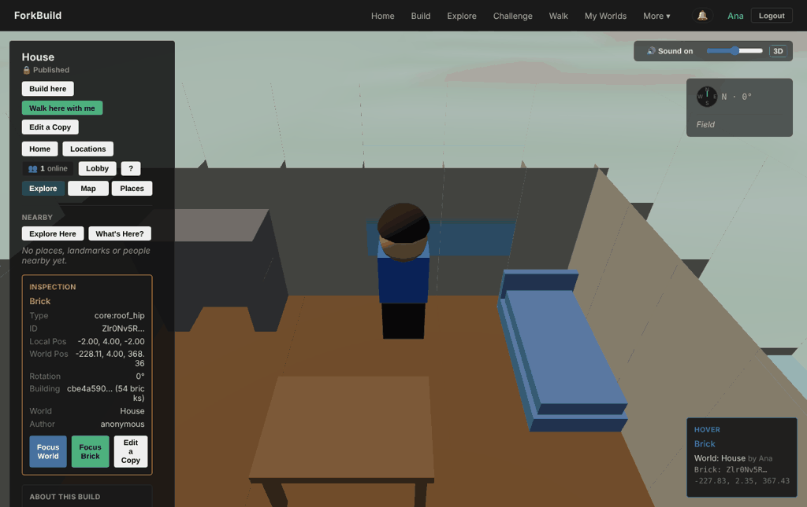
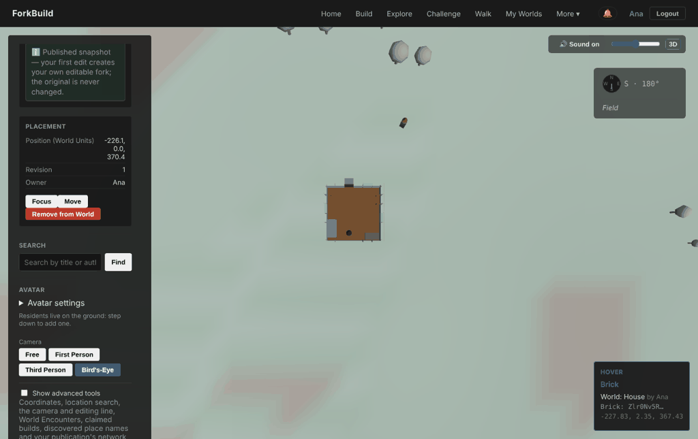
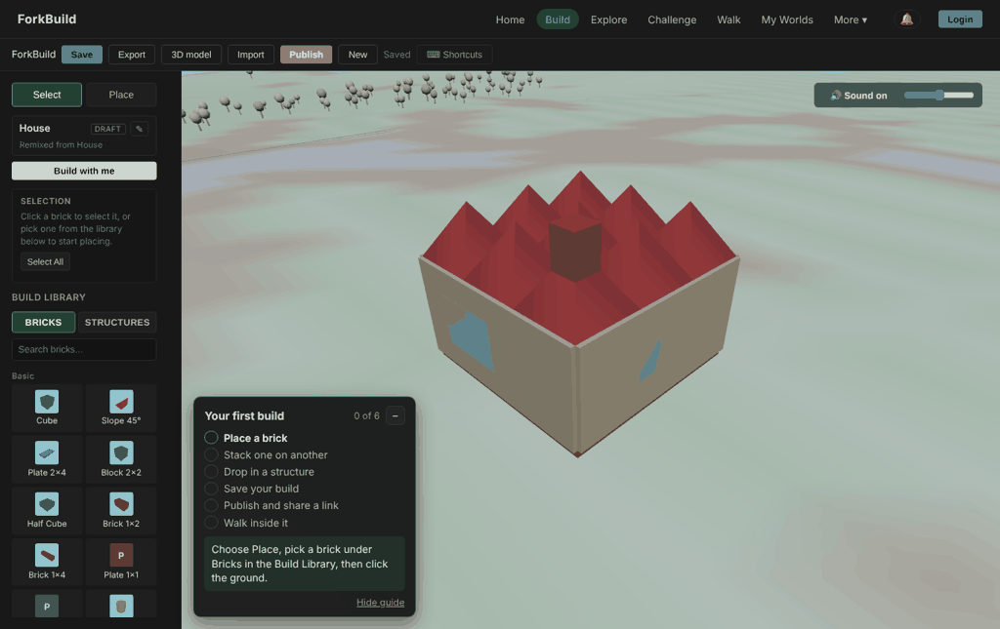
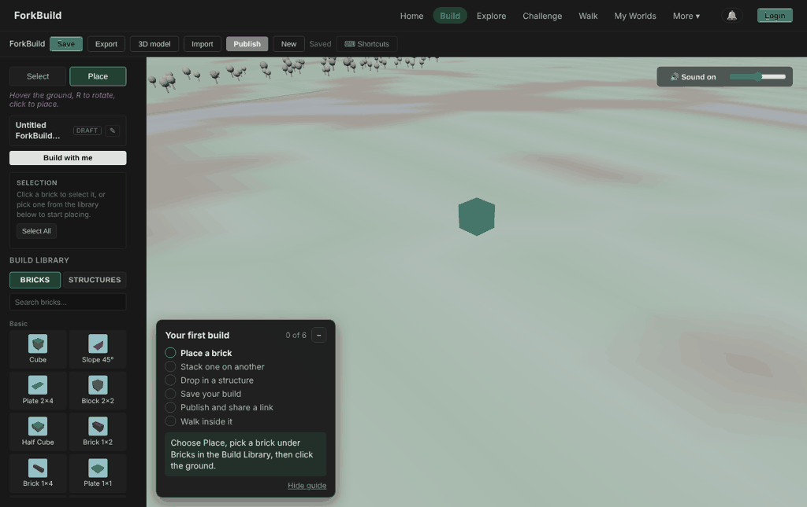
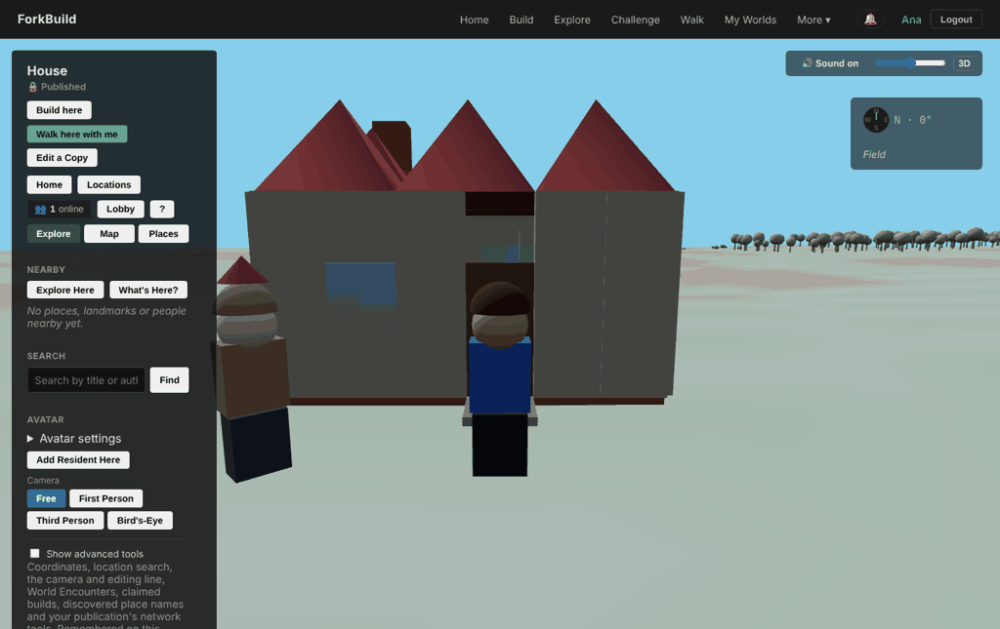
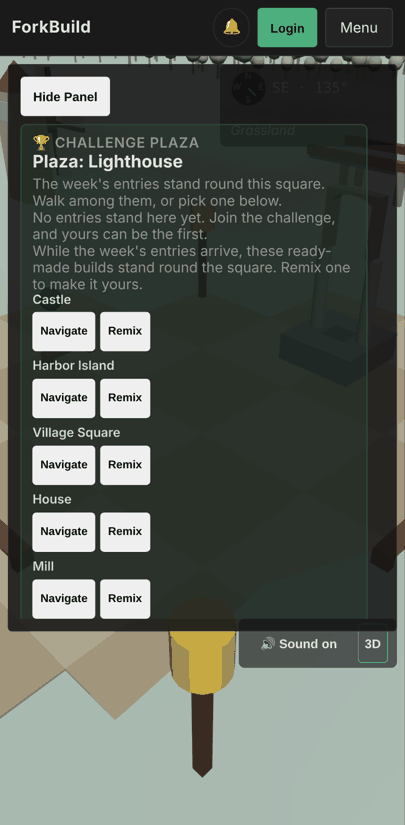
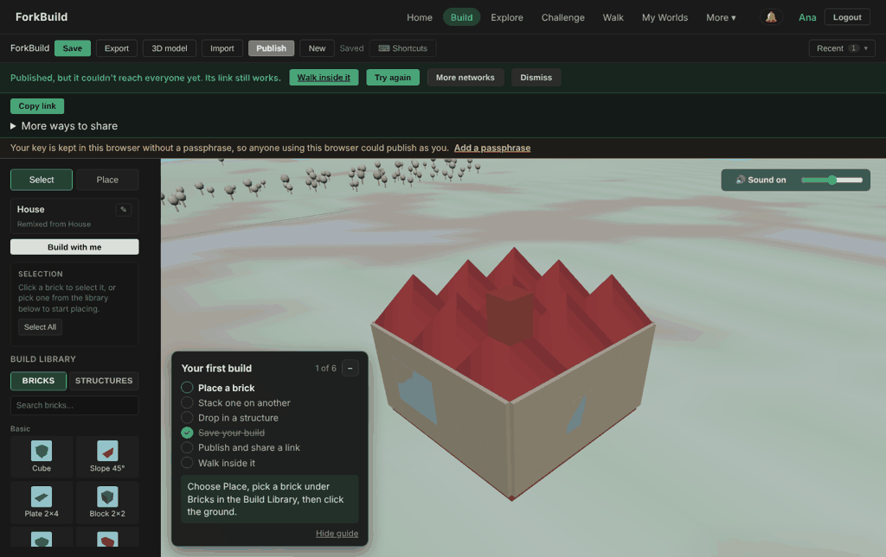

# Creative-direction audit, 2026-10-12 (second)

A Game Director's audit of ForkBuild 1.3.0 plus everything merged up to
"A room worth entering" (2026-10-12). It follows
[the morning's audit](CreativeDirection-2026-10-12.md), whose Releases D and E
both shipped the same day. This one checks whether they landed as a player
meets them, and asks the bigger question again: is the vision coherent, and
is the game in shape to launch? It doesn't repeat findings that have since
been fixed.

This is a review, not a decision record. [Pillars.md](../Pillars.md) still
wins, and whatever is adopted goes into the roadmap the usual way.

## Verdict

**The vision is coherent, and it's now written down well. Every
newcomer-facing surface tells the same story: Build · Explore · Challenge ·
Walk. What's left isn't a vision problem. It's three seams where the game
contradicts its own promise, and a launch plan aimed at the wrong
audience.**

Releases D and E did what they said. A published build now reaches everyone
with no wallet. Walking into the House shows a furnished room, with the roof
cut away and a resident by the door. The menu, Home and Publish use the
player's words. That's three audits' worth of findings closed in two days,
every one traced to a pillar.

Playing it again shows where the seams are now:

1. **The village is a stage set, not a place.** The plaza square and the
   ready-made builds round it exist only while you're on `/plaza/…`. Your own
   published house settles about 90 units away, beyond a clearing 72 units
   across, and from it you see nothing. The Home picture of a little village
   is still a picture.
2. **The fastest path skips the first pillar.** *Try it now* opens a
   finished, furnished 54-brick House. Publish works straight away, and the
   celebration fires for a build its player didn't touch. The launch gate
   counts exactly this as zero placed bricks. Release E made the House so
   complete that there's nothing left for a newcomer to add.
3. **The first click can fail.** In a new build, **Place** shows a brick
   under the cursor and the hint *"click to place"*, but clicking places
   nothing until a brick is picked in the library. No browser test places a
   brick with a real mouse.

Then there's the launch plan. It goes to r/threejs, r/WebGL, Show HN, and
the Nostr, Steem and Blurt communities. Those are people who want to read
the code, not people who play building games. The Pillars say "not a
blockchain product", but the launch would introduce it to crypto
communities first.

## What changed since the morning's audit

| Morning recommendation | State | As played |
|---|---|---|
| App-held Nostr key, **Who can find it?** in Publish | **Done** | Clear two-choice dialog; an honest "couldn't reach everyone yet" with **Try again** when relays are unreachable. |
| Context placement: plaza, beside the source, village of the week | **Done, partly felt** | A remix settles beside its source only if this device knows the source. A plain build settles on the ring 90 units from a square that isn't drawn there (finding 1). |
| Starter village and a **Walk** entry | **Done as a stage** | Walk shows the square and six ready-made builds. They're exhibits that disappear when you leave (finding 1). |
| Copy pass and `WordsTable.test.js` | **Done** | The menu, Home, Explore, Challenge and Publish read well. World View's inspection panel wasn't covered (finding 5). |
| Camera that respects walls, a close view indoors | **Done, and it works** | See the picture below. The best moment in the game right now. |
| Furnished, wider House; furniture bricks | **Done** | But see finding 2: finished is the opposite of inviting. |
| Resident with ready-made homes | **Done** | Stands by the door on arrival. |
| World View HUD, one celebration after Publish | **Partly** | The panel was reordered, not replaced. After Publish there are still three stacked bars over the view (finding 6). |
| Orphaned systems decided | Not done | Unchanged since 2026-10-11. |
| Playtest, launch to one channel, Now/Next/Later | Not done | Launch checklist still 0 of 8. |

## Is the vision coherent?

Yes, more than it was a day ago. The test I'd apply is whether the fantasy,
the pillars, Home, the menu and the release log all point the same way:

| Layer | Says | Consistent? |
|---|---|---|
| Fantasy | Build a little place. Anyone can remix it. Walk inside it with friends. | |
| Home | Build in 3D in your browser. Remix anything. Own your work. | Yes |
| Menu | Build · Explore · Challenge · Walk | Yes, one verb per beat |
| Last 20 milestones | All name a pillar. None adds a network. | Yes |
| Tone | A small, sunny, hand-built village | Yes in content; the kit's roofs fight it (finding 4) |
| Launch kit | threejs, WebGL, HN, Nostr/Steem/Blurt | **No** (finding 7) |
| Code and text mass | About 31% of UI strings and about 44% of non-test code are networks, publishing and proofs. About 10% of strings are remixing, the challenge and sharing, the thing Pillars calls the difference. | Weight, not direction (finding 8) |

The remaining incoherence isn't about what ForkBuild *is*. It's about
**where** it is: the game promises a village, and the world's code has two
separate ideas of place (finding 1).

## Findings, most serious first

### 1. The village is a stage set (P0, pillar 3)

`ui/views/worldView/useChallengePlaza.js` says it outright: *"Exhibits are
never placements: they are gone when the visitor leaves. The plaza's own
square stands the same way."* So:

- **Walk** shows a square, a well, benches and six ready-made builds. All of
  it is temporary scenery for that route.
- **Publish** settles your build on the village ring
  (`VILLAGE_FIRST_RING_RADIUS` = 72 + 18 = 90 units from `PLAZA_CENTER`).
  The first test house landed at (−226, 370), 89.6 units from the middle.
- **Walk inside it**, or **Walk here with me** from that house, then puts you
  and your friend next to a square that isn't drawn and builds that aren't
  there. From above, the house stands alone, exactly as in the morning's
  "alone in an empty field" picture:

- A challenge entry is *also* shown as an exhibit on the square while you
  visit the plaza. So the same build stands in two places, one of them
  temporary.
- Even when the ring fills up, a 72-unit clearing means the first two
  builders could be 180 units apart, out of each other's 100-unit streaming
  radius.

**Fix: make one place.** Draw the square and the six ready-made builds as
permanent world content at `PLAZA_CENTER` in every World View session, the
same way terrain and trees are drawn (deterministic, signed by nobody, never
a placement). Shrink the clearing so the first ring sits about 30 units from
the square, inside the streaming radius. Make a challenge entry's settled
spot its plaza spot, so a build stands in exactly one place. Then *Walk inside
it* arrives in a village, and *Walk here with me* brings a friend into one.

*Measured by:* the count the morning's audit proposed, World View sessions
that see at least one build that isn't the visitor's own. Ready-made builds
shouldn't count toward it.

### 2. The fastest path skips the building (P0, pillar 1)

Home's primary button is *Try it now: start with a house*. It opens the
House: 54 bricks, furnished, roofed, finished. Nothing in the next screen
asks for a change:

- **Publish** is enabled and runs to the end. The guide stays at "Place a
  brick" (1 of 6, only Save ticked), but nothing ties the celebration to it.
- Pillars' own gate (`median-placed`) counts this build as 0. If most
  launch visitors take the big green button, the building numbers can't move
  however good the kit is. That's the outcome the 2026-10-11 audit's "Make it
  yours" was written to prevent, and Release E made it more likely: a
  newcomer has no obvious gap to fill.
- The Editor opens high above the roof (above), so the furniture Release E
  added isn't visible where the player starts. The cutaway exists only in
  World View.

**Fix: hand over a house with a job left to do.** Try it now should open a
House that's clearly *started*, not finished: walls and floor up, the roof
missing, or an empty room with the furniture waiting in a pinned "For this
house" shelf, the way a challenge pins its ideas. The guide's first step then
says *"Give it a roof"*. If the player publishes with 0 placed bricks, the
celebration can say so kindly, once: *"It's still the ready-made House. Add
something of your own first?"*, with **Publish anyway**. Also open the
Editor's camera at a three-quarter angle, and offer the cutaway there (the
clipping planes are already shared in renderer/CutawayClipping.js).

*Measured by:* `/e/publish-placed-0` against all first publishes, which
should fall week on week.

### 3. Place can't place (P0 bug, pillar 1, first minute)

Steps, in a new build (`/#/editor`): click **Place**. The hint *"Hover the
ground, R to rotate, click to place."* appears, and a green cube is drawn in
the view. Click the ground: nothing is placed, and the guide stays at 0 of
6. Picking any brick in the Build Library first makes the same clicks work.

The guide's text does say "pick a brick … then click", but the hint and the
ghost brick say otherwise. Whichever a newcomer believes, the first verb of
the game fails silently. Reproduced in headless Chromium with real mouse
events; the code path is `PlacementTool.onPointerDown()`, which returns
early unless `editorContext.preview` is visible with a definition id.

**Fix:** Place with no brick chosen picks the Cube (or the last brick used)
and selects it in the library. Add a browser test that places and stacks
bricks with `page.mouse`. None of the 44 `*Browser.test.js` files or the
bundled-site test does that today, so the core verb has no end-to-end check.

### 4. The kit can't make a village roof (P1, pillar 1 and Tone)

Every pitched roof in the library is tiled from small `core:roof_hip` caps:
42 of them across VillageLibrary. The House alone has nine in a 3×3 grid. In
the Editor and from the street that reads as a tray of red spikes, not a
roof (see finding 2's picture and the door below). Roofs are a village's
silhouette, and the Tone section promises "small, sunny, hand-built".

**Fix:** three or four roof bricks that span: a long gable (2×4, 2×6), a
hipped 4×4 and 6×6, and a matching ridge. Then rebuild the House, Cottage and
Chapel roofs with them. That's content, not a system, and it's the single
change that would most improve every screenshot and the press kit.

### 5. One click in World View opens the engine room (P1, clarity)

Clicking the view to start walking also picks the brick under the cursor.
The panel then fills with **Inspection**: *Type core:roof_hip*, a brick id,
Local and World Pos, *Building cbe4a590… (54 bricks)*, and *Author
anonymous*. Two lines later the same build says *Owner Ana*, and the hover
card says *by Ana*. Below that are **About this build**, *"Published
snapshot — your first edit creates your own editable fork; the original is
never changed"*, Revision, Position (World Units), and a red **Remove from
World**.

`WordsTable.test.js` doesn't cover World View, so "fork", "snapshot" and
"immutable" are back on the screen the game is supposed to be about.

**Fix:** a visitor's click selects nothing. Inspection and placement
details go under **Show advanced tools**, which already exists for exactly
this. Credit should read the same in all three places (the builder's name).
Add the worldView namespace to the Words test, with the advanced panels
exempt.

### 6. The screen still crowds the moment (P1)

- **Phone, Walk:** the plaza panel covers about 85% of a Pixel 7's screen.
  The square is behind it.

  

- **After Publish:** a green notice bar, a share row and a yellow passphrase
  warning stack above the view and push the build down a third of the
  screen. That's at the moment it should be biggest. The warning is right to
  exist, but it can wait until the second publish or the first walk link.

  

- **Editor toolbar:** Export, 3D model and Import still sit beside Publish
  at the same weight. On a phone they push **New** off the edge.

**Fix:** the World View HUD the morning's audit asked for. On phones, start
the panel collapsed to one line ("Plaza: Lighthouse · 6 builds ▸"). Move
the passphrase nudge out of the celebration, and put Export, 3D model and
Import in a **File** menu.

### 7. The launch kit targets technologists and crypto (P1, strategy)

docs/launch/README.md orders: r/threejs → r/WebGL → r/SideProject, the same
week Nostr, Steem and Blurt, then Product Hunt, Show HN, and teachers "after
the first weeks". The GitHub topics it asks for include `nostr` and `p2p`.

These channels will try it, admire the architecture and leave. They won't
build a lighthouse every week. The people who will (Townscaper, LEGO,
Minecraft-builder, cozy-game and voxel-art communities, and families and
classrooms) aren't on the list until last. Leading with Nostr, Steem and
Blurt also tells the first audience that this is a crypto app, which
Pillars rules out.

The checklist is also out of date in two places. "Distribute them to
Nostr" is now just Publish → Everyone. And "tick Post to Steem and Blurt" is
asked of the launcher, which makes those networks part of how the game is
introduced.

**Fix:** lead with builders. One cozy- or building-game community first,
with a 30-second clip of *Join the challenge → build → walk inside with a
friend*. Bring teachers forward: no accounts, no download and an STL export
fit a classroom. Keep HN as the second wave, framed as "a building game
whose saves you own". Drop the Steem and Blurt step from the checklist.
Post in crypto communities only as "also works with", never first.

### 8. The mass is still under the waterline (P2, carried)

Rough split by file and message-key names (meant to show proportions):

| | Share of non-test code | Share of UI strings (4,196, each times 8 languages) |
|---|---|---|
| Networks, publishing, proofs | ~44% | ~31% |
| Identity, peers, chat, data | ~14% | ~13% |
| World, terrain, places | ~13% | ~19% (with avatars and creatures) |
| Avatars, vehicles, animals | ~8% | (above) |
| Building, editor | ~14% | ~22% |
| Remix, challenge, sharing | (above) | ~10% |

The Publications page alone has 641 strings, more than the Editor and the
Build Library together. That's the translation and test tax on every change.
The orphaned systems (catching and decorating animals, inventory, swimming,
chat with read receipts, voice, the public lobby) are still undecided after
two audits. **This needs the owner's one-line decision each**, not more
code.

### 9. The pace has outrun the players (P2, process)

47 commits since 9 October, every one on pillar, and still no one outside the
project has played any of it. Two of today's three P0s (findings 2 and 3)
are things a five-minute playtest with one newcomer finds and no unit test
does. The morning's audit said the same, and its "then launch" didn't
happen. Without a date, the next audit will find the next three seams.

## Pillar scorecard

| Pillar | 2026-10-12 morning | Now | Biggest gap |
|---|---|---|---|
| 1. Building feels joyful | Good | **Slipped in practice:** the kit is bigger, but the main path skips it and Place can fail | Findings 2, 3, 4 |
| 2. Every build has a family tree | Strong with a link | **Strong:** findable with no wallet | A remix of an unseen source doesn't join its family's street |
| 3. Yours, and lives in a world | Weak to better | **Good inside, empty outside:** the room is lovely, the village is a stage | Finding 1 |

## Recommended: one small release, then launch

**Release F, "Make it yours, in the village" (about one day, no new systems)**
1. Place picks a brick when none is chosen, plus a real-mouse browser test
   that places and stacks (finding 3).
2. Try it now opens an unfinished House with its job named; a gentle
   "add something of your own?" on a 0-placed publish (finding 2).
3. The square and the six ready-made builds drawn permanently at the plaza.
   The village ring pulled in to sit beside it, and an entry's plaza spot is
   its settled spot (finding 1).
4. Spanning roof bricks, with the House, Cottage and Chapel re-roofed
   (finding 4).
5. World View clicks select nothing without Advanced; the Words test covers
   World View (finding 5).

**Then, before any more features:**
- A five-person playtest with people who play building games, not
  developers. Watch them, write down every stall, fix the top three.
- Rewrite the launch order to lead with a builders' community and teachers
  (finding 7), set a date, and launch.
- The owner writes one line per orphaned system into Pillars (finding 8).

**Not now:** new traversal, new networks, more Build with me features, more
languages, and the HUD rewrite beyond collapsing the panel on phones. Each is
good, and none of them is what stands between a newcomer and the fantasy.

## Decisions only the project owner can make

1. **Is the plaza a place or a view?** I recommend a place: permanent, drawn
   for everyone, the origin of the village.
2. **What does Try it now hand over?** A finished showcase (today) or an
   unfinished house with a job? I recommend the job; the showcase stays on
   Home and in Explore.
3. **Who hears about ForkBuild first?** Builders and teachers (my
   recommendation), or developers and the networks it publishes to.
4. **The orphaned systems,** one line each.
5. **A launch date.**

## Method

- Played the newcomer path in headless Chromium (Playwright, SwiftShader
  WebGL) at 1366 × 860 and as a Pixel 7: Home, Challenge, Explore, Walk;
  *Try it now* → Publish → *Yes, allow remixes* → *Everyone* → a name →
  *Walk inside it* → walking in → turning → Bird's-Eye; and a blank
  `/#/editor` with **Place** with and without a library brick picked. Relays
  and RPC hosts were unreachable from the sandbox, so the "couldn't reach
  everyone yet" path is what showed. SwiftShader washes out the terrain
  colours, but geometry, layout and camera are what a player sees.
- Read Pillars.md, VISION.md, the README, both earlier audits, the roadmap
  entries "Find each other" and "A room worth entering",
  ui/views/worldView/useChallengePlaza.js, core/ChallengePlaza.js,
  core/BuildSettlement.js, core/library/VillageLibrary.js,
  application/tools/PlacementTool.js, the English catalogue and
  docs/launch/README.md.
- Measured the settled house's distance from `PLAZA_CENTER` and the ring
  constants; counted `core:roof_hip` in VillageLibrary; split UI strings by
  message namespace and non-test, non-vendor `.js` by path keyword (rough,
  for proportions only); counted commits since 2026-10-10 and browser tests
  that use `page.mouse`.
