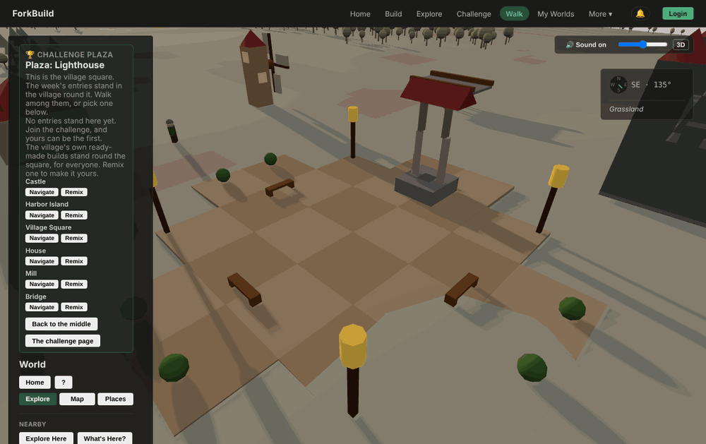
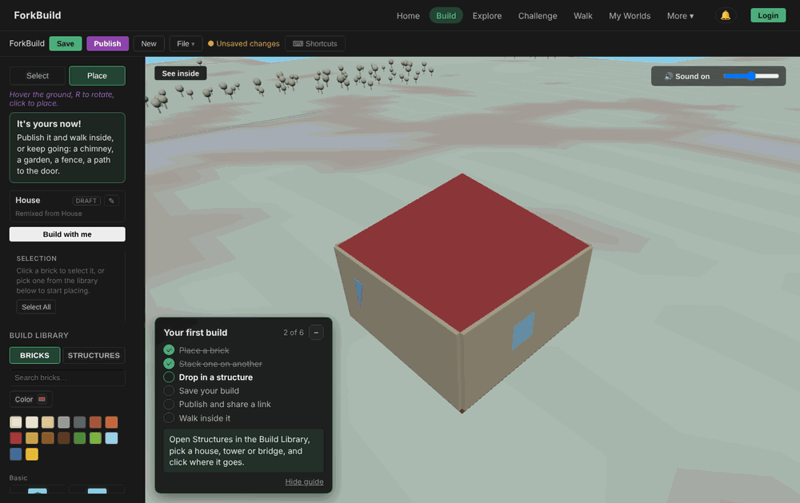
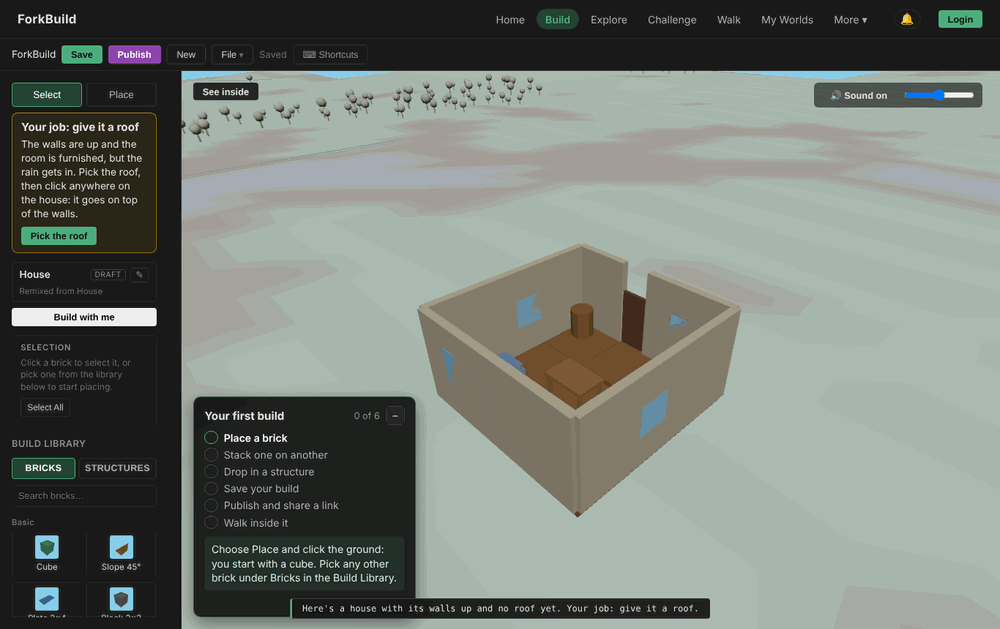
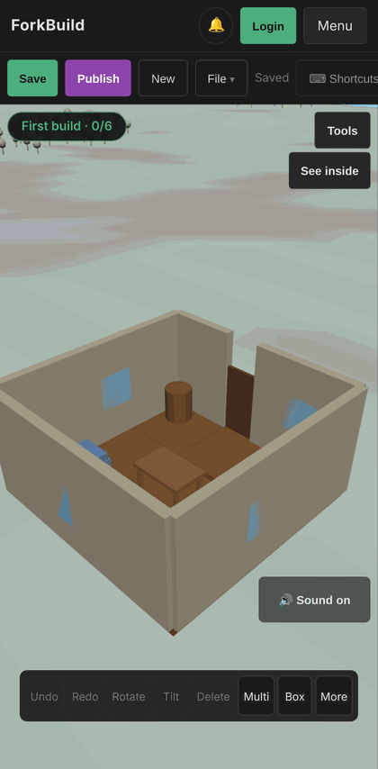
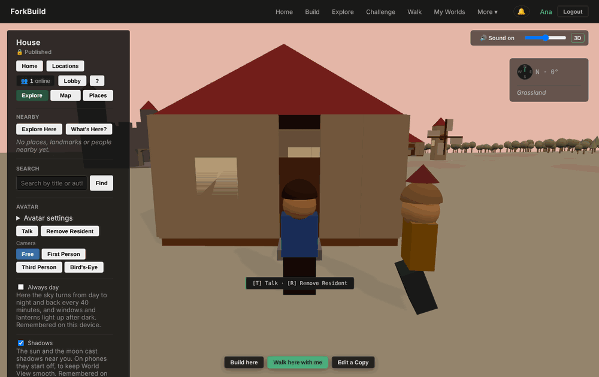

# Creative-direction audit, 2026-10-12 (third)

A Game Director's audit of ForkBuild 1.3.0 plus everything merged up to
"Stars and the Milky Way in World View" (2026-10-12, 15:00). It follows
[the second audit of the day](CreativeDirection-2026-10-12b.md), whose
Release F shipped. It asks the same two questions: is the vision coherent,
and is the game in good shape to deliver it? It doesn't repeat findings that
have since been fixed.

This is a review, not a decision record. [Pillars.md](../Pillars.md) still
wins, and whatever is adopted goes into the roadmap the usual way.

## Verdict

**The vision is coherent, and the product now mostly matches it. What's
weakest now is the process steering it. The pillar filter lets almost
anything through, and the game hasn't met a single outside player. The
first ten minutes still have seams, and only a playtest finds that kind.**

Release F did what it said. A newcomer who presses **Walk** stands in a
real village square with the six ready-made builds round it. A published
house stands about 56 units away, in sight of the square. **Try it now**
hands over a house with no roof. Place works on the first click. That
closes all three of the morning's P0s.

Then five milestones in a row went into the sky: day and night, a sun and
a moon, the compass fix, shadows, and stars with the Milky Way. Each one
says it serves "your work lives in a world", and each one passes the
filter. Taken together, they ignored the previous audit's one instruction:
*"Then, before any more features: a five-person playtest … set a date, and
launch."* None of that has happened. The launch checklist is still 0 of 8,
and the launch kit still opens with r/threejs and the Nostr, Steem and
Blurt communities. This is the fourth audit in two days, and every one of
them was written by playing the game in a headless browser. That's the
pattern to break.

Playing the newcomer path again found four new seams. All of them are
small, and all of them sit in the first five minutes:

1. **Walk doesn't let you walk.** Without a name, World View has no avatar.
2. **The job takes one click, and the guide then teaches the metric's blind
   spot.** One roof brick finishes "Try it now" and ticks two guide steps.
   The guide's next step is "Drop in a structure", which the building gate
   doesn't count.
3. **Two tutors speak at once on desktop, and on a phone the job is
   hidden.**
4. **The shell doesn't look like the village.** The app's chrome is a dark
   developer tool, and the world has no art direction written down.

## What changed since the second audit

| Second audit's recommendation | State | As played |
|---|---|---|
| Place picks a brick, real-mouse test | **Done** | First click places a cube; bundled-site test covers it. |
| Try it now hands over a job | **Done, too small** | One click finishes it (finding 2). |
| Square and ready-made builds permanent; ring pulled in | **Done** | **Walk** opens a real square, with the Mill, Castle and House in view. |
| Spanning roof bricks | **Done** | Hip Roof 4×4, 4×6, 6×6 and Gable 2×4; the House's roof is one piece. |
| World View click selects nothing | **Done** | Inspection is behind **Show advanced tools**. |
| Phone panel collapsed; one bar after Publish | **Done** | "🏆 Plaza: Lighthouse · 6 builds" on a Pixel 7. |
| Owner decides the side systems | **Done** | Kept and counted (Pillars, "The side systems"). |
| Five-person playtest | Not done | |
| Launch order led by builders and teachers; a date | Not done | docs/launch/README.md unchanged. |
| "Not now": nothing else before launch | **Not kept** | Five sky and lighting milestones. |

## Is the vision coherent?

Yes. The fantasy, the pillars, Home, the menu and the guide all tell one
story, and the Words test keeps the copy honest on the screens a newcomer
sees. What's changed is where the risk sits:

| Layer | State |
|---|---|
| Fantasy and pillars | Clear and well written. Nothing to change. |
| Newcomer surfaces | Consistent words; four small seams (findings 1 to 4). |
| Art direction | **Not written down.** The "Tone" paragraph covers what to build, not how it should look (finding 4). |
| Process | **The weak layer.** The filter can't say no, and nobody outside the project has played it (finding 5). |
| Launch | **Unchanged and off-vision.** Leads with technologists and crypto communities (finding 6). |

## Findings, most serious first

### 1. Walk doesn't let you walk (P0, pillar 3)

Click **Walk** in the main menu as a newcomer. It opens the plaza, and the
panel's Avatar section says *"Log in and create an avatar (My Avatar) to
appear here."* There's no body, no WASD walking and no door to step
through. It's a free camera. The menu promises the third beat of the
fantasy, and the first visit gives you a spectator's view of it
(`ui/views/worldView/templates/avatarSection.js`, `hasLocalAvatar`).

You only get a body after publishing (which creates a name) or logging in.
"Login" is a word the game otherwise avoids: Home says "No account".

**Fix:** a visitor walks as a guest with no name: a default avatar that
exists only on this device, is never advertised to peers and can't sign
anything. Ask for a name at the moment it's needed: **Walk here with me**,
Talk, or Publish. Rename the header's **Login / Logout** to the player's
name and a "Your name" menu, and add both words to the Words table.

*Measured by:* `/e/plaza-visit` plus a new count of guest walks, against
`/e/world-visit`.

### 2. The job takes one click, and the guide then teaches the metric's blind spot (P0, pillar 1)

Try it now → **Pick the roof** → one click on the house. The roof goes on,
the card says **"It's yours now!"**, and the guide ticks *Place a brick*
and *Stack one on another* together. The build now has **one** placed
brick.

The guide's next step is *"Drop in a structure: open Structures … pick a
house, tower or bridge"*. Structures are exactly what `/e/publish-placed-…`
leaves out. So the tutorial's path ends at about 1 placed brick, against a
median target of 10, which is also the gate on new networks. The game
teaches the behaviour its own success number ignores.

**Fix:** make the job a short chain that ends near ten placed bricks
without feeling like a chore. Roof → chimney → a door path → a fence or
a garden, each one a card with one **Pick the …** button, and each
celebrating as it's done. Rewrite the guide's third step as *"Add
something of your own"* (any five bricks placed). Keep "Drop in a
structure" as a tip, not a step. "It's yours now!" should come at the end
of the chain, not after the first click.

*Measured by:* the median of `/e/publish-placed-…` for builds started from
Try it now. Count the start (`/e/starter-job`) so the two can be put side
by side.

### 3. Two tutors at once, and on a phone the job is hidden (P1, first minute)

On a desktop, Try it now shows three instructions at once:

- the job card: *"Pick the roof, then click anywhere on the house"*;
- the first-build guide: *"Choose Place and click the ground: you start
  with a cube"*;
- a toast at the bottom: *"Your job: give it a roof."*

The first two ask for different clicks in different places.

On a Pixel 7 the job card doesn't show at all. It lives in the sidebar
(`EditorView.js`, `StarterJobCard`), which folds behind **Tools** on narrow
screens. Once the toast fades, all that's left is a *First build · 0/6*
pill and a roofless house.

**Fix:** one tutor at a time. While a starter job is open, the guide stays
folded to its pill, and the job card *is* the current step. Show the job
card over the view (like the guide), not in the sidebar, so phones get it
too.

### 4. The shell and the world don't share a look (P1, Tone)

Pillars' tone is *"a small, sunny, hand-built village, in warm colours."*
The village content fits that. Everything around it doesn't:

- The app's chrome is a near-black developer UI with green and purple
  buttons. Home's showcase picture sits on it like a screenshot in an admin
  panel.
- The bricks have no texture, studs or edge treatment. `assets/bricks/` and
  `assets/textures/` are empty, so walls render as flat brown planes, and a
  room reads as a box (see finding 1's square, and the House above).
- There's no music, only synthesised effects and ambience.
- There's no written art direction: palette, materials, lighting key,
  UI style. The last five milestones (sky, sun, shadows, stars) each made a
  local lighting choice with no reference to aim at.

That last point matters most. The sky work is good, but it's polish without
a target, and it's exactly what an art bible would have ordered *after* the
bricks themselves read as hand-made.

**Fix:** a one-page **Look** section in Pillars, beside Tone: a palette for
the UI (warm paper, wood and sky, not black), a brick material rule (a
subtle bevel or edge darkening, and studs or a light grain on top faces),
one lighting key (warm late-morning), and a reference board. Then one
content pass to meet it: a light, warm theme for the shell on Home, the
Editor and the shared link, and the brick material in ThreeBrickFactory.
That would do more for screenshots and the press kit than any further sky
work.

### 5. The filter can't say no, and nothing outside it has said anything (P1, process)

Pillars' filter asks *"Which pillar does it serve?"* Every milestone since
9 October answers it, and "your work lives in a world" can justify any
amount of World View polish. Five atmosphere milestones shipped in an
afternoon, in exactly the window the previous audit set aside for a
playtest and a launch date.

The filter needs a question with a number behind it. Pillars already has
eleven targets in core/LaunchTargets.js. None of them can move yet,
because nobody outside the project is playing.

**Fix, both small:**

- Add a fourth question to the filter: **"Which target in 'The numbers to
  reach' should this move, and why do we think it's the one holding that
  number back?"** Before launch, the honest answer for most work is "we
  don't know yet". That's the signal to stop and get players instead.
- Make "playtest" a real milestone with a record. Write
  `docs/playtests/2026-10-NN.md` with who played (five people who play
  building games), what they were asked, every stall with a timestamp, and
  the top three fixes. No feature milestone merges until the first one
  exists. Findings 1 to 3 here are the kind it would have caught in five
  minutes.

### 6. The launch kit hasn't moved (P1, strategy, carried)

docs/launch/README.md still opens with r/threejs → r/WebGL → r/SideProject,
then Nostr, Steem and Blurt, with teachers "after the first weeks". The
checklist still asks the launcher to tick **Post to Steem** and **Post to
Blurt**, and asks for the `nostr` and `p2p` topics. Its "Known issues"
section is now wrong: *"Distributing to Nostr needs a NIP-07 browser
extension"* stopped being true when build notes shipped. Posting that
would tell the first audience something false about the main publish path.

**Fix:** as the second audit said. Lead with one builders' or cozy-game
community, with a 30-second clip (*Try it now → roof → Walk inside*). Bring
Educators forward. Drop the Steem and Blurt ticks. Correct the known-issues
list. Then set a date and write it at the top of the kit.

### 7. Smaller things a player meets (P2)

- **World View's panel is still a control panel** when you walk inside your
  own build: Home, Locations, Lobby, ?, Explore, Map, Places, Explore Here,
  What's Here?, Search, Avatar settings, Talk, **Remove Resident**, four
  camera modes, Always day and Shadows. That's about 20 controls before
  "Show advanced tools". **Edit a Copy** is offered on your own build.
  *Remove Resident* (and its `[R]` hint) sits next to *Talk* as a peer
  action.

  

- **Engine words still on newcomer screens:** **Navigate** on every plaza
  entry, **Publish unsigned** in the name dialog, **🔒 Published** as World
  View's status, **My Worlds** in the menu (which Pillars itself calls open
  work), and the challenge tag `#lighthouse-20261012` shown in full on Home.
  None of them is in the Words table yet.
- **The first walk can be at night.** The day is set by the clock alone, so
  about a third of first visits (dusk, night and dawn) arrive in the dark,
  including the "Walk inside it" moment and any clip recorded for launch.
  Consider starting a page's first World View visit at day and letting the
  cycle catch up, or at least recording press clips with **Always day**.
- **The challenge prompts are all "a building".** 26 themes, each with a
  good twist, but every one is a structure with a ready-made starter. Some
  of them barely differ (tower, round tower, fortress, castle gate and
  walls; tiny home, family home, grand house and porch). Mix in prompts
  that point at the world and at each other: "something for a resident's
  wish", "a build that's best at night" (the new lanterns have earned it),
  "join two builds with a path or bridge", "under 30 bricks".
- **Two example lighthouse documents sit in the repository root**
  (`forkbuild-document-*.json`). If they're challenge seed entries, they
  belong beside the other library content.

## Pillar scorecard

| Pillar | Second audit | Now | Biggest gap |
|---|---|---|---|
| 1. Building feels joyful | Slipped in practice | **Good kit, thin first job** | Findings 2 and 3; the bricks' material (finding 4) |
| 2. Every build has a family tree | Strong | **Strong** | Unproven with real players |
| 3. Yours, and lives in a world | Good inside, empty outside | **A real village, but you can't walk it without a name** | Finding 1 |

## Recommended: a half-day fix, a playtest, then launch

**Release G, "First five minutes" (half a day, no new systems)**
1. Guest walking with no name; **Login** becomes your name (finding 1).
2. The starter job as a chain of four jobs; the guide's third step becomes
   "Add something of your own"; one tutor at a time; the job card over the
   view on phones (findings 2 and 3).
3. The Words table gains Navigate, Publish unsigned, Login and My Worlds;
   Remove Resident moves under the resident's own card (finding 7).
4. The launch kit's known issues corrected (finding 6).

**Then, with no feature work in between:**
- The first playtest record (finding 5). Fix its top three.
- The launch order rewritten and a date set (finding 6).
- The **Look** page written. Its brick-material pass is the first feature
  after launch (finding 4).

**Not now:** more sky, weather, water or creature work; new vehicles;
new networks; more languages. The world is pretty enough to show people.
What it needs now is people.

## Decisions only the project owner can make

1. **May a guest walk with no name?** I recommend yes, local only, with a
   name asked for at the first social or publishing act.
2. **Adopt the filter's fourth question and the "playtest before features"
   rule?** I recommend both. They're the only way the next audit finds
   something different from this one.
3. **Who hears about ForkBuild first, and when?** Carried from the second
   audit, still open.
4. **Should the shell go light and warm to match the village?** That's a
   brand decision, and it affects every screenshot.
5. **The name.** Pillars keeps "Fork" in the name and the tagline, and
   bans the word everywhere else a player reads. That's a deliberate
   choice. It's worth confirming once before launch, because no later point
   will be cheaper.

## Method

- Played in headless Chromium (Playwright, SwiftShader WebGL) at 1366 × 860
  and as a Pixel 7, from a fresh profile each time. Home → Challenge →
  Explore; **Try it now** → *Pick the roof* → one click → Publish → *Yes,
  allow remixes* → *Everyone* → a name → *Walk inside it* → walking in;
  **Walk** from the menu with no name; Try it now and Walk on the phone.
  Relays were unreachable from the sandbox, so the "couldn't reach everyone
  yet" path is what showed, and Explore and the challenge listed no
  entries. SwiftShader washes out the terrain colours.
- Read Pillars.md, VISION.md, the README, the three earlier audits, the
  roadmap from "Make it yours, in the village" to "Stars and the Milky Way",
  docs/launch/README.md, core/DayCycle.js, core/BuildChallenge.js, the
  English catalogue's challenge and resident strings, EditorView.js's
  starter-job wiring and World View's avatar section.
- Counted commits since the second audit (twelve non-merge, six of them
  sky and lighting), the challenge themes (26), and the files under
  `assets/bricks/` and `assets/textures/` (none).
