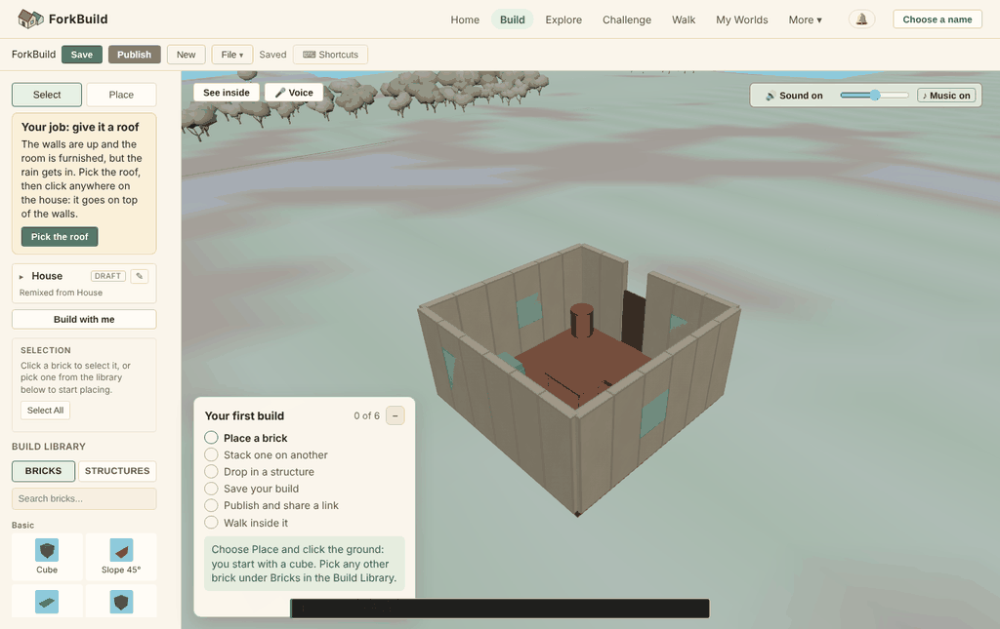
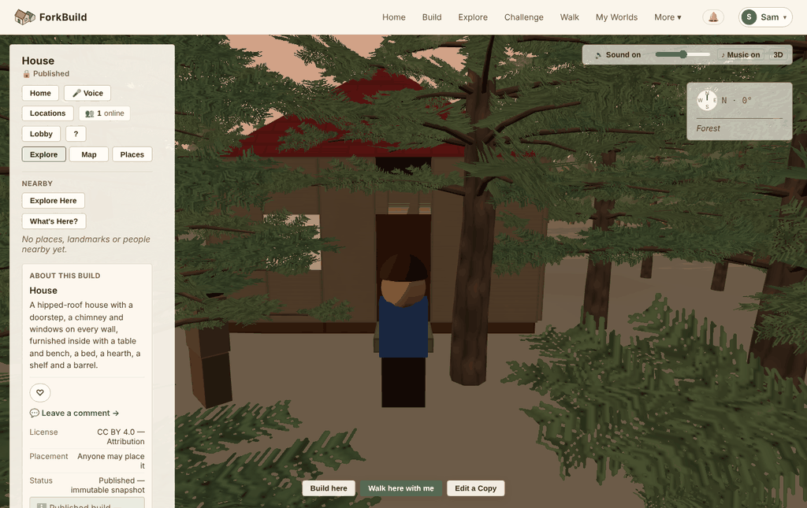
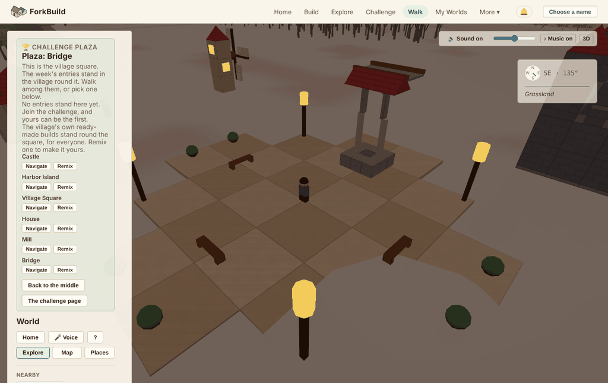

# Creative-direction audit, 2026-10-22

A Game Director's audit of ForkBuild 1.5.0 plus everything merged up to
"Unsaved work offered after a reload" (2026-10-22). It follows
[the third audit of 2026-10-12](CreativeDirection-2026-10-12c.md) and
[the growth audit of 2026-10-13](Growth-2026-10-13.md). It asks the same two
questions: is the vision coherent, and is the game in good shape to deliver
it? It doesn't repeat findings that have since been fixed.

This is a review, not a decision record. [Pillars.md](../Pillars.md) still
wins, and whatever is adopted goes into the roadmap the usual way.

## Verdict

**The vision is still coherent. The game has stopped following it.**

*Build a little place. Anyone can remix it. Walk inside it with friends.*
The fantasy, the three pillars, the Words table and the Look section are
as strong as ever, and nothing in them needs to change. Since the last
audit the owner took its brand recommendations (a guest walks, a warm
shell, bricks with a material, music, a logo), and those landed well. Home
now looks like the game it promises.

Then ForkBuild got its first real players, and the numbers were clear. In
the launch week, 24 daily visits led to 10 Editor opens and 3 first edits,
and **nobody published** (roadmap, "Make it yours, then publish",
2026-10-16). Building is the pillar that failed, and specifically the
stretch from the first brick to Publish.

Here is where the work went, before and after that number (74 roadmap
headings since the last audit, sorted by hand):

| Where the work went | 10-13 to 10-15 | 10-16 to 10-22, after the counts |
|---|---|---|
| The last audits' fixes: a guest walks, the warm shell, the bricks' material, music, the dark look, your name, the logo, World View's visitor page | 7 | 0 |
| Words and the user guide | 10 | 1 |
| The World's nature and life: water, clouds, rain, storms, moon phases, trees, seasons, winter, residents and animals | 10 | 10, plus two vehicle commits with no roadmap entry |
| Voice building and its speech model | 0 | 8 |
| Look-alikes, and credit and terms | 1 | 9 |
| Video, short links and launch channels | 1 | 6 |
| Library search, commands in plain words, Help, screen readers | 0 | 4 |
| Placement (builds have room again) | 0 | 2 |
| Releases and a QA pass | 1 | 2 |
| **The first brick to Publish, where the players stopped** | 1 (the first steps counted) | **1** ("Make it yours, then publish") |

That table is the audit's main finding. Three problems follow from it,
and each one breaks the game's coherence in a way the earlier audits
didn't see:

1. **The funnel that failed still fails the same way.** The starter job is
   still one click. Two tutors still talk at once. A first Publish still
   asks three questions, and one of them is a dead end.
2. **The art direction has split in two.** Home and the Editor are a toy
   brick diorama. In 1.5 the World turned into a naturalistic landscape,
   with fir trees three times taller than the starter house, and they
   swallow the build at the very moment the fantasy promises.
3. **The World runs on a different clock from the game.** Seasons last five
   hours, while the challenge runs by the week. So the "winter cabin" week
   (16 November) will mostly be shown in another season. And 57% of first
   walks arrive at dusk, at night or in bad weather.

Under all three is a process problem that the last audit named and that
got worse: **the filter can't say no.** The previous audit's "Not now"
list was *"more sky, weather, water or creature work"*. That became 1.5's
headline.

## What changed since the third audit

| Third audit's recommendation (2026-10-12c) | State | As played today |
|---|---|---|
| A guest walks with no name | **Done** | Walk gives you a body straight away. |
| **Login** becomes your name | **Done** | The header says **Choose a name**, then **Sam ▾**. |
| The Look page; a light, warm shell; bricks with a material | **Done** | Home reads as the village. This is the best change since the Pillars. |
| The starter job as a chain of four jobs | Not done | One click on the house still finishes the job. The card now *suggests* more ("a chimney, a garden, a fence"), but asks for none of it. |
| The guide's third step becomes "Add something of your own" | Not done | It still says **Drop in a structure**, which the building gate doesn't count. |
| One tutor at a time | Half done | The card floats on phones. On a desktop, the job card and the guide still ask for different clicks (screenshot below). |
| Navigate, Publish unsigned and My Worlds in the Words table | Not done | **Navigate** sits on every plaza entry, **Publish unsigned** is in the name dialog, and **My Worlds** is in the menu. |
| Correct the launch kit's known issues | Not done | It still says "Distributing to Nostr needs a NIP-07 browser extension". That stopped being true on 2026-10-12. |
| A playtest record | Not done | There is no `docs/playtests/`. The itch.io week is the only outside signal. |
| The filter's fourth question (which target does this move?) | Not adopted | Pillars' filter still has three questions. |
| "Not now: more sky, weather, water or creature work" | **Broken** | 20 milestones (see above). |
| The first walk shouldn't be at night | Not done | It's worse: weather and seasons now stack on top of night (finding 4). |
| Challenge prompts that aren't "a building" | Not done | All 30 themes still name a building with a ready-made starter. Six of them now name a season too. |
| Example documents out of the repository root | Worse | There were two `forkbuild-document-*.json` files; now there are four. |
| **Edit a Copy** on your own build; **🔒 Published** | Not done | Both still show when you walk inside a build you just published. |

## Is the vision coherent?

| Layer | State |
|---|---|
| Fantasy and pillars | **Coherent.** Nothing to change. |
| Words | **Coherent** on the screens the Words test covers. A few engine words are left (finding 6). |
| Look: the shell and the bricks | **Coherent** since 2026-10-13. |
| Look: the World around builds | **Split.** Naturalistic trees, water and weather beside toy bricks (finding 2). |
| Time | **Split.** A 40-minute day, a 21-hour year and a weekly challenge, with nothing tying them together (finding 3). |
| Priorities | **Inverted.** Measured data said "building"; the work went to "the world" (finding 1). |
| Process | **Not binding.** Reviews recommend, the filter allows anything, and one change shipped without a roadmap entry (finding 5). |

## Findings, most serious first

### 1. Nobody published, and the path to Publish is unchanged (P0, pillar 1)

The only real-player numbers ForkBuild has show the drop sitting between
the first edit and Publish: 3 edits and 0 publishes. Here is that path as a
newcomer plays it today (headless Chromium, 1366 × 860, fresh profile):

1. **Try it now** opens the House without its roof. Two tutors speak at
   once. The job card says *"Pick the roof, then click anywhere on the
   house."* The guide says *"Choose Place and click the ground: you start
   with a cube."* A dark toast at the bottom says a third thing.

   

2. One click puts the roof on. The card says **It's yours now!**, and the
   guide ticks two steps. The build now holds **one** placed brick, against
   a median target of 10.
3. **Publish it** → **Let others remix it?** offers three choices, and the
   third, **Not now**, *publishes nothing*.
4. → **Who can find it?** offers two choices and Cancel.
5. → **Choose a name to publish under** gives a text box, plus **Protect it
   with a passphrase now**, **Publish unsigned** and Cancel.
6. Published, and then a fourth surface may appear: since 1.5, a
   look-alike notice at Publish.

That's three modal decisions, two of them about law and networks, put to
someone who placed one brick a minute ago. Each one is well written. Put
together, they're a wall. The remix question matters most here, because
remixing is *the* pillar that sets ForkBuild apart, and the newcomer is
asked to opt in to it with an exit sitting right beside the choice.

**Fix:**
- **Publish in one sheet.** One panel with the name box (pre-filled with a
  friendly suggestion they can change), and two settings already chosen:
  *Others may remix it* (on) and *Everyone can find it* (on). Each can be
  changed in place, and one **Publish** button sends it. Nothing is
  hidden, and nothing is a dead end. "Publish unsigned" moves under
  Advanced.
- **The starter job as a short chain** (roof → chimney → a path to the
  door → a fence or a garden), so the first publish lands near ten placed
  bricks. "It's yours now!" comes at the end of the chain.
- **One tutor at a time** on every screen size: while a starter job is
  open, the guide folds to its pill, and the toast doesn't show.
- The guide's third step becomes **Add something of your own** (any five
  bricks).

*Measured by:* `/e/editor-edit` → `/e/publish-*` (the drop that killed the
launch week), and the median of `/e/publish-placed-…`.

### 2. The World now competes with the build (P0, Look)

Pillars' Look section says *"Bricks keep their own colours; the shell never
competes with them,"* and its Tone section asks for *"a small, sunny,
hand-built village."* That rule was written for the shell, not for the
World, and the World has moved off in another direction:

- **Realistic trees** (2026-10-18): conifers about 9.5 m tall, broadleaves
  7.5 m, every branch and leaf drawn close up. The player's own **Pine
  Tree** brick, which the first-edit card hands to every newcomer ("Pick a
  tree"), is a 2.5 m cone. Both now stand in the same frame at two
  different scales and two different levels of detail.
- **The fantasy's key moment** is *walk inside it*. Today it frames the
  player's house behind a tree trunk, under fir branches, in a forest:

  

- Rivers with foam and white water, swell you can ride, rain on wet ground
  and snow that keeps footprints are each well made. Together they make a
  nature simulation, while the bricks are a toy. Home's picture (a brick
  village on a green disc under a flat sky) is a different game from the
  World you walk into.

The roadmap's own note on the trees says *"the look stays muted and
stylised, so builds remain the focus."* The screenshot shows it didn't.

**Fix: a ruling, then one pass.**
- **Rule (for Look):** *the World is a diorama, not a simulation.*
  Everything natural shares the bricks' scale and level of detail. Near
  builds, nothing natural stands taller than a two-storey build. Every
  build gets a clearing (a meadow ring a few units wide) so it reads as a
  place, not a thing hidden in a wood.
- **Pass:** scale the World's trees to sit beside the brick kit's (or
  make **Detailed trees** off by default), clear a meadow round every
  placed build and the plaza, and check that the arrival camera for "Walk
  inside it" sees the door with nothing in between (a test can assert
  that, as the arrival-past-trees fix of 2026-10-21 already half does).

### 3. The World's clock and the game's clock disagree (P1, coherence)

There are three clocks, and nothing ties them together:

| Clock | Length | Who it's for |
|---|---|---|
| Day and night | 40 minutes | Atmosphere |
| The World's year (four seasons) | about 21 hours; a season lasts about 5 h 20 min | Atmosphere |
| The weekly challenge | 7 days, from Monday UTC | The game: what to build, and why come back |

`core/challenge/BuildChallenge.js` admits the gap: *"The world's seasons
turn far faster than the weeks, so the week doesn't wait for its season;
the challenge page suggests keeping World View in it."* So the six
seasonal themes ask players to set a menu option to see the game as it
was meant to be seen. And a five-hour season is too fast to give anyone a
reason to come back: "winter came to the village" is an event, and
"it's winter again this afternoon" is wallpaper.

**Fix:** one clock that matters, the week. Let the season follow the
challenge calendar: either a season per week (a four-week year, so the
winter-cabin week is winter for everyone), or the calendar's own season.
Day and night can stay at 40 minutes. Then the World changes when the game
does, and Monday brings a new theme and a changed village, which is a
return beat the growth audit asked for.

### 4. The first walk is a coin flip on looking like the game (P1, first impression)

Run against the World's own functions (`dayFractionAt`, `weatherAt`,
`rainAt`, `snowCoverAt`) over two weeks of arrival times, a first walk
arrives in **fair daylight only 43% of the time**. About 34% of arrivals
come at dusk or night, about 15% under overcast skies, about 7% in rain or
snow, and about 19% with snow on the ground. This audit's own first
**Walk** from the menu landed in winter, as dusk began, under bare trees
and on grey ground:

The third audit flagged night alone. Weather and seasons have multiplied
the problem since. "A small, sunny village" is the brand, and more than
half of first impressions now contradict it.

**Fix:** a page's first World View visit (and every guest's) opens in fair
late-morning light and blends to the shared clock over the first minute
or two. A guest walks alone, so nobody else has to agree. When a friend
joins through **Walk here with me**, both are on the shared clock.

### 5. The filter can't say no, and the gate leaks (P1, process)

The third audit's finding 5 still stands, with fresh evidence:

- Every milestone in the table above answers "which pillar?" correctly.
  "Lives in a world" can justify anything in World View: 20 nature
  milestones since the last audit, 10 of them after the counts said
  "building".
- The side systems were frozen (*"kept working, with no new features"*,
  Pillars, "The side systems"). Since then: ground vehicles drive up ramps
  and across bridges and collide at their height (commits `4115d73` and
  `1d031a2`, 2026-10-19), wading in rivers, riding the swell, and walking
  on frozen lakes. The two vehicle commits have **no roadmap entry**, so
  they never faced the filter at all. Two example builds made for driving
  over them landed in the repository root.
- Pillars.md has grown to 408 lines. The filter (15 lines) now sits
  between the network plugin policy, the logo's history and five
  paragraphs of "Where this came from". A one-page test has become a
  decision log.

**Fix:**
- **Adopt the fourth question, with teeth:** *"Which first step or target
  should this move, and what in the counts says it's the one holding
  players back?"* Until the counts can answer it, work that doesn't touch
  the funnel (Home → Editor → first edit → Publish → Walk inside) needs
  the owner's explicit yes in its roadmap entry.
- **A Now / Next / Later page**, three items each, above the roadmap. Now:
  finding 1. Nothing else starts until those three are done.
- **No player-facing change without a roadmap entry.** A small test can
  enforce that every non-merge commit touching `ui/`, `renderer/` or
  `core/` that changes behaviour arrives with a roadmap edit, or the PR
  template can ask.
- **Put Pillars.md on a diet:** the fantasy, pillars, filter, Words, Tone,
  Look and "What we are not making" on one page. Move networks, the side
  systems and "Where this came from" to a `docs/Decisions.md`.

### 6. Features that are done, and should stay done (P2, scope)

These are each sound, and each one is finished enough. More investment
before players publish would be scope drift:

- **Voice building** (experimental, a 70 MB model, and it can't place
  bricks). It's a good accessibility bet. Freeze it at its current state
  until someone outside the project asks for more.
- **Look-alikes.** The intent (credit stays with the maker) is pillar 2.
  But a game whose tagline is *Remix anything* now shows similarity
  notices, at Publish (where the funnel dies), to a community that hasn't
  published yet. Keep it, and make sure it never shows on a first
  publish.
- **Make a video, short links, hearts.** These are growth tools, built
  ahead of growth. Done.
- **The World's nature.** Done, apart from the diorama pass in finding 2.

### 7. Smaller things a player meets (P2)

- **Walking inside your own build** still offers **Edit a Copy** and shows
  **🔒 Published**, **Placement: Anyone may place it** and **Status:
  Published — immutable snapshot**. Those are engine words on the
  visitor's panel.
- **The House's description promises a chimney** ("…a doorstep, a chimney
  and windows…") that the starter job leaves off, and that the card then
  suggests adding.
- **The toolbar's Publish is purple.** Look says *one meadow green for
  the thing to press (… **Publish** sends it on its way)*.
- **The challenge's prompts are all buildings.** Mix in prompts that point
  at the World and at each other (from the third audit): *a resident's
  wish*, *best seen at night*, *join two builds with a path*, *under 30
  bricks*.
- **The brick kit hasn't grown since 2026-10-12** (59 bricks). That's
  right for now, but it's the place pillar 1's next investment belongs,
  ahead of any more World work.

## Pillar scorecard

| Pillar | Third audit | Now | Biggest gap |
|---|---|---|---|
| 1. Building feels joyful | Good kit, thin first job | **Measured weak:** 3 edits, 0 publishes | The first job and the Publish wall (finding 1) |
| 2. Every build has a family tree | Strong, unproven | **Strong, still unproven** | Nothing is remixed until something is published; the remix opt-in has a dead end |
| 3. Yours, and lives in a world | A real village, no guest body | **Beautiful, and pulling against the build** | Scale and clutter round builds; the clocks (findings 2 to 4) |

## Recommended: one release, then let the counts choose

**Release 1.6, "First publish" (pillar 1; no new systems)**
1. Publish in one sheet, with remix and Everyone already chosen, and a
   suggested name (finding 1).
2. The starter job as a chain of four; one tutor at a time; the guide's
   third step becomes "Add something of your own" (finding 1).
3. The first World visit in fair daylight; a meadow clearing round every
   build; the arrival camera sees the door (findings 2 and 4).
4. The launch kit's known issues corrected; the four example documents
   moved beside the library content; Edit a Copy hidden on your own build;
   Publish in the one green (findings 5 and 7).

*Measured by:* `/e/editor-edit` → `/e/publish-*`, and the median of
`/e/publish-placed-…`, over the first full week after release.

**Then, with no feature work in between:** a five-person playtest with a
written record, and one more launch channel aimed at builders (a cozy-game
or building-game community, with the 30-second clip *Try it now → roof →
Walk inside*). Read a week of counts, and let the biggest drop choose the
next release.

**Then, the diorama pass and the one clock** (findings 2 and 3), as their
own release, led by the Look rule written first.

**Not now:** more nature, weather or creature work; more voice; more
look-alike work; new vehicles; new networks; new languages.

## Decisions only the project owner can make

1. **Diorama or simulation?** Is the World a hand-built toy village that
   matches the bricks, or a naturalistic landscape the bricks sit in? I
   recommend the diorama: it's what Home promises, what Tone already says,
   and it keeps the player's build the hero.
2. **Remix on by default at Publish?** I recommend yes, changeable on the
   same sheet. Remixing is the pillar that makes ForkBuild ForkBuild, and
   the challenge's remix weeks depend on entries that allow it.
3. **Which clock do seasons follow?** I recommend the challenge week.
4. **Is the filter binding, and who says no?** I recommend the fourth
   question, the Now / Next / Later page, and the owner's explicit yes for
   anything off the funnel until the counts can speak.
5. **Carried, still open:** who hears about ForkBuild next, and when.

## Method

- Played in headless Chromium (Playwright, SwiftShader WebGL) at
  1366 × 860 from fresh profiles, with the repository served unbundled:
  Home → **Try it now** → **Pick the roof** → one click → **Publish it** →
  every dialog in turn, with the name "Sam" → **Walk inside it** → walking
  in with W; and, separately, **Walk** from the menu with no name. Relays
  were unreachable from the sandbox, so Publish showed "couldn't reach
  everyone yet". SwiftShader washes out the terrain's colours, so the
  screenshots look greyer than a real GPU draws them, but the scale,
  framing and time of day are as played.
- Computed the share of arrival times by sky and weather from
  `core/nature/DayCycle.js`, `core/nature/Weather.js` and
  `core/nature/Season.js`, sampling every 97 seconds over four two-week
  windows. The shares barely moved between windows (fair daylight 42–43%).
- Read Pillars.md, VISION.md, the README, the 1.5 release notes, all six
  earlier reviews, the launch kit, `core/challenge/StarterJob.js`,
  `core/challenge/BuildChallenge.js`, the English first-build strings, and
  every roadmap entry from "A guest walks, in a village-coloured shell"
  (2026-10-13) to "Unsaved work offered after a reload" (2026-10-22): 74
  headings, sorted by hand into the table in the verdict. Checked the
  commits since 2026-10-13 for player-facing changes without a roadmap
  entry.
- The public visitor counter couldn't be reached from the sandbox, so the
  launch-week numbers are the ones the roadmap recorded on 2026-10-16.
  Newer counts may say something different, and should be read before
  acting on finding 1's priority.
