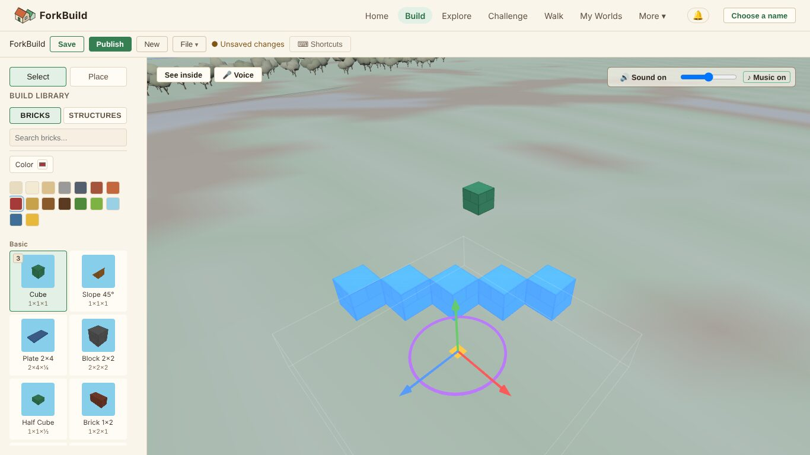
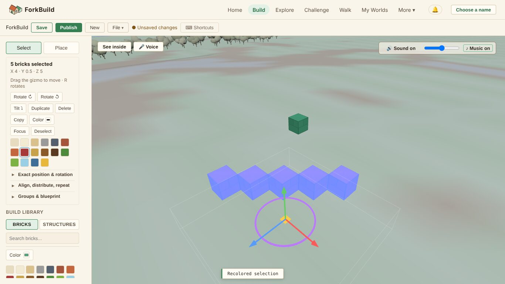
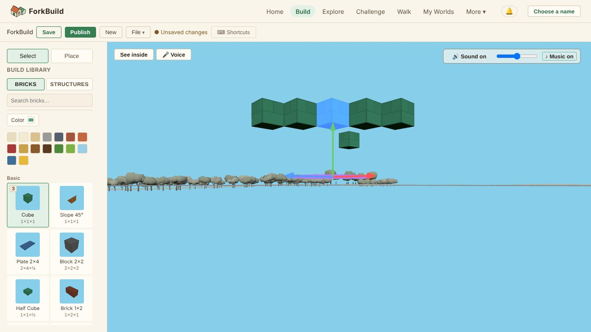
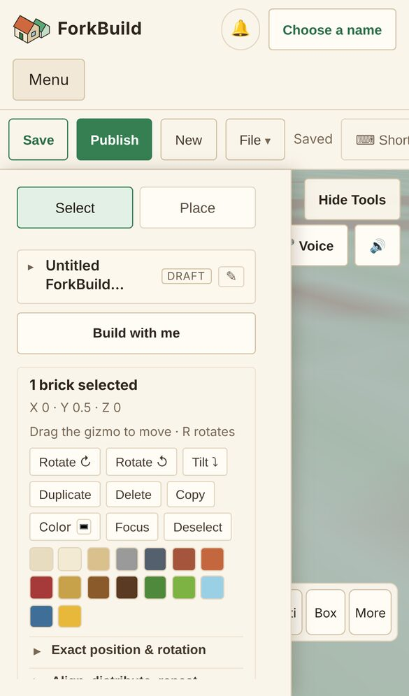

# Editor usability review, 2026-10-29

A Senior UX Designer's and UX Researcher's review of the Editor (ForkBuild
1.5.0, branch head of 2026-10-29). It asks one question: **once a brick is
down, can people use the Editor's features conveniently?** That covers
selecting, moving, turning, recolouring, copying, grouping, undoing,
saving, and finding all of these.

It follows [the placement audit of 2026-10-27](EditorPlacementUX-2026-10-27.md),
whose findings are all fixed. Placing is not re-examined here; this review
starts at the next step, editing what was placed.

This is a review, not a decision record. [Pillars.md](../Pillars.md) still
wins, and whatever is adopted goes into the roadmap the usual way.

## How this was checked

- **Task walkthrough in a real browser.** I ran the app in Chromium
  (Playwright) at 1440×900, at 1366×768 and on an emulated iPhone 13
  (390×664). In a new build I placed a row of five cubes and then did the
  tasks below as a first-time builder would. After each step I read the
  Selection panel's count and position, the feedback strip, and the
  geometry of the page, so every "works" and "fails" below is a measured
  result, not a guess.
- **Code reading** to explain each result: `ui/views/EditorView.js`,
  `ui/components/EditingSidebar.js`, `SelectionInspector.js`,
  `EditorTouchActionBar.js`, `CommandPalette.js`,
  `KeyboardShortcutsOverlay.js`, `Toolbar.js`,
  `application/editor/EditorActionRegistry.js`,
  `application/tools/SelectionTool.js` and `renderer/CameraController.js`.
- **Heuristic review** against Nielsen's ten heuristics and against
  [Principles.md](../Principles.md).
- **Limits.** No real participants took part. A scripted walkthrough
  shows where the interface fails, but not how often real people fall
  into each failure or how they feel about it. "A study to run next", at
  the end, says how to measure that.

The tasks:

| # | Task | Desktop | Phone |
|---|---|---|---|
| 1 | Select one brick, then a whole row | ✅ Click and Shift+drag work | ✅ Tap works; **Box** for a row |
| 2 | See what you can do with the selection | ❌ The Selection panel is scrolled out of view | ⚠️ Behind **Tools**, and the drawer then covers the build |
| 3 | Move a brick | ⚠️ Dragging the brick turns the camera; only the gizmo's handles move it | ✅ The gizmo's arrow works by finger |
| 4 | Recolour the selection | ❌ The visible colours are for *placing*; the right ones are off-screen. The result can't be seen while selected | ⚠️ Works, but you can't see the result |
| 5 | Undo a mistake | ⚠️ Ctrl+Z only: no button | ✅ **Undo** in the touch bar |
| 6 | Copy and paste | ✅ Pastes beside the original, selected | ✅ Through **More** |
| 7 | Make a named group | ⚠️ Five steps and a browser prompt | ⚠️ Same |
| 8 | Find an action you can't see | ⚠️ The palette finds edits, not Save, Publish, tools or the camera | ⚠️ Same |
| 9 | Recover a lost view | ❌ Only the Home key | ⚠️ No way that is visible |

## Verdict

**The Editor's features work, and many are well made. But at the moment
of editing, the screen points people at the wrong controls.** After a
selection, the panel that acts on it is scrolled out of view. What *is* in
view is the Build Library, with a colour row that looks like the
selection's but changes the next brick instead. The selection tint then
hides the colour that was chosen. Undo has no button on a computer, and
the command palette, which is the safety net for anything hard to find,
doesn't know Save, Publish, the tools or the camera, though the
Shortcuts overlay says it searches "every one of these".

None of this needs new features. It is about what the screen shows, and
when.

## What works, and should be kept

- **One action registry** behind the sidebar, the palette, the touch bar
  and the keys. Disabled actions say why in the palette ("Align Left —
  Select at least 2 bricks"), which is unusually helpful.
- **Undo says what it will undo**: the palette offers *"Undo Recolor 5
  Bricks"*. Every compound edit (a move, a recolour of many bricks, a
  repeat) is one step.
- **Paste lands beside the original and becomes the selection**, so the
  next nudge moves the copy, not the original.
- **Shift+drag box selection** is quick and forgiving.
- **The gizmo works by finger.** On the phone, dragging the red arrow's tip
  moved the brick from X 0 to X 2.
- **Commands in plain words.** *"paint it red"* turns into *"Paint the 5
  selected bricks Roof red"* before it runs.
- **The Selection panel shows only what applies**, and the rarer tools are
  folded into three named sections instead of a wall of buttons.
- **Feedback for each edit**: a short message ("Pasted", "Recolored
  selection", "Undone") and a sound.

## Findings

Each finding is ranked: **P1** stops or misleads people in an everyday
task, and **P2** is friction or polish. There is no P0: nothing breaks a
build or loses work.

### P1-1. After selecting, the Selection panel is out of view

*Five bricks are selected. The sidebar shows the library; the panel for the selection is above the top edge.*

**What happens.** Choosing **Place** scrolls the Build Library up to the
top of the sidebar (this was the fix for the placement audit's P2-8).
Going back to **Select** and choosing bricks doesn't scroll it back. The
panel that says *"5 bricks selected"*, with Rotate, Duplicate, Delete,
Colour and the rest, is above the sidebar's top edge.

**Evidence.** At 1366×768, after placing five bricks and pressing
**Select**, a click on a brick and then a Shift+drag over the row each put
`.selection-inspector` at **y = −258 to 142 px**. The sidebar was
scrolled 522 px down a 4,342 px list.

**Why.** `placeFromSwitcher()` (`ui/views/EditorView.js:1038`) scrolls the
sidebar to the library. Nothing scrolls it back to the top for a
selection.

**Impact.** This is the most important finding here. Every editing task
starts with this panel, and this is the normal way to reach it: you place
bricks, then select some. Builders who don't think to scroll up won't
know that Duplicate, Colour, Exact position, Align, Repeat or Groups exist.
It also sets up P1-2.

**Recommendation.** When a selection goes from empty to non-empty, or
**Select** is chosen, scroll the sidebar to the top, as Place scrolls it
to the library. Better still, keep the Selection card pinned under the
Select/Place switch while something is selected, as the library's tabs
are now pinned while it scrolls.

### P1-2. Two colour rows look the same but do different things, and a selection hides its colour

*The selection's colours, and under them the library's colours for placing. The five bricks, just painted Roof red, show as blue-violet.*

**What happens.**

- **The visible colours are the wrong ones.** With five bricks selected
  (and the panel out of view, P1-1), the only colours in view are the
  library's. Clicking Roof red there changed the colour for *placing*
  (the library's Color chip turned red). The bricks stayed as they were,
  with no message.
- **When both are in view, they look identical.** Scrolled up, the
  sidebar shows a **Color** button and sixteen village colours for the
  selection, and then, a little lower, a **Color** button and the same
  sixteen colours for placing. Nothing in either label says which bricks
  it changes.
- **The result can't be seen.** A selection is drawn as a solid blue
  tint. Five bricks painted Roof red showed as blue-violet until I
  deselected them. So a builder who tries a colour can't judge it.
- **The selection's Color button shows black** (`<input type="color">`
  with no value, `SelectionInspector.js:110`), not the colour of the
  bricks.

**Impact.** Recolouring is one of the most common edits in a building
game. A builder who gets no visible result from the colours in view will
decide recolouring is broken, or will paint the next bricks by mistake.

**Recommendation.**

1. While bricks are selected, hide the library's colour row, or name each
   row by what it does: *"Paint 5 selected"* and *"Colour for new
   bricks"*.
2. Draw the selection as an outline (or outline plus a light tint) so
   each brick's own colour shows through.
3. Give the selection's colour input the selection's colour, or a mixed
   state when the bricks differ.

### P1-3. On a computer, Undo and Redo have no button

**What happens.** On a phone the touch bar has **Undo** and **Redo**. On
a computer the only ways are Ctrl/Cmd+Z, Ctrl/Cmd+Shift+Z or Ctrl+Y, and
the palette. Of the 87 controls on the page at 1440×900, none is Undo.

**Impact.** Undo is what makes trying things safe. A first-time builder,
who has no reason to know that Ctrl+Z works in a web page's 3D view, sees
no way back after a mistake. This matters most in the funnel the
creative-direction audit of 2026-10-22 measured: first edits are where
people try, fail and leave.

**Recommendation.** Put **↶ Undo** and **↷ Redo** in the toolbar, after
**Save**. Disable them when there is nothing to undo, and use the
registry's label as the tooltip (*"Undo Recolor 5 Bricks (Ctrl+Z)"*).

### P1-4. Dragging a selected brick turns the camera, and the view is easy to lose

*One 95 px upward drag, started on the selected brick: the brick didn't move, and the camera is now at ground level.*

**What happens.**

- **A drag on a selected brick orbits the camera.** Only the gizmo's
  thin handles move a brick. A placed *structure* is different: click it
  once to select it, then drag it, and it moves
  (`SelectionTool.js`, "begins a terrain-aware drag"). So one rule moves
  bricks and another moves structures, though
  [Principles.md](../Principles.md) asks that *Buildable Things Share One
  Placement Experience*.
- **The view is easy to lose, and hard to get back.** One 95 px upward
  drag took the camera from the starting view down to ground level
  (`maxPolarAngle` is 89.4°, `CameraController.js:12`). There, the ground
  isn't drawn and nothing can be built. Reset camera is the **Home** key;
  no button does it, and the palette doesn't know "camera", "view", "zoom"
  or "reset". The Selection panel's **Focus** only shows when something is
  selected.

**Recommendation.**

1. Let a drag that starts on an already selected brick move the selection
   over the ground, snapped to the grid and blocked by collisions, as a
   structure instance already does. Orbiting from empty ground stays as it
   is.
2. Add a small **⌂ Whole build** button in the view (beside **See
   inside**), and register **Reset camera** in the palette.
3. Consider a lower `maxPolarAngle` while editing (about 80°), so the
   camera can't reach a view from which nothing can be built.

### P2-5. The palette and the Shortcuts overlay promise more than they do

**What happens.** The overlay ends with *"Ctrl/Cmd+K opens the Command
Palette, which searches every one of these by name."* The guide says the
palette is *"a searchable list of every action in this guide"*. I searched
the palette for 31 words. It found the editing actions, but for each of
these it only offered *"Ask the guide"*:

| Searched for | Where the action actually is |
|---|---|
| save, publish, new, export | Toolbar |
| select tool, place | Tool switch, keys 1 and 2 |
| sound | Sound button, key M |
| see inside | Button in the view |
| shortcuts | Toolbar, key ? |
| camera, view, zoom, reset camera, home | The Home key only |
| colour, color | The Selection panel's Color (palette only by *"paint … red"*) |

The overlay also leaves out the selection gestures: Shift+click,
Ctrl/Cmd+click and **Shift+drag to box-select**, which the guide calls
*"the fastest way to grab a whole wall"*. Shift+drag is listed only as
*"Lay a row"*, which is what it does in Place.

**Recommendation.** Register the toolbar actions, the tools, Sound, See
inside, Shortcuts and Reset camera in `EditorActionRegistry`. Then the
palette, the overlay and the keys agree, which is what the registry was
built for. Give actions a few synonyms ("colour", "color" and "paint" for
Recolour). Add a **Selecting** section to the overlay that lists
Shift+drag under both tools.

### P2-6. Naming a group takes five steps and a browser prompt

**What happens.** With bricks selected: unfold **Groups & blueprint** (1),
**New group** (2). This makes *"(unnamed group)"*, which **isn't
selected**, so **Rename group** is disabled. Click the group in the list
(3), **Rename group** (4), then type into the browser's own `prompt()`
dialog and confirm (5).

**Evidence.** After **New group**, the list showed `(unnamed group) 5`
with `aria-pressed="false"`, and **Rename group** was disabled.
`promptRenameGroup` calls `window.prompt` (`EditorView.js:1527`).
**Create Blueprint**, beside it, moved from a chain of prompts to its own
dialog for this reason (`CreateBlueprintDialog.js`, header comment).

**Recommendation.** **New group** asks for the name right away, in a small
inline field with a suggestion (*"Group 1"*, or the bricks' main part,
such as *"Windows"*), and the new group starts selected. Rename it in
place too, with a double-click on its name.

### P2-7. On a phone, desktop wording and too little room for the build

*The Tools drawer on a phone, with a brick selected: its hint says "R rotates", and the drawer covers the build.*

- **Desktop wording.** With a brick selected, the panel's hint reads
  *"Drag the gizmo to move · R rotates"* on a phone too
  (`selectionInspector.next`). The placement audit fixed the same issue
  for placing (`touchPlaceHint`).
- **⌨ Shortcuts** is in the phone's toolbar, cut off at its right edge,
  for a device with no keyboard.
- **The drawer covers the build.** The Tools drawer covers about 71% of the
  width. Recolouring, typing an exact position or aligning happens without
  sight of the bricks. Together with P1-2 (the tint), recolouring on a
  phone can't be judged at all.
- **Little room for the build.** The site header and toolbar take 162 of
  664 px (24%) before the view starts, and the touch bar takes another 56.

**Recommendation.** Use a touch version of the hint (*"Drag an arrow to
move · Rotate turns it"*), and hide **Shortcuts** on touch-only devices.
On a phone, open the drawer as a bottom sheet at half height, so the
selection stays in view above it. Fold the site header into the
toolbar's row while in the Editor.

### P2-8. Smaller issues

- **"Saved" on a build that was never saved.** A new, untitled build
  shows **Saved** in the toolbar and **DRAFT** in the sidebar. Until the
  first save, *"Not saved yet"* would be truthful.
- **Move has no on-screen nudge.** Arrow keys and Page Up/Down nudge a
  selection, but the panel has no buttons for them. Builders who don't
  know the keys must use the gizmo or type exact numbers.
- **"Rotate ↻" and "Rotate ↺"** differ only by a small arrow. *"Turn
  right"* and *"Turn left"* would be clearer to younger builders.

## Suggested order

| # | Change | Size | Why first |
|---|---|---|---|
| 1 | P1-1: scroll to (or pin) the Selection card when bricks are selected | Small | Every editing task starts here, and it fixes half of P1-2 |
| 2 | P1-3: Undo/Redo buttons in the toolbar | Small | Makes trying things safe; already done for touch |
| 3 | P1-2: name the two colour rows, outline the selection | Small to medium | Recolouring is a core edit and fails silently today |
| 4 | P2-5: register the missing actions; synonyms; Selecting in the overlay | Small to medium | The palette is the safety net for everything else |
| 5 | P1-4: drag a selected brick to move it; a Whole build button | Medium | One rule for bricks and structures; a way back from a lost view |
| 6 | P2-6, P2-7, P2-8 | Small each | Polish that adds up |

Items 1 and 2 together are probably under a day's work, and they change
what a new builder can find after their first brick more than anything
else here.

## A study to run next

The walkthrough finds what fails. A short study with real people shows how
often and how much it matters. Five to eight people per device are
enough to find most problems that remain:

- **Who.** Newcomers who have never used ForkBuild, half aged 10 to 16
  (the Educators audience), on a laptop and on their own phone.
- **Tasks.** Tasks 2 to 9 in the table above, in a build of about 30
  bricks, phrased by goal and not by control name ("make the roof red",
  not "use Recolor").
- **Measure.** Whether each task succeeds unaided; time on task; the first
  control touched; whether Ctrl+Z, the palette or the Shortcuts overlay is
  found; SEQ (a 1 to 7 ease rating) after each task; SUS at the end.
- **Before and after.** Run it once now and once after items 1 to 3 of
  the suggested order. Task 2 (finding the selection's actions) and task 4
  (recolouring) should change the most.
