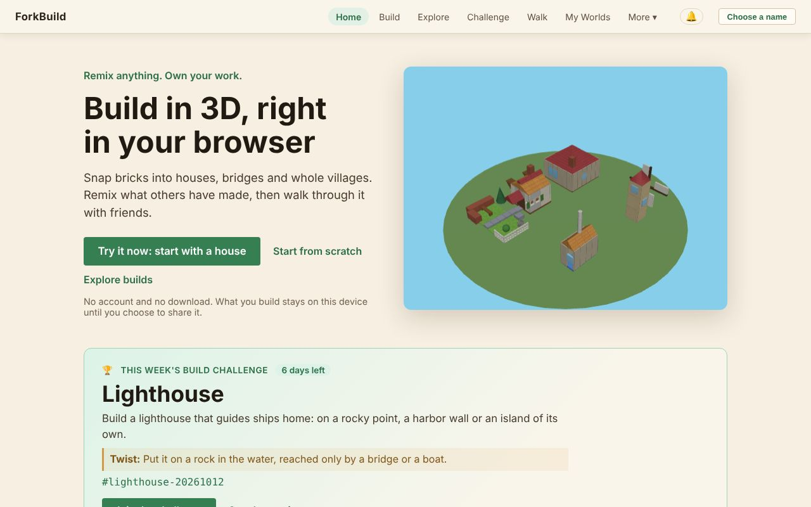
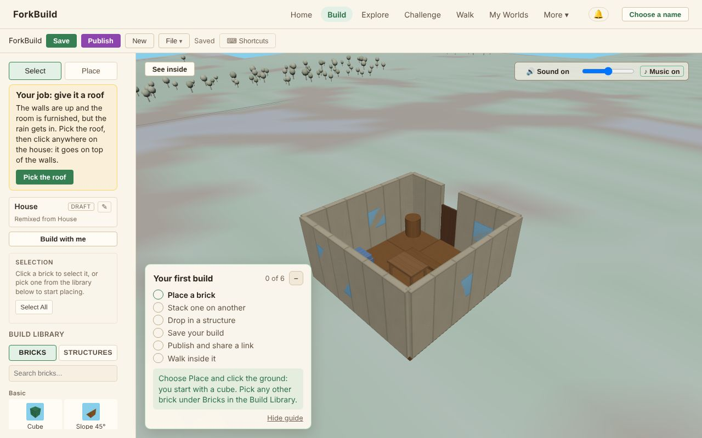

# 01 — Getting Started

<!-- languages -->
**English** · [Deutsch](de/01-GettingStarted.md) · [Español](es/01-GettingStarted.md) · [Français](fr/01-GettingStarted.md) · [Bahasa Indonesia](id/01-GettingStarted.md) · [日本語](ja/01-GettingStarted.md) · [한국어](ko/01-GettingStarted.md) · [Português (Brasil)](pt-BR/01-GettingStarted.md)
<!-- /languages -->

Welcome! This guide gets you from "just opened the app" to "I built something"
in about five minutes. You don't need an account, a download or a name to
start: everything stays on your device until you choose to share it.

**The short version:**

1. On the **Home** screen, click **Try it now: start with a house**.
2. Click **Pick the roof**, then click the house: the roof goes on.
3. Click **Publish** and answer its questions: a name to publish under
   (click **Publish as …**), and **Who can find it?**
4. Click **Walk inside it** to walk through your house in the World.

The rest of this page explains each part, and how to start from an empty
plot instead.

## Opening ForkBuild

*The Home screen: the top bar, the three ways in, and this week's build challenge.*

ForkBuild runs in any current web browser: open the hosted site and you
land on the **Home** screen. (To run a copy of your own, see
[Running your own copy](#running-your-own-copy) at the end of this page.)

The **Home** screen shows a small village turning in 3D and offers three
ways in:

- **Try it now: start with a house** opens a ready-made house in the
  Editor as your own copy, ready to change (see
  [Try it now](02-TheEditor.md#try-it-now-a-house-to-finish)).
- **Start from scratch** opens the Editor on an empty plot.
- **Explore builds** opens **Explore**, where everyone's published builds
  are.

Under **Start from a ready-made build**, each card (a castle, a harbor
island, a village square, a house, a mill and a bridge) opens your own copy
of that build the same way. Nothing is published or sent anywhere until you
choose to.

Home also shows **This week's build challenge**: a theme to build, with
**Join the challenge** (see
[The weekly build challenge](04-PublishingAndForking.md#the-weekly-build-challenge)).
Once you have published builds, it shows **Your stamps** too: facts about
your own builds, such as **Remixed** when someone made a remix of one,
**Challenger** when you entered a weekly challenge, or **Big builder** for a
build of a hundred bricks or more. They are worked out on this device and
shown only to you: credit, never points or a ranking.

## Finding your way around

The bar at the top is always visible:

`ForkBuild  Home  Build  Explore  Challenge  Walk  My Worlds  More ▾  🔔  Choose a name`

| Menu | What it opens |
|---|---|
| **Home** | The landing page |
| **Build** | The Editor, where you build (see [The Editor](02-TheEditor.md)) |
| **Explore** | Everyone's published builds, to open, remix or visit (see [Publishing & Remixing](04-PublishingAndForking.md#explore)) |
| **Challenge** | This week's build challenge and its entries (see [The weekly build challenge](04-PublishingAndForking.md#the-weekly-build-challenge)) |
| **Walk** | World View at this week's challenge plaza, to walk among the week's entries round the village square (see [World View](03-WorldView.md)) |
| **My Worlds** | Worlds you've visited on this device (see [My Worlds](03-WorldView.md#my-worlds--worlds-youve-actually-been-to)) |
| **🔔** | Your notifications: comments, remixes and new builds by people you follow (see [Orientation and Locations](03-WorldView.md#orientation-and-locations)) |
| **Choose a name** | Pick the name you publish and walk under; once you have one, it shows here instead (see [Choosing a name](#choosing-a-name)) |

**More** opens the rest, in four groups. On a phone, **Menu** shows them all
at once.

- **You**
  - **My Avatar** — how you appear to others in World View, see
    [Avatars & Presence](06-AvatarsAndPresence.md)
  - **My Identities** — the names (identities) stored on this device, see
    [Your Name & Identity](05-IdentityAndLogin.md)
  - **Your Data** — back up everything to one file, or copy it to another
    device, see [Your Data](13-YourData.md)
- **People**
  - **Peers** — the people you're connected, known, or friends with, see
    [Peer Connections & Friends](07-PeerConnectionsAndFriends.md)
  - **Following** — the people whose new builds you hear about, see
    [Following people](07-PeerConnectionsAndFriends.md#following-people)
  - **Conversations** — your direct messages, see
    [Chat & Conversations](08-ChatAndConversations.md)
- **Advanced** — you don't need these to build and share
  - **Publications** — signed authorship and place-name claims, where to
    store and announce them, and (*experimental*) their external evidence,
    see [Publications & External Evidence](09-PublicationsAndEvidence.md)
  - **Network Settings** — gateways, relays, providers, and peer-connection
    servers, see [Network Settings](10-NetworkSettings.md)
- **App**
  - **Language** — the language ForkBuild shows on this device. It follows
    your browser's languages until you choose one; saving reloads the page,
    so save your work first. ForkBuild comes in English, German, Spanish,
    French, Bahasa Indonesia, Japanese, Korean and Brazilian Portuguese.
  - **Look** — **Auto**, **Light** or **Dark**, right in the menu. Auto
    follows your device's light or dark mode; Light is the village by day,
    Dark the same village after dark. It changes at once and is kept on
    this device.
  - **About** — version info and a link to this guide
  - **Install ForkBuild** — where the browser can install it (see
    [Installing ForkBuild](#installing-forkbuild))

## Placing your first brick

*The Editor with Home's house open: your tools and the Build Library on the left, the build in the middle, and the Your first build card.*

The first time you open the Editor, a **Your first build** card in the
corner of the 3D view walks you through six steps and ticks each one off
as you do it, the last one walking inside your published build; see
[Your first build](02-TheEditor.md#your-first-build).

1. Click **Build** in the top bar (or **Start from scratch** on Home).
2. In the left sidebar, make sure the **Place** tool is active (press `2`).
3. In the **Build Library** below it, open the **Bricks** tab and click a
   brick — for example, **Cube** under **Basic**.
4. Move your mouse into the 3D view. A translucent **ghost** of the brick
   follows the grid.
5. **Click** to place it.

Congratulations — you've built your first brick! 🎉

On a phone or tablet, tap instead of clicking; see
[On a phone or tablet](02-TheEditor.md#on-a-phone-or-tablet).

### Stacking bricks

You don't have to build on the ground. Hover over a **face** of an existing
brick and the ghost snaps to it — click to stack on top, or attach to the side.
This is how you build walls, towers, and roofs.

Made a mistake? Press `Ctrl+Z` (`Cmd+Z` on a Mac) to undo it. Every change
can be undone.

## Saving your work

Press **Ctrl+S** (or click **Save** in the toolbar). The **● Unsaved changes**
indicator turns into **Saved**.

Your build is stored in your browser, so it's still there when you come back.
While you edit, ForkBuild also keeps a crash-recovery copy of unsaved changes,
and offers to restore it if the page closes before you save.

> **Keep a copy.** Your builds live only in this browser. Clearing the
> browser's data for the site deletes them, so back them up now and then
> with **More → Your Data → Back Up to a File** (see
> [Your Data](13-YourData.md)).

Browsers limit how much each site may store, usually to a share of the
disk. If ForkBuild's share fills up, saving and crash recovery stop with a
message saying so; nothing you have open is lost. Use **File → Export** in
the toolbar to keep a copy of the build as a file. The first time you save,
some browsers ask whether ForkBuild may keep its data permanently; allowing
it stops the browser from clearing it when the disk runs low.

## Choosing a name

You don't need a name to build or save. You need one to **publish**,
because publishing signs your build so others can check it's really yours,
and to **walk with friends**, so they see you under it.

The first time you click **Publish**, ForkBuild asks for a name to publish
under. Type one and click **Publish as …**: a name is made on this device,
and your build is published. (A walk link asks the same way, with
**Walk as …**.)

You can also choose a name at any time: click **Choose a name** in the
top-right corner, type one and click **Continue as …**.

ForkBuild has no passwords and no accounts. Behind your name is a
cryptographic key kept on this device, called an **identity**. Its key is
kept in this browser without a passphrase until you add one: the Editor
reminds you after you publish, and **Protect with Passphrase** on
**My Identities** adds one any time. To choose a passphrase straight away,
click **Protect it with a passphrase now** in the name dialog instead.

> **There is no passphrase reset.** A passphrase encrypts your key on this
> device, and nobody, not even ForkBuild, can recover it. Choose one you'll
> keep.

Once you have a name, the top-right corner shows it. Click it for **My
Avatar**, **My Identities**, **Your Data** and **Switch name**, which lists
every name this browser already holds (click one to use it), makes a new one,
or goes on with **Go on without a name**. Making a new name there also asks
for a **passphrase** of at least 8 characters, twice. (To skip it, tick
**Create without a passphrase**; the key is then stored unencrypted in this
browser.) Then click **Use this name**.

Everything you publish, or send to other people, is then signed under that
name.

**Publishing without a name.** The name dialog that Publish opens also has
**Publish unsigned**. A build published that way has no author and no
signature, so it gets no link, can't be shared with other people, and can't
be sent to everyone later. Choose a name instead unless you only want it in
your own **Explore**.

What a passphrase protects, locking and unlocking, and backing your
identity up are all covered in [Your Name & Identity](05-IdentityAndLogin.md).

## Installing ForkBuild

ForkBuild can be installed as an app, so it opens from your home screen,
dock or app list in a window of its own, and works without a connection.
Click **Install ForkBuild** on the Home screen (or under **More**), then
confirm in the browser's own dialog. In Safari on an iPhone or iPad, the
button says how instead: tap **Share**, then **Add to Home Screen**. Where
the browser can't install apps, or ForkBuild is already installed, the
button isn't shown.

- **Offline.** The first time you open ForkBuild, your browser keeps its
  files, so it opens again with no connection, installed or not: Home, the
  Editor, your saved builds and the ready-made ones all work. Anything that
  needs the network (finding builds and people, sending builds out, chat and
  calls) waits until you are back online.
- **Updates.** When a new version is out, a line at the top says **A new
  version of ForkBuild is ready**; click **Reload** to start it, or it
  starts by itself the next time you open ForkBuild.
- **Notifications.** An installed ForkBuild (or one open in a background
  tab) can show your notifications through your device; see
  [Notifications on this device](03-WorldView.md#notifications-on-this-device).

## What's next?

- Learn the full building toolkit in **[The Editor](02-TheEditor.md)**.
- Ready to share? Jump to **[Publishing & Remixing](04-PublishingAndForking.md)**.
- Walk among other people's builds in **[World View](03-WorldView.md)**.
- Set up your avatar and meet people in
  **[Avatars & Presence](06-AvatarsAndPresence.md)** and
  **[Peer Connections & Friends](07-PeerConnectionsAndFriends.md)**.
- Stuck? The **[FAQ](FAQ.md)** answers the questions people most often ask.
- Or ask in your own words: **Help**, under **More**, answers from this
  guide in your language, and still works offline once opened. In the
  Editor, a question typed in the Command Palette (`Ctrl/Cmd+K`) offers
  **Ask the guide**.

## Running your own copy

*For developers and self-hosters; you don't need this to use ForkBuild.*

To run your own copy, serve the folder over HTTP (for example
`python3 -m http.server 8000`, then open <http://localhost:8000/>). Opening
`index.html` straight from disk doesn't work, because browsers won't load
its modules from a `file://` page.

- **Finding people.** The default rendezvous server only serves the hosted
  site, so a copy of your own can't use it to find people; connect with
  invitations instead, or set up a rendezvous server of your own (see
  [Peer Connections & Friends](07-PeerConnectionsAndFriends.md)).
- **Installing and offline use.** A copy you run straight from the folder
  doesn't install or work offline; one built with `node scripts/build.mjs`
  does (see [Deployment](../Deployment.md)).
- **Translations.** To add or improve a language, see
  [Translating ForkBuild](../Translating.md).
