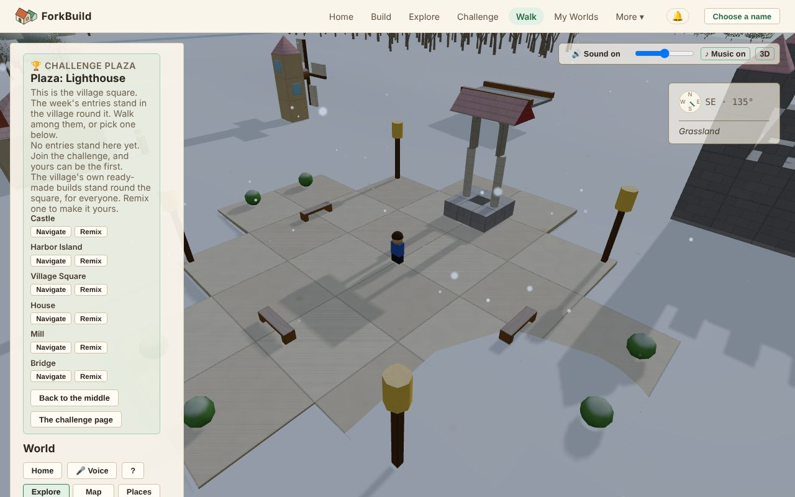

# 03 — World View

<!-- languages -->
**English** · [Deutsch](de/03-WorldView.md) · [Español](es/03-WorldView.md) · [Français](fr/03-WorldView.md) · [Bahasa Indonesia](id/03-WorldView.md) · [日本語](ja/03-WorldView.md) · [한국어](ko/03-WorldView.md) · [Português (Brasil)](pt-BR/03-WorldView.md)
<!-- /languages -->

World View is the shared 3D world where **every published build stands
side by side**. You walk or fly around, find things, look at what others
have built, and bring friends along.

You don't build here: the Editor is the one place for that. When you want
to change something you found, **Edit a Copy** opens your own copy in the
Editor (see [Edit a Copy](#edit-a-copy--taking-something-into-the-editor)).
The only changes World View makes are labels, not bricks: naming
[Landmarks](#landmarks--marking-a-place-worth-remembering) and regions, and
leaving a released animal in the World with **G** (see
[Avatars & Presence](06-AvatarsAndPresence.md#decorating-a-world-with-an-animal)).

**The short version:**

| To… | Do this |
|---|---|
| Get here | **Walk** in the top bar, or **Explore** on any build |
| Walk | `W` `A` `S` `D` to move, `Shift` to run, `Space` to jump (on a phone, the joystick) |
| Look around | Drag to turn the camera, scroll to zoom |
| Change what you see | **Edit a Copy** opens your own copy in the Editor |
| Start a build right here | **Build here** |
| Bring friends | **Walk here with me** makes a link to send them |
| Mute or unmute | The **Sound** button, or `M` |

Every control is listed in the [Controls Reference](ControlsReference.md).
The network tools behind the World have their own page,
[World View: Advanced Tools](WorldViewAdvancedTools.md).

## Opening World View


*World View at the challenge plaza: the side panel on the left, your avatar in the square, and sound and the compass at the top right.*

There are two ways in:

- **Walk** in the top bar opens World View at this week's challenge plaza.
  You don't need a build of your own. The plaza is the village square: the
  six ready-made builds stand round it, ready to remix, and the week's
  entries stand just outside (see
  [The challenge plaza](04-PublishingAndForking.md#the-challenge-plaza)).
- On the **Explore** page, **Explore** on any build puts you next to it.
  Opening a link to a World does the same.

Builds that people [sent to everyone](04-PublishingAndForking.md#who-can-find-it)
stand where their builders put them: each on a spot of its own, with room
round it, across a wide land (see
[Where a build stands](04-PublishingAndForking.md#where-a-build-stands)).

## A visitor's view, and Advanced

World View opens as a visitor's view. What you came to do sits on a bar at
the bottom of the World: **Build here**, **Walk here with me**, and, when
the build isn't yours, **Edit a Copy**.

The side panel shows the build's name and who made it, then where you can
go and what's around you. On a phone the panel starts closed so the World
fills the screen; **Panel** opens it. At the plaza a phone shows one line
instead, **Plaza: …** with how many builds stand there; tap it to open the
panel. Who is drawn, whether the keys walk your avatar, and the camera
choices are under **Avatar settings**.

At the bottom of the panel, **Show advanced tools** adds the tools for the
networks behind the World: coordinates, inspecting bricks, placements,
World Encounters and more. They're described on their own page,
[World View: Advanced Tools](WorldViewAdvancedTools.md). The choice is
remembered on this device and changes nothing for anyone else. Everything
on this page works either way.

## Flying around

- **Left-drag**: turn the camera round
- **Right-drag**: slide the camera sideways
- **Scroll**: zoom in and out
- **Home** (the key, or the button in the panel): go back to your own
  World (see [Orientation and Locations](#orientation-and-locations))

To walk your avatar instead, see
[Walking your avatar](06-AvatarsAndPresence.md#walking-your-avatar).

Nearby Worlds **load and unload by themselves** as you move. The side panel
reads from top to bottom:

1. what you're looking at (the header);
2. where you can go: **Home**, **Locations**, and the **Explore**, **Map**
   and **Places** tabs;
3. what's around you (**Nearby**);
4. your own tools: **Search** and **Avatar**.

At the bottom, **Worlds in View** lists the other Worlds loaded around you,
and **Nearby Worlds** lists ones you can fly to with a click.

Point at something in the World and a small card at the bottom right of
the view says what it is.

### What's around you

**The land** is the same for everyone. Grass, beaches, rock, forest,
farmland, lakes, rivers and the sea all follow the shape of the ground.
The land near the centre is always dry; about a thousand units out you
reach a coast, where the ground slopes down into deep sea.

**Water.** Lakes ripple in the breeze and the sea rolls with a slow
swell. Rivers run downhill in their beds, quicker where the ground is steeper.
They rise at bubbling springs below the highland, tumble down the steepest ground
in little cascades, and now and then end in a still pond.
Foam gathers where waves reach the shore and where a river runs over
rapids. Your avatar wades into a lake, the sea or a river and slows as
the water rises. Once the water is deeper than half its height, it swims,
rising and falling with the swell (see
[Swimming and diving](06-AvatarsAndPresence.md#swimming-and-diving)). Dive
under and you see seaweed and small schools of fish.

**Trees and animals.** Forests have conifers where it's wetter and
broadleaf trees where it's drier, with scrub at the edge of the grassland.
Deer live in the forest and rabbits on the grassland. Trees never move.
Animals wander slowly near their own spot, stop to graze, and look up now
and then. Come close and one turns its head to watch you (unless you're
right behind it); a grazing deer lifts its head and a rabbit sits up. They
never run away or move because of you, and other people see them watching
*them*. Animals block your way on foot, like trees.

Everyone looking at the same place at the same moment sees the same land,
fish, trees and animals. None of it can be edited.

**Residents** are people who live in a World. They stroll around their
homes, walk round buildings rather than through them, and turn to greet
you; talk to one and it tells you what's around. Unlike animals, they're
part of the World: its author adds them. The ready-made homes come with
one resident by the front door, including the ones round the challenge
plaza. In your own build, **R** removes one. See
[Residents](06-AvatarsAndPresence.md#residents).

**Faint, see-through builds** are builds other people announced near you
that this device hasn't accepted. They go away again as you walk on. See
[Claimed Builds](WorldViewAdvancedTools.md#claimed-builds--other-peoples-builds-where-their-publishers-say-they-stand).

### Inside a build

Walk in through a door and the build above your head is cut away, so you
see the room you're standing in rather than the wall behind you: its roof
and everything higher than your head, for that build only, while the walls
stand to just above your height. With the camera following you, or in
**Third Person**, the camera comes in too, behind and above you looking
down into the room, and rises rather than going through a wall when one is
right behind you. **Bird's-Eye** looks straight down into the room;
**First Person** sees it through your own eyes, with nothing cut away.
Step back outside and the whole build is drawn again. Only what is drawn
changes: the roof is still there, for everyone and for walking.

## Day and night

The sky over World View turns from day to night and back every 40 minutes:
a warm dusk, a blue, moonlit night, a pink dawn, then day again. It follows
the clock, so everyone at a build sees the same sky at the same moment. After
dark, glass windows glow with lamplight and **Lanterns** shine in their own
color, so a lighthouse shows the way in and a village looks lived in; the
birds go quiet and crickets take over. The night is never too dark to find
your way. Only World View has night: the Editor, pictures of builds and link
previews are always in daylight.

The sun rises in the east, crosses the southern sky and sets in the west,
glowing orange near the horizon; after it sets, the moon follows the same
path through the night. The light on builds comes from whichever is up, so
walls facing east catch the morning and walls facing west the evening.

The sun and the moon cast shadows: yours, the trees', animals' and every
build's, long in the morning and evening and short at midday, and fainter by
moonlight. They fall within about 45 metres of you, and fade away for a
moment while the sun hands the sky over to the moon and back. Shadows cost a
phone more than a computer, so they start on with a mouse and off on a
phone or tablet; tick or untick **Shadows** at the bottom of the panel to
change it on this device.

At night the stars come out as the dusk deepens, with the Milky Way
across them, and fade again at dawn. The whole starry sky turns slowly round
a point high in the north, so the stars rise in the east and set in the west
with the moon, and everyone sees the same stars at the same moment.

The moon goes through its phases, one a night: from a dark new moon through
a thin crescent, a half moon and a gibbous moon to a full moon, and back
again, every eight days of World View (a little over five hours). A waxing
moon is lit on its western side, a waning one on its eastern side. The phase
changes the night too: under a full moon the night is a little brighter and
shadows are crisper; around a new moon the light is softer, the sky a deeper
blue, and the stars and the Milky Way shine their brightest. Like the rest of
the sky, everyone sees the same moon at the same moment, and it's never so
dark that builds are hard to see.

Clouds come and go, the same for everyone at the same moment. Most of the
time a few white clouds drift over; now and then the sky clouds over, and
sometimes it turns grey and overcast, with softer light and fainter shadows.
It's never so dark that builds are hard to see.

Now and then an overcast sky brings rain, for a few minutes at a time. You
see it falling around you and rings spreading wherever the drops land on a
lake, the sea or a river, and you hear it, while the birds and insects go
quiet. Step inside a build and it stays dry: you hear the rain drumming on
the roof instead, and see it still falling outside. The ground and builds
get darker and glisten in the rain, and dry off over a few minutes after it
stops. The heaviest downpours sometimes bring a gentle storm: now and then
lightning softly lights the sky, and thunder rumbles far off a few seconds
later. If your device is set to reduce motion, the lightning doesn't flash.
Rain is only for looking and listening: rivers don't rise, and you walk just
as fast.

If you'd rather it were always day, tick **Always day** at the bottom of the
panel, just above **Shadows**. It keeps the sky clear as well. It's
remembered on this device and changes nothing for anyone else.

## Sound

**Controls**, at the top right of the view (bottom right on a phone):

- **Sound**, or `M`: all sound off or on.
- The slider: volume. On a phone or tablet, use the device's own volume
  buttons.
- **♪ Music**: the music alone off or on.
- **3D**: switch between 3D sound and plain **Stereo**.

Sound starts with your first click, tap or key press (browsers require
that) and pauses while the tab is hidden. These choices are remembered on
this device, in World View and the Editor.

**What you hear:**

- **The land around you**: wind on high, rocky ground, birdsong in
  forests, crickets in fields, water lapping at a lake, a river running.
  Trees rustle or sigh in the wind, louder the closer they are. Sounds fade
  into each other as you walk from one kind of land to another.
- **Your avatar**: footsteps that change with the ground (grass, leaves,
  sand, stone, water, bricks), a whoosh when you jump and a thud when you
  land.
- **Vehicles**: wheels or a balloon's burner, rising as you speed up;
  sounds for getting on and off; and squealing brakes when you stop fast.
- **Animals and residents**: a deer snorts and a rabbit thumps its foot
  when it looks up or is startled; catching and releasing one has its own
  sound. Residents hum when they greet you and murmur when they talk.
  Everyone hears the same deer look up at the same moment.
- **Other people**: their footsteps, jumps and vehicles, from where they
  are, as long as you can see them. Hide other avatars and they fall
  silent. Vehicles are heard up to 40 m away, the three nearest only.
- **Your own changes**: naming a landmark or region, adding or removing a
  resident, decorating with an animal, and undo and redo make the same
  short sounds as in the Editor. Other people's changes are silent.

Sounds come from where they are: ahead or behind, above or below, left or
right, turning as you turn the camera. Headphones help. **Stereo** plays
plain left and right instead, which may suit a slow device or speakers.

**Music** plays softly underneath: a gentle tune your browser makes up as
it goes, warm by day and slower after dark, with quiet spells between
pieces. It never plays the same way twice.

All sound is made in your browser: nothing is downloaded and nothing is
sent. Other people's browsers make the sound of your footsteps from where
they already see you walking.

## Orientation and Locations

The **compass** floats over the top right of the view. It shows north,
east, south and west, which way you're facing in degrees, and small dots
for nearby builds, people and landmarks. Point at a dot for its name, or
read the list under the compass, which also names the place you're in. The
compass only shows; it never moves the camera.

A row of buttons near the top of the panel helps you get around:

- **Home** takes you, camera and avatar, back to your own World: the one
  you have open, or last looked at. You land just outside it, however far
  you've wandered. If you haven't been to a World of your own yet, Home
  takes you to the centre of the map.
- **Locations** lists every place World View knows about so far, grouped
  into **World**, **Structures**, **Landmarks** and **Places**. **Focus**
  on a row moves the camera there and nothing else.
- **👥 N online** counts who's here; click it to see the World's members.
  A **Lobby** button follows when the World has a public lobby.
- **?** shows the camera and walking controls; click it again to hide them.

**Notifications** is the 🔔 button in the app's header, beside your name
(or **Choose a name**), so it's on every page. It opens your
**Notification History**, newest first. You get a notification when:

- someone comments on a build you published (see
  [Commentary](09-PublicationsAndEvidence.md#commentary));
- someone you follow publishes something new (see
  [Following people](07-PeerConnectionsAndFriends.md#following-people));
- someone remixes one of your builds (see
  [Remix counts](04-PublishingAndForking.md#remix-counts)).

Each one says what happened and when. **Explore** takes you to that build's
World. It's a simple list, not an inbox: nothing is marked read, nothing is
dismissed, and there's no count on the button. It loads when you open it;
click **Refresh** to load it again. It belongs to your name, not to the
World you have open.

### Notifications on this device

At the top of the panel, **Notify me on this device** lets your device show
these notifications itself, like any app. The browser asks you to allow it;
**Turn off** stops it.

They appear while ForkBuild is open but not in front of you: in another
tab, or as an [installed app](01-GettingStarted.md#installing-forkbuild) in
the background. Click one to open ForkBuild at that build. Nothing is sent
anywhere to make this work, so a closed ForkBuild shows nothing; what came
in meanwhile is in the list next time. Only a few appear at once; the rest
wait in the list. If the browser blocks them, the panel says so: allow
ForkBuild's notifications in the browser's site settings.

### Explore, Map, and Places — three ways to browse, never at once

Below the buttons are three tabs. Only one is open at a time, and
switching only changes what the panel shows.

- **Explore** (the default) shows who's here and a few places to visit,
  then **Nearby**: **Places**, **Landmarks** and **People** around you,
  each with its distance and a **Go** button. Empty groups are hidden.
  Click a group's title to fold or open it; World View remembers which you
  left open. Advanced tools add three more groups (see
  [World View: Advanced Tools](WorldViewAdvancedTools.md)).
- **Map** shows the [World Map](#the-world-map).
- **Places** lists [geographic places](#geographic-places).

### Info — what am I looking at?

Next to most **Go** buttons, in Nearby and in **Locations**, is an
**Info** button. **Go** moves your camera there. **Info** tells you about
the place without moving: what it is, how far away, and which named place
it's in ("You are in Willow Village") or near ("You are near Kawahara
Village").

From the Info panel you can:

- **Go**: travel there;
- **Show on Map**: see it on the World Map;
- **Names** (for a named place): see what people call it, or publish a
  name;
- **Edit a Copy**: open your own copy in the Editor (see below).

### Edit a Copy — taking something into the Editor

**Edit a Copy** is how you change something you found in World View. It
makes your own independent copy of the build and opens it in the Editor,
ready to build on. The original is never touched.

You'll find it:

- on the bar at the bottom of the World, when the build you're visiting
  isn't yours: it copies the whole build;
- on the **Info** panel for a region, landmark or placed structure;
- with advanced tools on, when you click a brick, bare ground or a placed
  structure (see
  [Inspecting a brick](WorldViewAdvancedTools.md#inspecting-a-brick--or-a-placed-structure)).

What gets copied depends on what you picked:

- For a **landmark**, a **region**, a **brick** or **bare ground**, you
  get the World they belong to.
- For a **placed structure**, you get that structure, not the World it
  stands in.

ForkBuild tells you the moment your copy is ready (see
[Publishing & Remixing](04-PublishingAndForking.md)). If the copy can't be
made, a **Can't make a copy** dialog says why, usually because the
build's license doesn't allow copies or the build can't be fetched yet,
and **Back to the build** returns you to where you were (see
[When a remix can't complete](04-PublishingAndForking.md#when-a-remix-cant-complete)).

A **geographic place** and a **person** have no Edit a Copy. A geographic
place is made of several people's regions, so there's no single build to
copy; open one of its regions instead.

Edit a Copy is the same as **Remix** in Explore and on an author's page,
with the same license rules (see
[Remixing: make it your own](04-PublishingAndForking.md#remixing-make-it-your-own)).
Everything else in World View, such as Search, the compass, the Map and
Info, only looks.

### Build here — starting a build for this spot

**Build here**, beside **Home**, starts a new, empty build in the Editor
for the spot where your avatar stands (or, when flying, the spot under the
camera). The Editor says which World it's for.

When you publish it, the build stands right on that spot, instead of on an
open plot ForkBuild picks. **Go and see it** brings you back to look.
**Forget this spot**, in the Editor, lets ForkBuild place it as usual.

The spot is only your own note, kept on this device and in its backups. It
doesn't claim the land, and others may build there too (see
[Why can two builds sit in the same spot?](WorldViewAdvancedTools.md#why-can-two-builds-sit-in-the-same-spot)).

### Walk here with me — bringing friends into this World

**Walk here with me**, beside **Build here**, makes a link that brings
friends into the World you're in, to walk around together. Send it any
way you like, or let them scan its QR code with a phone.

A friend who opens it chooses a name if they haven't yet (they walk as
their own avatar), clicks **Join**, and arrives in this World. You see
each other walking around. The dialog lists who is on the way and who has
arrived.

- The World has to be published first: your friend's ForkBuild checks its
  signature and its build, as it does for a shared link, and keeps a copy.
- The link works for anyone who opens it, for 30 minutes, while you stay in
  World View. Closing the dialog keeps it working; **Stop the link** ends
  it. Friends who already joined stay connected either way.
- Joining connects your two devices directly, like an invitation on
  **Peers**. Each of you can see the other's IP address, and your avatars
  show as each side's **Presence Visibility** allows (see
  [Who can see you](06-AvatarsAndPresence.md#who-can-see-you-two-independent-settings)).
  Nobody becomes a Known Peer or a friend unless you choose to.
- It needs a rendezvous server. The official site has one; a copy you run
  yourself needs its own (see
  [Peer Connections & Friends](07-PeerConnectionsAndFriends.md)).

### The challenge plaza

**Walk the plaza** on a week's challenge page, or **Walk** in the top bar,
opens World View at the village square: paved, with a well, benches and
lamp posts, and the six ready-made builds round it.

The square and the ready-made builds are part of the World, like its hills
and trees. They stand there for everyone, and nobody owns them. The week's
entries stand just outside, and only that week's: open last week's plaza
and you see last week's entries. A panel lists the week's entries and the
ready-made builds (see
[The challenge plaza](04-PublishingAndForking.md#the-challenge-plaza)).
No trees grow round the square, and there's no **Build here** on it.

### Landmarks — marking a place worth remembering

A **landmark** is a named point you put in a World, such as "Old Bridge"
or "Great View", with an optional description. It's placed exactly where
your avatar is standing.

When you can edit the World you're in, the Landmarks part of
**Locations** has a **+ Add Landmark** button. Give it a title, and a
description if you like, and click **Place Here**. It appears straight
away for you, and moments later for everyone else editing the same World:
on the compass, in **Locations**, and as a place to go.

Landmarks belong to the World, not to you. Anyone who can edit the World
can rename, change or remove any landmark, whoever made it.

### The World Map

The **Map** tab shows the World from above: named places, landmarks,
builds, the people here, and a marker for you. It shows everything World
View knows about so far, all at once.

- Scroll, or use **+** and **−**, to zoom.
- Drag empty space to move the map.
- Click a place or a person to move your camera there.

Looking at the map never changes anything.

### Geographic places

A **geographic place** is an area that several people have named or
described as a region, each on their own, and that turns out to be roughly
the same ground. The **Places** tab lists the ones World View has found
so far.

Click one to see how many descriptions and Worlds it spans, its
**Community Names**, and **Go to Place** and **Show on Map**. **← Back** (or
Escape) returns to the list. If you switch tabs and come back, you find the
same screen you left.

A place's **Community Names** shows its top few names; **More names**
shows the full ranked list. Below them you can publish a name of your
own. Everything else (other descriptions of the place, the full history of
names, import and export) is folded under **More**.

Publishing a name tells the people you're connected to, just like
claiming you made a build. To see every name and claim this device has
published or heard about, see
[Publications & External Evidence](09-PublicationsAndEvidence.md).

## My Worlds — worlds you've actually been to

**My Worlds**, in the top bar, lists every World you've
been inside on this device, newest first, with its title, author, and how
many builds and landmarks it has. **Continue Exploring** takes you back
in. Only this device keeps the list, and nobody else sees it.

Haven't been anywhere yet? **Open Explore** to find a World or start from
a ready-made build.

**Builds you helped make** lists the builds a friend credited you on when
you built together with **Build with me** (see
[The Editor](02-TheEditor.md#build-with-me-building-together-live)). Each
shows its title and **with** your friend's name, which opens their page.
It says **Not published yet** until your friend publishes it; then its
title opens its World. Your other devices list them too, once connected to
this one. The section shows only when there's something in it.

## Finding worlds

There are two ways to look for something, each answering a different
question.

### Search — "which publications match this?"

**Search** looks for a **title or author** in everything published, not
just what's loaded around you. Type a word and click **Find**. Each result
shows where it is (📍); click **Focus** to fly there.

A result may say its position is a **default position**: its author never
chose a spot, so ForkBuild shows it on one. With advanced tools on, you
can also search by position (see
[World View: Advanced Tools](WorldViewAdvancedTools.md)); results then
show how far away they are (📏).

### Explore Here / What's Here? — "what's around me right now?"

These two buttons, at the top of Explore's **Nearby**, look around
**wherever your camera is**. You don't need a title or coordinates.

- **Explore Here** looks over a wide area. You can widen or narrow it
  afterwards.
- **What's Here?** looks only right where you are.

Both open the **Explore Location** dialog:

```
📍 Center: 100.0, 50.0, 250.0
⭕ Radius: 25 World Units

Showing 3 of 3 builds you can find

📍 City Hall            📏 4.2 World Units away
by alice
[Focus] [Select] [Inspect]
```

Each result has three buttons:

| Button | What it does |
|---|---|
| **Focus** | Flies there, and makes it the build your next change applies to |
| **Select** | Makes it the build your next change applies to, without moving |
| **Inspect** | Shows its title, author, status, position and owner, without moving |

The dialog itself never moves, changes or publishes anything.

## World View is read-only — building happens in the Editor

Clicking, dragging or pressing a key in World View never changes a brick.
There are no building tools here. To build on something, use
**[Edit a Copy](#edit-a-copy--taking-something-into-the-editor)** and carry
on in [The Editor](02-TheEditor.md). The only changes World View makes are
the labels listed at the top of this page.

## Seeing other collaborators

When other people are in the same World:

- **You see them**: their avatars, with their names and what they're doing
  ("**Bob — exploring nearby**").
- **You see their changes as they happen**: a landmark, a name, a new copy
  of their own.
- **A short activity list** in the panel shows what changed recently, even
  out of view. It's kept only while you're here.

Seeing people never changes anything by itself. Only a real change does:
one made in the Editor, or one of the labels World View allows.

## Save and publish here, too

When you're working on a build, the header has **Save**, **Publish** and
**Edit Metadata**, so you can save and share it without leaving. The
status line says which it is: **🔒 Published** or **✎ Editing your copy**.

A published build never changes. If the build you're in is published,
your first change here (its details, a landmark or region, or an animal
left as decoration) makes your own copy, titled *"Remix of &lt;original
name&gt;"*. A short notice tells you so ("Created your own editable copy —
… is unchanged"). The same license rules apply as for any remix (see
[Publishing & Remixing](04-PublishingAndForking.md#remixing-make-it-your-own)).

## History — previewing and restoring earlier states

Every change you make here, such as adding, renaming or removing a
landmark or region, is kept in the build's history. Click **History** in
the header to see a numbered list with times, like:

```
1. Add Landmark "Old Bridge"
2. Rename Region "Willow Village"
3. Remove Landmark "Great View"
```

Steps you've undone are marked **undone**. Clicking a step only picks it;
nothing changes until you press a button:

- **Preview** shows the World as it was *just after* that step, next to
  the current one, without changing anything. **Cancel Preview** goes back.
- **Restore** goes back to that step. It asks nothing first, but leaves
  the change unsaved, so you can still choose whether to save.
- **Close** closes the list.

## What's next?

Ready to share what you've made, or remix someone else's work? Continue to
**[Publishing & Remixing](04-PublishingAndForking.md)**. For the network
tools behind the World, see
**[World View: Advanced Tools](WorldViewAdvancedTools.md)**.
