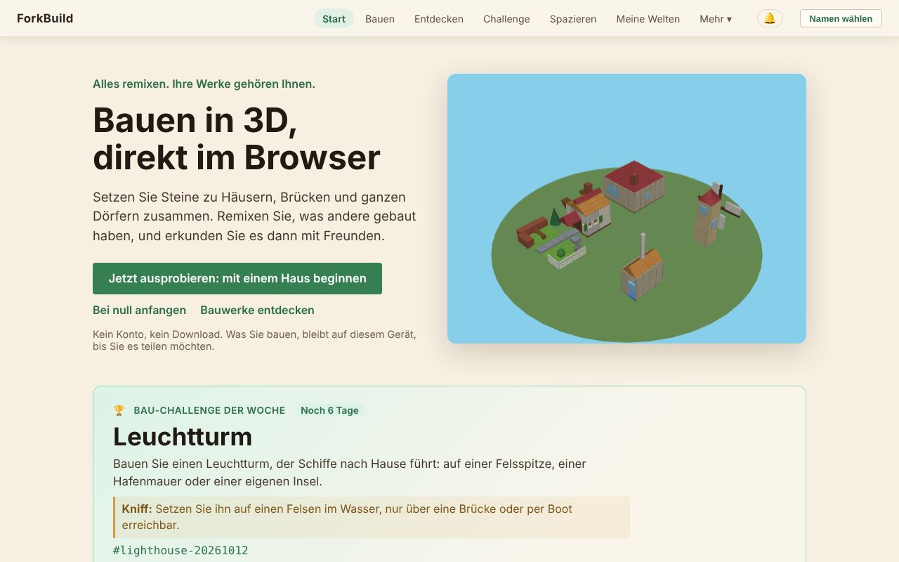
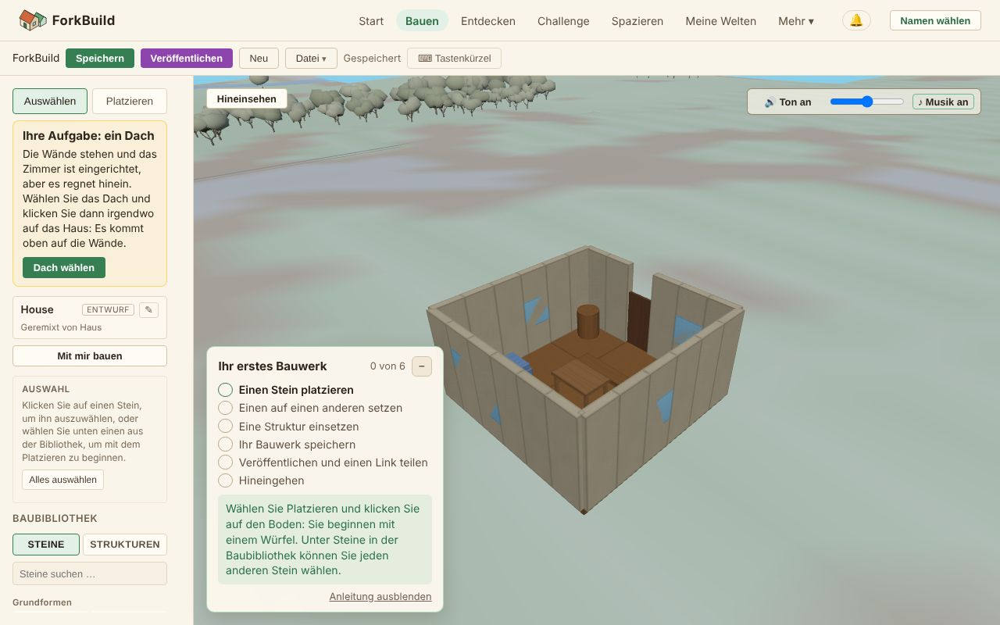

<!-- translation-of: docs/user/01-GettingStarted.md source-hash: 170440c7f3266fb3 -->
# 01 — Erste Schritte

<!-- languages -->
[English](../01-GettingStarted.md) · **Deutsch** · [Español](../es/01-GettingStarted.md) · [Français](../fr/01-GettingStarted.md) · [Bahasa Indonesia](../id/01-GettingStarted.md) · [日本語](../ja/01-GettingStarted.md) · [한국어](../ko/01-GettingStarted.md) · [Português (Brasil)](../pt-BR/01-GettingStarted.md)
<!-- /languages -->

<!-- stale -->
> **Hinweis:** Die englische Fassung dieser Seite wurde seit der Übersetzung geändert, daher ist diese Übersetzung möglicherweise nicht mehr aktuell. Siehe die [englische Fassung](../01-GettingStarted.md).
<!-- /stale -->

Willkommen! Diese Anleitung bringt Sie in etwa fünf Minuten von „gerade die
App geöffnet“ zu „ich habe etwas gebaut“. Sie brauchen kein Konto, keinen
Download und keinen Namen, um anzufangen: Alles bleibt auf Ihrem Gerät, bis
Sie es teilen.

**Die Kurzfassung:**

1. Klicken Sie auf der Seite **Start** auf **Jetzt ausprobieren: mit einem
   Haus beginnen**.
2. Klicken Sie auf **Dach wählen** und dann auf das Haus: Das Dach sitzt.
3. Klicken Sie auf **Veröffentlichen** und beantworten Sie die Fragen: einen
   Namen, unter dem Sie veröffentlichen (klicken Sie auf **Als …
   veröffentlichen**), und **Wer kann es finden?**
4. Klicken Sie auf **Hineingehen**, um in der Welt durch Ihr Haus zu gehen.

Der Rest dieser Seite erklärt jeden Teil, und wie Sie stattdessen auf einem
leeren Grundstück anfangen.

## ForkBuild öffnen

*Die Seite Start: die obere Leiste, die drei Einstiege und die Bau-Challenge der Woche.*

ForkBuild läuft in jedem aktuellen Webbrowser: Öffnen Sie die gehostete
Website, und Sie landen auf der Seite **Start**. (Wie Sie eine eigene Kopie
betreiben, steht in [Eine eigene Kopie betreiben](#eine-eigene-kopie-betreiben)
am Ende dieser Seite.)

Die Seite **Start** zeigt ein kleines Dorf, das sich in 3D dreht, und
bietet drei Einstiege:

- **Jetzt ausprobieren: mit einem Haus beginnen** öffnet ein fertiges Haus
  im Editor als Ihre eigene Kopie, bereit zum Ändern (siehe
  [Jetzt ausprobieren](02-TheEditor.md#jetzt-ausprobieren-ein-haus-zum-fertigbauen)).
- **Bei null anfangen** öffnet den Editor auf einem leeren Grundstück.
- **Bauwerke entdecken** öffnet **Entdecken**, wo die veröffentlichten
  Bauwerke aller stehen.

Unter **Mit einem fertigen Bauwerk beginnen** öffnet jede Karte (eine Burg,
eine Hafeninsel, ein Dorfplatz, ein Haus, eine Mühle und eine Brücke) auf
dieselbe Weise Ihre eigene Kopie dieses Bauwerks. Nichts wird veröffentlicht
oder irgendwohin gesendet, solange Sie es nicht selbst tun.

Start zeigt außerdem die **Bau-Challenge der Woche**: ein Thema zum Bauen,
mit **Mitmachen** (siehe
[Die wöchentliche Bau-Challenge](04-PublishingAndForking.md#die-wöchentliche-bau-challenge)).
Sobald Sie Bauten veröffentlicht haben, zeigt sie auch **Ihre Stempel**:
Tatsachen über Ihre eigenen Bauten, etwa **Geremixt**, wenn jemand einen
davon geremixt hat, **Herausforderer**, wenn Sie an einer Wochen-Challenge
teilgenommen haben, oder **Großbaumeister** für einen Bau mit hundert
Steinen oder mehr. Sie werden auf diesem Gerät ermittelt und nur Ihnen
gezeigt: Anerkennung, nie Punkte oder eine Rangliste.

## Sich zurechtfinden

Die Leiste oben ist immer sichtbar:

`ForkBuild  Start  Bauen  Entdecken  Challenge  Spazieren  Meine Welten  Mehr ▾  🔔  Namen wählen`

| Menü | Was es öffnet |
|---|---|
| **Start** | Die Startseite |
| **Bauen** | Den Editor, in dem Sie bauen (siehe [Der Editor](02-TheEditor.md)) |
| **Entdecken** | Die veröffentlichten Bauwerke aller, zum Öffnen, Remixen oder Besuchen (siehe [Veröffentlichen & Remixen](04-PublishingAndForking.md#entdecken)) |
| **Challenge** | Die Bau-Challenge dieser Woche und ihre Beiträge (siehe [Die wöchentliche Bau-Challenge](04-PublishingAndForking.md#die-wöchentliche-bau-challenge)) |
| **Spazieren** | Die Weltansicht am Platz der Challenge dieser Woche, um zwischen den Einsendungen der Woche rund um den Dorfplatz umherzugehen (siehe [Weltansicht](03-WorldView.md)) |
| **Meine Welten** | Welten, die Sie auf diesem Gerät besucht haben (siehe [Meine Welten](03-WorldView.md#meine-welten--welten-in-denen-sie-wirklich-waren)) |
| **🔔** | Ihre Benachrichtigungen: Kommentare, Remixe und neue Bauwerke von Menschen, denen Sie folgen (siehe [Orientierung und Orte](03-WorldView.md#orientierung-und-orte)) |
| **Namen wählen** | Den Namen wählen, unter dem Sie veröffentlichen und spazieren; sobald Sie einen haben, steht er hier (siehe [Einen Namen wählen](#einen-namen-wählen)) |

**Mehr** öffnet den Rest, in vier Gruppen. Auf einem Telefon zeigt **Menü**
alle auf einmal.

- **Persönlich**
  - **Mein Avatar** — wie andere Sie in der Weltansicht sehen, siehe
    [Avatare & Anwesenheit](06-AvatarsAndPresence.md)
  - **Meine Identitäten** — die auf diesem Gerät gespeicherten Namen
    (Identitäten), siehe [Ihr Name & Ihre Identität](05-IdentityAndLogin.md)
  - **Ihre Daten** — alles in eine Datei sichern oder auf ein anderes Gerät
    kopieren, siehe [Ihre Daten](13-YourData.md)
- **Menschen**
  - **Peers** — die Menschen, mit denen Sie verbunden sind, die Sie kennen
    oder mit denen Sie befreundet sind, siehe
    [Peer-Verbindungen & Freunde](07-PeerConnectionsAndFriends.md)
  - **Gefolgt** — die Menschen, von deren neuen Bauwerken Sie erfahren,
    siehe [Personen folgen](07-PeerConnectionsAndFriends.md#personen-folgen)
  - **Unterhaltungen** — Ihre Direktnachrichten, siehe
    [Chat & Unterhaltungen](08-ChatAndConversations.md)
- **Erweitert** — zum Bauen und Teilen brauchen Sie das nicht
  - **Veröffentlichungen** — signierte Urheberschafts- und
    Ortsnamensansprüche, wo sie gespeichert und angekündigt werden, und
    (*experimentell*) ihre externen Nachweise, siehe
    [Veröffentlichungen & externe Nachweise](09-PublicationsAndEvidence.md)
  - **Netzwerkeinstellungen** — Gateways, Relays, Anbieter und Server für
    Peer-Verbindungen, siehe [Netzwerkeinstellungen](10-NetworkSettings.md)
- **App**
  - **Sprache** — die Sprache, in der ForkBuild auf diesem Gerät angezeigt
    wird. Sie folgt den Sprachen Ihres Browsers, bis Sie eine wählen; das
    Speichern lädt die Seite neu, speichern Sie also vorher Ihre Arbeit.
    ForkBuild gibt es auf Englisch, Deutsch, Spanisch, Französisch,
    Indonesisch (Bahasa Indonesia), Japanisch, Koreanisch und
    brasilianischem Portugiesisch.
  - **Aussehen** — **Auto**, **Hell** oder **Dunkel**, direkt im Menü. Auto
    folgt dem hellen oder dunklen Modus Ihres Geräts; Hell ist das Dorf am
    Tag, Dunkel dasselbe Dorf bei Nacht. Es wechselt sofort und wird auf
    diesem Gerät gespeichert.
  - **Hilfe** — stellen Sie eine Frage in Ihren eigenen Worten; die Antwort
    kommt aus dieser Anleitung, gelesen auf Ihrem Gerät. Einmal geöffnet,
    funktioniert es auch offline.
  - **Über** — Versionsinformationen und ein Link zu dieser Anleitung
  - **ForkBuild installieren** — wo der Browser es installieren kann (siehe
    [ForkBuild installieren](#forkbuild-installieren))

## Ihren ersten Stein platzieren

*Der Editor mit dem Haus von der Seite Start: links Ihre Werkzeuge und die Baubibliothek, in der Mitte das Bauwerk, dazu die Karte Ihr erstes Bauwerk.*

Wenn Sie den Editor zum ersten Mal öffnen, führt Sie eine Karte **Ihr
erstes Bauwerk** in der Ecke der 3D-Ansicht durch sechs Schritte und hakt
jeden ab, sobald Sie ihn erledigt haben; der letzte ist, in Ihr
veröffentlichtes Bauwerk hineinzugehen. Siehe
[Ihr erstes Bauwerk](02-TheEditor.md#ihr-erstes-bauwerk).

1. Klicken Sie in der oberen Leiste auf **Bauen** (oder auf der Seite Start
   auf **Bei null anfangen**).
2. Stellen Sie in der linken Seitenleiste sicher, dass das Werkzeug
   **Platzieren** aktiv ist (drücken Sie `2`).
3. Öffnen Sie darunter in der **Baubibliothek** den Reiter **Steine** und
   klicken Sie auf einen Stein — zum Beispiel **Würfel** unter
   **Grundformen**.
4. Bewegen Sie die Maus in die 3D-Ansicht. Ein durchscheinender **Geist**
   des Steins folgt dem Raster.
5. **Klicken** Sie, um ihn zu platzieren.

Glückwunsch — Sie haben Ihren ersten Stein gebaut! 🎉

Auf einem Telefon oder Tablet tippen Sie, statt zu klicken; siehe
[Auf Telefon oder Tablet](02-TheEditor.md#auf-telefon-oder-tablet).

### Steine stapeln

Sie müssen nicht auf dem Boden bauen. Fahren Sie über eine **Fläche** eines
vorhandenen Steins, und der Geist rastet daran ein — klicken Sie, um oben
aufzustapeln oder seitlich anzusetzen. So bauen Sie Wände, Türme und
Dächer.

Ein Fehler? Drücken Sie `Strg+Z` (`Cmd+Z` auf einem Mac), um ihn
rückgängig zu machen. Jede Änderung lässt sich rückgängig machen.

## Ihre Arbeit speichern

Drücken Sie **Strg+S** (oder klicken Sie in der Werkzeugleiste auf
**Speichern**). Die Anzeige **● Ungespeicherte Änderungen** wird zu
**Gespeichert**.

Ihr Bauwerk wird in Ihrem Browser gespeichert und ist daher noch da, wenn
Sie zurückkommen. Während Sie bearbeiten, hält ForkBuild außerdem eine
Kopie ungespeicherter Änderungen zur Absturzwiederherstellung bereit und
bietet an, sie wiederherzustellen, wenn die Seite vor dem Speichern
geschlossen wird.

> **Behalten Sie eine Kopie.** Ihre Bauwerke liegen nur in diesem Browser.
> Wer die Browserdaten der Website löscht, löscht sie mit; sichern Sie sie
> also ab und zu mit **Mehr → Ihre Daten → In eine Datei sichern** (siehe
> [Ihre Daten](13-YourData.md)).

Browser begrenzen, wie viel jede Website speichern darf, meist auf einen
Anteil der Festplatte. Wenn der Anteil von ForkBuild voll ist, stoppen
Speichern und Absturzwiederherstellung mit einer entsprechenden Meldung;
nichts, was Sie geöffnet haben, geht verloren. Nutzen Sie **Datei →
Exportieren** in der Werkzeugleiste, um eine Kopie des Bauwerks als Datei zu
behalten. Beim ersten Speichern fragen manche Browser, ob ForkBuild seine
Daten dauerhaft behalten darf; wenn Sie es erlauben, löscht der Browser sie
nicht, wenn der Speicherplatz knapp wird.

## Einen Namen wählen

Zum Bauen und Speichern brauchen Sie keinen Namen. Sie brauchen einen zum
**Veröffentlichen**, denn Veröffentlichen signiert Ihr Bauwerk, damit
andere prüfen können, dass es wirklich von Ihnen ist, und zum **Spazieren
mit Freunden**, damit sie Sie darunter sehen.

Wenn Sie zum ersten Mal auf **Veröffentlichen** klicken, fragt ForkBuild
nach einem Namen zum Veröffentlichen. Geben Sie einen ein und klicken Sie
auf **Als … veröffentlichen**: Ein Name wird auf diesem Gerät angelegt, und
Ihr Bauwerk wird veröffentlicht. (Ein Spazier-Link fragt genauso, mit
**Als … spazieren**.)

Sie können auch jederzeit einen Namen wählen: Klicken Sie oben rechts auf
**Namen wählen**, geben Sie einen ein und klicken Sie auf **Weiter als …**.

ForkBuild hat keine Passwörter und keine Konten. Hinter Ihrem Namen steht
ein kryptografischer Schlüssel auf diesem Gerät, eine sogenannte
**Identität**. Der Schlüssel liegt ohne Passphrase in diesem Browser, bis
Sie eine hinzufügen: Der Editor erinnert Sie nach dem Veröffentlichen
daran, und **Mit Passphrase schützen** unter **Meine Identitäten** fügt
jederzeit eine hinzu. Um gleich eine Passphrase zu wählen, klicken Sie im
Namensdialog stattdessen auf **Jetzt mit einer Passphrase schützen**.

> **Eine Passphrase lässt sich nicht zurücksetzen.** Sie verschlüsselt Ihren
> Schlüssel auf diesem Gerät, und niemand, auch ForkBuild nicht, kann sie
> wiederherstellen. Wählen Sie eine, die Sie behalten.

Sobald Sie einen Namen haben, zeigt die Ecke oben rechts ihn an. Klicken Sie
darauf für **Mein Avatar**, **Meine Identitäten**, **Ihre Daten** und
**Namen wechseln**: Das listet jeden Namen auf, den dieser Browser schon
besitzt (klicken Sie auf einen, um ihn zu verwenden), legt einen neuen an
oder macht mit **Ohne Namen weiter** weiter. Ein neuer Name fragt dort auch
zweimal nach einer **Passphrase** mit mindestens 8 Zeichen. (Um sie zu
überspringen, setzen Sie das Häkchen bei **Ohne Passphrase erstellen**; der
Schlüssel wird dann unverschlüsselt in diesem Browser gespeichert.) Klicken
Sie dann auf **Diesen Namen nutzen**.

Alles, was Sie veröffentlichen oder an andere senden, wird dann unter
diesem Namen signiert.

**Ohne Namen veröffentlichen.** Der Namensdialog, den Veröffentlichen
öffnet, hat auch **Unsigniert veröffentlichen**. Ein so veröffentlichtes
Bauwerk hat keinen Autor und keine Signatur: Es bekommt keinen Link, kann
nicht mit anderen geteilt und später nicht an alle gesendet werden. Wählen
Sie lieber einen Namen, es sei denn, Sie wollen es nur in Ihrem eigenen
**Entdecken** haben.

Was eine Passphrase schützt, Sperren und Entsperren sowie das Sichern Ihrer
Identität werden in [Ihr Name & Ihre Identität](05-IdentityAndLogin.md)
behandelt.

## ForkBuild installieren

ForkBuild lässt sich als App installieren: Es öffnet sich dann vom
Home-Bildschirm, Dock oder der App-Liste in einem eigenen Fenster und
funktioniert ohne Verbindung. Klicken Sie auf der Seite Start (oder unter
**Mehr**) auf **ForkBuild installieren** und bestätigen Sie im Dialog des
Browsers. In Safari auf einem iPhone oder iPad sagt die Schaltfläche
stattdessen, wie es geht: Tippen Sie auf **Teilen**, dann auf **Zum
Home-Bildschirm**. Wo der Browser keine Apps installieren kann oder
ForkBuild schon installiert ist, wird die Schaltfläche nicht gezeigt.

- **Offline.** Beim ersten Öffnen behält Ihr Browser die Dateien von
  ForkBuild, sodass es danach auch ohne Verbindung öffnet, installiert oder
  nicht: Start, der Editor, Ihre gespeicherten und die fertigen Bauwerke
  funktionieren. Was das Netz braucht (Bauwerke und Personen finden,
  Bauwerke hinausschicken, Chat und Anrufe), wartet, bis Sie wieder online
  sind.
- **Updates.** Ist eine neue Version da, sagt eine Zeile oben **Eine neue
  Version von ForkBuild ist bereit**; **Neu laden** startet sie, sonst
  startet sie beim nächsten Öffnen von ForkBuild von selbst.
- **Benachrichtigungen.** Ein installiertes ForkBuild (oder eines in einem
  Hintergrund-Tab) kann Ihre Benachrichtigungen über Ihr Gerät anzeigen;
  siehe [Benachrichtigungen auf diesem Gerät](03-WorldView.md#benachrichtigungen-auf-diesem-gerät).

## Wie geht es weiter?

- Lernen Sie den vollständigen Baukasten in **[Der Editor](02-TheEditor.md)**
  kennen.
- Bereit zum Teilen? Springen Sie zu
  **[Veröffentlichen & Remixen](04-PublishingAndForking.md)**.
- Gehen Sie in der **[Weltansicht](03-WorldView.md)** zwischen den
  Bauwerken anderer umher.
- Richten Sie Ihren Avatar ein und lernen Sie Menschen kennen, in
  **[Avatare & Anwesenheit](06-AvatarsAndPresence.md)** und
  **[Peer-Verbindungen & Freunde](07-PeerConnectionsAndFriends.md)**.
- Nicht weiter? Die **[FAQ](FAQ.md)** beantworten die häufigsten Fragen.
- Oder fragen Sie mit eigenen Worten: **Hilfe** unter **Mehr** antwortet
  aus diesem Handbuch in Ihrer Sprache und funktioniert nach dem ersten
  Öffnen auch offline. Im Editor bietet eine Frage in der Befehlspalette
  (`Strg/Cmd+K`) **Das Handbuch fragen** an.

## Eine eigene Kopie betreiben

*Für Entwickler und Selbst-Hoster; zum Benutzen von ForkBuild brauchen Sie
das nicht.*

Um eine eigene Kopie zu betreiben, liefern Sie den Ordner über HTTP aus
(zum Beispiel mit `python3 -m http.server 8000` und dann
<http://localhost:8000/> öffnen). `index.html` direkt von der Festplatte zu
öffnen funktioniert nicht, weil Browser die Module einer `file://`-Seite
nicht laden.

- **Menschen finden.** Der Standard-Rendezvous-Server bedient nur die
  gehostete Website, daher kann eine eigene Kopie ihn nicht nutzen, um
  Menschen zu finden; verbinden Sie sich stattdessen mit Einladungen oder
  richten Sie einen eigenen Rendezvous-Server ein (siehe
  [Peer-Verbindungen & Freunde](07-PeerConnectionsAndFriends.md)).
- **Installieren und offline nutzen.** Eine Kopie, die Sie direkt aus dem
  Ordner betreiben, lässt sich nicht installieren und funktioniert nicht
  offline; eine mit `node scripts/build.mjs` gebaute schon (siehe
  [Deployment](../../Deployment.md) (Englisch)).
- **Übersetzungen.** Um eine Sprache hinzuzufügen oder zu verbessern, siehe
  [Translating ForkBuild](../../Translating.md) (Englisch).
