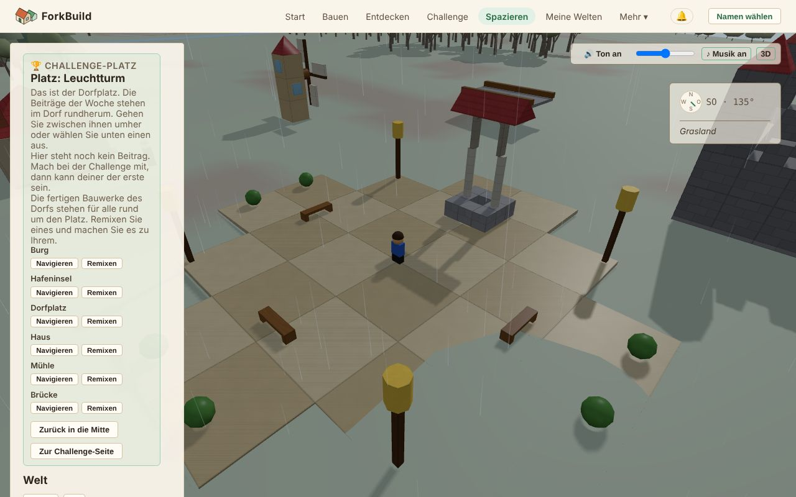

<!-- translation-of: docs/user/03-WorldView.md source-hash: b70b27623985ebf0 -->
# 03 — Weltansicht

<!-- languages -->
[English](../03-WorldView.md) · **Deutsch** · [Español](../es/03-WorldView.md) · [Français](../fr/03-WorldView.md) · [Bahasa Indonesia](../id/03-WorldView.md) · [日本語](../ja/03-WorldView.md) · [한국어](../ko/03-WorldView.md) · [Português (Brasil)](../pt-BR/03-WorldView.md)
<!-- /languages -->

<!-- stale -->
> **Hinweis:** Die englische Fassung dieser Seite wurde seit der Übersetzung geändert, daher ist diese Übersetzung möglicherweise nicht mehr aktuell. Siehe die [englische Fassung](../03-WorldView.md).
<!-- /stale -->

Die Weltansicht ist die geteilte 3D-Welt, in der **jedes veröffentlichte
Bauwerk Seite an Seite steht**. Sie gehen oder fliegen herum, finden Dinge,
sehen sich an, was andere gebaut haben, und bringen Freunde mit.

Gebaut wird hier nicht: Dafür gibt es nur den Editor. Wenn Sie etwas ändern
möchten, das Sie gefunden haben, öffnet **Eine Kopie bearbeiten** Ihre
eigene Kopie im Editor (siehe
[Eine Kopie bearbeiten](#eine-kopie-bearbeiten--etwas-in-den-editor-übernehmen)).
Die Weltansicht ändert nur Beschriftungen, keine Steine:
[Wahrzeichen](#wahrzeichen--einen-ort-markieren-den-man-sich-merken-sollte)
und Regionen benennen und ein freigelassenes Tier mit **G** als Schmuck in
der Welt lassen (siehe
[Avatare & Anwesenheit](06-AvatarsAndPresence.md#eine-welt-mit-einem-tier-schmücken)).

**Die Kurzfassung:**

| Um … | Tun Sie das |
|---|---|
| hierherzukommen | **Spazieren** in der oberen Leiste, oder **Erkunden** bei einem beliebigen Bauwerk |
| zu gehen | `W` `A` `S` `D` zum Gehen, `Umschalt` zum Laufen, `Leertaste` zum Springen (auf einem Telefon der Joystick) |
| sich umzusehen | Ziehen, um die Kamera zu drehen, scrollen zum Zoomen |
| zu ändern, was Sie sehen | **Eine Kopie bearbeiten** öffnet Ihre eigene Kopie im Editor |
| genau hier ein Bauwerk zu beginnen | **Hier bauen** |
| Freunde mitzubringen | **Mit mir hier spazieren** erstellt einen Link, den Sie ihnen schicken |
| den Ton aus- oder einzuschalten | Die Schaltfläche **Ton**, oder `M` |

Jede Steuerung steht in der [Steuerungsreferenz](ControlsReference.md).
Die Netzwerkwerkzeuge hinter der Welt haben eine eigene Seite:
[Weltansicht: Erweiterte Werkzeuge](WorldViewAdvancedTools.md).

## Die Weltansicht öffnen


*Die Weltansicht auf dem Challenge-Platz: links das Seitenfeld, Ihr Avatar auf dem Platz, oben rechts Ton und Kompass.*

Es gibt zwei Wege hinein:

- **Spazieren** in der oberen Leiste öffnet die Weltansicht auf dem
  Challenge-Platz dieser Woche. Sie brauchen kein eigenes Bauwerk. Der
  Platz ist der Dorfplatz: Die sechs fertigen Bauwerke stehen darum herum,
  bereit zum Remixen, und gleich daneben stehen die Einsendungen der Woche
  (siehe
  [Der Challenge-Platz](04-PublishingAndForking.md#der-challenge-platz)).
- Auf der Seite **Entdecken** bringt Sie **Erkunden** bei einem beliebigen
  Bauwerk direkt daneben. Ein Link zu einer Welt tut dasselbe.

Bauwerke, die andere
[an alle gesendet haben](04-PublishingAndForking.md#wer-kann-es-finden),
stehen dort, wo ihre Erbauer sie hingestellt haben: jedes auf einem
eigenen Platz, mit Raum darum herum, über ein weites Land verteilt (siehe
[Wo ein Bauwerk steht](04-PublishingAndForking.md#wo-ein-bauwerk-steht)).

## Ein Besucherblick und Erweitert

Die Weltansicht öffnet sich als Besucherblick. Was Sie hier tun wollen,
steht auf einer Leiste unten in der Welt: **Hier bauen**, **Mit mir hier
spazieren** und, wenn das Bauwerk nicht Ihres ist, **Eine Kopie
bearbeiten**.

Das Seitenfeld zeigt den Namen des Bauwerks und wer es gemacht hat, dann,
wohin Sie gehen können und was um Sie herum ist. Auf einem Telefon ist das
Feld zuerst geschlossen, damit die Welt den Bildschirm füllt; **Feld**
öffnet es. Auf dem Platz zeigt ein Telefon stattdessen eine Zeile,
**Platz: …** mit der Zahl der Bauwerke dort; tippen Sie darauf, um das Feld
zu öffnen. Wer gezeichnet wird, ob die Tasten Ihren Avatar bewegen und die
Kamerawahl finden Sie unter **Avatar-Einstellungen**.

Ganz unten im Feld fügt **Erweiterte Werkzeuge zeigen** die Werkzeuge für
die Netzwerke hinter der Welt hinzu: Koordinaten, das Untersuchen von
Steinen, Platzierungen, Begegnungen in der Welt und mehr. Sie stehen auf
einer eigenen Seite,
[Weltansicht: Erweiterte Werkzeuge](WorldViewAdvancedTools.md). Die Wahl
wird auf diesem Gerät gespeichert und ändert für niemanden sonst etwas.
Alles auf dieser Seite funktioniert so oder so.

## Herumfliegen

- **Linke Maustaste ziehen**: die Kamera drehen
- **Rechte Maustaste ziehen**: die Kamera seitlich verschieben
- **Scrollen**: hinein- und herauszoomen
- **Start** (die Taste oder die Schaltfläche im Feld): zurück zu Ihrer
  eigenen Welt (siehe [Orientierung und Orte](#orientierung-und-orte))

Wie Sie stattdessen Ihren Avatar gehen lassen, steht unter
[Mit Ihrem Avatar gehen](06-AvatarsAndPresence.md#mit-ihrem-avatar-gehen).

Welten in der Nähe **laden und verschwinden von selbst**, während Sie sich
bewegen. Das Seitenfeld liest sich von oben nach unten:

1. was Sie gerade ansehen (der Kopfbereich);
2. wohin Sie gehen können: **Start**, **Orte** und die Reiter **Erkunden**,
   **Karte** und **Gegenden**;
3. was um Sie herum ist (**In der Nähe**);
4. Ihre eigenen Werkzeuge: **Suche** und **Avatar**.

Ganz unten listet **Sichtbare Welten** die anderen Welten, die um Sie herum
geladen sind, und **Welten in der Nähe** die, zu denen Sie mit einem Klick
fliegen können.

Zeigen Sie auf etwas in der Welt, und eine kleine Karte unten rechts in der
Ansicht sagt, was es ist.

### Was um Sie herum ist

**Das Land** ist für alle gleich. Gras, Strände, Fels, Wald, Felder, Seen,
Flüsse und das Meer folgen der Form des Geländes. Das Land in der Mitte ist
immer trocken; etwa tausend Einheiten weiter draußen kommen Sie an eine
Küste, wo der Boden ins tiefe Meer abfällt.

**Wasser.** Seen kräuseln sich im Wind, und das Meer hebt und senkt
sich in einer langsamen Dünung. Flüsse fließen in ihrem Bett bergab,
schneller, wo der Boden steiler ist. Sie entspringen sprudelnden Quellen am Fuß des Hochlands,
stürzen über das steilste Gelände in kleinen Kaskaden und enden manchmal
in einem stillen Teich. Wo Wellen das Ufer erreichen und wo
ein Fluss über Stromschnellen läuft, bildet sich Schaum. Ihr Avatar watet
in einen See, ins Meer oder in einen Fluss und wird langsamer,
je höher das Wasser steigt. Ist das Wasser tiefer als seine halbe Größe,
schwimmt er und hebt und senkt sich mit der Dünung (siehe
[Schwimmen und Tauchen](06-AvatarsAndPresence.md#schwimmen-und-tauchen)).
Tauchen Sie unter, sehen Sie Seegras und kleine Fischschwärme.

**Bäume und Tiere.** Im Wald wachsen Nadelbäume, wo es feuchter ist, und
Laubbäume, wo es trockener ist, mit Gestrüpp am Rand der Wiesen. Hirsche
leben im Wald, Kaninchen auf den Wiesen. Bäume bewegen sich nie. Tiere
wandern langsam um ihren eigenen Platz, bleiben zum Grasen stehen und sehen
ab und zu auf. Kommen Sie näher, dreht eines den Kopf nach Ihnen (außer Sie
stehen direkt dahinter); ein grasender Hirsch hebt den Kopf, ein Kaninchen
macht Männchen. Sie laufen nie weg und bewegen sich nie Ihretwegen, und
andere sehen sie stattdessen *sich* beobachten. Tiere versperren Ihnen zu
Fuß den Weg, wie Bäume. Wo gebaut wurde, halten sich wilde Tiere fern:
Eines, auf dessen Fleckchen Boden ein Bauwerk steht, verblasst und bleibt
weg, solange das Bauwerk steht; so grast kein Hirsch im Wohnzimmer. Unter
einer Brücke oder einem hohen Stockwerk ist Platz für sie. Wird das Bauwerk
entfernt, kommt das Tier zurück.

Alle, die im selben Moment auf dieselbe Stelle schauen, sehen dasselbe
Land, dieselben Fische, Bäume und Tiere. Nichts davon lässt sich bearbeiten.

**Bewohner** sind Menschen, die in einer Welt leben. Sie spazieren um ihr
Zuhause, gehen um Gebäude herum statt hindurch und drehen sich zu Ihnen um,
um Sie zu grüßen; sprechen Sie einen an, erzählt er, was es in der Nähe
gibt. Anders als Tiere gehören sie zur Welt selbst: Ihr Autor fügt sie
hinzu. Die fertigen Häuser haben einen Bewohner an der Haustür, auch die
rund um den Challenge-Platz. In Ihrem eigenen Bauwerk entfernt **R** einen.
Siehe [Bewohner](06-AvatarsAndPresence.md#bewohner).

**Nachts** kommt die Welt zur Ruhe. Tiere kehren an ihren eigenen Platz zurück und legen sich bis zum Morgen hin; kommen Sie einem nahe, steht es auf und beobachtet Sie. Bewohner gehen in der Abenddämmerung nach Hause und bleiben dort bis zum Morgengrauen.

**Blasse, durchscheinende Bauwerke** sind Bauwerke, die andere in Ihrer Nähe
angekündigt haben und die dieses Gerät nicht angenommen hat. Sie
verschwinden wieder, wenn Sie weitergehen. Siehe
[Beanspruchte Bauwerke](WorldViewAdvancedTools.md#beanspruchte-bauwerke--die-bauwerke-anderer-dort-wo-ihre-herausgeber-sie-hinstellen).

### In einem Bauwerk

Gehen Sie durch eine Tür hinein, und das Bauwerk über Ihrem Kopf wird
weggeschnitten, sodass Sie den Raum sehen, in dem Sie stehen, statt der Wand
hinter Ihnen: sein Dach und alles, was höher ist als Ihr Kopf, nur bei
diesem Bauwerk, während die Wände bis knapp über Ihre Größe stehen bleiben.
Folgt die Kamera Ihnen oder ist **Verfolgerperspektive** gewählt, kommt die
Kamera mit hinein, hinter und über Ihnen, mit Blick hinunter in den Raum,
und steigt, statt durch eine Wand zu gehen, wenn eine direkt hinter Ihnen
ist. **Vogelperspektive** blickt senkrecht hinunter in den Raum;
**Ich-Perspektive** sieht ihn mit Ihren eigenen Augen, ohne dass etwas
weggeschnitten wird. Treten Sie wieder hinaus, und das ganze Bauwerk wird
wieder gezeichnet. Nur was gezeichnet wird, ändert sich: Das Dach ist noch
da, für alle und zum Gehen.

## Tag und Nacht

Der Himmel über der Weltansicht wechselt alle 40 Minuten von Tag zu Nacht
und zurück: eine warme Abenddämmerung, eine blaue, mondhelle Nacht, ein
rosa Morgengrauen, dann wieder Tag. Er folgt der Uhr, sodass alle an einem
Bauwerk im selben Moment denselben Himmel sehen. Im Dunkeln leuchten
Glasfenster wie von Lampenlicht, und **Laternen** strahlen in ihrer eigenen
Farbe, sodass ein Leuchtturm den Weg in den Hafen zeigt und ein Dorf bewohnt
aussieht; die Vögel verstummen, und die Grillen übernehmen. Die Nacht wird
nie so dunkel, dass Sie den Weg nicht finden. Nacht gibt es nur in der
Weltansicht: der Editor, Bilder von Bauwerken und Linkvorschauen sind immer
taghell.

Die Sonne geht im Osten auf, zieht über den südlichen Himmel und geht im
Westen unter, nah am Horizont orange; nach ihr nimmt der Mond in der Nacht
denselben Weg. Das Licht auf den Bauten kommt von dem, der gerade am Himmel
steht: Mauern nach Osten bekommen die Morgensonne, Mauern nach Westen die
Abendsonne.

Sonne und Mond werfen Schatten: Ihren, den der Bäume, der Tiere und jedes
Bauwerks, morgens und abends lang, mittags kurz und im Mondlicht schwächer.
Sie fallen im Umkreis von etwa 45 Metern um Sie und verblassen kurz, während
die Sonne den Himmel an den Mond übergibt und zurück. Schatten kosten ein
Smartphone mehr als einen Computer, darum sind sie mit Maus zuerst an und auf
Smartphone oder Tablet zuerst aus; mit dem Häkchen bei **Schatten** unten im
Bereich ändern Sie das auf diesem Gerät.

Bäume wachsen wie in der Natur: Tannen und Fichten mit Quirlen hängender
Äste in den feuchtesten Wäldern, Laubbäume mit verzweigten Ästen und runden
Kronen, wo es trockener ist, und niedriges, krummes Buschwerk am Rand des
Graslands. Aus der Nähe sehen Sie jeden Ast und jedes Blatt; sie wiegen sich
im Wind, stärker, wenn ein Sturm aufzieht, und werfen gesprenkelte Schatten.
Weiter weg werden sie zu einfacheren Formen, damit selbst ein ganzer Wald
flüssig bleibt. Auf einem Smartphone oder Tablet sind die Bäume zunächst
schlichter; setzen Sie das Häkchen bei **Detaillierte Bäume**, gleich unter
**Schatten**, um auf diesem Gerät jedes Blatt zu sehen.

Nachts kommen mit der tiefer werdenden Dämmerung die Sterne heraus, mit der
Milchstraße quer darüber, und verblassen in der Morgendämmerung wieder. Der
ganze Sternenhimmel dreht sich langsam um einen Punkt hoch im Norden, sodass
die Sterne mit dem Mond im Osten aufgehen und im Westen untergehen, und alle
sehen im selben Moment dieselben Sterne.

Der Mond durchläuft seine Phasen, eine pro Nacht: vom dunklen Neumond über
eine schmale Sichel, den Halbmond und den dreiviertelvollen Mond bis zum
Vollmond und wieder zurück, alle acht Tage der Weltansicht (etwas mehr als
fünf Stunden). Ein zunehmender Mond ist auf seiner westlichen Seite
beleuchtet, ein abnehmender auf seiner östlichen. Die Phase verändert auch
die Nacht: Bei Vollmond ist die Nacht etwas heller und die Schatten sind
schärfer; um Neumond ist das Licht weicher, der Himmel tiefer blau, und die
Sterne und die Milchstraße leuchten am hellsten. Wie den übrigen Himmel sehen
alle im selben Moment denselben Mond, und es wird nie so dunkel, dass
Bauwerke schwer zu erkennen sind.

Wolken kommen und gehen, für alle im selben Moment dieselben. Meistens
ziehen ein paar weiße Wolken vorüber; ab und zu bewölkt sich der Himmel, und
manchmal wird er grau und bedeckt, mit weicherem Licht und blasseren
Schatten. Es wird nie so dunkel, dass man Bauten schlecht sieht.

Ab und zu bringt ein bedeckter Himmel Regen, jeweils für ein paar Minuten.
Sie sehen ihn um sich herum fallen und Ringe sich ausbreiten, wo die Tropfen
auf einen See, das Meer oder einen Fluss treffen, und Sie hören ihn, während
Vögel und Insekten verstummen. Treten Sie in ein Bauwerk, bleibt es trocken:
Sie hören den Regen aufs Dach trommeln und sehen ihn draußen weiter fallen.
Boden und Bauwerke werden im Regen dunkler und glänzen und trocknen nach dem
Regen in ein paar Minuten wieder ab.
Die stärksten Güsse bringen manchmal ein sanftes Gewitter: Ab und zu erhellt ein Blitz leicht den Himmel, und ein paar Sekunden später grollt fern der Donner. Ist Ihr Gerät auf reduzierte Bewegung eingestellt, blitzt es nicht. Regen ist nur zum Ansehen und Anhören: Flüsse
steigen nicht, und Sie gehen genauso schnell.

Wenn Sie lieber immer Tag hätten, setzen Sie unten im Bereich, direkt über
**Schatten**, das Häkchen bei **Immer Tag**. Dann bleibt auch der
Himmel klar. Das wird auf diesem Gerät gespeichert und ändert für niemanden sonst etwas.

## Jahreszeiten

Die Welt durchläuft vier Jahreszeiten, jede acht Tage von World View lang
(etwas mehr als fünf Stunden), eine für jeden Mondumlauf:

- **Frühling**: Bäume blühen rosa und weiß und treiben frisches, hellgrünes
  Laub aus; Wildblumen sprenkeln das Gras, und Blütenblätter schweben zwischen
  den Bäumen herab.
- **Sommer**: Alles ist üppig grün, an manchen Bäumen reift Obst, und die
  Felder werden golden.
- **Herbst**: Das Laub färbt sich rot, orange und gelb, jeder Baum zu seiner
  Zeit, und weht um Sie herum herab, bis die Bäume kahl sind; die Felder werden
  abgeerntet.
- **Winter**: Die Bäume stehen kahl, das Gras ist matt, und wenn sich der
  Himmel zuzieht, schneit es statt zu regnen. Der Schnee bleibt erst in
  Flecken liegen, die zu einer weißen Decke zusammenwachsen, liegt auf Dächern
  und Baumkronen (nie auf Wänden und nie in dem Bauwerk, in dem Sie stehen) und
  taut im Frühling weg. Vögel singen weniger, und die Insekten sind fort.

Das Land ändert sich jeden Tag ein wenig statt auf einen Schlag, und alle sehen
im selben Moment dieselbe Jahreszeit. Nadelbäume bleiben das ganze Jahr grün.
Um auf Ihrem Gerät stattdessen eine Jahreszeit zu behalten, wählen Sie sie unten
im Bereich unter **Jahreszeit**, direkt unter **Detaillierte Bäume**; **Das Jahr der
Welt** folgt wieder der Welt. Mit **Immer Tag** wechseln die Jahreszeiten
weiter, unter klarem Himmel.

Auch die Sonne folgt den Jahreszeiten. Im Sommer steigt sie hoch, und die
Tage sind lang; im Winter bleibt sie tief, wirft lange Schatten, und die
Nacht kommt früher. Im tiefsten Winter frieren die Seen so fest zu, dass man
über sie gehen kann (das Meer und die Flüsse nie); solange das Eis sich noch
bildet oder am Ende des Winters aufbricht, trägt es Sie nicht. Alle sehen im
selben Moment dasselbe Eis, welche Jahreszeit sie auch behalten. Schnee
knirscht unter den Füßen, Eis klackt, und im Schnee hinterlässt Ihr Avatar
Fußspuren, die nach einer Minute verblassen. Nur Sie sehen Ihre Fußspuren.

## Ton

**Steuerung**, oben rechts in der Ansicht (auf einem Telefon unten rechts):

- **Ton** oder `M`: allen Ton aus- oder einschalten.
- Der Schieberegler: die Lautstärke. Auf einem Telefon oder Tablet nehmen
  Sie die Lautstärketasten des Geräts.
- **♪ Musik**: nur die Musik aus- oder einschalten.
- **3D**: zwischen 3D-Ton und einfachem **Stereo** wechseln.

Der Ton beginnt mit Ihrem ersten Klick, Tippen oder Tastendruck (das
verlangen die Browser) und pausiert, solange der Tab verborgen ist. Diese
Wahl wird auf diesem Gerät gespeichert, für die Weltansicht und den Editor.

**Was Sie hören:**

- **Das Land um Sie herum**: Wind auf hohem, felsigem Boden, Vogelgesang im
  Wald, Grillen auf den Feldern, plätscherndes Wasser am See, einen
  rauschenden Fluss. Bäume rascheln oder seufzen im Wind, lauter, je näher
  sie sind. Die Geräusche gehen ineinander über, wenn Sie von einer Art Land
  in die andere gehen.
- **Ihr Avatar**: Schritte, die sich mit dem Boden ändern (Gras, Laub,
  Sand, Stein, Wasser, Steine), ein Rauschen beim Springen und ein dumpfer
  Aufprall beim Landen.
- **Fahrzeuge**: Räder oder der Brenner eines Ballons, lauter, je schneller
  Sie werden; Geräusche beim Auf- und Absteigen; und quietschende Bremsen,
  wenn Sie schnell anhalten.
- **Tiere und Bewohner**: Ein Hirsch schnaubt und ein Kaninchen klopft mit
  dem Fuß, wenn es aufsieht oder erschrickt; Fangen und Freilassen haben
  einen eigenen Klang. Bewohner summen, wenn sie Sie grüßen, und murmeln,
  wenn sie sprechen. Alle hören denselben Hirsch im selben Moment aufsehen.
- **Andere Menschen**: ihre Schritte, Sprünge und Fahrzeuge, von dort, wo
  sie sind, solange Sie sie sehen. Blenden Sie andere Avatare aus, werden
  sie still. Fahrzeuge hört man bis 40 m weit, nur die drei nächsten.
- **Ihre eigenen Änderungen**: Ein Wahrzeichen oder eine Region benennen,
  einen Bewohner hinzufügen oder entfernen, mit einem Tier schmücken,
  Rückgängig und Wiederholen klingen kurz wie im Editor. Änderungen anderer
  sind still.

Geräusche kommen von dort, wo sie sind: vorn oder hinten, oben oder unten,
links oder rechts, und drehen sich mit der Kamera. Kopfhörer helfen.
**Stereo** spielt stattdessen einfach links und rechts, was zu einem
langsamen Gerät oder zu Lautsprechern besser passen kann.

**Musik** spielt leise darunter: eine sanfte Melodie, die Ihr Browser beim
Spielen erfindet, warm am Tag und langsamer nach Einbruch der Dunkelheit,
mit stillen Pausen zwischen den Stücken. Sie klingt nie zweimal gleich.

Aller Ton entsteht in Ihrem Browser: Nichts wird heruntergeladen und nichts
gesendet. Die Browser anderer erzeugen den Klang Ihrer Schritte aus dem,
was sie ohnehin von Ihrem Gehen sehen.

## Orientierung und Orte

Der **Kompass** schwebt oben rechts über der Ansicht. Er zeigt Norden,
Osten, Süden und Westen, Ihre Blickrichtung in Grad und kleine Punkte für
Bauwerke, Menschen und Wahrzeichen in der Nähe. Zeigen Sie auf einen Punkt,
um seinen Namen zu sehen, oder lesen Sie die Liste unter dem Kompass, die
auch den Ort nennt, an dem Sie sind. Der Kompass zeigt nur; er bewegt nie
die Kamera.

Eine Reihe von Schaltflächen oben im Feld hilft beim Herumkommen:

- **Start** bringt Sie, Kamera und Avatar, zurück zu Ihrer eigenen Welt:
  der, die Sie geöffnet haben, oder der, die Sie zuletzt angesehen haben.
  Sie landen gleich daneben, egal wie weit Sie gewandert sind. Waren Sie
  noch in keiner eigenen Welt, bringt Start Sie zur Mitte der Karte.
- **Orte** listet jeden Ort, den die Weltansicht bisher kennt, gruppiert
  nach **Welt**, **Strukturen**, **Wahrzeichen** und **Gegenden**.
  **Fokussieren** bei einer Zeile bewegt die Kamera dorthin, sonst nichts.
- **👥 N online** zählt, wer hier ist; ein Klick zeigt die Mitglieder der
  Welt. Hat die Welt eine öffentliche Lobby, folgt eine Schaltfläche
  **Lobby**.
- **?** zeigt die Kamera- und Gehsteuerung; ein zweiter Klick blendet sie
  aus.

**Benachrichtigungen** ist die Schaltfläche 🔔 in der Kopfleiste der App,
neben Ihrem Namen (oder **Namen wählen**), also auf jeder Seite. Sie öffnet
Ihren **Benachrichtigungsverlauf**, das Neueste zuerst. Sie bekommen eine
Benachrichtigung, wenn:

- jemand ein Bauwerk kommentiert, das Sie veröffentlicht haben (siehe
  [Kommentare](09-PublicationsAndEvidence.md#kommentare));
- jemand, dem Sie folgen, etwas Neues veröffentlicht (siehe
  [Personen folgen](07-PeerConnectionsAndFriends.md#personen-folgen));
- jemand eines Ihrer Bauwerke remixt (siehe
  [Remix-Zähler](04-PublishingAndForking.md#remix-zähler));
- jemand nach Ihnen ein Bauwerk veröffentlicht, das einem Ihrer sehr ähnelt
  (siehe
  [Ähnliche Bauwerke, die früher veröffentlicht wurden](04-PublishingAndForking.md#ähnliche-bauwerke-die-früher-veröffentlicht-wurden)).

Jede sagt, was wann geschah. **Erkunden** bringt Sie zur Welt dieses
Bauwerks. Es ist eine einfache Liste, kein Posteingang: Nichts wird als
gelesen markiert, nichts weggeklickt, und die Schaltfläche zeigt keine
Zahl. Die Liste lädt, wenn Sie sie öffnen; **Aktualisieren** lädt sie neu.
Sie gehört zu Ihrem Namen, nicht zu der Welt, die Sie geöffnet haben.

### Benachrichtigungen auf diesem Gerät

Oben im Feld lässt **Auf diesem Gerät benachrichtigen** Ihr Gerät diese
Benachrichtigungen selbst zeigen, wie bei jeder App. Der Browser fragt, ob
Sie das erlauben; **Ausschalten** beendet es.

Sie erscheinen, solange ForkBuild offen ist, aber nicht vorn: in einem
anderen Tab oder als
[installierte App](01-GettingStarted.md#forkbuild-installieren) im
Hintergrund. Ein Klick darauf öffnet ForkBuild bei diesem Bauwerk. Dafür
wird nichts irgendwohin gesendet, darum zeigt ein geschlossenes ForkBuild
nichts; was inzwischen kam, steht beim nächsten Mal in der Liste. Nur
wenige erscheinen auf einmal; der Rest wartet in der Liste. Blockiert der
Browser sie, sagt das Feld es: Erlauben Sie die Benachrichtigungen von
ForkBuild in den Website-Einstellungen des Browsers.

### Sagen, wohin es geht (Sprachsteuerung)

Drücken Sie `V` oder **🎤 Sprachsteuerung** neben **Start** und sagen Sie,
wohin es gehen oder was geschehen soll. Drücken Sie `V` (oder **Stopp**),
wenn Sie fertig sind:

- *bring mich zur alten Mühle* oder einfach der Name eines Ortes: Die Kamera
  fliegt dorthin, wie mit **Fokus** unter **Orte**. Jeder Ort unter **Orte**
  lässt sich nennen, auf einer Challenge-Plaza auch ihre Bauwerke.
- *nach Hause*: wie **Start**.
- *Ich-Perspektive*, *Verfolgerperspektive*, *Vogelperspektive*, *freie
  Kamera*: die Kameraansichten im Avatar-Bereich.
- *Ton aus*, *Ton an*.
- *rückgängig*, *wiederholen*: wie `Strg+Z` und `Strg+Y`.
- *sprich mit*: wie `T` neben einem Bewohner.

Alles andere wird mit **Das Handbuch fragen** dem Handbuch angeboten. Die
Sprachsteuerung ist hier dieselbe wie im Editor (siehe
[Einen Befehl sprechen](02-TheEditor.md#einen-befehl-sprechen-sprachsteuerung)):
einmal für beide eingeschaltet, auf Ihrem Gerät erkannt, und die Welt bewegt
sich weiter, während sie herausfindet, was Sie gesagt haben.

### Erkunden, Karte und Gegenden — drei Arten zu stöbern, nie gleichzeitig

Unter den Schaltflächen liegen drei Reiter. Nur einer ist offen, und ein
Wechsel ändert nur, was das Feld zeigt.

- **Erkunden** (die Vorgabe) zeigt, wer hier ist, und einige Orte zum
  Besuchen, dann **In der Nähe**: **Gegenden**, **Wahrzeichen** und
  **Menschen** um Sie herum, jeweils mit Entfernung und einer Schaltfläche
  **Hin**. Leere Gruppen bleiben verborgen. Ein Klick auf den Titel einer
  Gruppe klappt sie zu oder auf; die Weltansicht merkt sich, welche offen
  waren. Die erweiterten Werkzeuge fügen drei weitere Gruppen hinzu (siehe
  [Weltansicht: Erweiterte Werkzeuge](WorldViewAdvancedTools.md)).
- **Karte** zeigt die [Weltkarte](#die-weltkarte).
- **Gegenden** listet [geografische Orte](#geografische-orte).

### Info — was sehe ich mir an?

Neben den meisten Schaltflächen **Hin**, in In der Nähe und in **Orte**,
steht eine Schaltfläche **Info**. **Hin** bewegt Ihre Kamera dorthin.
**Info** erzählt von dem Ort, ohne sich zu bewegen: was er ist, wie weit
entfernt, und in welchem benannten Ort er liegt („Sie sind in Weidendorf“)
oder bei welchem („Sie sind bei Kawahara“).

Im Info-Feld können Sie:

- **Hin**: dorthin reisen;
- **Auf der Karte zeigen**: ihn auf der Weltkarte sehen;
- **Namen** (bei einem benannten Ort): sehen, wie ihn andere nennen, oder
  einen Namen veröffentlichen;
- **Eine Kopie bearbeiten**: Ihre eigene Kopie im Editor öffnen (siehe
  unten).

### Eine Kopie bearbeiten — etwas in den Editor übernehmen

Mit **Eine Kopie bearbeiten** ändern Sie etwas, das Sie in der Weltansicht
gefunden haben. Es macht Ihre eigene, unabhängige Kopie des Bauwerks und
öffnet sie im Editor, bereit zum Weiterbauen. Das Original bleibt
unberührt.

Sie finden es:

- auf der Leiste unten in der Welt, wenn das Bauwerk, das Sie besuchen,
  nicht Ihres ist: Es kopiert das ganze Bauwerk;
- im Feld **Info** einer Region, eines Wahrzeichens oder einer platzierten
  Struktur;
- mit erweiterten Werkzeugen, wenn Sie auf einen Stein, freien Boden oder
  eine platzierte Struktur klicken (siehe
  [Einen Stein untersuchen](WorldViewAdvancedTools.md#einen-stein-untersuchen--oder-eine-platzierte-struktur)).

Was kopiert wird, hängt davon ab, was Sie gewählt haben:

- Bei einem **Wahrzeichen**, einer **Region**, einem **Stein** oder
  **freiem Boden** bekommen Sie die Welt, zu der sie gehören.
- Bei einer **platzierten Struktur** bekommen Sie diese Struktur, nicht die
  Welt, in der sie steht.

ForkBuild sagt Ihnen, sobald Ihre Kopie fertig ist (siehe
[Veröffentlichen & Remixen](04-PublishingAndForking.md)). Lässt sich die
Kopie nicht machen, sagt ein Dialog **Keine Kopie möglich**, warum, meist
weil die Lizenz des Bauwerks keine Kopien erlaubt oder das Bauwerk noch
nicht geladen werden kann, und **Zurück zum Bauwerk** bringt Sie dorthin
zurück, wo Sie waren (siehe
[Wenn ein Remix nicht möglich ist](04-PublishingAndForking.md#wenn-ein-remix-nicht-möglich-ist)).

Ein **geografischer Ort** und eine **Person** haben kein Eine Kopie
bearbeiten. Ein geografischer Ort besteht aus den Regionen mehrerer
Menschen, es gibt also nicht das eine Bauwerk zum Kopieren; öffnen Sie
stattdessen eine seiner Regionen.

Eine Kopie bearbeiten ist dasselbe wie **Remixen** unter Entdecken und auf
der Seite eines Autors, mit denselben Lizenzregeln (siehe
[Remixen: Machen Sie es zu Ihrem eigenen](04-PublishingAndForking.md#remixen-machen-sie-es-zu-ihrem-eigenen)).
Alles andere in der Weltansicht, etwa die Suche, der Kompass, die Karte und
Info, schaut nur.

### Hier bauen — einen Bau für diese Stelle beginnen

**Hier bauen**, neben **Start**, beginnt im Editor ein neues, leeres
Bauwerk für die Stelle, an der Ihr Avatar steht (oder, im Flug, die Stelle
unter der Kamera). Der Editor sagt, für welche Welt es ist.

Wenn Sie es veröffentlichen, steht das Bauwerk genau auf dieser Stelle,
statt auf einem freien Grundstück, das ForkBuild wählt. **Ansehen** bringt
Sie zurück, um es anzuschauen. **Diese Stelle vergessen**, im Editor, lässt
ForkBuild es wie üblich platzieren.

Die Stelle ist nur Ihre eigene Notiz, gespeichert auf diesem Gerät und in
seinen Sicherungen. Sie beansprucht kein Land, und andere dürfen dort auch
bauen (siehe
[Warum können zwei Bauwerke an derselben Stelle stehen?](WorldViewAdvancedTools.md#warum-können-zwei-bauwerke-an-derselben-stelle-stehen)).

### Mit mir hier spazieren — Freunde in diese Welt holen

**Mit mir hier spazieren**, neben **Hier bauen**, erstellt einen Link, der
Freunde in die Welt holt, in der Sie sind, um gemeinsam herumzugehen.
Schicken Sie ihn, wie Sie möchten, oder lassen Sie seinen QR-Code mit einem
Telefon scannen.

Wer ihn öffnet, wählt einen Namen, falls noch nicht geschehen (jeder geht
als eigener Avatar), klickt auf **Beitreten** und kommt in diese Welt. Sie
sehen einander herumgehen. Der Dialog zeigt, wer unterwegs ist und wer
angekommen ist.

- Die Welt muss zuerst veröffentlicht sein: Das ForkBuild Ihres Freundes
  prüft ihre Signatur und ihr Bauwerk, wie bei einem geteilten Link, und
  behält eine Kopie.
- Der Link gilt 30 Minuten für alle, die ihn öffnen, solange Sie in der
  Weltansicht bleiben. Den Dialog zu schließen beendet ihn nicht; **Link
  beenden** tut es. Wer schon beigetreten ist, bleibt so oder so verbunden.
- Beitreten verbindet Ihre beiden Geräte direkt, wie eine Einladung unter
  **Peers**. Sie sehen gegenseitig Ihre IP-Adresse, und Ihre Avatare
  erscheinen so, wie es die **Sichtbarkeit der Anwesenheit** jeder Seite
  erlaubt (siehe
  [Wer Sie sehen kann](06-AvatarsAndPresence.md#wer-sie-sehen-kann-zwei-unabhängige-einstellungen)).
  Niemand wird zum bekannten Peer oder Freund, außer Sie wählen es.
- Es braucht einen Rendezvous-Server. Die offizielle Website hat einen;
  eine Kopie, die Sie selbst betreiben, braucht einen eigenen (siehe
  [Peer-Verbindungen & Freunde](07-PeerConnectionsAndFriends.md)).

### Der Challenge-Platz

**Über den Platz gehen** auf der Seite einer Wochen-Challenge, oder
**Spazieren** in der oberen Leiste, öffnet die Weltansicht auf dem
Dorfplatz: gepflastert, mit Brunnen, Bänken und Laternenpfählen, und den
sechs fertigen Bauwerken rundherum.

Der Platz und die fertigen Bauwerke gehören zur Welt, wie ihre Hügel und
Bäume. Sie stehen dort für alle, und niemandem gehören sie.
Die Einsendungen der Woche stehen gleich daneben, und nur die dieser Woche:
Öffnen Sie den Platz der letzten Woche, sehen Sie die Einsendungen der
letzten Woche. Ein Feld listet die Einsendungen der Woche und die fertigen
Bauwerke (siehe
[Der Challenge-Platz](04-PublishingAndForking.md#der-challenge-platz)).
Um den Platz wachsen keine Bäume, und auf ihm gibt es kein **Hier bauen**.

### Wahrzeichen — einen Ort markieren, den man sich merken sollte

Ein **Wahrzeichen** ist ein benannter Punkt, den Sie in eine Welt setzen,
etwa „Alte Brücke“ oder „Schöne Aussicht“, mit einer Beschreibung, wenn Sie
möchten. Es wird genau dort gesetzt, wo Ihr Avatar steht.

Wenn Sie die Welt, in der Sie sind, bearbeiten dürfen, hat der
Wahrzeichen-Teil von **Orte** eine Schaltfläche **+ Wahrzeichen
hinzufügen**. Geben Sie einen Titel ein, und eine Beschreibung, wenn Sie
möchten, und klicken Sie auf **Hier setzen**. Es erscheint sofort bei
Ihnen, und kurz danach bei allen anderen, die dieselbe Welt bearbeiten: auf
dem Kompass, in **Orte** und als Ziel.

Wahrzeichen gehören der Welt, nicht Ihnen. Wer die Welt bearbeiten darf,
kann jedes Wahrzeichen umbenennen, ändern oder entfernen, egal wer es
gesetzt hat.

### Die Weltkarte

Der Reiter **Karte** zeigt die Welt von oben: benannte Orte, Wahrzeichen,
Bauwerke, die Menschen hier und eine Markierung für Sie. Er zeigt alles,
was die Weltansicht bisher kennt, auf einmal.

- Scrollen Sie, oder nehmen Sie **+** und **−**, zum Zoomen.
- Ziehen Sie freie Fläche, um die Karte zu verschieben.
- Klicken Sie auf einen Ort oder eine Person, um Ihre Kamera dorthin zu
  bewegen.

Die Karte anzusehen ändert nie etwas.

### Geografische Orte

Ein **geografischer Ort** ist ein Gebiet, das mehrere Menschen, jeder für
sich, als Region benannt oder beschrieben haben, und das sich als ungefähr
derselbe Boden herausstellt. Der Reiter **Gegenden** listet die, die die
Weltansicht bisher gefunden hat.

Klicken Sie auf einen, um zu sehen, wie viele Beschreibungen und Welten er
umfasst, seine **Namen aus der Gemeinschaft** sowie **Zum Ort gehen** und
**Auf der Karte zeigen**. **← Zurück** (oder Escape) führt zur Liste
zurück. Wechseln Sie den Reiter und kommen zurück, finden Sie denselben
Bildschirm wieder.

Die **Namen aus der Gemeinschaft** eines Ortes zeigen seine wichtigsten
Namen; **Weitere Namen** zeigt die ganze Rangliste. Darunter können Sie
einen eigenen Namen veröffentlichen. Alles andere (andere Beschreibungen
des Ortes, der ganze Verlauf der Namen, Import und Export) ist unter
**Mehr** eingeklappt.

Einen Namen zu veröffentlichen sagt es den Menschen, mit denen Sie
verbunden sind, genau wie wenn Sie beanspruchen, ein Bauwerk gemacht zu
haben. Jeden Namen und Anspruch, den dieses Gerät veröffentlicht oder
erfahren hat, sehen Sie unter
[Signierte Einträge & externe Nachweise](09-PublicationsAndEvidence.md).

## Meine Welten — Welten, in denen Sie wirklich waren

**Meine Welten**, in der oberen Leiste, listet jede Welt, in der Sie auf
diesem Gerät waren, die neueste zuerst, mit Titel, Autor und der Zahl ihrer
Bauwerke und Wahrzeichen. **Weiter erkunden** bringt Sie wieder hinein.
Nur dieses Gerät führt die Liste, und niemand sonst sieht sie.

Waren Sie noch nirgends? **Öffnen Sie Entdecken**, um eine Welt zu finden
oder mit einem fertigen Bauwerk zu beginnen.

**Bauten, an denen Sie mitgebaut haben** listet die Bauwerke, bei denen ein
Freund Sie genannt hat, als Sie mit **Mit mir bauen** zusammen gebaut haben
(siehe [Der Editor](02-TheEditor.md#mit-mir-bauen-gemeinsam-bauen-live)).
Jedes zeigt seinen Titel und **mit** dem Namen Ihres Freundes, der seine
Seite öffnet. Es steht **Noch nicht veröffentlicht** daneben, bis Ihr
Freund es veröffentlicht; dann öffnet sein Titel seine Welt. Ihre anderen
Geräte listen sie auch, sobald sie mit diesem verbunden sind. Der Abschnitt
erscheint erst, wenn etwas darin steht.

## Welten finden

Es gibt zwei Arten, etwas zu suchen, und jede beantwortet eine andere
Frage.

### Suche — welche Veröffentlichungen passen dazu?

**Suche** sucht einen **Titel oder Autor** in allem Veröffentlichten, nicht
nur in dem, was um Sie herum geladen ist. Geben Sie ein Wort ein und
klicken Sie auf **Suchen**. Jedes Ergebnis zeigt, wo es steht (📍); ein
Klick auf **Fokussieren** fliegt hin.

Ein Ergebnis kann sagen, seine Position sei eine **Standardposition**: Sein
Autor hat nie eine Stelle gewählt, also zeigt ForkBuild es auf einer. Mit
erweiterten Werkzeugen können Sie auch nach Position suchen (siehe
[Weltansicht: Erweiterte Werkzeuge](WorldViewAdvancedTools.md)); Ergebnisse
zeigen dann, wie weit entfernt sie sind (📏).

### Hier erkunden / Was ist hier? — was ist gerade um mich herum?

Diese beiden Schaltflächen, oben in **In der Nähe** unter Erkunden, sehen
sich **dort um, wo Ihre Kamera ist**. Sie brauchen weder Titel noch
Koordinaten.

- **Hier erkunden** sieht sich in einem weiten Bereich um. Sie können ihn
  danach vergrößern oder verkleinern.
- **Was ist hier?** sieht nur genau dort nach, wo Sie sind.

Beide öffnen den Dialog **Ort erkunden**:

```
📍 Mitte: 100.0, 50.0, 250.0
⭕ Radius: 25 Welteinheiten

3 von 3 auffindbaren Bauwerken werden angezeigt

📍 Rathaus             📏 4.2 Welteinheiten entfernt
von alice
[Fokussieren] [Auswählen] [Untersuchen]
```

Jedes Ergebnis hat drei Schaltflächen:

| Schaltfläche | Was sie tut |
|---|---|
| **Fokussieren** | Fliegt hin und macht es zu dem Bauwerk, für das Ihre nächste Änderung gilt |
| **Auswählen** | Macht es zu dem Bauwerk, für das Ihre nächste Änderung gilt, ohne sich zu bewegen |
| **Untersuchen** | Zeigt Titel, Autor, Status, Position und Eigentümer, ohne sich zu bewegen |

Der Dialog selbst bewegt, ändert oder veröffentlicht nie etwas.

## Die Weltansicht ist schreibgeschützt — gebaut wird im Editor

Klicken, Ziehen oder ein Tastendruck in der Weltansicht ändert nie einen
Stein. Hier gibt es keine Bauwerkzeuge. Um auf etwas aufzubauen, nehmen Sie
**[Eine Kopie bearbeiten](#eine-kopie-bearbeiten--etwas-in-den-editor-übernehmen)**
und machen im [Editor](02-TheEditor.md) weiter. Die einzigen Änderungen,
die die Weltansicht macht, sind die Beschriftungen oben auf dieser Seite.

## Andere Mitwirkende sehen

Wenn andere in derselben Welt sind:

- **Sie sehen sie**: ihre Avatare, mit ihren Namen und dem, was sie gerade
  tun („**Bob — erkundet die Umgebung**“).
- **Sie sehen ihre Änderungen, sobald sie geschehen**: ein Wahrzeichen,
  einen Namen, eine neue eigene Kopie.
- **Eine kurze Aktivitätsliste** im Feld zeigt, was sich kürzlich geändert
  hat, auch außer Sicht. Sie bleibt nur, solange Sie hier sind.

Menschen zu sehen ändert von sich aus nie etwas. Nur eine echte Änderung
tut das: eine im Editor oder eine der Beschriftungen, die die Weltansicht
erlaubt.

## Auch hier speichern und veröffentlichen

Wenn Sie an einem Bauwerk arbeiten, hat der Kopfbereich **Speichern**,
**Veröffentlichen** und **Metadaten bearbeiten**, sodass Sie es sichern und
teilen können, ohne die Welt zu verlassen. Die Statuszeile sagt, was es
ist: **🔒 Veröffentlicht** oder **✎ Ihre Kopie wird bearbeitet**.

Ein veröffentlichtes Bauwerk ändert sich nie. Ist das Bauwerk, in dem Sie
sind, veröffentlicht, macht Ihre erste Änderung hier (seine Angaben, ein
Wahrzeichen oder eine Region, oder ein Tier als Schmuck) Ihre eigene Kopie
mit dem Titel *„Remix von &lt;ursprünglicher Name&gt;“*. Ein kurzer Hinweis
sagt es Ihnen („Ihre eigene bearbeitbare Kopie wurde erstellt — … bleibt
unverändert“). Es gelten dieselben Lizenzregeln wie für jeden Remix (siehe
[Veröffentlichen & Remixen](04-PublishingAndForking.md#remixen-machen-sie-es-zu-ihrem-eigenen)).

## Verlauf — frühere Zustände in der Vorschau ansehen und wiederherstellen

Jede Änderung, die Sie hier machen, etwa ein Wahrzeichen oder eine Region
hinzufügen, umbenennen oder entfernen, steht im Verlauf des Bauwerks.
Klicken Sie im Kopfbereich auf **Verlauf**, um eine nummerierte Liste mit
Uhrzeiten zu sehen, etwa:

```
1. Wahrzeichen „Alte Brücke“ erstellen
2. Region „Weidendorf“ aktualisieren
3. Wahrzeichen entfernen
```

Rückgängig gemachte Schritte sind als **rückgängig gemacht** markiert. Ein
Klick auf einen Schritt wählt ihn nur aus; nichts ändert sich, bis Sie eine
Schaltfläche drücken:

- **Vorschau** zeigt die Welt, wie sie *direkt nach* diesem Schritt war,
  neben der jetzigen, ohne etwas zu ändern. **Vorschau abbrechen** geht
  zurück.
- **Wiederherstellen** geht zu diesem Schritt zurück. Es fragt nicht
  vorher, lässt die Änderung aber ungespeichert, sodass Sie noch wählen
  können, ob Sie speichern.
- **Schließen** schließt die Liste.

## Wie geht es weiter?

Möchten Sie teilen, was Sie gemacht haben, oder die Arbeit anderer remixen?
Weiter mit **[Veröffentlichen & Remixen](04-PublishingAndForking.md)**. Die
Netzwerkwerkzeuge hinter der Welt finden Sie unter
**[Weltansicht: Erweiterte Werkzeuge](WorldViewAdvancedTools.md)**.
