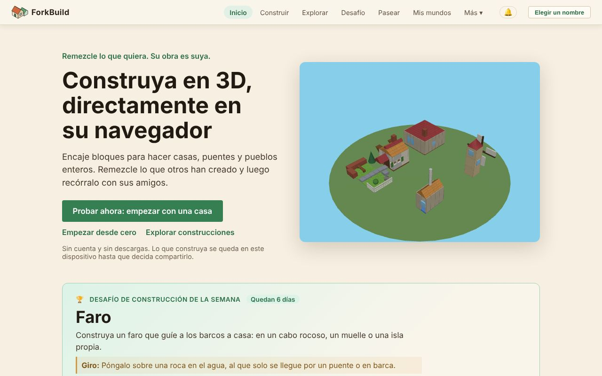
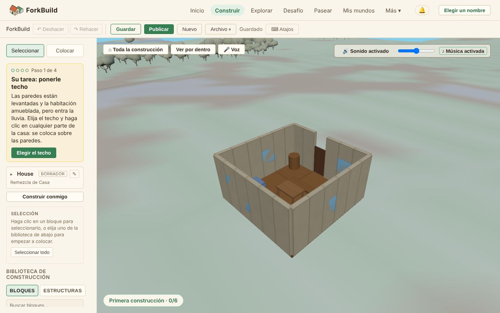

<!-- translation-of: docs/user/01-GettingStarted.md source-hash: 924941a6d98b2fef -->
# 01 — Primeros pasos

<!-- languages -->
[English](../01-GettingStarted.md) · [Deutsch](../de/01-GettingStarted.md) · **Español** · [Français](../fr/01-GettingStarted.md) · [Bahasa Indonesia](../id/01-GettingStarted.md) · [日本語](../ja/01-GettingStarted.md) · [한국어](../ko/01-GettingStarted.md) · [Português (Brasil)](../pt-BR/01-GettingStarted.md)
<!-- /languages -->

¡Bienvenido! Esta guía lo lleva de "acabo de abrir la aplicación" a "construí
algo" en unos cinco minutos. No necesita cuenta, descarga ni nombre para
empezar: todo se queda en su dispositivo hasta que decida compartirlo.

**La versión corta:**

1. En la pantalla de **Inicio**, haga clic en **Probar ahora: empezar con
   una casa**.
2. Haga clic en **Elegir el techo** y luego en la casa: el techo queda
   puesto.
3. Haga clic en **Publicar** y responda sus preguntas: un nombre con el que
   publicar (haga clic en **Publicar como …**) y **¿Quién puede
   encontrarla?**
4. Haga clic en **Entrar caminando** para recorrer su casa en el Mundo.

El resto de esta página explica cada parte, y cómo empezar en un terreno
vacío.

## Abrir ForkBuild

*La pantalla de Inicio: la barra superior, las tres formas de empezar y el desafío de construcción de la semana.*

ForkBuild funciona en cualquier navegador web actual: abra el sitio alojado
y llegará a la pantalla de **Inicio**. (Para ejecutar una copia propia,
consulte [Ejecutar su propia copia](#ejecutar-su-propia-copia) al final de
esta página.)

La pantalla de **Inicio** muestra un pequeño pueblo que gira en 3D y ofrece
tres formas de empezar:

- **Probar ahora: empezar con una casa** abre una casa ya hecha en el
  Editor como su propia copia, lista para cambiar (consulte
  [Probar ahora](02-TheEditor.md#probar-ahora-una-casa-por-terminar)).
- **Empezar desde cero** abre el Editor en un terreno vacío.
- **Explorar construcciones** abre **Explorar**, donde están las
  construcciones publicadas de todos.

En **Empiece con una construcción ya hecha**, cada tarjeta (un castillo,
una isla con puerto, una plaza de pueblo, una casa, un molino y un puente)
abre su propia copia de esa construcción de la misma manera. No se publica
ni se envía nada a ningún lado hasta que usted lo decida.

Inicio también muestra el **Desafío de construcción de la semana**: un tema
para construir, con **Unirse al desafío** (consulte
[El desafío de construcción semanal](04-PublishingAndForking.md#el-desafío-de-construcción-semanal)).
Cuando ya tiene construcciones publicadas, muestra también **Sus sellos**:
datos sobre sus propias construcciones, como **Remezclada** cuando alguien
remezcló una, **Participante** cuando participó en un desafío semanal, o
**Gran constructor** por una construcción de cien bloques o más. Se
calculan en este dispositivo y solo usted los ve: reconocimiento, nunca
puntos ni clasificación.

## Orientarse

La barra de arriba siempre está visible:

`ForkBuild  Inicio  Construir  Explorar  Desafío  Pasear  Mis mundos  Más ▾  🔔  Elegir un nombre`

| Menú | Qué abre |
|---|---|
| **Inicio** | La página de inicio |
| **Construir** | El Editor, donde construye (consulte [El Editor](02-TheEditor.md)) |
| **Explorar** | Las construcciones publicadas de todos, para abrirlas, remezclarlas o visitarlas (consulte [Publicar y remezclar](04-PublishingAndForking.md#explorar)) |
| **Desafío** | El desafío de construcción de esta semana y sus participaciones (consulte [El desafío de construcción semanal](04-PublishingAndForking.md#el-desafío-de-construcción-semanal)) |
| **Pasear** | La Vista del mundo en la plaza del desafío de esta semana, para pasear entre las participaciones de la semana alrededor de la plaza del pueblo (consulte [Vista del mundo](03-WorldView.md)) |
| **Mis mundos** | Los Mundos que visitó en este dispositivo (consulte [Mis mundos](03-WorldView.md#mis-mundos--los-mundos-que-realmente-visitó)) |
| **🔔** | Sus notificaciones: comentarios, remezclas y construcciones nuevas de personas que sigue (consulte [Orientación y ubicaciones](03-WorldView.md#orientación-y-ubicaciones)) |
| **Elegir un nombre** | Elegir el nombre con el que publica y pasea; cuando ya tiene uno, aparece aquí en su lugar (consulte [Elegir un nombre](#elegir-un-nombre)) |

**Más** abre el resto, en cuatro grupos. En un teléfono, **Menú** los
muestra todos a la vez.

- **Personal**
  - **Mi avatar**: cómo lo ven los demás en la Vista del mundo; consulte
    [Avatares y presencia](06-AvatarsAndPresence.md)
  - **Mis identidades**: los nombres (identidades) guardados en este
    dispositivo; consulte
    [Su nombre y su identidad](05-IdentityAndLogin.md)
  - **Sus datos**: hacer una copia de seguridad de todo en un archivo, o
    copiarlo a otro dispositivo; consulte [Sus datos](13-YourData.md)
- **Personas**
  - **Pares**: las personas con las que está conectado, a las que conoce o
    de las que es amigo; consulte
    [Conexiones entre pares y amigos](07-PeerConnectionsAndFriends.md)
  - **Siguiendo**: las personas de cuyas construcciones nuevas se entera;
    consulte [Seguir a personas](07-PeerConnectionsAndFriends.md#seguir-a-personas)
  - **Conversaciones**: sus mensajes directos; consulte
    [Chat y conversaciones](08-ChatAndConversations.md)
- **Avanzado**: no lo necesita para construir y compartir
  - **Publicaciones**: declaraciones firmadas de autoría y de nombres de
    lugares, dónde guardarlas y anunciarlas, y (*experimental*) su
    evidencia externa; consulte
    [Publicaciones y evidencia externa](09-PublicationsAndEvidence.md)
  - **Configuración de red**: puertas de enlace, relays, proveedores y
    servidores de conexión entre pares; consulte
    [Configuración de red](10-NetworkSettings.md)
- **Aplicación**
  - **Idioma**: el idioma en que ForkBuild se muestra en este dispositivo.
    Sigue los idiomas de su navegador hasta que elija uno; guardar recarga
    la página, así que guarde antes su trabajo. ForkBuild está en inglés,
    alemán, español, francés, indonesio (Bahasa Indonesia), japonés,
    coreano y portugués de Brasil.
  - **Aspecto**: **Auto**, **Claro** u **Oscuro**, directamente en el
    menú. Auto sigue el modo claro u oscuro de su dispositivo; Claro es el
    pueblo de día y Oscuro el mismo pueblo de noche. Cambia al instante y
    se guarda en este dispositivo.
  - **Acerca de**: información de la versión y un enlace a esta guía
  - **Instalar ForkBuild**: donde el navegador puede instalarlo (consulte
    [Instalar ForkBuild](#instalar-forkbuild))

## Colocar su primer bloque

*El Editor con la casa de Inicio abierta: sus herramientas y la Biblioteca de construcción a la izquierda, la construcción en el centro y la tarjeta Su primera construcción.*

La primera vez que abre el Editor, una tarjeta **Su primera construcción**
en una esquina de la vista 3D lo guía por seis pasos y marca cada uno a
medida que lo hace; el último es entrar caminando en su construcción
publicada. Consulte
[Su primera construcción](02-TheEditor.md#su-primera-construcción).

1. Haga clic en **Construir** en la barra superior (o en **Empezar desde
   cero** en Inicio).
2. En la barra lateral izquierda, asegúrese de que la herramienta
   **Colocar** esté activa (presione `2`).
3. En la **Biblioteca de construcción**, debajo, abra la pestaña
   **Bloques** y haga clic en un bloque; por ejemplo, **Cubo** en
   **Básicos**.
4. Mueva el ratón a la vista 3D. Un **fantasma** translúcido del bloque
   sigue la cuadrícula.
5. **Haga clic** para colocarlo.

¡Felicidades: construyó su primer bloque! 🎉

En un teléfono o una tableta, toque en lugar de hacer clic; consulte
[En un teléfono o una tableta](02-TheEditor.md#en-un-teléfono-o-una-tableta).

### Apilar bloques

No tiene que construir sobre el suelo. Pase el cursor sobre una **cara**
de un bloque existente y el fantasma se ajusta a ella: haga clic para
apilarlo encima o para unirlo al costado. Así se construyen paredes,
torres y techos.

¿Se equivocó? Presione `Ctrl+Z` (`Cmd+Z` en un Mac) para deshacerlo. Todo
cambio se puede deshacer.

## Guardar su trabajo

Presione **Ctrl+S** (o haga clic en **Guardar** en la barra de
herramientas). El indicador **● Cambios sin guardar** cambia a
**Guardado**.

Su construcción se guarda en su navegador, así que sigue ahí cuando vuelve.
Mientras edita, ForkBuild también conserva una copia de recuperación de
los cambios sin guardar, y ofrece restaurarla si la página se cierra antes
de que guarde.

> **Guarde una copia.** Sus construcciones viven solo en este navegador.
> Borrar los datos del navegador para el sitio las borra, así que haga de
> vez en cuando una copia de seguridad con **Más → Sus datos → Hacer copia
> de seguridad en un archivo** (consulte [Sus datos](13-YourData.md)).

Los navegadores limitan cuánto puede guardar cada sitio, normalmente a una
parte del disco. Si se llena la parte de ForkBuild, el guardado y la
recuperación se detienen con un mensaje que lo indica; no se pierde nada
de lo que tenga abierto. Use **Archivo → Exportar** en la barra de
herramientas para conservar una copia de la construcción como archivo. La
primera vez que guarda, algunos navegadores preguntan si ForkBuild puede
conservar sus datos de forma permanente; permitirlo evita que el navegador
los borre cuando queda poco espacio en el disco.

## Elegir un nombre

No necesita un nombre para construir ni guardar. Lo necesita para
**publicar**, porque publicar firma su construcción para que otros puedan
comprobar que de verdad es suya, y para **pasear con amigos**, para que lo
vean con ese nombre.

La primera vez que hace clic en **Publicar**, ForkBuild le pide un nombre
con el que publicar. Escriba uno y haga clic en **Publicar como …**: se
crea un nombre en este dispositivo y su construcción se publica. (Un enlace
para pasear pregunta igual, con **Pasear como …**.)

También puede elegir un nombre en cualquier momento: haga clic en **Elegir
un nombre** en la esquina superior derecha, escriba uno y haga clic en
**Continuar como …**.

ForkBuild no tiene contraseñas ni cuentas. Detrás de su nombre hay una
clave criptográfica guardada en este dispositivo, llamada **identidad**. La
clave se guarda en este navegador sin frase de contraseña hasta que
agregue una: el Editor se lo recuerda después de publicar, y **Proteger con
frase de contraseña** en **Mis identidades** agrega una en cualquier
momento. Para elegir una frase de contraseña de inmediato, haga clic en
**Protegerla ahora con una frase de contraseña** en el diálogo del nombre.

> **La frase de contraseña no se puede restablecer.** Cifra su clave en
> este dispositivo y nadie, ni siquiera ForkBuild, puede recuperarla. Elija
> una que vaya a conservar.

Cuando ya tiene un nombre, la esquina superior derecha lo muestra. Haga
clic en él para ver **Mi avatar**, **Mis identidades**, **Sus datos** y
**Cambiar de nombre**, que lista todos los nombres que ya tiene este
navegador (haga clic en uno para usarlo), crea uno nuevo o sigue con
**Seguir sin nombre**. Crear un nombre nuevo ahí también pide una **frase
de contraseña** de al menos 8 caracteres, dos veces. (Para omitirla, marque
**Crear sin frase de contraseña**; la clave se guarda entonces sin cifrar
en este navegador.) Luego haga clic en **Usar este nombre**.

Todo lo que publique, o envíe a otras personas, queda firmado con ese
nombre.

**Publicar sin nombre.** El diálogo de nombre que abre Publicar también
tiene **Publicar sin firmar**. Una construcción publicada así no tiene
autor ni firma: no recibe enlace, no se puede compartir con otras personas
y no se puede enviar a todos más tarde. Elija un nombre, salvo que solo la
quiera en su propio **Explorar**.

Qué protege una frase de contraseña, cómo bloquear y desbloquear, y cómo
hacer una copia de seguridad de su identidad se explican en
[Su nombre y su identidad](05-IdentityAndLogin.md).

## Instalar ForkBuild

ForkBuild se puede instalar como aplicación: así se abre desde la pantalla
de inicio, el dock o la lista de aplicaciones en una ventana propia, y
funciona sin conexión. Haga clic en **Instalar ForkBuild** en la pantalla
de Inicio (o en **Más**) y confirme en el diálogo del navegador. En Safari
en un iPhone o iPad, el botón explica cómo hacerlo: toque **Compartir** y
luego **Agregar a pantalla de inicio**. Donde el navegador no puede
instalar aplicaciones, o ForkBuild ya está instalado, el botón no aparece.

- **Sin conexión.** La primera vez que abre ForkBuild, el navegador guarda
  sus archivos, así que vuelve a abrirse sin conexión, instalado o no:
  Inicio, el Editor y sus construcciones guardadas y las ya hechas
  funcionan. Lo que necesita la red (encontrar construcciones y personas,
  enviar construcciones, chat y llamadas) espera a que vuelva a estar en
  línea.
- **Actualizaciones.** Cuando sale una versión nueva, una línea arriba
  dice **Hay una nueva versión de ForkBuild lista**; haga clic en
  **Volver a cargar** para iniciarla, o se inicia sola la próxima vez que
  abra ForkBuild.
- **Notificaciones.** Un ForkBuild instalado (o abierto en una pestaña en
  segundo plano) puede mostrar sus notificaciones a través de su
  dispositivo; consulte [Notificaciones en este dispositivo](03-WorldView.md#notificaciones-en-este-dispositivo).

## ¿Y ahora qué?

- Aprenda todas las herramientas de construcción en
  **[El Editor](02-TheEditor.md)**.
- ¿Listo para compartir? Vaya a
  **[Publicar y remezclar](04-PublishingAndForking.md)**.
- Pasee entre las construcciones de otras personas en la
  **[Vista del mundo](03-WorldView.md)**.
- Configure su avatar y conozca gente en
  **[Avatares y presencia](06-AvatarsAndPresence.md)** y
  **[Conexiones entre pares y amigos](07-PeerConnectionsAndFriends.md)**.
- ¿Atascado? Las **[Preguntas frecuentes](FAQ.md)** responden las dudas más
  comunes.
- O pregunte con sus propias palabras: **Ayuda**, en **Más**, responde con
  esta guía en su idioma y, una vez abierta, funciona también sin conexión.
  En el Editor, una pregunta escrita en la paleta de comandos
  (`Ctrl/Cmd+K`) ofrece **Preguntar a la guía**.

## Ejecutar su propia copia

*Para desarrolladores y quienes alojan su propia copia; no lo necesita para
usar ForkBuild.*

Para ejecutar su propia copia, sirva la carpeta por HTTP (por ejemplo,
`python3 -m http.server 8000` y luego abra <http://localhost:8000/>). Abrir
`index.html` directamente desde el disco no funciona, porque los
navegadores no cargan sus módulos desde una página `file://`.

- **Encontrar personas.** El servidor de encuentro predeterminado solo
  atiende al sitio alojado, así que una copia propia no puede usarlo para
  encontrar personas; conéctese con invitaciones o configure su propio
  servidor de encuentro (consulte
  [Conexiones entre pares y amigos](07-PeerConnectionsAndFriends.md)).
- **Instalar y usar sin conexión.** Una copia que ejecuta directamente
  desde la carpeta no se instala ni funciona sin conexión; una hecha con
  `node scripts/build.mjs` sí (consulte [Despliegue](../../Deployment.md)
  (en inglés)).
- **Traducciones.** Para agregar o mejorar un idioma, consulte
  [Translating ForkBuild](../../Translating.md) (en inglés).
