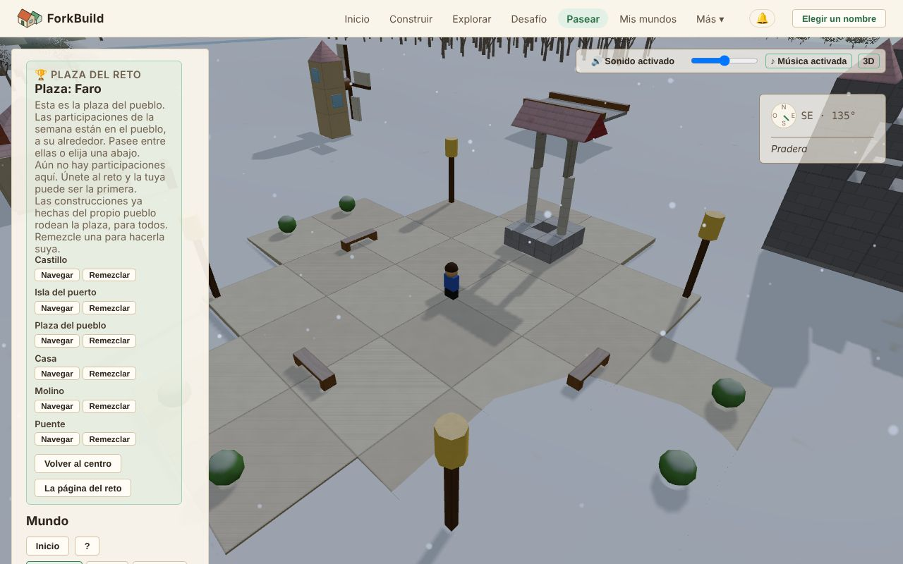

<!-- translation-of: docs/user/03-WorldView.md source-hash: b70b27623985ebf0 -->
# 03 — Vista del mundo

<!-- languages -->
[English](../03-WorldView.md) · [Deutsch](../de/03-WorldView.md) · **Español** · [Français](../fr/03-WorldView.md) · [Bahasa Indonesia](../id/03-WorldView.md) · [日本語](../ja/03-WorldView.md) · [한국어](../ko/03-WorldView.md) · [Português (Brasil)](../pt-BR/03-WorldView.md)
<!-- /languages -->

<!-- stale -->
> **Nota:** La versión en inglés de esta página cambió desde que se tradujo, así que es posible que esta traducción ya no esté actualizada. Consulte la [versión en inglés](../03-WorldView.md).
<!-- /stale -->

La Vista del mundo es el mundo 3D compartido donde **todas las
construcciones publicadas están una junto a otra**. Usted camina o vuela,
encuentra cosas, mira lo que otras personas construyeron y trae a sus
amigos.

Aquí no se construye: para eso está el Editor. Cuando quiera cambiar algo
que encontró, **Editar una copia** abre su propia copia en el Editor
(consulte [Editar una copia](#editar-una-copia--llevar-algo-al-editor)).
Los únicos cambios que hace la Vista del mundo son etiquetas, no bloques:
nombrar [Hitos](#hitos--marcar-un-lugar-que-vale-la-pena-recordar) y
regiones, y dejar en el Mundo un animal soltado como decoración, con **G**
(consulte
[Avatares y presencia](06-AvatarsAndPresence.md#decorar-un-mundo-con-un-animal)).

**La versión corta:**

| Para… | Haga esto |
|---|---|
| Llegar aquí | **Pasear** en la barra superior, o **Explorar** en cualquier construcción |
| Caminar | `W` `A` `S` `D` para moverse, `Mayús` para correr, `Espacio` para saltar (en un teléfono, el joystick) |
| Mirar alrededor | Arrastre para girar la cámara, use la rueda para hacer zoom |
| Cambiar lo que ve | **Editar una copia** abre su propia copia en el Editor |
| Empezar una construcción justo aquí | **Construir aquí** |
| Traer amigos | **Pasear aquí conmigo** crea un enlace para enviarles |
| Silenciar o activar el sonido | El botón **Sonido**, o `M` |

Todos los controles están en la [Referencia de controles](ControlsReference.md).
Las herramientas de red que hay detrás del Mundo tienen su propia página:
[Vista del mundo: herramientas avanzadas](WorldViewAdvancedTools.md).

## Abrir la Vista del mundo


*La Vista del mundo en la plaza del desafío: el panel lateral a la izquierda, su avatar en la plaza, y el sonido y la brújula arriba a la derecha.*

Hay dos formas de entrar:

- **Pasear** en la barra superior abre la Vista del mundo en la plaza del
  reto de esta semana. No necesita una construcción propia. La plaza es la
  plaza del pueblo: las seis construcciones listas la rodean, listas para
  remezclar, y justo afuera están las participaciones de la semana
  (consulte [La plaza del reto](04-PublishingAndForking.md#la-plaza-del-reto)).
- En la página **Explorar**, **Explorar** en cualquier construcción lo
  lleva justo a su lado. Abrir un enlace a un Mundo hace lo mismo.

Las construcciones que otras personas
[enviaron a todos](04-PublishingAndForking.md#quién-puede-encontrarla)
están donde las pusieron sus constructores: cada una en un lugar propio,
con espacio a su alrededor, a lo largo de una tierra amplia (consulte
[Dónde se alza una construcción](04-PublishingAndForking.md#dónde-se-alza-una-construcción)).

## Una vista de visitante, y Avanzado

La Vista del mundo se abre como vista de visitante. Lo que vino a hacer
está en una barra en la parte inferior del Mundo: **Construir aquí**,
**Pasear aquí conmigo** y, cuando la construcción no es suya, **Editar una
copia**.

El panel lateral muestra el nombre de la construcción y quién la hizo, y
luego adónde puede ir y qué hay a su alrededor. En un teléfono el panel
empieza cerrado para que el Mundo llene la pantalla; **Panel** lo abre. En
la plaza, un teléfono muestra en su lugar una línea, **Plaza: …** con
cuántas construcciones hay; tóquela para abrir el panel. Quién se dibuja,
si las teclas mueven a su avatar y las opciones de cámara están en
**Ajustes del avatar**.

Al final del panel, **Mostrar herramientas avanzadas** agrega las
herramientas para las redes que hay detrás del Mundo: coordenadas,
inspeccionar bloques, colocaciones, Encuentros en el Mundo y más. Están en
su propia página,
[Vista del mundo: herramientas avanzadas](WorldViewAdvancedTools.md). La
elección se recuerda en este dispositivo y no cambia nada para nadie más.
Todo lo de esta página funciona igual con o sin ellas.

## Volar por el mundo

- **Arrastrar con el botón izquierdo**: girar la cámara
- **Arrastrar con el botón derecho**: desplazar la cámara de lado
- **Rueda del mouse**: acercar y alejar
- **Inicio** (la tecla, o el botón del panel): volver a su propio Mundo
  (consulte [Orientación y ubicaciones](#orientación-y-ubicaciones))

Para caminar con su avatar, consulte
[Caminar con su avatar](06-AvatarsAndPresence.md#caminar-con-su-avatar).

Los Mundos cercanos **se cargan y se descargan solos** a medida que se
mueve. El panel lateral se lee de arriba abajo:

1. lo que está mirando (el encabezado);
2. adónde puede ir: **Inicio**, **Ubicaciones** y las pestañas
   **Explorar**, **Mapa** y **Lugares**;
3. qué hay a su alrededor (**Cerca**);
4. sus propias herramientas: **Buscar** y **Avatar**.

Al final, **Mundos a la vista** lista los demás Mundos cargados a su
alrededor, y **Mundos cercanos** los que puede visitar volando con un clic.

Señale algo en el Mundo y una pequeña tarjeta abajo a la derecha de la
vista le dice qué es.

### Lo que hay a su alrededor

**La tierra** es la misma para todos. El pasto, las playas, la roca, el
bosque, los campos, los lagos, los ríos y el mar siguen la forma del
terreno. La tierra del centro siempre está seca; a unas mil unidades llega
a una costa, donde el suelo baja hacia el mar profundo.

**Agua.** Los lagos se rizan con la brisa y el mar se mece con un
oleaje lento. Los ríos corren cuesta abajo por su cauce, más rápido donde
el terreno es más empinado. Nacen en manantiales burbujeantes al pie de las tierras
altas, bajan por el terreno más empinado en pequeñas cascadas y a veces
terminan en un estanque tranquilo. Se forma espuma donde las olas llegan a la
orilla y donde un río pasa por rápidos. Su avatar entra caminando en un
lago, en el mar o en un río y va más
despacio a medida que sube el agua. Cuando el agua es más profunda que la
mitad de su altura, nada, subiendo y bajando con el oleaje (consulte
[Nadar y bucear](06-AvatarsAndPresence.md#nadar-y-bucear)). Si se sumerge,
ve algas y pequeños cardúmenes de peces.

**Árboles y animales.** En el bosque crecen coníferas donde hay más
humedad y árboles de hoja ancha donde está más seco, con matorrales en el
borde de los pastizales. Los ciervos viven en el bosque y los conejos en
los pastizales. Los árboles nunca se mueven. Los animales pasean despacio
cerca de su propio lugar, se detienen a pastar y levantan la vista de vez
en cuando. Si se acerca, uno gira la cabeza para mirarlo (salvo que esté
justo detrás); un ciervo que pasta levanta la cabeza y un conejo se sienta
sobre las patas traseras. Nunca huyen ni se mueven por usted, y los demás
ven que los miran *a ellos*. Los animales le cierran el paso a pie, como
los árboles. Donde se ha construido, los animales salvajes se mantienen
lejos: uno cuyo trozo de terreno ocupa una construcción se desvanece y no
vuelve mientras la construcción siga en pie, así que ningún ciervo pasta en
un salón. Bajo un puente o un piso alto hay sitio para ellos. Quite la
construcción y el animal vuelve.

Todos los que miran el mismo lugar en el mismo momento ven la misma
tierra, los mismos peces, árboles y animales. Nada de esto se puede
editar.

Los **habitantes** son personas que viven en un Mundo. Pasean alrededor de
su casa, rodean los edificios en lugar de atravesarlos y se vuelven para
saludarlo; hable con uno y le contará qué hay cerca. A diferencia de los
animales, forman parte del Mundo: los agrega su autor. Las casas listas
traen un habitante junto a la puerta, también las que rodean la plaza del
reto. En su propia construcción, **R** quita uno. Consulte
[Habitantes](06-AvatarsAndPresence.md#habitantes).

**De noche** el Mundo se aquieta. Los animales vuelven a su propio sitio y se echan hasta la mañana; si se acerca a uno, se levanta para observarlo. Los habitantes vuelven a casa al anochecer y se quedan allí hasta el amanecer.

**Las construcciones tenues y transparentes** son construcciones que otras
personas anunciaron cerca de usted y que este dispositivo no ha aceptado.
Desaparecen de nuevo cuando sigue caminando. Consulte
[Construcciones declaradas](WorldViewAdvancedTools.md#construcciones-declaradas--las-construcciones-de-otros-donde-sus-editores-dicen-que-están).

### Dentro de una construcción

Entre por una puerta y la construcción que tiene sobre la cabeza se corta,
para que vea la habitación en la que está y no la pared que tiene detrás: su
techo y todo lo que esté más alto que su cabeza, solo de esa construcción,
mientras las paredes se mantienen hasta justo por encima de su estatura.
Con la cámara siguiéndolo, o en **Tercera persona**, la cámara también
entra, detrás y por encima de usted, mirando hacia la habitación, y sube en
lugar de atravesar una pared cuando tiene una justo detrás. **Vista de
pájaro** mira directamente hacia abajo a la habitación; **Primera persona**
la ve con sus propios ojos, sin cortar nada. Vuelva a salir y la
construcción entera se dibuja de nuevo. Solo cambia lo que se dibuja: el
techo sigue ahí, para todos y para caminar.

## Día y noche

El cielo de la Vista del mundo pasa del día a la noche y vuelve cada 40
minutos: un atardecer cálido, una noche azul y con luna, un amanecer rosado
y otra vez el día. Sigue al reloj, así que todas las personas que están en
una construcción ven el mismo cielo en el mismo momento. Al oscurecer, las
ventanas de cristal brillan con luz de lámpara y los **Faroles** se
encienden con su propio color, de modo que un faro indica el camino a puerto
y una aldea parece habitada; los pájaros callan y empiezan los grillos. La
noche nunca es tan oscura que usted no encuentre el camino. Solo la Vista
del mundo tiene noche: el Editor, las imágenes de las construcciones y las
vistas previas de enlaces siempre están a pleno día.

El sol sale por el este, cruza el cielo del sur y se pone por el oeste,
anaranjado cerca del horizonte; cuando se pone, la luna hace el mismo
recorrido durante la noche. La luz sobre las construcciones viene del que
esté en el cielo, así que las paredes que miran al este reciben la mañana y
las que miran al oeste, la tarde.

El sol y la luna proyectan sombras: la suya, la de los árboles, la de los
animales y la de cada construcción, largas por la mañana y por la tarde,
cortas a mediodía y más tenues a la luz de la luna. Caen a unos 45 metros a
su alrededor y se desvanecen un momento mientras el sol cede el cielo a la
luna y al revés. Las sombras le cuestan más a un teléfono que a un
ordenador, así que empiezan activadas con ratón y desactivadas en un teléfono
o tableta; marque o desmarque **Sombras** al final del panel para cambiarlo
en este dispositivo.

Los árboles crecen como en la naturaleza: abetos con verticilos de ramas
caídas en los bosques más húmedos, árboles de hoja ancha con ramas que se
bifurcan y copas redondeadas donde es más seco, y matorral bajo y retorcido
en los bordes de la pradera. De cerca se ve cada rama y cada hoja; se mecen
con el viento, más cuando se acerca una tormenta, y proyectan sombras
moteadas. Más lejos se convierten en formas más sencillas, para que hasta un
bosque entero se recorra con fluidez. En un teléfono o una tableta los
árboles empiezan más sencillos; marque **Árboles detallados**, justo debajo
de **Sombras**, para ver cada hoja en este dispositivo.

De noche, a medida que oscurece, salen las estrellas, con la Vía Láctea
cruzándolas, y se apagan de nuevo al amanecer. Todo el cielo estrellado gira
despacio alrededor de un punto alto en el norte, así que las estrellas salen
por el este y se ponen por el oeste con la luna, y todos ven las mismas
estrellas en el mismo momento.

La luna pasa por sus fases, una cada noche: de una luna nueva oscura a un
fino creciente, una media luna y una luna gibosa hasta la luna llena, y de
vuelta, cada ocho días de la Vista del mundo (algo más de cinco horas). Una
luna creciente está iluminada por su lado oeste, y una menguante por su lado
este. La fase también cambia la noche: con luna llena la noche es un poco
más clara y las sombras más nítidas; cerca de la luna nueva la luz es más
suave, el cielo de un azul más profundo, y las estrellas y la Vía Láctea
brillan más que nunca. Como el resto del cielo, todos ven la misma luna en
el mismo momento, y nunca está tan oscuro como para que cueste ver las
construcciones.

Las nubes vienen y van, las mismas para todos en el mismo momento. Casi
siempre pasan unas pocas nubes blancas; de vez en cuando el cielo se nubla, y
a veces se vuelve gris y cubierto, con una luz más suave y sombras más
tenues. Nunca oscurece tanto como para que cueste ver las construcciones.

De vez en cuando un cielo cubierto trae lluvia, durante unos minutos cada
vez. La ve caer a su alrededor y formar anillos donde las gotas caen sobre un
lago, el mar o un río, y la oye, mientras los pájaros y los insectos se
callan. Si entra en una construcción, dentro no llueve: oye la lluvia
repiquetear en el tejado y la ve seguir cayendo fuera. Con la lluvia, el
suelo y las construcciones se oscurecen y brillan, y se secan en unos minutos
cuando para. Los chaparrones más fuertes traen a veces una tormenta suave: de vez en cuando un relámpago ilumina un poco el cielo y unos segundos después retumba un trueno lejano. Si su dispositivo pide reducir el movimiento, los relámpagos no destellan. La lluvia es solo
para ver y oír: los ríos no crecen y usted camina
igual de rápido.

Si prefiere que siempre sea de día, marque **Siempre de día** al final del
panel, justo encima de **Sombras**. Así el cielo también
queda despejado. Se recuerda en este dispositivo y no cambia nada para nadie más.

## Estaciones

El mundo pasa por cuatro estaciones, cada una de ocho días de World View (algo
más de cinco horas), una por cada vuelta de la luna:

- **Primavera**: los árboles florecen en rosa y blanco y se cubren de hojas
  nuevas de un verde claro; las flores silvestres salpican la hierba y los
  pétalos caen entre los árboles.
- **Verano**: todo está verde y frondoso, la fruta madura en algunos árboles y
  los campos se vuelven dorados.
- **Otoño**: las hojas se vuelven rojas, naranjas y amarillas, cada árbol a su
  tiempo, y caen a su alrededor mientras los árboles se quedan desnudos; los
  campos se cosechan.
- **Invierno**: los árboles quedan desnudos, la hierba se apaga y, cuando el
  cielo se nubla, nieva en lugar de llover. La nieve se posa en manchas que se
  juntan en un manto blanco, cubre tejados y copas (nunca las paredes, ni el
  interior de la construcción en la que está) y se derrite en primavera. Los
  pájaros cantan menos y los insectos desaparecen.

El paisaje cambia un poco cada día en lugar de todo de golpe, y todos ven la
misma estación en el mismo momento. Las coníferas siguen verdes todo el año.
Para mantener una estación en su dispositivo, elíjala en **Estación**, cerca del
final del panel, justo debajo de **Árboles detallados**; **El año del mundo** vuelve a
seguir al mundo. Con **Siempre de día** activado, las estaciones siguen
cambiando, bajo un cielo despejado.

El sol también sigue las estaciones. En verano sube alto y los días son
largos; en invierno se queda bajo, proyecta sombras largas y la noche llega
antes. En pleno invierno los lagos se hielan lo bastante como para cruzarlos
a pie (el mar y los ríos nunca); mientras el hielo aún se forma, o se rompe
al final del invierno, no lo aguantará. Todos ven el mismo hielo en el mismo
momento, sea cual sea la estación que mantengan. La nieve cruje bajo los pies
y el hielo suena seco, y al caminar por la nieve su avatar deja huellas que
se borran al cabo de un minuto. Solo usted ve sus huellas.

## Sonido

**Controles**, arriba a la derecha de la vista (abajo a la derecha en un
teléfono):

- **Sonido**, o `M`: todo el sonido apagado o encendido.
- El control deslizante: el volumen. En un teléfono o tableta, use los
  botones de volumen del dispositivo.
- **♪ Música**: solo la música, apagada o encendida.
- **3D**: cambiar entre sonido 3D y **Estéreo** simple.

El sonido empieza con su primer clic, toque o tecla (los navegadores lo
exigen) y se pausa mientras la pestaña está oculta. Estas opciones se
recuerdan en este dispositivo, en la Vista del mundo y en el Editor.

**Lo que oye:**

- **La tierra a su alrededor**: viento en terreno alto y rocoso, cantos de
  pájaros en el bosque, grillos en los campos, agua que golpea la orilla de
  un lago, un río que corre. Los árboles susurran o suspiran con el viento,
  más fuerte cuanto más cerca están. Los sonidos se funden cuando pasa de
  un tipo de tierra a otro.
- **Su avatar**: pasos que cambian con el suelo (pasto, hojas, arena,
  piedra, agua, bloques), un silbido al saltar y un golpe al caer.
- **Vehículos**: ruedas o el quemador de un globo, más fuerte cuanto más
  rápido va; sonidos al subir y bajar; y frenos que chirrían si se detiene
  de golpe.
- **Animales y habitantes**: un ciervo resopla y un conejo golpea con la
  pata cuando levanta la vista o se asusta; atrapar y soltar uno tiene su
  propio sonido. Los habitantes tararean al saludarlo y murmuran al hablar.
  Todos oyen al mismo ciervo levantar la vista en el mismo momento.
- **Otras personas**: sus pasos, saltos y vehículos, desde donde están,
  siempre que usted las vea. Oculte los otros avatares y se quedan en
  silencio. Los vehículos se oyen hasta a 40 m, solo los tres más
  cercanos.
- **Sus propios cambios**: nombrar un hito o una región, agregar o quitar
  un habitante, decorar con un animal, y deshacer y rehacer suenan breve,
  como en el Editor. Los cambios de los demás son silenciosos.

Los sonidos vienen de donde están: delante o detrás, arriba o abajo, a la
izquierda o a la derecha, y giran cuando gira la cámara. Los auriculares
ayudan. **Estéreo** reproduce simplemente izquierda y derecha, lo que puede
ir mejor con un dispositivo lento o con parlantes.

La **música** suena suave por debajo: una melodía tranquila que su
navegador inventa sobre la marcha, cálida de día y más lenta al
anochecer, con pausas silenciosas entre piezas. Nunca suena dos veces
igual.

Todo el sonido se genera en su navegador: no se descarga nada y no se
envía nada. Los navegadores de los demás generan el sonido de sus pasos a
partir de lo que ya ven de usted caminando.

## Orientación y ubicaciones

La **brújula** flota arriba a la derecha de la vista. Muestra el norte, el
este, el sur y el oeste, hacia dónde mira en grados y pequeños puntos para
construcciones, personas e hitos cercanos. Señale un punto para ver su
nombre, o lea la lista bajo la brújula, que también nombra el lugar donde
está. La brújula solo muestra; nunca mueve la cámara.

Una fila de botones arriba en el panel le ayuda a moverse:

- **Inicio** lo lleva, con cámara y avatar, de vuelta a su propio Mundo: el
  que tiene abierto, o el último que miró. Llega justo al lado, por lejos
  que haya ido. Si todavía no estuvo en un Mundo propio, Inicio lo lleva al
  centro del mapa.
- **Ubicaciones** lista todos los lugares que la Vista del mundo conoce
  hasta ahora, agrupados en **Mundo**, **Estructuras**, **Hitos** y
  **Lugares**. **Enfocar** en una fila mueve la cámara allí y nada más.
- **👥 N en línea** cuenta quién está aquí; haga clic para ver a los
  miembros del Mundo. Si el Mundo tiene una sala pública, le sigue un botón
  **Sala**.
- **?** muestra los controles de cámara y de caminar; haga clic otra vez
  para ocultarlos.

**Notificaciones** es el botón 🔔 en el encabezado de la aplicación, junto
a su nombre (o **Elegir un nombre**), así que está en todas las páginas.
Abre su **Historial de notificaciones**, lo más reciente primero. Recibe
una notificación cuando:

- alguien comenta una construcción que usted publicó (consulte
  [Comentarios](09-PublicationsAndEvidence.md#comentarios));
- alguien a quien sigue publica algo nuevo (consulte
  [Seguir a personas](07-PeerConnectionsAndFriends.md#seguir-a-personas));
- alguien remezcla una de sus construcciones (consulte
  [Recuentos de remezclas](04-PublishingAndForking.md#recuentos-de-remezclas));
- alguien publica, después de usted, una construcción que se parece mucho a
  una de las suyas (consulte
  [Construcciones parecidas publicadas antes](04-PublishingAndForking.md#construcciones-parecidas-publicadas-antes)).

Cada una dice qué pasó y cuándo. **Explorar** lo lleva al Mundo de esa
construcción. Es una lista sencilla, no una bandeja de entrada: nada se
marca como leído, nada se descarta y el botón no muestra ningún número. Se
carga cuando la abre; **Actualizar** la vuelve a cargar. Pertenece a su
nombre, no al Mundo que tiene abierto.

### Notificaciones en este dispositivo

Arriba en el panel, **Avisarme en este dispositivo** deja que su
dispositivo muestre estas notificaciones por sí mismo, como cualquier
aplicación. El navegador le pide permiso; **Desactivar** lo detiene.

Aparecen mientras ForkBuild está abierto pero no delante: en otra pestaña,
o como [aplicación instalada](01-GettingStarted.md#instalar-forkbuild) en
segundo plano. Al hacer clic en una, ForkBuild se abre en esa construcción.
No se envía nada a ninguna parte para esto, así que un ForkBuild cerrado no
muestra nada; lo que llegó mientras tanto está en la lista la próxima vez.
Solo aparecen unas pocas a la vez; el resto espera en la lista. Si el
navegador las bloquea, el panel lo dice: permita las notificaciones de
ForkBuild en la configuración del sitio del navegador.

### Decir adónde ir (voz)

Presione `V`, o **🎤 Voz** junto a **Inicio**, y diga adónde ir o qué hacer.
Presione `V` (o **Detener**) cuando termine:

- *llévame al viejo molino*, o solo el nombre de un lugar: la cámara va
  allí, como **Enfocar** en **Ubicaciones**. Se puede nombrar cualquier
  lugar de **Ubicaciones** y, en una plaza del desafío, también sus
  construcciones.
- *a casa*: lo mismo que **Inicio**.
- *primera persona*, *tercera persona*, *vista de pájaro*, *cámara libre*:
  las vistas de cámara del panel de avatar.
- *silencio*, *activa el sonido*.
- *deshacer*, *rehacer*: como `Ctrl+Z` y `Ctrl+Y`.
- *habla con*: lo mismo que `T` junto a un residente.

Cualquier otra cosa se ofrece a la guía con **Preguntar a la guía**. La voz
aquí es la misma que en el Editor (vea
[Decir un comando](02-TheEditor.md#decir-un-comando-voz)): se activa una vez
para ambos, se entiende en su dispositivo, y el mundo sigue moviéndose
mientras averigua lo que dijo.

### Explorar, Mapa y Lugares — tres formas de recorrer, nunca a la vez

Debajo de los botones hay tres pestañas. Solo una está abierta, y cambiar
de pestaña solo cambia lo que muestra el panel.

- **Explorar** (la predeterminada) muestra quién está aquí y algunos
  lugares para visitar, y luego **Cerca**: **Lugares**, **Hitos** y
  **Personas** a su alrededor, cada uno con su distancia y un botón **Ir**.
  Los grupos vacíos se ocultan. Haga clic en el título de un grupo para
  plegarlo o desplegarlo; la Vista del mundo recuerda cuáles dejó abiertos.
  Las herramientas avanzadas agregan tres grupos más (consulte
  [Vista del mundo: herramientas avanzadas](WorldViewAdvancedTools.md)).
- **Mapa** muestra el [Mapa del mundo](#el-mapa-del-mundo).
- **Lugares** lista los [lugares geográficos](#lugares-geográficos).

### Información — ¿qué estoy mirando?

Junto a la mayoría de los botones **Ir**, en Cerca y en **Ubicaciones**,
hay un botón **Información**. **Ir** mueve su cámara allí. **Información**
le cuenta del lugar sin moverse: qué es, a qué distancia está y en qué
lugar con nombre se encuentra (“Está en Aldea de los Sauces”) o cerca de
cuál (“Está cerca de Aldea Kawahara”).

Desde el panel de información puede:

- **Ir**: viajar allí;
- **Mostrar en el mapa**: verlo en el Mapa del mundo;
- **Nombres** (para un lugar con nombre): ver cómo lo llama la gente, o
  publicar un nombre;
- **Editar una copia**: abrir su propia copia en el Editor (vea abajo).

### Editar una copia — llevar algo al Editor

**Editar una copia** es la forma de cambiar algo que encontró en la Vista
del mundo. Hace su propia copia independiente de la construcción y la abre
en el Editor, lista para seguir construyendo. El original nunca se toca.

La encontrará:

- en la barra de la parte inferior del Mundo, cuando la construcción que
  visita no es suya: copia toda la construcción;
- en el panel **Información** de una región, un hito o una estructura
  colocada;
- con las herramientas avanzadas, al hacer clic en un bloque, en suelo
  vacío o en una estructura colocada (consulte
  [Inspeccionar un bloque](WorldViewAdvancedTools.md#inspeccionar-un-bloque--o-una-estructura-colocada)).

Lo que se copia depende de lo que eligió:

- Para un **hito**, una **región**, un **bloque** o **suelo vacío**,
  obtiene el Mundo al que pertenecen.
- Para una **estructura colocada**, obtiene esa estructura, no el Mundo
  donde está.

ForkBuild le avisa en cuanto su copia está lista (consulte
[Publicar y remezclar](04-PublishingAndForking.md)). Si no se puede hacer
la copia, un diálogo **No se puede hacer una copia** dice por qué,
normalmente porque la licencia de la construcción no permite copias o
porque todavía no se puede obtener la construcción, y **Volver a la
construcción** lo devuelve adonde estaba (consulte
[Cuando una remezcla no se puede completar](04-PublishingAndForking.md#cuando-una-remezcla-no-se-puede-completar)).

Un **lugar geográfico** y una **persona** no tienen Editar una copia. Un
lugar geográfico está hecho de las regiones de varias personas, así que no
hay una sola construcción que copiar; abra una de sus regiones.

Editar una copia es lo mismo que **Remezclar** en Explorar y en la página
de un autor, con las mismas reglas de licencia (consulte
[Remezclar: hágalo suyo](04-PublishingAndForking.md#remezclar-hágalo-suyo)).
Todo lo demás en la Vista del mundo, como Buscar, la brújula, el Mapa e
Información, solo mira.

### Construir aquí — empezar una construcción para este lugar

**Construir aquí**, junto a **Inicio**, empieza en el Editor una
construcción nueva y vacía para el lugar donde está su avatar (o, si
vuela, el lugar bajo la cámara). El Editor dice para qué Mundo es.

Cuando la publica, la construcción queda justo en ese lugar, en vez de en
un terreno libre que elige ForkBuild. **Ir a verla** lo trae de vuelta
para mirarla. **Olvidar este lugar**, en el Editor, deja que ForkBuild la
coloque como siempre.

El lugar es solo una nota suya, guardada en este dispositivo y en sus
copias de seguridad. No reclama el terreno, y otros también pueden
construir allí (consulte
[¿Por qué dos construcciones pueden estar en el mismo lugar?](WorldViewAdvancedTools.md#por-qué-dos-construcciones-pueden-estar-en-el-mismo-lugar)).

### Pasear aquí conmigo — traer a sus amigos a este Mundo

**Pasear aquí conmigo**, junto a **Construir aquí**, crea un enlace que
trae a sus amigos al Mundo donde está, para pasear juntos. Envíelo como
quiera, o deje que escaneen su código QR con un teléfono.

Un amigo que lo abre elige un nombre si aún no tiene uno (cada uno camina
con su propio avatar), hace clic en **Unirse** y llega a este Mundo. Se
ven caminando. El diálogo muestra quién está en camino y quién ya llegó.

- Primero el Mundo tiene que estar publicado: el ForkBuild de su amigo
  comprueba su firma y su construcción, como con un enlace compartido, y
  guarda una copia.
- El enlace sirve 30 minutos para cualquiera que lo abra, mientras usted
  siga en la Vista del mundo. Cerrar el diálogo no lo detiene; **Detener el
  enlace** sí. Quienes ya se unieron siguen conectados de todos modos.
- Unirse conecta sus dos dispositivos directamente, como una invitación en
  **Pares**. Cada uno puede ver la dirección IP del otro, y sus avatares se
  muestran según lo permita la **Visibilidad de la presencia** de cada uno
  (consulte
  [Quién puede verlo](06-AvatarsAndPresence.md#quién-puede-verlo-dos-opciones-independientes)).
  Nadie pasa a ser un par conocido ni un amigo a menos que usted lo elija.
- Necesita un servidor de encuentro. El sitio oficial tiene uno; una copia
  que usted mismo ejecuta necesita el suyo (consulte
  [Conexiones entre pares y amigos](07-PeerConnectionsAndFriends.md)).

### La plaza del reto

**Recorrer la plaza** en la página de un reto semanal, o **Pasear** en la
barra superior, abre la Vista del mundo en la plaza del pueblo:
empedrada, con un pozo, bancos y faroles, y las seis construcciones listas
alrededor.

La plaza y las construcciones listas forman parte del Mundo, como sus
colinas y árboles. Están allí para todos, y no son de nadie. Las
participaciones de la semana están justo afuera, y solo las de esa semana:
abra la plaza de la semana pasada y verá las participaciones de la semana
pasada. Un panel lista las entradas de la semana y las
construcciones listas (consulte
[La plaza del reto](04-PublishingAndForking.md#la-plaza-del-reto)). No
crecen árboles alrededor de la plaza, y en ella no hay **Construir aquí**.

### Hitos — marcar un lugar que vale la pena recordar

Un **hito** es un punto con nombre que usted pone en un Mundo, como
“Puente viejo” o “Gran vista”, con una descripción si quiere. Se coloca
exactamente donde está su avatar.

Cuando puede editar el Mundo en el que está, la parte de Hitos de
**Ubicaciones** tiene un botón **+ Agregar hito**. Póngale un título, y una
descripción si quiere, y haga clic en **Colocar aquí**. Aparece de
inmediato para usted, y momentos después para todos los que editan el
mismo Mundo: en la brújula, en **Ubicaciones** y como lugar adonde ir.

Los hitos pertenecen al Mundo, no a usted. Cualquiera que pueda editar el
Mundo puede renombrar, cambiar o quitar cualquier hito, sin importar quién
lo hizo.

### El Mapa del mundo

La pestaña **Mapa** muestra el Mundo desde arriba: lugares con nombre,
hitos, construcciones, las personas que están aquí y un marcador para
usted. Muestra todo lo que la Vista del mundo conoce hasta ahora, de una
vez.

- Use la rueda, o **+** y **−**, para hacer zoom.
- Arrastre un espacio vacío para mover el mapa.
- Haga clic en un lugar o una persona para mover su cámara allí.

Mirar el mapa nunca cambia nada.

### Lugares geográficos

Un **lugar geográfico** es una zona que varias personas nombraron o
describieron como región, cada una por su cuenta, y que resulta ser más o
menos el mismo terreno. La pestaña **Lugares** lista los que la Vista del
mundo ha encontrado hasta ahora.

Haga clic en uno para ver cuántas descripciones y Mundos abarca, sus
**Nombres de la comunidad**, e **Ir al lugar** y **Mostrar en el mapa**.
**← Volver** (o Escape) vuelve a la lista. Si cambia de pestaña y regresa,
encuentra la misma pantalla que dejó.

Los **Nombres de la comunidad** de un lugar muestran sus nombres
principales; **Más nombres** muestra la lista completa por orden. Debajo
puede publicar un nombre propio. Todo lo demás (otras descripciones del
lugar, el historial completo de nombres, importar y exportar) está plegado
en **Más**.

Publicar un nombre se lo dice a las personas con las que está conectado,
igual que declarar que usted hizo una construcción. Para ver todos los
nombres y declaraciones que este dispositivo publicó o conoció, consulte
[Registros firmados y evidencia externa](09-PublicationsAndEvidence.md).

## Mis mundos — los Mundos que realmente visitó

**Mis mundos**, en la barra superior, lista todos los Mundos en los que
estuvo en este dispositivo, el más reciente primero, con su título, su
autor y cuántas construcciones e hitos tiene. **Seguir explorando** lo
vuelve a llevar adentro. Solo este dispositivo guarda la lista, y nadie más
la ve.

¿Todavía no estuvo en ninguno? **Abra Explorar** para encontrar un Mundo o
empezar desde una construcción lista.

**Construcciones que ayudó a hacer** lista las construcciones en las que un
amigo le dio crédito cuando construyeron juntos con **Construir conmigo**
(consulte [El Editor](02-TheEditor.md#construir-conmigo-construir-juntos-en-vivo)).
Cada una muestra su título y **con** el nombre de su amigo, que abre su
página. Dice **Aún sin publicar** hasta que su amigo la publica; entonces
su título abre su Mundo. Sus otros dispositivos también las listan, una
vez conectados a este. La sección solo aparece cuando tiene algo.

## Encontrar mundos

Hay dos formas de buscar algo, y cada una responde a una pregunta
distinta.

### Buscar — “¿qué publicaciones coinciden?”

**Buscar** busca un **título o autor** en todo lo publicado, no solo en lo
que está cargado a su alrededor. Escriba una palabra y haga clic en
**Buscar**. Cada resultado muestra dónde está (📍); haga clic en
**Enfocar** para volar allí.

Un resultado puede decir que su posición es una **posición
predeterminada**: su autor nunca eligió un lugar, así que ForkBuild la
muestra en uno. Con las herramientas avanzadas también puede buscar por
posición (consulte
[Vista del mundo: herramientas avanzadas](WorldViewAdvancedTools.md)); los
resultados muestran entonces a qué distancia están (📏).

### Explorar aquí / ¿Qué hay aquí? — “¿qué hay a mi alrededor ahora mismo?”

Estos dos botones, arriba en **Cerca** dentro de Explorar, miran
**alrededor de donde está su cámara**. No necesita un título ni
coordenadas.

- **Explorar aquí** mira una zona amplia. Después puede ampliarla o
  reducirla.
- **¿Qué hay aquí?** mira solo justo donde está.

Los dos abren el diálogo **Explorar ubicación**:

```
📍 Centro: 100.0, 50.0, 250.0
⭕ Radio: 25 unidades del Mundo

Se muestran 3 de 3 construcciones que se pueden encontrar

📍 Ayuntamiento         📏 A 4.2 unidades del Mundo
de alicia
[Enfocar] [Seleccionar] [Inspeccionar]
```

Cada resultado tiene tres botones:

| Botón | Qué hace |
|---|---|
| **Enfocar** | Vuela allí y la convierte en la construcción a la que se aplica su próximo cambio |
| **Seleccionar** | La convierte en la construcción a la que se aplica su próximo cambio, sin moverse |
| **Inspeccionar** | Muestra su título, autor, estado, posición y propietario, sin moverse |

El diálogo por sí mismo nunca mueve, cambia ni publica nada.

## La Vista del mundo es de solo lectura — se construye en el Editor

Hacer clic, arrastrar o pulsar una tecla en la Vista del mundo nunca
cambia un bloque. Aquí no hay herramientas de construcción. Para construir
sobre algo, use
**[Editar una copia](#editar-una-copia--llevar-algo-al-editor)** y siga en
[el Editor](02-TheEditor.md). Los únicos cambios que hace la Vista del
mundo son las etiquetas que se mencionan al principio de esta página.

## Ver a otros colaboradores

Cuando hay otras personas en el mismo Mundo:

- **Las ve**: sus avatares, con su nombre y lo que están haciendo
  (“**Beto: explorando cerca**”).
- **Ve sus cambios en cuanto ocurren**: un hito, un nombre, una copia
  propia nueva.
- **Una breve lista de actividad** en el panel muestra lo que cambió hace
  poco, incluso fuera de la vista. Solo se conserva mientras está aquí.

Ver a las personas nunca cambia nada por sí mismo. Solo un cambio real lo
hace: uno hecho en el Editor, o una de las etiquetas que permite la Vista
del mundo.

## Guardar y publicar también aquí

Cuando trabaja en una construcción, el encabezado tiene **Guardar**,
**Publicar** y **Editar metadatos**, así que puede guardarla y compartirla
sin salir. La línea de estado dice cuál es: **🔒 Publicado** o
**✎ Editando su copia**.

Una construcción publicada nunca cambia. Si la construcción en la que está
es publicada, su primer cambio aquí (sus datos, un hito o una región, o un
animal como decoración) crea su propia copia, titulada *“Remezcla de
&lt;nombre original&gt;”*. Un breve aviso se lo dice (“Se creó su propia
copia editable: … no cambió”). Se aplican las mismas reglas de licencia
que a cualquier remezcla (consulte
[Publicar y remezclar](04-PublishingAndForking.md#remezclar-hágalo-suyo)).

## Historial — previsualizar y restaurar estados anteriores

Cada cambio que hace aquí, como agregar, renombrar o quitar un hito o una
región, queda en el historial de la construcción. Haga clic en
**Historial** en el encabezado para ver una lista numerada con horas, así:

```
1. Crear hito “Puente viejo”
2. Actualizar región “Aldea de los Sauces”
3. Quitar hito
```

Los pasos que deshizo se marcan como **Deshecho**. Hacer clic en un paso
solo lo elige; no cambia nada hasta que presione un botón:

- **Vista previa** muestra el Mundo como estaba *justo después* de ese
  paso, junto al actual, sin cambiar nada. **Cancelar vista previa**
  vuelve.
- **Restaurar** vuelve a ese paso. No pregunta antes, pero deja el cambio
  sin guardar, así que todavía puede decidir si guardarlo.
- **Cerrar** cierra la lista.

## ¿Y ahora qué?

¿Listo para compartir lo que hizo, o para remezclar el trabajo de otra
persona? Siga con **[Publicar y remezclar](04-PublishingAndForking.md)**.
Para las herramientas de red que hay detrás del Mundo, consulte
**[Vista del mundo: herramientas avanzadas](WorldViewAdvancedTools.md)**.
