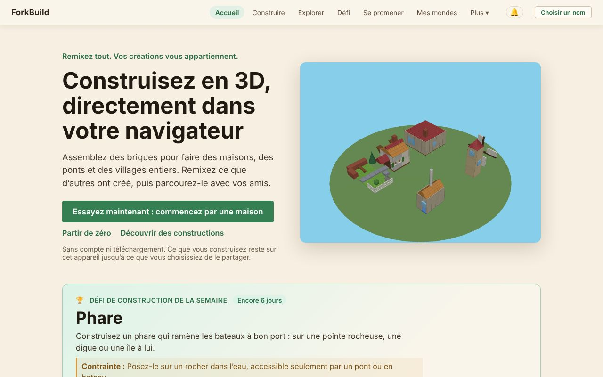
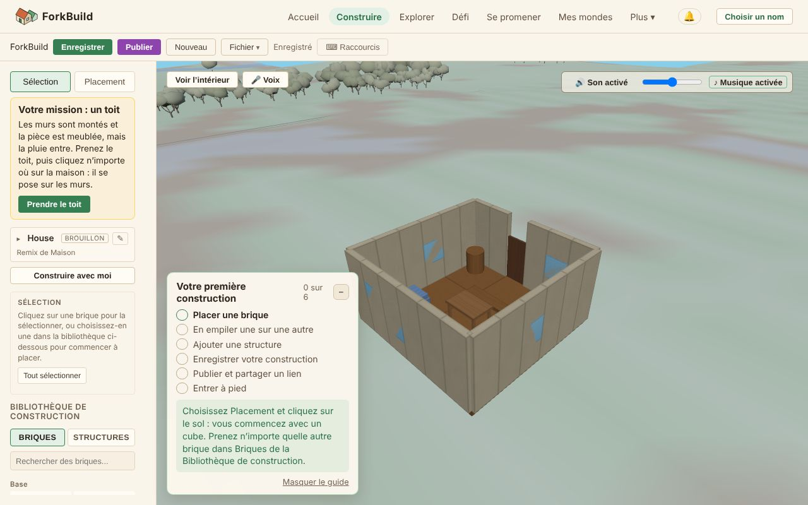

<!-- translation-of: docs/user/01-GettingStarted.md source-hash: 170440c7f3266fb3 -->
# 01 — Premiers pas

<!-- languages -->
[English](../01-GettingStarted.md) · [Deutsch](../de/01-GettingStarted.md) · [Español](../es/01-GettingStarted.md) · **Français** · [Bahasa Indonesia](../id/01-GettingStarted.md) · [日本語](../ja/01-GettingStarted.md) · [한국어](../ko/01-GettingStarted.md) · [Português (Brasil)](../pt-BR/01-GettingStarted.md)
<!-- /languages -->

Bienvenue ! Ce guide vous emmène de « je viens d’ouvrir l’application » à
« j’ai construit quelque chose » en cinq minutes environ. Pas besoin de
compte, de téléchargement ni de nom pour commencer : tout reste sur votre
appareil jusqu’à ce que vous choisissiez de le partager.

**La version courte :**

1. Sur l’écran d’**Accueil**, cliquez sur **Essayez maintenant : commencez
   par une maison**.
2. Cliquez sur **Prendre le toit**, puis sur la maison : le toit se pose.
3. Cliquez sur **Publier** et répondez à ses questions : un nom sous lequel
   publier (cliquez sur **Publier en tant que …**), et **Qui peut la
   trouver ?**
4. Cliquez sur **Entrer à pied** pour parcourir votre maison dans le Monde.

La suite de cette page explique chaque étape, et comment partir d’un
terrain vide à la place.

## Ouvrir ForkBuild

*L’écran d’Accueil : la barre du haut, les trois façons de commencer et le défi de construction de la semaine.*

ForkBuild fonctionne dans n’importe quel navigateur web récent : ouvrez le
site hébergé et vous arrivez sur l’écran d’**Accueil**. (Pour faire tourner
votre propre copie, voir
[Faire tourner votre propre copie](#faire-tourner-votre-propre-copie) à la
fin de cette page.)

L’écran d’**Accueil** montre un petit village qui tourne en 3D et propose
trois façons de commencer :

- **Essayez maintenant : commencez par une maison** ouvre une maison toute
  prête dans l’Éditeur, comme votre propre copie, prête à modifier (voir
  [Essayez maintenant](02-TheEditor.md#essayez-maintenant--une-maison-à-finir)).
- **Partir de zéro** ouvre l’Éditeur sur un terrain vide.
- **Découvrir des constructions** ouvre **Explorer**, où se trouvent les
  constructions publiées de tout le monde.

Sous **Partir d’une construction toute prête**, chaque carte (un château,
une île portuaire, une place de village, une maison, un moulin et un pont)
ouvre de la même façon votre propre copie de cette construction. Rien n’est
publié ni envoyé nulle part tant que vous ne le décidez pas.

L’Accueil montre aussi le **Défi de construction de la semaine** : un thème
à construire, avec **Participer au défi** (voir
[Le défi de construction hebdomadaire](04-PublishingAndForking.md#le-défi-de-construction-hebdomadaire)).
Une fois que vous avez publié des constructions, il montre aussi **Vos
tampons** : des faits sur vos propres constructions, comme **Remixée**
quand quelqu’un en a remixé une, **Challenger** quand vous avez participé à
un défi hebdomadaire, ou **Grand bâtisseur** pour une construction de cent
briques ou plus. Ils sont calculés sur cet appareil et montrés à vous
seul : de la reconnaissance, jamais des points ni un classement.

## Se repérer

La barre du haut est toujours visible :

`ForkBuild  Accueil  Construire  Explorer  Défi  Se promener  Mes mondes  Plus ▾  🔔  Choisir un nom`

| Menu | Ce qu’il ouvre |
|---|---|
| **Accueil** | La page d’accueil |
| **Construire** | L’Éditeur, où vous construisez (voir [L’Éditeur](02-TheEditor.md)) |
| **Explorer** | Les constructions publiées de tout le monde, à ouvrir, remixer ou visiter (voir [Publier et remixer](04-PublishingAndForking.md#explorer)) |
| **Défi** | Le défi de construction de la semaine et ses participations (voir [Le défi de construction hebdomadaire](04-PublishingAndForking.md#le-défi-de-construction-hebdomadaire)) |
| **Se promener** | La Vue du Monde sur la place du défi de la semaine, pour se promener parmi les participations de la semaine autour de la place du village (voir [La Vue du Monde](03-WorldView.md)) |
| **Mes mondes** | Les Mondes que vous avez visités sur cet appareil (voir [Mes mondes](03-WorldView.md#mes-mondes--les-mondes-où-vous-êtes-vraiment-allé)) |
| **🔔** | Vos notifications : commentaires, remix et nouvelles constructions des personnes que vous suivez (voir [Orientation et emplacements](03-WorldView.md#orientation-et-emplacements)) |
| **Choisir un nom** | Choisir le nom sous lequel vous publiez et vous promenez ; une fois que vous en avez un, il s’affiche ici à la place (voir [Choisir un nom](#choisir-un-nom)) |

**Plus** ouvre le reste, en quatre groupes. Sur un téléphone, **Menu** les
montre tous à la fois.

- **Vous**
  - **Mon avatar** — comment les autres vous voient dans la Vue du Monde,
    voir [Avatars et présence](06-AvatarsAndPresence.md)
  - **Mes identités** — les noms (identités) enregistrés sur cet appareil,
    voir [Votre nom et votre identité](05-IdentityAndLogin.md)
  - **Vos données** — tout sauvegarder dans un fichier, ou le copier vers
    un autre appareil, voir [Vos données](13-YourData.md)
- **Personnes**
  - **Pairs** — les personnes avec qui vous êtes connecté, que vous
    connaissez ou dont vous êtes ami, voir
    [Connexions entre pairs et amis](07-PeerConnectionsAndFriends.md)
  - **Abonnements** — les personnes dont vous apprenez les nouvelles
    constructions, voir
    [Suivre des personnes](07-PeerConnectionsAndFriends.md#suivre-des-personnes)
  - **Conversations** — vos messages directs, voir
    [Chat et conversations](08-ChatAndConversations.md)
- **Avancé** — inutile pour construire et partager
  - **Publications** — revendications signées de paternité et de noms de
    lieux, où les stocker et les annoncer, et (*expérimental*) leurs
    preuves externes, voir
    [Publications et preuves externes](09-PublicationsAndEvidence.md)
  - **Paramètres réseau** — passerelles, relais, fournisseurs et serveurs
    de connexion entre pairs, voir [Paramètres réseau](10-NetworkSettings.md)
- **Application**
  - **Langue** — la langue dans laquelle ForkBuild s’affiche sur cet
    appareil. Elle suit les langues de votre navigateur jusqu’à ce que vous
    en choisissiez une ; enregistrer recharge la page, alors enregistrez
    d’abord votre travail. ForkBuild existe en anglais, allemand, espagnol,
    français, indonésien (Bahasa Indonesia), japonais, coréen et portugais
    du Brésil.
  - **Apparence** — **Auto**, **Clair** ou **Sombre**, directement dans le
    menu. Auto suit le mode clair ou sombre de votre appareil ; Clair est le
    village de jour, Sombre le même village la nuit. Le changement est
    immédiat et gardé sur cet appareil.
  - **Aide** — posez une question avec vos propres mots et obtenez la
    réponse tirée de ce guide, lu sur votre appareil. Une fois ouverte,
    elle fonctionne aussi hors ligne.
  - **À propos** — informations de version et un lien vers ce guide
  - **Installer ForkBuild** — là où le navigateur peut l’installer (voir
    [Installer ForkBuild](#installer-forkbuild))

## Placer votre première brique

*L’Éditeur avec la maison de l’Accueil ouverte : vos outils et la Bibliothèque de construction à gauche, la construction au milieu, et la carte Votre première construction.*

La première fois que vous ouvrez l’Éditeur, une carte **Votre première
construction** dans un coin de la vue 3D vous guide à travers six étapes et
coche chacune dès que vous la faites ; la dernière consiste à entrer à pied
dans votre construction publiée. Voir
[Votre première construction](02-TheEditor.md#votre-première-construction).

1. Cliquez sur **Construire** dans la barre du haut (ou sur **Partir de
   zéro** sur l’Accueil).
2. Dans la barre latérale gauche, vérifiez que l’outil **Placer** est actif
   (appuyez sur `2`).
3. Dans la **Bibliothèque de construction** en dessous, ouvrez l’onglet
   **Briques** et cliquez sur une brique — par exemple **Cube** sous
   **Base**.
4. Déplacez la souris dans la vue 3D. Un **fantôme** translucide de la
   brique suit la grille.
5. **Cliquez** pour la placer.

Félicitations — vous avez construit votre première brique ! 🎉

Sur un téléphone ou une tablette, touchez au lieu de cliquer ; voir
[Sur un téléphone ou une tablette](02-TheEditor.md#sur-un-téléphone-ou-une-tablette).

### Empiler des briques

Vous n’êtes pas obligé de construire au sol. Survolez une **face** d’une
brique existante et le fantôme s’y aimante — cliquez pour empiler dessus,
ou pour l’accoler sur le côté. C’est ainsi qu’on construit des murs, des
tours et des toits.

Une erreur ? Appuyez sur `Ctrl+Z` (`Cmd+Z` sur Mac) pour l’annuler. Chaque
modification peut être annulée.

## Enregistrer votre travail

Appuyez sur **Ctrl+S** (ou cliquez sur **Enregistrer** dans la barre
d’outils). L’indicateur **● Modifications non enregistrées** devient
**Enregistré**.

Votre construction est stockée dans votre navigateur : elle est donc
toujours là quand vous revenez. Pendant que vous modifiez, ForkBuild garde
aussi une copie de récupération des modifications non enregistrées, et
propose de la restaurer si la page se ferme avant que vous n’enregistriez.

> **Gardez une copie.** Vos constructions ne vivent que dans ce navigateur.
> Effacer les données du navigateur pour le site les supprime, alors
> sauvegardez-les de temps en temps avec **Plus → Vos données →
> Sauvegarder dans un fichier** (voir [Vos données](13-YourData.md)).

Les navigateurs limitent ce que chaque site peut stocker, généralement à une
part du disque. Si la part de ForkBuild est pleine, l’enregistrement et la
récupération s’arrêtent avec un message qui le dit ; rien de ce que vous
avez ouvert n’est perdu. Utilisez **Fichier → Exporter** dans la barre
d’outils pour garder une copie de la construction dans un fichier. La
première fois que vous enregistrez, certains navigateurs demandent si
ForkBuild peut garder ses données de façon permanente ; l’autoriser évite
que le navigateur les efface quand le disque manque de place.

## Choisir un nom

Vous n’avez pas besoin de nom pour construire ou enregistrer. Il vous en
faut un pour **publier**, parce que publier signe votre construction pour
que les autres puissent vérifier qu’elle est bien de vous, et pour **vous
promener avec des amis**, pour qu’ils vous voient sous ce nom.

La première fois que vous cliquez sur **Publier**, ForkBuild demande un nom
sous lequel publier. Tapez-en un et cliquez sur **Publier en tant que …** :
un nom est créé sur cet appareil, et votre construction est publiée. (Un
lien de promenade demande de la même façon, avec **Se promener en tant que
…**.)

Vous pouvez aussi choisir un nom à tout moment : cliquez sur **Choisir un
nom** en haut à droite, tapez-en un et cliquez sur **Continuer en tant que
…**.

ForkBuild n’a ni mots de passe ni comptes. Derrière votre nom se trouve une
clé cryptographique gardée sur cet appareil, appelée **identité**. Sa clé
est gardée dans ce navigateur sans phrase secrète jusqu’à ce que vous en
ajoutiez une : l’Éditeur vous le rappelle après la publication, et
**Protéger par une phrase secrète** dans **Mes identités** en ajoute une à
tout moment. Pour choisir une phrase secrète tout de suite, cliquez plutôt
sur **La protéger maintenant par une phrase secrète** dans la fenêtre du
nom.

> **Une phrase secrète ne se réinitialise pas.** Elle chiffre votre clé sur
> cet appareil, et personne, pas même ForkBuild, ne peut la retrouver.
> Choisissez-en une que vous garderez.

Une fois que vous avez un nom, le coin en haut à droite l’affiche.
Cliquez dessus pour **Mon avatar**, **Mes identités**, **Vos données** et
**Changer de nom**, qui liste tous les noms que ce navigateur détient déjà
(cliquez sur l’un d’eux pour l’utiliser), en crée un nouveau, ou continue
avec **Continuer sans nom**. Créer un nouveau nom à cet endroit demande
aussi une **phrase secrète** d’au moins 8 caractères, deux fois. (Pour
l’éviter, cochez **Créer sans phrase secrète** ; la clé est alors stockée
non chiffrée dans ce navigateur.) Cliquez ensuite sur **Utiliser ce nom**.

Tout ce que vous publiez, ou envoyez à d’autres, est alors signé sous ce
nom.

**Publier sans nom.** La fenêtre de nom qu’ouvre Publier propose aussi
**Publier sans signer**. Une construction publiée ainsi n’a ni auteur ni
signature : elle n’obtient pas de lien, ne peut pas être partagée avec
d’autres et ne peut pas être envoyée à tout le monde plus tard. Choisissez
plutôt un nom, sauf si vous ne la voulez que dans votre propre
**Explorer**.

Ce que protège une phrase secrète, le verrouillage et le déverrouillage, et
la sauvegarde de votre identité sont expliqués dans
[Votre nom et votre identité](05-IdentityAndLogin.md).

## Installer ForkBuild

ForkBuild peut s’installer comme une application : il s’ouvre alors depuis
votre écran d’accueil, le dock ou la liste des applications, dans sa propre
fenêtre, et fonctionne sans connexion. Cliquez sur **Installer ForkBuild**
sur l’écran d’Accueil (ou sous **Plus**), puis confirmez dans la boîte de
dialogue du navigateur. Dans Safari sur iPhone ou iPad, le bouton indique
plutôt comment faire : touchez **Partager**, puis **Sur l’écran
d’accueil**. Là où le navigateur ne peut pas installer d’applications, ou
si ForkBuild est déjà installé, le bouton n’apparaît pas.

- **Hors ligne.** La première fois que vous ouvrez ForkBuild, votre
  navigateur garde ses fichiers : il s’ouvre ensuite sans connexion,
  installé ou non. L’Accueil, l’Éditeur, vos constructions enregistrées et
  les constructions toutes prêtes fonctionnent. Ce qui a besoin du réseau
  (trouver des constructions et des personnes, envoyer des constructions,
  le chat et les appels) attend votre retour en ligne.
- **Mises à jour.** Quand une nouvelle version sort, une ligne en haut
  indique **Une nouvelle version de ForkBuild est prête** ; cliquez sur
  **Recharger** pour la lancer, sinon elle se lance d’elle-même la
  prochaine fois que vous ouvrez ForkBuild.
- **Notifications.** Un ForkBuild installé (ou ouvert dans un onglet en
  arrière-plan) peut afficher vos notifications via votre appareil ; voir
  [Notifications sur cet appareil](03-WorldView.md#notifications-sur-cet-appareil).

## Et ensuite ?

- Apprenez tous les outils de construction dans
  **[L’Éditeur](02-TheEditor.md)**.
- Prêt à partager ? Passez à
  **[Publier et remixer](04-PublishingAndForking.md)**.
- Promenez-vous parmi les constructions des autres avec
  **[La Vue du Monde](03-WorldView.md)**.
- Réglez votre avatar et rencontrez du monde dans
  **[Avatars et présence](06-AvatarsAndPresence.md)** et
  **[Connexions entre pairs et amis](07-PeerConnectionsAndFriends.md)**.
- Bloqué ? La **[FAQ](FAQ.md)** répond aux questions les plus fréquentes.
- Ou demandez avec vos propres mots : **Aide**, dans **Plus**, répond à
  partir de ce guide dans votre langue, et marche hors ligne une fois
  ouverte. Dans l’Éditeur, une question tapée dans la palette de commandes
  (`Ctrl/Cmd+K`) propose **Demander au guide**.

## Faire tourner votre propre copie

*Pour les développeurs et ceux qui hébergent leur propre copie ; vous n’en
avez pas besoin pour utiliser ForkBuild.*

Pour faire tourner votre propre copie, servez le dossier en HTTP (par
exemple `python3 -m http.server 8000`, puis ouvrez
<http://localhost:8000/>). Ouvrir `index.html` directement depuis le disque
ne fonctionne pas, car les navigateurs ne chargent pas ses modules depuis
une page `file://`.

- **Trouver des personnes.** Le serveur de rendez-vous par défaut ne sert
  que le site hébergé : une copie à vous ne peut donc pas l’utiliser pour
  trouver des personnes ; connectez-vous plutôt par invitation, ou mettez
  en place votre propre serveur de rendez-vous (voir
  [Connexions entre pairs et amis](07-PeerConnectionsAndFriends.md)).
- **Installation et hors ligne.** Une copie lancée directement depuis le
  dossier ne s’installe pas et ne fonctionne pas hors ligne ; une copie
  construite avec `node scripts/build.mjs`, si (voir
  [Déploiement](../../Deployment.md) (en anglais)).
- **Traductions.** Pour ajouter ou améliorer une langue, voir
  [Translating ForkBuild](../../Translating.md) (en anglais).
