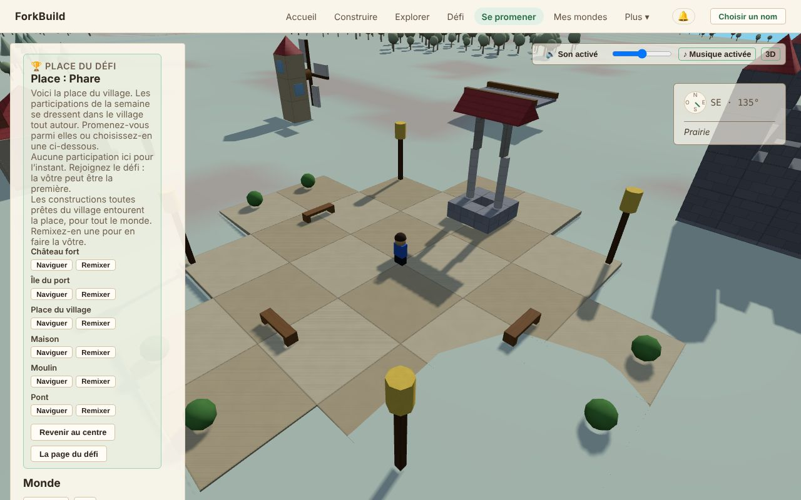

<!-- translation-of: docs/user/03-WorldView.md source-hash: a51a7c2c7ea79eeb -->
# 03 — La Vue du Monde

<!-- languages -->
[English](../03-WorldView.md) · [Deutsch](../de/03-WorldView.md) · [Español](../es/03-WorldView.md) · **Français** · [Bahasa Indonesia](../id/03-WorldView.md) · [日本語](../ja/03-WorldView.md) · [한국어](../ko/03-WorldView.md) · [Português (Brasil)](../pt-BR/03-WorldView.md)
<!-- /languages -->

La Vue du Monde est le monde 3D partagé où **toutes les constructions
publiées se tiennent côte à côte**. Vous y marchez ou y volez, vous
trouvez des choses, vous regardez ce que d’autres ont construit et vous y
amenez vos amis.

On n’y construit pas : c’est le rôle de l’Éditeur. Quand vous voulez
changer quelque chose que vous avez trouvé, **Modifier une copie** ouvre
votre propre copie dans l’Éditeur (voir
[Modifier une copie](#modifier-une-copie--emporter-quelque-chose-dans-léditeur)).
Les seuls changements que fait la Vue du Monde sont des étiquettes, pas des
briques : nommer des
[Points de repère](#points-de-repère--marquer-un-lieu-qui-mérite-quon-sen-souvienne)
et des régions, et laisser dans le Monde un animal relâché comme
décoration avec **G** (voir
[Avatars et présence](06-AvatarsAndPresence.md#décorer-un-monde-avec-un-animal)).

**La version courte :**

| Pour… | Faites ceci |
|---|---|
| Venir ici | **Se promener** dans la barre du haut, ou **Explorer** sur n’importe quelle construction |
| Marcher | `W` `A` `S` `D` pour avancer, `Maj` pour courir, `Espace` pour sauter (sur un téléphone, le joystick) |
| Regarder autour de vous | Faites glisser pour tourner la caméra, molette pour zoomer |
| Changer ce que vous voyez | **Modifier une copie** ouvre votre propre copie dans l’Éditeur |
| Commencer une construction ici même | **Construire ici** |
| Amener des amis | **Se promener ici avec moi** crée un lien à leur envoyer |
| Couper ou rétablir le son | Le bouton **Son**, ou `M` |

Toutes les commandes sont dans la [Référence des commandes](ControlsReference.md).
Les outils réseau derrière le Monde ont leur propre page :
[La Vue du Monde : outils avancés](WorldViewAdvancedTools.md).

## Ouvrir la Vue du Monde


*La Vue du Monde sur la place du défi : le panneau latéral à gauche, votre avatar sur la place, et le son et la boussole en haut à droite.*

Il y a deux façons d’entrer :

- **Se promener**, dans la barre du haut, ouvre la Vue du Monde sur la
  place du défi de cette semaine. Pas besoin d’une construction à vous. La
  place est celle du village : les six constructions toutes prêtes
  l’entourent, prêtes à être remixées, et juste à côté se tiennent les
  participations de la semaine (voir
  [La place du défi](04-PublishingAndForking.md#la-place-du-défi)).
- Sur la page **Explorer**, **Explorer** sur n’importe quelle construction
  vous place juste à côté. Ouvrir le lien d’un Monde fait de même.

Les constructions que d’autres ont
[envoyées à tout le monde](04-PublishingAndForking.md#qui-peut-la-trouver-)
se tiennent là où leurs auteurs les ont mises : chacune sur un
emplacement à elle, avec de la place autour, à travers une vaste terre
(voir
[Où se dresse une construction](04-PublishingAndForking.md#où-se-dresse-une-construction)).

## Une vue de visiteur, et Avancé

La Vue du Monde s’ouvre en vue de visiteur. Ce que vous êtes venu faire se
trouve sur une barre en bas du Monde : **Construire ici**, **Se promener
ici avec moi** et, quand la construction n’est pas à vous, **Modifier une
copie**.

Le panneau latéral affiche le nom de la construction et qui l’a faite,
puis où vous pouvez aller et ce qu’il y a autour de vous. Sur un
téléphone, le panneau commence fermé pour que le Monde remplisse l’écran ;
**Panneau** l’ouvre. Sur la place, un téléphone affiche plutôt une ligne,
**Place : …** avec le nombre de constructions présentes ; touchez-la pour
ouvrir le panneau. Qui est affiché, si les touches font marcher votre
avatar et les choix de caméra se trouvent dans **Réglages de l’avatar**.

En bas du panneau, **Afficher les outils avancés** ajoute les outils pour
les réseaux derrière le Monde : coordonnées, inspection des briques,
placements, Rencontres dans le Monde et plus encore. Ils ont leur propre
page, [La Vue du Monde : outils avancés](WorldViewAdvancedTools.md). Le
choix est mémorisé sur cet appareil et ne change rien pour personne
d’autre. Tout ce qui est sur cette page fonctionne dans les deux cas.

## Se déplacer

- **Glisser avec le bouton gauche** : faire tourner la caméra
- **Glisser avec le bouton droit** : faire glisser la caméra sur le côté
- **Molette** : zoomer et dézoomer
- **Accueil** (la touche, ou le bouton du panneau) : revenir à votre propre
  Monde (voir [Orientation et emplacements](#orientation-et-emplacements))

Pour faire marcher votre avatar, voir
[Faire marcher votre avatar](06-AvatarsAndPresence.md#faire-marcher-votre-avatar).

Les Mondes proches **se chargent et se déchargent tout seuls** à mesure
que vous bougez. Le panneau latéral se lit de haut en bas :

1. ce que vous regardez (l’en-tête) ;
2. où vous pouvez aller : **Accueil**, **Emplacements** et les onglets
   **Explorer**, **Carte** et **Lieux** ;
3. ce qu’il y a autour de vous (**À proximité**) ;
4. vos propres outils : **Recherche** et **Avatar**.

En bas, **Mondes en vue** liste les autres Mondes chargés autour de vous,
et **Mondes proches** ceux où vous pouvez voler d’un clic.

Pointez quelque chose dans le Monde, et une petite carte en bas à droite de
la vue vous dit ce que c’est.

### Ce qu’il y a autour de vous

**Le terrain** est le même pour tout le monde. Herbe, plages, roche,
forêt, champs, lacs, rivières et mer suivent la forme du sol. Le terrain
au centre est toujours sec ; à environ mille unités, vous atteignez une
côte, où le sol descend vers la mer profonde.

**L’eau.** Les lacs frémissent sous la brise et la mer roule d’une
houle lente. Les rivières descendent la pente dans leur lit, plus vite là où le
sol est plus raide. Elles naissent de sources bouillonnantes au pied des hautes terres,
dévalent les pentes les plus raides en petites cascades et finissent
parfois dans un étang calme. L’écume se forme là où les vagues atteignent le rivage
et là où une rivière franchit des rapides. Votre avatar entre à pied dans
un lac, dans la mer ou dans une rivière et
ralentit à mesure que l’eau monte. Quand l’eau est plus profonde que la
moitié de sa taille, il nage, montant et descendant avec la houle (voir
[Nager et plonger](06-AvatarsAndPresence.md#nager-et-plonger)). Plongez,
et vous voyez des algues et de petits bancs de poissons.

**Les arbres et les animaux.** La forêt a des conifères là où c’est plus
humide et des feuillus là où c’est plus sec, avec des broussailles en
bordure des prairies. Les cerfs vivent en forêt, les lapins dans les
prairies. Les arbres ne bougent jamais. Les animaux errent lentement près
de leur propre place, s’arrêtent pour brouter et lèvent la tête de temps
en temps. Approchez-vous, et l’un d’eux tourne la tête vers vous (sauf si
vous êtes juste derrière) ; un cerf qui broute relève la tête, un lapin se
dresse sur ses pattes arrière. Ils ne s’enfuient jamais et ne bougent
jamais à cause de vous, et les autres les voient *les* regarder, eux. Les
animaux vous barrent le chemin à pied, comme les arbres.

Tous ceux qui regardent le même endroit au même moment voient le même
terrain, les mêmes poissons, arbres et animaux. Rien de tout cela ne se
modifie.

Les **habitants** sont des personnes qui vivent dans un Monde. Ils se
promènent autour de chez eux, contournent les bâtiments au lieu de les
traverser et se tournent vers vous pour vous saluer ; parlez à l’un d’eux
et il vous dit ce qu’il y a autour. Contrairement aux animaux, ils font
partie du Monde : c’est son auteur qui les ajoute. Les maisons toutes
prêtes ont un habitant près de la porte d’entrée, y compris celles autour
de la place du défi. Dans votre propre construction, **R** en retire un.
Voir [Habitants](06-AvatarsAndPresence.md#habitants).

**Les constructions pâles et transparentes** sont des constructions que
d’autres ont annoncées près de vous et que cet appareil n’a pas acceptées.
Elles disparaissent quand vous poursuivez votre chemin. Voir
[Constructions déclarées](WorldViewAdvancedTools.md#constructions-déclarées--les-constructions-des-autres-là-où-leurs-éditeurs-disent-quelles-se-trouvent).

### À l’intérieur d’une construction

Entrez par une porte et la construction au-dessus de votre tête est coupée,
pour que vous voyiez la pièce où vous êtes plutôt que le mur derrière vous :
son toit et tout ce qui est plus haut que votre tête, pour cette
construction seulement, tandis que les murs restent debout jusqu’un peu
au-dessus de votre taille. Quand la caméra vous suit, ou en **Troisième
personne**, la caméra entre aussi, derrière et au-dessus de vous, regardant
la pièce d’en haut, et monte plutôt que de traverser un mur quand il y en a
un juste derrière vous. **Vue aérienne** regarde droit vers le bas dans la
pièce ; **Première personne** la voit par vos propres yeux, sans rien
couper. Ressortez et la construction entière est de nouveau dessinée. Seul
ce qui est dessiné change : le toit est toujours là, pour tout le monde et
pour marcher.

## Le jour et la nuit

Le ciel de la Vue du Monde passe du jour à la nuit et revient toutes les
40 minutes : un crépuscule chaud, une nuit bleue éclairée par la lune, une
aube rose, puis de nouveau le jour. Il suit l’horloge, si bien que tout le
monde voit le même ciel au même moment devant une construction. À la nuit
tombée, les fenêtres vitrées brillent d’une lumière de lampe et les
**Lanternes** s’allument de leur propre couleur : un phare montre l’entrée
du port et un village a l’air habité ; les oiseaux se taisent et les
grillons prennent le relais. La nuit n’est jamais assez sombre pour vous
empêcher de trouver votre chemin. Seule la Vue du Monde connaît la nuit :
l’Éditeur, les images des constructions et les aperçus de liens sont
toujours en plein jour.

Le soleil se lève à l’est, traverse le ciel du sud et se couche à l’ouest,
orangé près de l’horizon ; une fois couché, la lune suit le même chemin
pendant la nuit. La lumière sur les constructions vient de celui qui est
dans le ciel : les murs tournés vers l’est prennent le matin, ceux tournés
vers l’ouest le soir.

Le soleil et la lune projettent des ombres : la vôtre, celles des arbres,
des animaux et de chaque construction, longues le matin et le soir, courtes à
midi et plus pâles au clair de lune. Elles tombent à environ 45 mètres autour
de vous et s’effacent un instant pendant que le soleil cède le ciel à la lune
et inversement. Les ombres coûtent plus à un téléphone qu’à un ordinateur :
elles sont d’abord activées avec une souris et désactivées sur un téléphone
ou une tablette ; cochez ou décochez **Ombres** en bas du panneau pour le
changer sur cet appareil.

Les arbres poussent comme dans la nature : sapins et épicéas aux verticilles
de branches tombantes dans les forêts les plus humides, feuillus aux
branches fourchues et aux couronnes arrondies là où c’est plus sec, et
broussailles basses et tordues en bordure des prairies. De près, vous voyez
chaque branche et chaque feuille ; ils se balancent au vent, davantage quand
un orage se prépare, et projettent des ombres tachetées. Plus loin, ils
deviennent des formes plus simples, pour que même une forêt entière reste
fluide à parcourir. Sur un téléphone ou une tablette, les arbres sont
d’abord plus simples ; cochez **Arbres détaillés**, juste sous **Ombres**,
pour voir chaque feuille sur cet appareil.

La nuit, à mesure que le crépuscule s’assombrit, les étoiles apparaissent,
traversées par la Voie lactée, puis s’effacent à l’aube. Tout le ciel étoilé
tourne lentement autour d’un point haut dans le nord : les étoiles se lèvent
à l’est et se couchent à l’ouest avec la lune, et chacun voit les mêmes
étoiles au même moment.

La lune passe par ses phases, une par nuit : d’une nouvelle lune sombre à un
mince croissant, une demi-lune et une lune gibbeuse jusqu’à la pleine lune,
puis retour, tous les huit jours de la Vue du Monde (un peu plus de cinq
heures). Une lune croissante est éclairée de son côté ouest, une lune
décroissante de son côté est. La phase change aussi la nuit : sous la pleine
lune, la nuit est un peu plus claire et les ombres plus nettes ; autour de
la nouvelle lune, la lumière est plus douce, le ciel d’un bleu plus profond,
et les étoiles et la Voie lactée brillent le plus. Comme le reste du ciel,
tout le monde voit la même lune au même moment, et il ne fait jamais assez
sombre pour que les constructions soient difficiles à voir.

Les nuages vont et viennent, les mêmes pour tous au même moment. La plupart
du temps, quelques nuages blancs passent ; de temps en temps le ciel se
couvre, et parfois il devient gris et bouché, avec une lumière plus douce et
des ombres plus pâles. Il ne fait jamais assez sombre pour qu’on distingue
mal les constructions.

De temps en temps, un ciel couvert apporte la pluie, pour quelques minutes
à chaque fois. Vous la voyez tomber autour de vous et des cercles s’étendre
là où les gouttes touchent un lac, la mer ou une rivière, et vous l’entendez,
tandis que les oiseaux et les insectes se taisent. Entrez dans une
construction et vous restez au sec : vous entendez la pluie tambouriner sur
le toit et la voyez toujours tomber dehors. Sous la pluie, le sol et les
constructions foncent et luisent, puis sèchent en quelques minutes une fois
qu’elle s’arrête. Les plus fortes averses amènent parfois un orage tranquille : de temps en temps, un éclair éclaire doucement le ciel, et le tonnerre gronde au loin quelques secondes plus tard. Si votre appareil demande de réduire les animations, les éclairs ne clignotent pas. La pluie n’est là que pour
les yeux et les oreilles : les rivières ne montent pas et vous marchez tout
aussi vite.

Si vous préférez qu’il fasse toujours jour, cochez **Toujours le jour** en
bas du panneau, juste au-dessus de **Ombres**. Le ciel reste
alors dégagé. Ce choix est mémorisé sur cet appareil et ne change rien pour les autres.

## Saisons

Le monde passe par quatre saisons, chacune de huit jours de World View (un peu
plus de cinq heures), une par tour de la lune :

- **Printemps** : les arbres fleurissent en rose et blanc et se couvrent de
  jeunes feuilles d’un vert tendre ; des fleurs sauvages parsèment l’herbe, et
  des pétales tombent entre les arbres.
- **Été** : tout est vert et luxuriant, des fruits mûrissent sur certains
  arbres et les champs deviennent dorés.
- **Automne** : les feuilles virent au rouge, à l’orange et au jaune, chaque
  arbre à son heure, et tombent autour de vous tandis que les arbres se
  dénudent ; les champs sont moissonnés.
- **Hiver** : les arbres sont nus, l’herbe est terne et, quand le ciel se
  couvre, il neige au lieu de pleuvoir. La neige se pose par plaques qui se
  rejoignent en un manteau blanc, couvre les toits et la cime des arbres
  (jamais les murs, ni l’intérieur de la construction où vous êtes) et fond au
  printemps. Les oiseaux chantent moins et les insectes ont disparu.

Le paysage change un peu chaque jour plutôt que d’un coup, et tout le monde
voit la même saison au même moment. Les conifères restent verts toute l’année.
Pour garder une saison sur votre appareil, choisissez-la sous **Saison**, en
bas du panneau, juste sous **Arbres détaillés** ; **L’année du monde** suit de
nouveau le monde. Avec **Toujours le jour**, les saisons continuent de tourner,
sous un ciel dégagé.

Le soleil suit aussi les saisons. En été, il monte haut et les jours sont
longs ; en hiver, il reste bas, projette de longues ombres, et la nuit tombe
plus tôt. Au cœur de l’hiver, les lacs gèlent assez pour qu’on les traverse
à pied (la mer et les rivières jamais) ; tant que la glace se forme encore,
ou se brise à la fin de l’hiver, elle ne vous porte pas. Tout le monde voit
la même glace au même moment, quelle que soit la saison qu’il garde. La neige
crisse sous les pas, la glace claque, et dans la neige votre avatar laisse
des empreintes qui s’effacent au bout d’une minute. Vous seul voyez vos
empreintes.

## Son

**Commandes**, en haut à droite de la vue (en bas à droite sur un
téléphone) :

- **Son**, ou `M` : couper ou rétablir tout le son.
- Le curseur : le volume. Sur un téléphone ou une tablette, utilisez les
  boutons de volume de l’appareil.
- **♪ Musique** : couper ou rétablir la musique seule.
- **3D** : passer du son 3D à la simple **Stéréo**, et inversement.

Le son démarre à votre premier clic, toucher ou appui sur une touche (les
navigateurs l’exigent) et se met en pause quand l’onglet est masqué. Ces
choix sont mémorisés sur cet appareil, dans la Vue du Monde et l’Éditeur.

**Ce que vous entendez :**

- **Le terrain autour de vous** : le vent sur les hauteurs rocheuses, les
  oiseaux en forêt, les grillons dans les champs, l’eau qui clapote au bord
  d’un lac, une rivière qui coule. Les arbres bruissent ou soupirent dans le
  vent, plus fort quand ils sont proches. Les sons se fondent quand vous
  passez d’un terrain à un autre.
- **Votre avatar** : des pas qui changent avec le sol (herbe, feuilles,
  sable, pierre, eau, briques), un souffle quand vous sautez et un bruit
  sourd quand vous retombez.
- **Les véhicules** : les roues, ou le brûleur d’une montgolfière, plus
  forts à mesure que vous accélérez ; des sons pour monter et descendre ;
  et des freins qui crissent quand vous vous arrêtez vite.
- **Les animaux et les habitants** : un cerf s’ébroue et un lapin tape du
  pied quand il lève la tête ou prend peur ; attraper et relâcher un animal
  a son propre son. Les habitants fredonnent en vous saluant et murmurent
  quand ils parlent. Tout le monde entend le même cerf lever la tête au
  même moment.
- **Les autres** : leurs pas, leurs sauts et leurs véhicules, depuis là où
  ils sont, tant que vous les voyez. Masquez les autres avatars et ils se
  taisent. On entend les véhicules jusqu’à 40 m, seulement les trois plus
  proches.
- **Vos propres changements** : nommer un point de repère ou une région,
  ajouter ou retirer un habitant, décorer avec un animal, annuler et
  rétablir font le même petit son que dans l’Éditeur. Les changements des
  autres sont silencieux.

Les sons viennent de là où ils sont : devant ou derrière, au-dessus ou en
dessous, à gauche ou à droite, et tournent avec la caméra. Un casque aide.
**Stéréo** joue simplement à gauche et à droite, ce qui peut mieux
convenir à un appareil lent ou à des haut-parleurs.

La **musique** joue doucement en dessous : un air paisible que votre
navigateur invente au fil de l’eau, chaleureux le jour et plus lent après
la tombée de la nuit, avec des silences entre les morceaux. Elle ne joue
jamais deux fois la même chose.

Tout le son est créé dans votre navigateur : rien n’est téléchargé et rien
n’est envoyé. Les navigateurs des autres créent le son de vos pas à partir
de ce qu’ils voient déjà de votre marche.

## Orientation et emplacements

La **boussole** flotte en haut à droite de la vue. Elle montre le nord,
l’est, le sud et l’ouest, votre direction en degrés et de petits points
pour les constructions, les personnes et les points de repère proches.
Pointez un point pour voir son nom, ou lisez la liste sous la boussole, qui
nomme aussi le lieu où vous êtes. La boussole ne fait que montrer ; elle ne
déplace jamais la caméra.

Une rangée de boutons en haut du panneau vous aide à vous déplacer :

- **Accueil** vous ramène, caméra et avatar, à votre propre Monde : celui
  que vous avez ouvert, ou le dernier que vous avez regardé. Vous arrivez
  juste à côté, si loin que vous soyez allé. Si vous n’êtes encore allé
  dans aucun Monde à vous, Accueil vous emmène au centre de la carte.
- **Emplacements** liste tous les lieux que la Vue du Monde connaît pour
  l’instant, regroupés en **Monde**, **Structures**, **Points de repère**
  et **Lieux**. **Centrer** sur une ligne y déplace la caméra, et rien
  d’autre.
- **👥 N en ligne** compte qui est là ; cliquez pour voir les membres du
  Monde. Si le Monde a un salon public, un bouton **Salon** suit.
- **?** affiche les commandes de caméra et de marche ; cliquez à nouveau
  pour les masquer.

**Notifications** est le bouton 🔔 dans l’en-tête de l’application, à côté
de votre nom (ou de **Choisir un nom**), donc présent sur toutes les pages.
Il ouvre votre **Historique des notifications**, le plus récent en
premier. Vous recevez une notification quand :

- quelqu’un commente une construction que vous avez publiée (voir
  [Commentaires](09-PublicationsAndEvidence.md#commentaires)) ;
- quelqu’un que vous suivez publie quelque chose de nouveau (voir
  [Suivre des personnes](07-PeerConnectionsAndFriends.md#suivre-des-personnes)) ;
- quelqu’un remixe l’une de vos constructions (voir
  [Nombre de remix](04-PublishingAndForking.md#nombre-de-remix)) ;
- quelqu’un publie après vous une construction qui ressemble beaucoup à
  l’une des vôtres (voir
  [Constructions semblables publiées avant](04-PublishingAndForking.md#constructions-semblables-publiées-avant)).

Chacune dit ce qui s’est passé et quand. **Explorer** vous emmène au Monde
de cette construction. C’est une simple liste, pas une boîte de réception :
rien n’est marqué comme lu, rien ne se ferme, et le bouton n’affiche aucun
nombre. Elle se charge quand vous l’ouvrez ; **Actualiser** la recharge.
Elle appartient à votre nom, pas au Monde que vous avez ouvert.

### Notifications sur cet appareil

En haut du panneau, **Me notifier sur cet appareil** laisse votre appareil
afficher lui-même ces notifications, comme n’importe quelle application. Le
navigateur vous demande l’autorisation ; **Désactiver** l’arrête.

Elles apparaissent quand ForkBuild est ouvert mais pas au premier plan :
dans un autre onglet, ou en
[application installée](01-GettingStarted.md#installer-forkbuild) en
arrière-plan. Un clic sur l’une d’elles ouvre ForkBuild sur cette
construction. Rien n’est envoyé nulle part pour cela, donc un ForkBuild
fermé n’affiche rien ; ce qui est arrivé entre-temps se trouve dans la
liste la fois suivante. Seules quelques-unes apparaissent à la fois ; les
autres attendent dans la liste. Si le navigateur les bloque, le panneau le
dit : autorisez les notifications de ForkBuild dans les paramètres du site
du navigateur.

### Dire où aller (voix)

Appuyez sur `V`, ou sur **🎤 Voix** à côté d’**Accueil**, et dites où aller
ou quoi faire. Appuyez sur `V` (ou **Arrêter**) quand vous avez fini :

- *emmène-moi au vieux moulin*, ou simplement le nom d’un lieu : la caméra y
  va, comme avec **Centrer** dans **Emplacements**. Tout lieu des
  **Emplacements** peut être nommé, et sur une place du défi, ses
  constructions aussi.
- *à la maison* : comme **Accueil**.
- *première personne*, *troisième personne*, *vue aérienne*, *caméra
  libre* : les vues de caméra du panneau Avatar.
- *coupe le son*, *remets le son*.
- *annuler*, *rétablir* : comme `Ctrl+Z` et `Ctrl+Y`.
- *parle à* : comme `T` à côté d’un habitant.

Tout le reste est proposé au guide avec **Demander au guide**. La voix est
ici la même que dans l’Éditeur (voir
[Dire une commande](02-TheEditor.md#dire-une-commande-voix)) : activée une
fois pour les deux, comprise sur votre appareil, et le monde continue de
bouger pendant qu’elle comprend ce que vous avez dit.

### Explorer, Carte et Lieux — trois façons de parcourir, jamais en même temps

Sous les boutons se trouvent trois onglets. Un seul est ouvert, et en
changer ne modifie que ce qu’affiche le panneau.

- **Explorer** (par défaut) montre qui est là et quelques lieux à visiter,
  puis **À proximité** : **Lieux**, **Points de repère** et **Personnes**
  autour de vous, chacun avec sa distance et un bouton **Y aller**. Les
  groupes vides sont masqués. Cliquez sur le titre d’un groupe pour le
  replier ou le déplier ; la Vue du Monde se souvient de ceux que vous avez
  laissés ouverts. Les outils avancés ajoutent trois autres groupes (voir
  [La Vue du Monde : outils avancés](WorldViewAdvancedTools.md)).
- **Carte** affiche la [Carte du Monde](#la-carte-du-monde).
- **Lieux** liste les [lieux géographiques](#lieux-géographiques).

### Infos — qu’est-ce que je regarde ?

À côté de la plupart des boutons **Y aller**, dans À proximité et dans
**Emplacements**, se trouve un bouton **Infos**. **Y aller** y déplace
votre caméra. **Infos** vous parle du lieu sans bouger : ce que c’est, à
quelle distance, et dans quel lieu nommé il se trouve (« Vous êtes à
Saule-Village ») ou près duquel (« Vous êtes près de Kawahara »).

Depuis le panneau Infos, vous pouvez :

- **Y aller** : vous y rendre ;
- **Afficher sur la carte** : le voir sur la Carte du Monde ;
- **Noms** (pour un lieu nommé) : voir comment les gens l’appellent, ou
  publier un nom ;
- **Modifier une copie** : ouvrir votre propre copie dans l’Éditeur (voir
  ci-dessous).

### Modifier une copie — emporter quelque chose dans l’Éditeur

**Modifier une copie** est la façon de changer quelque chose trouvé dans la
Vue du Monde. Elle fait votre propre copie indépendante de la construction
et l’ouvre dans l’Éditeur, prête à être complétée. L’original n’est jamais
touché.

Vous la trouvez :

- sur la barre en bas du Monde, quand la construction que vous visitez
  n’est pas à vous : elle copie toute la construction ;
- dans le panneau **Infos** d’une région, d’un point de repère ou d’une
  structure placée ;
- avec les outils avancés, quand vous cliquez sur une brique, sur un sol
  nu ou sur une structure placée (voir
  [Inspecter une brique](WorldViewAdvancedTools.md#inspecter-une-brique--ou-une-structure-placée)).

Ce qui est copié dépend de ce que vous avez choisi :

- Pour un **point de repère**, une **région**, une **brique** ou un **sol
  nu**, vous obtenez le Monde auquel ils appartiennent.
- Pour une **structure placée**, vous obtenez cette structure, pas le Monde
  où elle se trouve.

ForkBuild vous prévient dès que votre copie est prête (voir
[Publier et remixer](04-PublishingAndForking.md)). Si la copie ne peut pas
être faite, une boîte de dialogue **Impossible de faire une copie** dit
pourquoi, en général parce que la licence de la construction n’autorise
pas les copies ou que la construction ne peut pas encore être récupérée,
et **Retour à la construction** vous ramène où vous étiez (voir
[Quand un remix ne peut pas aboutir](04-PublishingAndForking.md#quand-un-remix-ne-peut-pas-aboutir)).

Un **lieu géographique** et une **personne** n’ont pas de Modifier une
copie. Un lieu géographique est fait des régions de plusieurs personnes, il
n’y a donc pas une seule construction à copier ; ouvrez plutôt l’une de ses
régions.

Modifier une copie revient à **Remixer** dans Explorer et sur la page d’un
auteur, avec les mêmes règles de licence (voir
[Remixer : faites-le vôtre](04-PublishingAndForking.md#remixer--faites-le-vôtre)).
Tout le reste de la Vue du Monde, comme la Recherche, la boussole, la Carte
et Infos, ne fait que regarder.

### Construire ici — commencer une construction pour cet endroit

**Construire ici**, à côté d’**Accueil**, commence dans l’Éditeur une
construction nouvelle et vide pour l’endroit où se tient votre avatar (ou,
en vol, l’endroit sous la caméra). L’Éditeur indique pour quel Monde elle
est.

Quand vous la publiez, la construction se dresse juste à cet endroit, au
lieu d’une parcelle libre choisie par ForkBuild. **Aller la voir** vous y
ramène pour la regarder. **Oublier cet emplacement**, dans l’Éditeur,
laisse ForkBuild la placer comme d’habitude.

L’endroit n’est qu’une note à vous, gardée sur cet appareil et dans ses
sauvegardes. Il ne réserve pas le terrain, et d’autres peuvent aussi y
construire (voir
[Pourquoi deux constructions peuvent-elles se trouver au même endroit ?](WorldViewAdvancedTools.md#pourquoi-deux-constructions-peuvent-elles-se-trouver-au-même-endroit-)).

### Se promener ici avec moi — amener vos amis dans ce Monde

**Se promener ici avec moi**, à côté de **Construire ici**, crée un lien
qui amène vos amis dans le Monde où vous êtes, pour vous y promener
ensemble. Envoyez-le comme vous voulez, ou laissez-les scanner son code QR
avec un téléphone.

Un ami qui l’ouvre choisit un nom s’il n’en a pas encore (chacun marche
avec son propre avatar), clique sur **Rejoindre** et arrive dans ce Monde.
Vous vous voyez marcher. La boîte de dialogue indique qui est en route et
qui est arrivé.

- Le Monde doit d’abord être publié : le ForkBuild de votre ami vérifie sa
  signature et sa construction, comme pour un lien partagé, et en garde une
  copie.
- Le lien fonctionne 30 minutes pour quiconque l’ouvre, tant que vous
  restez dans la Vue du Monde. Fermer la boîte de dialogue ne l’arrête pas ;
  **Arrêter le lien** le fait. Ceux qui ont déjà rejoint restent connectés
  dans tous les cas.
- Rejoindre relie vos deux appareils directement, comme une invitation dans
  **Pairs**. Chacun voit l’adresse IP de l’autre, et vos avatars
  s’affichent comme le permet la **Visibilité de la présence** de chacun
  (voir
  [Qui peut vous voir](06-AvatarsAndPresence.md#qui-peut-vous-voir--deux-réglages-indépendants)).
  Personne ne devient pair connu ni ami sauf si vous le choisissez.
- Il faut un serveur de rendez-vous. Le site officiel en a un ; une copie
  que vous faites tourner vous-même a besoin du sien (voir
  [Connexions entre pairs et amis](07-PeerConnectionsAndFriends.md)).

### La place du défi

**Parcourir la place**, sur la page d’un défi de la semaine, ou **Se
promener** dans la barre du haut, ouvre la Vue du Monde sur la place du
village : pavée, avec un puits, des bancs et des réverbères, et les six
constructions toutes prêtes tout autour.

La place et les constructions toutes prêtes font partie du Monde, comme
ses collines et ses arbres. Elles sont là pour tout le monde, et
n’appartiennent à personne. Les participations de la semaine se tiennent
juste à côté, et seulement celles de cette semaine : ouvrez la place de la
semaine dernière et vous voyez les participations de la semaine dernière.
Un panneau
liste les participations de la semaine et les constructions toutes prêtes
(voir [La place du défi](04-PublishingAndForking.md#la-place-du-défi)).
Aucun arbre ne pousse autour de la place, et on n’y trouve pas
**Construire ici**.

### Points de repère — marquer un lieu qui mérite qu’on s’en souvienne

Un **point de repère** est un point nommé que vous placez dans un Monde,
comme « Vieux pont » ou « Belle vue », avec une description si vous
voulez. Il est placé exactement là où se tient votre avatar.

Quand vous pouvez modifier le Monde où vous êtes, la partie Points de
repère d’**Emplacements** a un bouton **+ Ajouter un point de repère**.
Donnez-lui un titre, et une description si vous voulez, puis cliquez sur
**Placer ici**. Il apparaît tout de suite pour vous, et quelques instants
plus tard pour tous ceux qui modifient le même Monde : sur la boussole,
dans **Emplacements** et comme lieu où aller.

Les points de repère appartiennent au Monde, pas à vous. Toute personne qui
peut modifier le Monde peut renommer, changer ou retirer n’importe quel
point de repère, quel que soit son auteur.

### La Carte du Monde

L’onglet **Carte** montre le Monde vu de haut : lieux nommés, points de
repère, constructions, les personnes présentes et un repère pour vous. Il
montre tout ce que la Vue du Monde connaît pour l’instant, d’un seul coup.

- Utilisez la molette, ou **+** et **−**, pour zoomer.
- Faites glisser un espace vide pour déplacer la carte.
- Cliquez sur un lieu ou une personne pour y déplacer votre caméra.

Regarder la carte ne change jamais rien.

### Lieux géographiques

Un **lieu géographique** est une zone que plusieurs personnes ont nommée ou
décrite comme région, chacune de son côté, et qui se révèle être à peu près
le même terrain. L’onglet **Lieux** liste ceux que la Vue du Monde a
trouvés jusqu’ici.

Cliquez sur l’un d’eux pour voir combien de descriptions et de Mondes il
couvre, ses **Noms donnés par la communauté**, ainsi qu’**Aller au lieu**
et **Afficher sur la carte**. **← Retour** (ou Échap) revient à la liste.
Si vous changez d’onglet puis revenez, vous retrouvez l’écran que vous
aviez quitté.

Les **Noms donnés par la communauté** d’un lieu affichent ses principaux
noms ; **Plus de noms** affiche la liste complète par ordre. En dessous,
vous pouvez publier un nom à vous. Tout le reste (les autres descriptions
du lieu, l’historique complet des noms, l’import et l’export) est replié
sous **Plus**.

Publier un nom le dit aux personnes avec qui vous êtes connecté, comme
lorsque vous déclarez avoir fait une construction. Pour voir tous les noms
et toutes les déclarations que cet appareil a publiés ou appris, voir
[Publications et preuves externes](09-PublicationsAndEvidence.md).

## Mes mondes — les Mondes où vous êtes vraiment allé

**Mes mondes**, dans la barre du haut, liste tous les Mondes où vous êtes
allé sur cet appareil, le plus récent en premier, avec leur titre, leur
auteur et leur nombre de constructions et de points de repère.
**Continuer l’exploration** vous y ramène. Seul cet appareil garde la
liste, et personne d’autre ne la voit.

Vous n’êtes encore allé nulle part ? **Ouvrez Explorer** pour trouver un
Monde ou partir d’une construction toute prête.

**Constructions auxquelles vous avez participé** liste les constructions
où un ami vous a crédité quand vous avez construit ensemble avec
**Construire avec moi** (voir
[L’Éditeur](02-TheEditor.md#construire-avec-moi--construire-ensemble-en-direct)).
Chacune affiche son titre et **avec** le nom de votre ami, qui ouvre sa
page. Elle indique **Pas encore publiée** jusqu’à ce que votre ami la
publie ; son titre ouvre alors son Monde. Vos autres appareils les listent
aussi, une fois connectés à celui-ci. La section n’apparaît que si elle
contient quelque chose.

## Trouver des mondes

Il y a deux façons de chercher quelque chose, chacune répondant à une
question différente.

### Recherche — « quelles publications correspondent ? »

**Recherche** cherche un **titre ou un auteur** dans tout ce qui est
publié, pas seulement dans ce qui est chargé autour de vous. Tapez un mot
et cliquez sur **Chercher**. Chaque résultat montre où il se trouve (📍) ;
cliquez sur **Centrer** pour y voler.

Un résultat peut dire que sa position est une **position par défaut** :
son auteur n’a jamais choisi d’endroit, alors ForkBuild l’affiche sur un
endroit. Avec les outils avancés, vous pouvez aussi chercher par position
(voir [La Vue du Monde : outils avancés](WorldViewAdvancedTools.md)) ; les
résultats montrent alors à quelle distance ils sont (📏).

### Explorer ici / Qu’y a-t-il ici ? — « qu’y a-t-il autour de moi en ce moment ? »

Ces deux boutons, en haut d’**À proximité** dans Explorer, regardent
**autour de l’endroit où se trouve votre caméra**. Pas besoin de titre ni
de coordonnées.

- **Explorer ici** regarde une zone large. Vous pouvez l’agrandir ou la
  réduire ensuite.
- **Qu’y a-t-il ici ?** regarde seulement juste là où vous êtes.

Les deux ouvrent la boîte de dialogue **Explorer l’emplacement** :

```
📍 Centre : 100.0, 50.0, 250.0
⭕ Rayon : 25 unités du Monde

3 constructions trouvables affichées sur 3

📍 Hôtel de ville       📏 À 4,2 unités du Monde
par alice
[Centrer] [Sélectionner] [Inspecter]
```

Chaque résultat a trois boutons :

| Bouton | Ce qu’il fait |
|---|---|
| **Centrer** | Y vole et en fait la construction à laquelle s’applique votre prochain changement |
| **Sélection** | En fait la construction à laquelle s’applique votre prochain changement, sans bouger |
| **Inspecter** | Affiche son titre, son auteur, son statut, sa position et son propriétaire, sans bouger |

La boîte de dialogue elle-même ne déplace, ne change et ne publie jamais
rien.

## La Vue du Monde est en lecture seule — on construit dans l’Éditeur

Cliquer, faire glisser ou appuyer sur une touche dans la Vue du Monde ne
change jamais une brique. Il n’y a pas d’outils de construction ici. Pour
construire à partir de quelque chose, utilisez
**[Modifier une copie](#modifier-une-copie--emporter-quelque-chose-dans-léditeur)**
et continuez dans [l’Éditeur](02-TheEditor.md). Les seuls changements que
fait la Vue du Monde sont les étiquettes citées en haut de cette page.

## Voir les autres collaborateurs

Quand d’autres personnes sont dans le même Monde :

- **Vous les voyez** : leurs avatars, avec leur nom et ce qu’ils font
  (« **Bob — explore à proximité** »).
- **Vous voyez leurs changements au moment où ils se produisent** : un
  point de repère, un nom, une nouvelle copie à eux.
- **Une courte liste d’activité** dans le panneau montre ce qui a changé
  récemment, même hors de votre vue. Elle n’est gardée que pendant que vous
  êtes là.

Voir des gens ne change jamais rien en soi. Seul un vrai changement le
fait : un changement fait dans l’Éditeur, ou l’une des étiquettes que la
Vue du Monde permet.

## Enregistrer et publier ici aussi

Quand vous travaillez sur une construction, l’en-tête a **Enregistrer**,
**Publier** et **Modifier les métadonnées**, pour l’enregistrer et la
partager sans partir. La ligne d’état dit de quoi il s’agit :
**🔒 Publié** ou **✎ Modification de votre copie**.

Une construction publiée ne change jamais. Si la construction où vous êtes
est publiée, votre premier changement ici (ses informations, un point de
repère ou une région, ou un animal comme décoration) crée votre propre
copie, intitulée *« Remix de &lt;nom d’origine&gt; »*. Un court avis vous
le signale (« Votre propre copie modifiable a été créée — … reste
inchangé »). Les mêmes règles de licence s’appliquent qu’à tout remix (voir
[Publier et remixer](04-PublishingAndForking.md#remixer--faites-le-vôtre)).

## Historique — prévisualiser et restaurer des états antérieurs

Chaque changement que vous faites ici, comme ajouter, renommer ou retirer
un point de repère ou une région, est gardé dans l’historique de la
construction. Cliquez sur **Historique** dans l’en-tête pour voir une liste
numérotée avec les heures, par exemple :

```
1. Créer le point de repère « Vieux pont »
2. Modifier la région « Village des Saules »
3. Retirer le point de repère
```

Les étapes que vous avez annulées sont marquées **annulé**. Cliquer sur une
étape ne fait que la choisir ; rien ne change tant que vous n’appuyez pas
sur un bouton :

- **Aperçu** montre le Monde tel qu’il était *juste après* cette étape, à
  côté de l’actuel, sans rien changer. **Quitter l’aperçu** revient.
- **Restaurer** revient à cette étape. Rien n’est demandé avant, mais le
  changement reste non enregistré, donc vous pouvez encore choisir de
  l’enregistrer ou non.
- **Fermer** ferme la liste.

## Et ensuite ?

Prêt à partager ce que vous avez fait, ou à remixer le travail de quelqu’un
d’autre ? Continuez avec
**[Publier et remixer](04-PublishingAndForking.md)**. Pour les outils
réseau derrière le Monde, voir
**[La Vue du Monde : outils avancés](WorldViewAdvancedTools.md)**.
