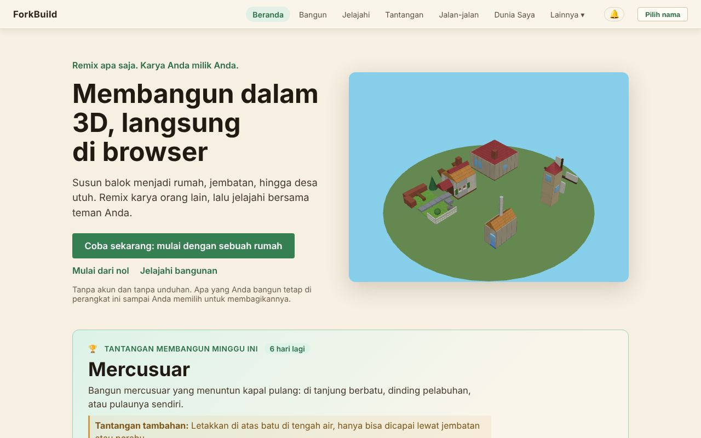

<!-- translation-of: docs/user/01-GettingStarted.md source-hash: 49f2f034ec1550ac -->
# 01 — Memulai

<!-- languages -->
[English](../01-GettingStarted.md) · [Deutsch](../de/01-GettingStarted.md) · [Español](../es/01-GettingStarted.md) · [Français](../fr/01-GettingStarted.md) · **Bahasa Indonesia** · [日本語](../ja/01-GettingStarted.md) · [한국어](../ko/01-GettingStarted.md) · [Português (Brasil)](../pt-BR/01-GettingStarted.md)
<!-- /languages -->

Selamat datang! Panduan ini membawa Anda dari "baru membuka aplikasi" ke
"saya sudah membangun sesuatu" dalam sekitar lima menit. Anda tidak perlu
akun, unduhan, atau nama untuk mulai: semuanya tetap di perangkat Anda
sampai Anda memilih untuk membagikannya.

**Versi singkatnya:**

1. Di layar **Beranda**, klik **Coba sekarang: mulai dengan sebuah rumah**.
2. Klik **Ambil atap**, lalu klik rumahnya: atapnya terpasang.
3. Klik **Terbitkan** dan jawab pertanyaannya: nama untuk menerbitkan
   (klik **Terbitkan sebagai …**), dan **Siapa yang bisa menemukannya?**
4. Klik **Masuk ke dalamnya** untuk berjalan di dalam rumah Anda di Dunia.

Bagian lain halaman ini menjelaskan setiap langkah, dan cara memulai dari
lahan kosong.

## Membuka ForkBuild

*Layar Beranda: bilah atas, tiga cara masuk, dan tantangan membangun minggu ini.*

ForkBuild berjalan di browser web modern mana pun: buka situs yang di-host
dan Anda tiba di layar **Beranda**. (Untuk menjalankan salinan Anda
sendiri, lihat
[Menjalankan salinan Anda sendiri](#menjalankan-salinan-anda-sendiri) di
akhir halaman ini.)

Layar **Beranda** menampilkan desa kecil yang berputar dalam 3D dan
menawarkan tiga cara masuk:

- **Coba sekarang: mulai dengan sebuah rumah** membuka rumah siap pakai di
  Editor sebagai salinan Anda sendiri, siap diubah (lihat
  [Coba sekarang](02-TheEditor.md#coba-sekarang-rumah-yang-perlu-diselesaikan)).
- **Mulai dari nol** membuka Editor di lahan kosong.
- **Jelajahi bangunan** membuka **Jelajahi**, tempat bangunan terbitan
  semua orang.

Di bawah **Mulai dari bangunan siap pakai**, setiap kartu (sebuah kastel,
pulau pelabuhan, alun-alun desa, rumah, kincir, dan jembatan) membuka
salinan Anda sendiri dari bangunan itu dengan cara yang sama. Tidak ada
yang diterbitkan atau dikirim ke mana pun sampai Anda memilihnya.

Beranda juga menampilkan **Tantangan membangun minggu ini**: tema untuk
dibangun, dengan **Ikut tantangan** (lihat
[Tantangan membangun mingguan](04-PublishingAndForking.md#tantangan-membangun-mingguan)).
Setelah Anda menerbitkan bangunan, Beranda juga menampilkan **Cap Anda**:
fakta tentang bangunan Anda sendiri, seperti **Di-remix** saat seseorang
membuat remix salah satunya, **Penantang** saat Anda ikut tantangan
mingguan, atau **Pembangun besar** untuk bangunan berisi seratus balok
atau lebih. Cap dihitung di perangkat ini dan hanya ditampilkan kepada
Anda: penghargaan, bukan poin atau peringkat.

## Mengenal menu

Bilah di atas selalu terlihat:

`ForkBuild  Beranda  Bangun  Jelajahi  Tantangan  Jalan-jalan  Dunia Saya  Lainnya ▾  🔔  Pilih nama`

| Menu | Apa yang dibukanya |
|---|---|
| **Beranda** | Halaman awal |
| **Bangun** | Editor, tempat Anda membangun (lihat [Editor](02-TheEditor.md)) |
| **Jelajahi** | Bangunan terbitan semua orang, untuk dibuka, di-remix, atau dikunjungi (lihat [Penerbitan & Fork](04-PublishingAndForking.md#repositori)) |
| **Tantangan** | Tantangan membangun minggu ini dan karya-karyanya (lihat [Tantangan membangun mingguan](04-PublishingAndForking.md#tantangan-membangun-mingguan)) |
| **Jalan-jalan** | Tampilan Dunia di alun-alun tantangan minggu ini, untuk berjalan di desa bangunan terbitan (lihat [Tampilan Dunia](03-WorldView.md)) |
| **Dunia Saya** | Dunia yang pernah Anda kunjungi di perangkat ini (lihat [Dunia Saya](03-WorldView.md#dunia-saya--dunia-yang-benar-benar-pernah-anda-kunjungi)) |
| **🔔** | Notifikasi Anda: komentar, remix, dan bangunan baru dari orang yang Anda ikuti (lihat [Orientasi dan lokasi](03-WorldView.md#orientasi-dan-lokasi)) |
| **Pilih nama** | Memilih nama untuk menerbitkan dan berjalan-jalan; setelah Anda punya nama, nama itu tampil di sini (lihat [Memilih nama](#memilih-nama)) |

**Lainnya** membuka sisanya, dalam empat kelompok. Di ponsel, **Menu**
menampilkan semuanya sekaligus.

- **Anda**
  - **Avatar Saya** — bagaimana Anda terlihat oleh orang lain di Tampilan
    Dunia, lihat [Avatar & Kehadiran](06-AvatarsAndPresence.md)
  - **Identitas Saya** — nama (identitas) yang tersimpan di perangkat ini,
    lihat [Identitas & Masuk](05-IdentityAndLogin.md)
  - **Data Anda** — mencadangkan semuanya ke satu file, atau menyalinnya ke
    perangkat lain, lihat [Data Anda](13-YourData.md)
- **Orang**
  - **Rekan** — orang yang terhubung, Anda kenal, atau berteman dengan
    Anda, lihat [Koneksi Rekan & Teman](07-PeerConnectionsAndFriends.md)
  - **Diikuti** — orang yang bangunan barunya Anda ketahui, lihat
    [Mengikuti orang](07-PeerConnectionsAndFriends.md#mengikuti-orang)
  - **Percakapan** — pesan langsung Anda, lihat
    [Obrolan & Percakapan](08-ChatAndConversations.md)
- **Lanjutan** — tidak diperlukan untuk membangun dan berbagi
  - **Publikasi** — klaim kepengarangan dan nama tempat yang ditandatangani,
    tempat menyimpan dan mengumumkannya, serta (*eksperimental*) bukti
    eksternalnya, lihat
    [Publikasi & Bukti Eksternal](09-PublicationsAndEvidence.md)
  - **Pengaturan Jaringan** — gateway, relay, penyedia, dan server koneksi
    rekan, lihat [Pengaturan Jaringan](10-NetworkSettings.md)
- **Aplikasi**
  - **Bahasa** — bahasa yang ditampilkan ForkBuild di perangkat ini.
    Bahasa mengikuti pengaturan bahasa browser Anda sampai Anda memilihnya
    sendiri; menyimpan akan memuat ulang halaman, jadi simpan pekerjaan
    Anda dulu. ForkBuild tersedia dalam bahasa Inggris, bahasa Jerman,
    bahasa Spanyol, bahasa Prancis, Bahasa Indonesia, bahasa Jepang,
    bahasa Korea, dan bahasa Portugis Brasil.
  - **Tampilan** — **Otomatis**, **Terang**, atau **Gelap**, langsung di
    menu. Otomatis mengikuti mode terang atau gelap perangkat Anda; Terang
    adalah desa di siang hari, Gelap desa yang sama di malam hari. Berubah
    seketika dan disimpan di perangkat ini.
  - **Tentang** — informasi versi dan tautan ke panduan ini
  - **Pasang ForkBuild** — jika browser dapat memasangnya (lihat
    [Memasang ForkBuild](#memasang-forkbuild))

## Menempatkan balok pertama Anda

*Editor dengan rumah dari Beranda terbuka: alat Anda dan Pustaka Bangunan di kiri, bangunannya di tengah, dan kartu Bangunan pertama Anda.*

Saat pertama kali Anda membuka Editor, kartu **Bangunan pertama Anda** di
sudut tampilan 3D memandu Anda melalui enam langkah dan mencentang
masing-masing begitu Anda melakukannya; langkah terakhir adalah berjalan
masuk ke bangunan terbitan Anda. Lihat
[Bangunan pertama Anda](02-TheEditor.md#bangunan-pertama-anda).

1. Klik **Bangun** di bilah atas (atau **Mulai dari nol** di Beranda).
2. Di bilah sisi kiri, pastikan alat **Tempatkan** aktif (tekan `2`).
3. Di **Pustaka Bangunan** di bawahnya, buka tab **Balok** dan klik sebuah
   balok — misalnya **Kubus** di bawah **Dasar**.
4. Gerakkan mouse ke tampilan 3D. **Bayangan** tembus pandang balok itu
   mengikuti grid.
5. **Klik** untuk menempatkannya.

Selamat — Anda sudah membangun balok pertama Anda! 🎉

Di ponsel atau tablet, ketuk alih-alih mengeklik; lihat
[Di ponsel atau tablet](02-TheEditor.md#di-ponsel-atau-tablet).

### Menumpuk balok

Anda tidak harus membangun di atas tanah. Arahkan penunjuk ke **sisi**
balok yang sudah ada, dan bayangannya menempel ke sisi itu — klik untuk
menumpuk di atas, atau menempel di samping. Begitulah cara membangun
dinding, menara, dan atap.

Salah langkah? Tekan `Ctrl+Z` (`Cmd+Z` di Mac) untuk membatalkannya. Setiap
perubahan bisa dibatalkan.

## Menyimpan pekerjaan Anda

Tekan **Ctrl+S** (atau klik **Simpan** di bilah alat). Penanda
**● Perubahan belum disimpan** berubah menjadi **Tersimpan**.

Bangunan Anda disimpan di browser Anda, jadi masih ada saat Anda kembali.
Selama Anda mengedit, ForkBuild juga menyimpan salinan pemulihan dari
perubahan yang belum disimpan, dan menawarkan untuk memulihkannya jika
halaman tertutup sebelum Anda menyimpan.

> **Simpan salinan.** Bangunan Anda hanya ada di browser ini. Menghapus
> data browser untuk situs ini ikut menghapusnya, jadi cadangkan sesekali
> dengan **Lainnya → Data Anda → Cadangkan ke File** (lihat
> [Data Anda](13-YourData.md)).

Browser membatasi berapa banyak yang boleh disimpan setiap situs, biasanya
sebagian dari disk. Jika jatah ForkBuild penuh, penyimpanan dan pemulihan
berhenti dengan pesan yang menjelaskannya; tidak ada yang sedang terbuka
yang hilang. Gunakan **Berkas → Ekspor** di bilah alat untuk menyimpan
salinan bangunan sebagai file. Saat pertama kali Anda menyimpan, beberapa
browser bertanya apakah ForkBuild boleh menyimpan datanya secara permanen;
mengizinkannya mencegah browser menghapus data saat ruang disk hampir
penuh.

## Memilih nama

Anda tidak perlu nama untuk membangun atau menyimpan. Anda memerlukannya
untuk **menerbitkan**, karena menerbitkan menandatangani bangunan Anda agar
orang lain bisa memeriksa bahwa bangunan itu benar-benar milik Anda, dan
untuk **berjalan-jalan dengan teman**, agar mereka melihat Anda dengan nama
itu.

Saat pertama kali Anda mengeklik **Terbitkan**, ForkBuild meminta nama
untuk menerbitkan. Ketik satu dan klik **Terbitkan sebagai …**: sebuah nama
dibuat di perangkat ini, dan bangunan Anda diterbitkan. (Tautan
jalan-jalan bertanya dengan cara yang sama, dengan **Berjalan sebagai …**.)

Anda juga bisa memilih nama kapan saja: klik **Pilih nama** di pojok kanan
atas, ketik satu, lalu klik **Lanjut sebagai …**.

ForkBuild tidak memakai kata sandi atau akun. Di balik nama Anda ada kunci
kriptografis yang disimpan di perangkat ini, yang disebut **identitas**.
Kuncinya disimpan di browser ini tanpa frasa sandi sampai Anda
menambahkannya: Editor mengingatkan Anda setelah menerbitkan, dan
**Lindungi dengan Frasa Sandi** di **Identitas Saya** menambahkannya kapan
saja. Untuk langsung memilih frasa sandi, klik **Lindungi dengan frasa
sandi sekarang** di dialog nama.

> **Frasa sandi tidak bisa diatur ulang.** Frasa sandi mengenkripsi kunci
> Anda di perangkat ini, dan tidak ada seorang pun, bahkan ForkBuild, yang
> bisa memulihkannya. Pilih frasa sandi yang akan Anda ingat.

Setelah Anda punya nama, pojok kanan atas menampilkannya. Klik nama itu
untuk **Avatar Saya**, **Identitas Saya**, **Data Anda**, dan **Ganti
nama**, yang mencantumkan setiap nama yang sudah dimiliki browser ini (klik
salah satu untuk memakainya), membuat nama baru, atau lanjut dengan
**Lanjut tanpa nama**. Membuat nama baru di sana juga meminta **frasa
sandi** minimal 8 karakter, dua kali. (Untuk melewatinya, centang **Buat
tanpa frasa sandi**; kuncinya lalu disimpan tanpa enkripsi di browser ini.)
Lalu klik **Pakai nama ini**.

Semua yang Anda terbitkan, atau kirim ke orang lain, lalu ditandatangani
dengan nama itu.

**Menerbitkan tanpa nama.** Dialog nama yang dibuka Terbitkan juga punya
**Terbitkan tanpa tanda tangan**. Bangunan yang diterbitkan dengan cara itu
tidak punya pembuat dan tanda tangan: tidak mendapat tautan, tidak bisa
dibagikan kepada orang lain, dan tidak bisa dikirim ke semua orang nanti.
Pilihlah nama, kecuali Anda hanya ingin bangunan itu ada di **Jelajahi**
Anda sendiri.

Apa yang dilindungi frasa sandi, mengunci dan membuka kunci, serta
mencadangkan identitas Anda dibahas di
[Identitas & Masuk](05-IdentityAndLogin.md).

## Memasang ForkBuild

ForkBuild dapat dipasang sebagai aplikasi, sehingga terbuka dari layar
utama, dock, atau daftar aplikasi di jendelanya sendiri, dan berfungsi
tanpa internet. Klik **Pasang ForkBuild** di layar Beranda (atau di bawah
**Lainnya**), lalu konfirmasi di dialog peramban. Di Safari pada iPhone
atau iPad, tombol itu menjelaskan caranya: ketuk **Bagikan**, lalu
**Tambahkan ke Layar Utama**. Jika peramban tidak dapat memasang aplikasi,
atau ForkBuild sudah terpasang, tombol itu tidak ditampilkan.

- **Tanpa internet.** Saat pertama kali Anda membuka ForkBuild, peramban
  menyimpan berkasnya, jadi ForkBuild terbuka lagi tanpa koneksi, terpasang
  atau tidak: Beranda, Editor, bangunan tersimpan Anda dan bangunan siap
  pakai berfungsi. Apa pun yang memerlukan jaringan (menemukan bangunan dan
  orang, mengirim bangunan, obrolan dan panggilan) menunggu sampai Anda
  online lagi.
- **Pembaruan.** Saat versi baru keluar, sebuah baris di atas menyebutkan
  **Versi baru ForkBuild sudah siap**; klik **Muat ulang** untuk
  memulainya, atau versi itu mulai sendiri saat Anda membuka ForkBuild
  berikutnya.
- **Notifikasi.** ForkBuild yang terpasang (atau terbuka di tab latar
  belakang) dapat menampilkan notifikasi Anda melalui perangkat Anda; lihat
  [Notifikasi di perangkat ini](03-WorldView.md#notifikasi-di-perangkat-ini).

## Apa selanjutnya?

- Pelajari semua alat membangun di **[Editor](02-TheEditor.md)**.
- Siap berbagi? Lanjut ke **[Penerbitan & Fork](04-PublishingAndForking.md)**.
- Jalan-jalan di desa bangunan terbitan di
  **[Tampilan Dunia](03-WorldView.md)**.
- Atur avatar Anda dan bertemu orang di
  **[Avatar & Kehadiran](06-AvatarsAndPresence.md)** dan
  **[Koneksi Rekan & Teman](07-PeerConnectionsAndFriends.md)**.
- Buntu? **[FAQ](FAQ.md)** menjawab pertanyaan yang paling sering muncul.

## Menjalankan salinan Anda sendiri

*Untuk pengembang dan yang meng-host sendiri; Anda tidak memerlukan ini
untuk memakai ForkBuild.*

Untuk menjalankan salinan Anda sendiri, sajikan folder lewat HTTP
(misalnya `python3 -m http.server 8000`, lalu buka
<http://localhost:8000/>). Membuka `index.html` langsung dari disk tidak
berhasil, karena browser tidak memuat modulnya dari halaman `file://`.

- **Menemukan orang.** Server rendezvous bawaan hanya melayani situs yang
  di-host, jadi salinan Anda sendiri tidak dapat memakainya untuk
  menemukan orang; terhubunglah lewat undangan, atau siapkan server
  rendezvous Anda sendiri (lihat
  [Koneksi Rekan & Teman](07-PeerConnectionsAndFriends.md)).
- **Memasang dan tanpa internet.** Salinan yang Anda jalankan langsung dari
  folder tidak dapat dipasang dan tidak berfungsi tanpa internet; salinan
  yang dibangun dengan `node scripts/build.mjs` dapat (lihat
  [Deployment](../../Deployment.md), bahasa Inggris).
- **Terjemahan.** Untuk menambah atau memperbaiki bahasa, lihat
  [Translating ForkBuild](../../Translating.md), bahasa Inggris.
