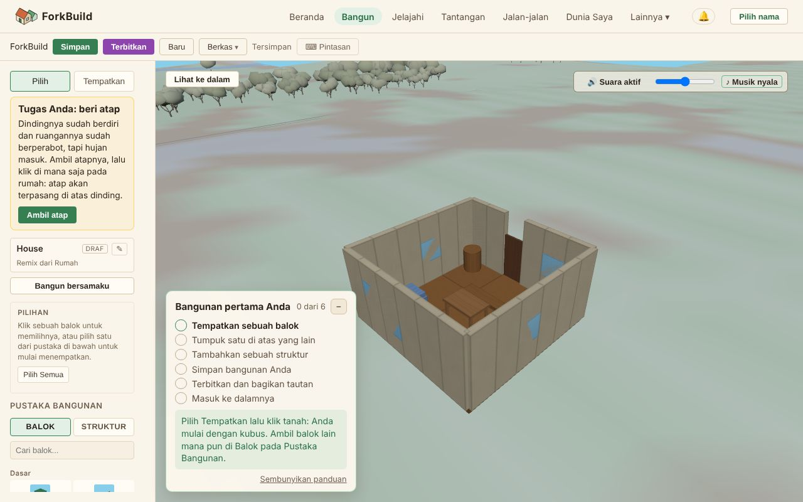

<!-- translation-of: docs/user/02-TheEditor.md source-hash: 1ddea9df5bda977a -->
# 02 — Editor

<!-- languages -->
[English](../02-TheEditor.md) · [Deutsch](../de/02-TheEditor.md) · [Español](../es/02-TheEditor.md) · [Français](../fr/02-TheEditor.md) · **Bahasa Indonesia** · [日本語](../ja/02-TheEditor.md) · [한국어](../ko/02-TheEditor.md) · [Português (Brasil)](../pt-BR/02-TheEditor.md)
<!-- /languages -->

Editor adalah tempat Anda membangun. Panduan ini membahas alat-alatnya,
cara memilih dan mentransformasi balok, dan cara menata bangunan Anda
dengan grup.

## Tata letak


*Bilah alat di atas; di kiri, alat, nama bangunan, panel Pilihan, dan Pustaka Bangunan; di tengah, tampilan 3D.*

```
┌─────────────────────────────────────────────────────────────┐
│ Bilah alat: Simpan · Terbitkan · Baru · Ekspor · Impor ·    │
│             Terbaru · ⌨ Pintasan                            │
├──────────────────────┬──────────────────────────────────────┤
│ [Pilih | Tempatkan]  │                                      │
│ Judul bangunan    ✎  │                                      │
│ Pilihan              │            Viewport 3D               │
│ Pustaka Bangunan     │                                      │
│   [Balok|Struktur]   │                                      │
│                      │                                      │
└──────────────────────┴──────────────────────────────────────┘
```

- **Bilah alat** — pertama **Simpan**, **Terbitkan**, dan **Baru**, lalu
  **Berkas**, menu berisi **Ekspor**, **Model 3D**, dan **Impor**; membuka
  kembali yang terbaru, dan membuka daftar **⌨ Pintasan** (juga `?`).
- **Alat** — beralih antara **Pilih** (`1`) dan **Tempatkan** (`2`).
  **Tempatkan** tetap tersorot selama Anda menempatkan balok atau
  struktur.
- **Judul bangunan** — nama karya yang terbuka. Klik **✎** untuk mengedit
  judul, deskripsi, dan lisensinya. Apakah sudah tersimpan ditampilkan di
  bilah alat.
  Klik judulnya sendiri (**▸**) untuk membuka panel **Tentang bangunan
  ini** yang sama dengan di Tampilan Dunia, dengan **Baca selengkapnya**
  untuk deskripsi yang panjang; **▾** menutupnya lagi, dan Editor
  mengingat pilihan Anda.
- **Pilihan** — hanya menampilkan apa yang dapat bekerja pada pilihan Anda
  saat ini; lihat [Panel Pilihan](#panel-pilihan) di bawah.
- **Pustaka Bangunan** — kotak pencarian dan dua tab. Ketik sebagian nama,
  atau katakan apa yang Anda perlukan dengan kata-kata Anda sendiri:
  *menyeberang sungai* menemukan Jembatan, *tidur* menemukan Tempat Tidur.
  Kata-kata untuk menemukan setiap balok dan struktur sudah ada di dalam
  aplikasi, jadi tidak ada yang dikirim ke mana pun.
  - **Balok** — semua yang dapat Anda tempatkan dengan alat Tempatkan,
    sebagai ubin dalam enam bagian (Dasar, Struktur, Atap & Tangga,
    Bukaan, Detail, Alam): lima puluh sembilan keping, dari setengah
    kubus, balok bulat, dan gelondong kayu hingga atap pelana dan kerucut,
    atap limas yang menutupi seluruh rumah dalam satu keping (4x4, 4x6, dan
    6x6) dan atap pelana panjang 2x4, bingkai jendela dan jendela bulat,
    pagar, bangku, semak, dan pohon pinus, perabot untuk ruangan yang Anda
    masuki (meja, ranjang, perapian, dan rak, di Detail), serta
    **Lentera** yang menyala di malam hari di Tampilan Dunia (lihat
    [Siang dan malam](03-WorldView.md#siang-dan-malam)). Klik salah satunya untuk memilihnya (dan beralih ke
    alat Tempatkan); contoh warna **Warna** lalu muncul untuk memilih
    warnanya — lihat [Warna balok](#warna-balok) di bawah.
    **Lereng 45°**, **Lereng Landai 2x1**, **Tangga**, **Tangga Lebar**, dan
    **Penguat Diagonal 2x2** naik ke satu sisi; putar dua kali (**R**, **R**) untuk membaliknya ke arah lain.
    Penguat Diagonal dan salinannya yang diputar 180° membentuk silang.
  - **Struktur** — dua puluh dua struktur siap pakai dalam lima kategori
    (hunian, pertanian, komersial, komunitas, infrastruktur) dan tiga
    bangunan lebih besar dalam kategori **unggulan**, ditambah
    **Struktur Saya** milik Anda sendiri. Klik sebuah kartu untuk
    menempatkannya — lihat
    [Struktur: menyusun, me-remix, dan pustaka pribadi Anda](#struktur-menyusun-me-remix-dan-pustaka-pribadi-anda)
    di bawah.

### Panel Pilihan

Panel ini berubah sesuai apa yang Anda pilih, jadi tidak pernah menampilkan
tombol yang belum bisa melakukan apa-apa:

- **Tidak ada yang dipilih** — petunjuk singkat, **Pilih Semua**,
  **Tempel** begitu Anda menyalin sesuatu, dan grup-grup Anda (klik salah
  satunya untuk memilih baloknya).
- **Balok dipilih** — berapa banyak, di mana letaknya, dan tindakan
  sehari-hari: **Putar ↻ / ↺**, **Duplikat**, **Hapus**, **Salin**,
  **Tempel**, **Warna**, **Fokus**, dan **Batalkan Pilihan**. Alat yang
  lebih jarang dipakai terlipat di tiga bagian di bawahnya: **Posisi &
  rotasi tepat**, **Ratakan, sebarkan, ulangi**, dan **Grup & cetak biru**.
- **Instans struktur dipilih** — kartunya sendiri sebagai gantinya, dengan
  posisi, rotasi, dan tindakannya (lihat
  [Instans struktur](#instans-struktur-referensi-hidup)).

> **Kiat:** Tekan `Ctrl/Cmd+K` di mana saja untuk membuka **Palet
> Perintah** — daftar yang dapat dicari berisi setiap tindakan di panduan
> ini, berdasarkan nama.

## Coba sekarang: rumah yang perlu diselesaikan

**Coba sekarang** di **Beranda** membuka rumah milik Anda sendiri yang belum
selesai: dindingnya sudah berdiri dan ruangannya sudah berperabot, tetapi
belum beratap. Kartu di bagian atas alat memberi Anda tugasnya, satu langkah
demi satu langkah (**Langkah 1 dari 4**), masing-masing dengan tombol yang
memilih bata yang dibutuhkan dan beralih ke Tempatkan:

1. **Beri atap**: klik **Ambil atap** (**Atap Limas 6x6**), lalu klik di
   mana saja pada rumah: atapnya terpasang di atas dinding.
2. **Cerobong**: klik **Ambil cerobong**, lalu klik di mana saja pada
   rumah: cerobong menembus atap di atas tungku.
3. **Jalan setapak ke pintu**: klik **Ambil batu**, lalu klik empat kali di
   mana saja pada rumah: batu-batunya berjajar dari ambang pintu.
4. **Taman**: klik **Ambil semak**, lalu taruh empat benda di sekitar
   rumah, di mana saja. Semak, pagar, rumput, batu besar, pohon, atau
   lentera dari Pustaka Bangunan semuanya dihitung.

Setiap langkah menghitung bata yang Anda tambahkan, dalam urutan apa pun,
dan urungkan mundur satu langkah. Selama tugas terbuka, kartu **Bangunan
pertama Anda** menunggu terlipat, jadi hanya ada satu petunjuk pada satu
waktu. Setelah keempat langkah selesai, kartu itu mengatakan bahwa rumah itu
kini milik Anda, dengan **Terbitkan** (Terbitkan yang sama dengan di bilah
alat, yang juga bisa Anda pakai kapan saja) dan **Lanjut membangun**, yang
menyimpan kartunya.

Setiap bangunan siap pakai lainnya (kartu di **Beranda**, ide sebuah
tantangan, atau yang dipilih lewat **Baru** di Editor) dibuka dengan kartu
**Jadikan milikmu**. Klik **Ambil pohon** (ini memilih pohon dan beralih ke
Tempatkan), lalu klik tanah di samping bangunan. Begitu ada sesuatu buatan
Anda di dalamnya, kartu itu menawarkan **Terbitkan** dengan cara yang sama. Di
ponsel, kartu itu berada di atas tampilan 3D, di atas tombol sentuh, karena
alat-alatnya terlipat di sana.

## Bangunan pertama Anda

Saat pertama kali Anda membuka Editor di sebuah perangkat, kartu
**Bangunan pertama Anda** muncul di sudut kiri bawah tampilan 3D (di
ponsel, kartu itu mulai terlipat menjadi tombol kecil
**Bangunan pertama · 0/6** di kiri atas, dan selama rumah dari **Coba sekarang** masih punya tugas terbuka, kartu itu juga menunggu terlipat). Kartu itu mencantumkan enam langkah
dan menampilkan petunjuk untuk langkah berikutnya:

1. **Tempatkan sebuah balok**
2. **Tumpuk satu di atas yang lain**: tempatkan balok di atas balok lain.
3. **Tambahkan sesuatu milik Anda**: pasang lima bata milik Anda, satu per
   satu. Struktur yang ditambahkan dari Pustaka Bangunan tidak dihitung.
4. **Simpan bangunan Anda**
5. **Terbitkan dan bagikan tautan**: terbitkan, lalu **Salin tautan** atau
   **Bagikan…**.
6. **Masuk ke dalamnya**: klik **Masuk ke dalamnya**, di samping tautan yang
   ditampilkan Terbitkan (atau di kartu), lalu masuk lewat pintu bangunan
   Anda di Tampilan Dunia (lihat
   [Masuk ke dalamnya](04-PublishingAndForking.md#masuk-ke-dalamnya)).

Setiap langkah dicentang begitu Anda melakukannya, dalam urutan apa pun;
urungkan dan ulangi tidak dihitung. Setelah keenamnya selesai, kartu itu
merayakannya dan menawarkan **Lihat bangunan lain** atau **Terus
membangun**, lalu menghilang; jika sudah selesai sebelum masuk ke dalam menjadi sebuah
langkah, kartu itu tidak muncul lagi. **–** melipatnya menjadi tombol kecil;
**Sembunyikan panduan** menyembunyikannya untuk seterusnya di perangkat
ini. Untuk memunculkannya lagi, buka palet perintah (**Ctrl+K**) dan
jalankan **Panduan Bangunan Pertama**. Perangkat yang sudah memiliki karya
tersimpan memulai dengan panduan tersembunyi.

## Dua alat

### Alat Tempatkan (`2`)

Pilih balok dari palet, arahkan penunjuk ke viewport, lalu klik untuk
menempatkannya. Jika belum ada balok yang dipilih, Tempatkan dimulai dengan
**Kubus**, sehingga klik pertama selalu menempatkan sesuatu. Bayangan tembus
pandang menunjukkan persis di mana balok akan mendarat. Arahkan penunjuk ke
sisi balok yang sudah ada untuk menumpuk atau menempelkan. Balok yang
ditaruh di atas balok lain bertumpu pada balok tertinggi di bawahnya, bukan
di dalamnya: atap yang dijatuhkan di tengah lantai rumah duduk di atas
dindingnya, dan balok melintang di atas dua tiang bertumpu pada tiangnya.

Hanya klik yang menempatkan: tekan lalu lepas tanpa bergerak. Menyeret
untuk melihat sekeliling (dengan tombol apa pun) menggerakkan kamera dan
tidak menempatkan apa pun, jadi Tempatkan bisa tetap aktif selagi Anda
memutar bangunan untuk mencari tempat berikutnya.

Klik di tempat pratinjau berwarna merah tidak menempatkan apa pun: Editor
memberi tahu ada yang menghalangi dan memainkan ketukan pelan yang rendah,
supaya Anda tahu untuk mencoba tempat lain atau memutar bagiannya.

> **Kiat:** Tekan **Escape** untuk kembali ke alat Pilih.

### Alat Pilih (`1`)

Klik balok untuk memilihnya, lalu pindahkan, putar, atau hapus. Di sinilah
Anda menghabiskan sebagian besar waktu begitu bentuk kasarnya sudah jadi.

## Memilih balok

ForkBuild memberi Anda kendali yang presisi atas pemilihan:

| Tindakan | Hasil |
|---|---|
| **Klik** sebuah balok | Memilihnya (menggantikan pilihan saat ini) |
| **Ctrl/Cmd + Klik** | Memasukkan atau mengeluarkan balok itu dari pilihan |
| **Shift + Klik** | Menambahkan balok itu ke pilihan |
| **Shift + Seret** | Menggambar kotak — memilih semua yang ada di dalamnya |
| **Ctrl/Cmd + Shift + Seret** | Memilih dengan kotak dan *menambah* ke pilihan saat ini |
| **Ctrl/Cmd + A** | Memilih setiap balok dalam karya |
| **Escape** | Menghapus pilihan |

> **Mengapa ini penting:** Membangun apa pun yang lebih besar dari satu
> balok berarti bekerja dengan *banyak* balok sekaligus. Pelajari kotak
> pilihan dengan Shift-seret sejak awal — itulah cara tercepat untuk
> mengambil satu dinding utuh.

## Memindahkan, memutar, dan menghapus

Dengan satu balok atau lebih dipilih:

| Tombol | Tindakan |
|---|---|
| **Tombol panah** | Mendorong ke kiri/kanan/depan/belakang |
| **Page Up / Page Down** | Mendorong ke atas / bawah |
| **R** | Memutar 90° searah jarum jam |
| **Shift + R** | Memutar 90° berlawanan arah jarum jam |
| **T** | Miringkan ke sisi berikutnya |
| **Shift + T** | Miringkan ke arah sebaliknya |
| **Delete / Backspace** | Menghapus balok yang dipilih |

Saat Anda memilih beberapa balok, balok-balok itu berputar di sekitar
**pusat bersamanya**, sehingga satu bagian utuh berayun sebagai satu
kesatuan.

**T** merebahkan setiap balok terpilih ke sisi berikutnya, di tempatnya:
tiang rebah menjadi balok melintang, dinding menjadi lantai, lereng terbalik
menjadi bagian menjorok. Setiap balok mempertahankan tinggi alasnya, dan
memiringkan bisa diurungkan dalam satu langkah. Empat kali tekan membuat
balok tegak lagi. Saat menempatkan, **T** memiringkan balok yang akan Anda
tempatkan. Struktur yang ditempatkan diputar, tidak dimiringkan. Versi
ForkBuild yang lebih lama (1.3.0 dan sebelumnya) menampilkan balok miring
dalam posisi tegak.

## Warna balok

Setiap jenis balok memiliki warna bawaannya sendiri, tetapi Anda dapat
memilih warna sendiri:

- **Sebelum menempatkan** — begitu sebuah balok dipilih di tab **Balok**
  pada Pustaka Bangunan, klik contoh warna **Warna**-nya dan pilih warna.
  Setiap balok yang Anda tempatkan sejak itu memakainya, dan bayangan
  penempatan menampilkan pratinjaunya. Memilih jenis balok lain kembali ke
  warna bawaan jenis itu sampai Anda memilih warna lagi.
- **Setelah menempatkan** — pilih satu balok atau lebih dan gunakan contoh
  warna **Warna** di bagian **Pilihan** untuk mewarnai ulang semuanya
  sekaligus. Setiap perubahan dapat diurungkan (`Ctrl/Cmd+Z`) seperti
  suntingan lainnya. Contoh warna tidak ditawarkan untuk pilihan instans
  struktur — edit bangunan struktur itu sendiri sebagai gantinya (lihat
  [Instans struktur](#instans-struktur-referensi-hidup) di bawah).

Di samping setiap contoh **Warna** ada sederet **warna desa** (plester,
batu, bata, merah genteng, kayu ek, daun, langit, dan lainnya) yang serasi:
satu klik memilihnya, untuk balok berikutnya atau untuk pilihan. Contoh
warna tetap bisa dipakai untuk memilih warna apa pun.

Warna balok disimpan bersama karya Anda dan ikut terbawa saat Anda
menerbitkan atau membagikannya.

## Transformasi presisi: masukan angka, perataan, dan pengulangan

Bagian-bagian yang terlipat di panel Pilihan memberi Anda cara yang lebih
tepat untuk memindahkan pilihan, di samping gizmo dan tombol-tombol di
atas:

- **Posisi & rotasi tepat** — ketik nilai X/Y/Z/Rotasi yang tepat alih-alih
  menyeret. Alihkan ke **Absolut** (nilai menjadi sasaran bagi
  poros/orientasi pilihan) atau **Selisih** (nilai ditambahkan sebagai
  selisih), lalu tekan **Terapkan** (atau `Enter` di sebuah kolom). Kolom
  kosong berarti "biarkan tidak berubah", bukan nol. **Atur ulang isian**
  mengosongkan kolom tanpa menyentuh pilihan.
- **Perataan & Penyebaran** (di bawah **Ratakan, sebarkan, ulangi**) —
  sembilan tombol untuk meratakan tepi atau tengah seluruh pilihan pada
  sumbu dunia (← Kiri/Tengah X/Kanan →, ↓ Bawah/Tengah Y/Atas ↑,
  Depan/Tengah Z/Belakang), ditambah tiga untuk menyebarkannya merata
  (Sebarkan X/Y/Z). Perataan memerlukan **2+ balok** yang dipilih;
  penyebaran memerlukan **3+**.
- **Ulangi** (juga di bawah **Ratakan, sebarkan, ulangi**) — membuat **N**
  salinan tambahan dari pilihan, berjarak sama sepanjang satu sumbu. Jika
  ada salinan yang akan bertabrakan, tidak ada salinan yang dibuat sama
  sekali.

Masing-masing adalah **satu langkah urung**, persis seperti seretan gizmo
atau dorongan keyboard — lihat
[Referensi Kontrol](ControlsReference.md#transformasi--panel-angka-hanya-editor)
untuk perilaku lengkap per kolom.

Tombol **Fokus** di panel Pilihan membingkai kamera pada balok yang dipilih
tanpa mengubah apa pun.

> **Tabrakan diblokir.** Menyeret gizmo atau mendorong dengan keyboard
> memeriksa hasilnya terhadap setiap balok di luar pilihan. Jika
> melepaskannya akan membuat anggota mana pun mendarat di atas salah
> satunya, seluruh pemindahan dibatalkan alih-alih diterapkan — setiap
> balok dalam pilihan kembali tepat ke tempat awalnya, tanpa entri urung
> baru. Menata ulang balok *di dalam* pilihan Anda sendiri (seperti
> menukar tempat dua balok dengan rotasi) tidak pernah dianggap tabrakan.

## Salin, tempel, dan duplikat

| Tombol | Tindakan |
|---|---|
| **Ctrl/Cmd + C** | Menyalin balok yang dipilih |
| **Ctrl/Cmd + V** | Menempelkannya (sedikit digeser agar terlihat) |
| **Ctrl/Cmd + D** | Menduplikasi pilihan di tempat — salin dan tempel dalam satu langkah |

Salin lalu tempel sangat cocok untuk elemen yang berulang — buat satu
jendela, lalu salin-tempel di sepanjang fasad. **Duplikat** melakukan hal
yang sama dalam satu gerakan dan satu langkah urung, dan tidak menyentuh
papan klip Anda: Ctrl+C sebelumnya masih ada untuk ditempel setelah Anda
menduplikasi sesuatu yang lain. Hasil duplikat menjadi pilihan baru Anda,
jadi alur alaminya adalah pilih → duplikat → seret atau dorong ke tempatnya.
Duplikat bekerja pada pilihan apa pun — balok lepas, satu grup penuh, atau
satu [instans struktur](#instans-struktur-referensi-hidup).

## Urungkan dan ulangi

Setiap perubahan dicatat, jadi Anda selalu dapat kembali:

| Tombol | Tindakan |
|---|---|
| **Ctrl/Cmd + Z** | Mengurungkan tindakan terakhir |
| **Ctrl/Cmd + Y** *(atau Ctrl/Cmd+Shift+Z)* | Mengulanginya |

Memindahkan sepuluh balok dihitung sebagai **satu** langkah urung, jadi
urungkan tetap mudah dikelola bahkan pada bangunan besar.

Selama kalian membangun bersama (**Bangun bersamaku**, di bawah), Urungkan
hanya membatalkan langkah Anda sendiri, tidak pernah langkah teman, dan di
semua layar sekaligus; Ulangi mengembalikannya. Jika sejak itu teman telah
mengubah apa yang dibuat oleh langkah Anda (misalnya menghapus balok yang Anda
tempatkan), langkah itu dilewati dan Editor memberi tahu Anda. Saat seseorang
bergabung, Urungkan semua orang dimulai lagi dari situ: pendatang baru tidak
pernah memiliki langkah-langkah yang dibuat sebelumnya.

## Grup

Grup memungkinkan Anda memberi nama dan memakai ulang kumpulan balok —
seperti "Atap" atau "Jendela".

**Membuat grup:**
1. Pilih beberapa balok.
2. Buka bagian **Grup & cetak biru** di panel Pilihan dan klik **Grup
   baru**, lalu beri nama dengan **Ganti nama grup** (di bawah).

**Memakai grup:** klik nama sebuah grup di daftar untuk memilihnya (beserta
baloknya) — daftarnya ada di panel Pilihan saat tidak ada yang dipilih, dan
di **Grup & cetak biru** jika ada. Tombol-tombol ini bekerja pada grup mana
pun yang sedang dipilih:

| Tombol | Fungsinya |
|---|---|
| **Ganti nama grup** | Mengubah nama grup |
| **Duplikat grup** | Menyalin seluruh grup *dan* baloknya |
| **Hapus grup** | Menghapus grup (baloknya sendiri tetap ada) |
| **Tambahkan ke grup** | Menambahkan pilihan Anda saat ini ke grup |
| **Keluarkan dari grup** | Mengeluarkan pilihan Anda saat ini dari grup |

> **Perlu diketahui:** Memilih sebuah grup hanya memilih baloknya — tidak
> pernah mengubah grupnya. Dan menghapus grup hanya menghapus *labelnya*,
> bukan balok di dalamnya.

## Struktur: menyusun, me-remix, dan pustaka pribadi Anda

Tab **Struktur** di Pustaka Bangunan (lihat [Tata letak](#tata-letak) di
atas) memberi Anda dua puluh dua struktur siap pakai — rumah, lumbung, sumur,
pasar, kincir, jembatan, dan lainnya, dalam lima kategori — dan tiga
bangunan lebih besar dalam kategori **unggulan** (kastil, pulau pelabuhan, dan
alun-alun desa), ditambah
**Struktur Saya**, koleksi pribadi Anda berisi apa pun yang Anda simpan
dari sebuah bangunan. Ada tiga hal berbeda yang dapat Anda lakukan dengan
salah satunya, dan masing-masing penting untuk alasan yang berbeda:

- **Tempatkan** (klik kartunya) — menyalin balok struktur langsung ke
  bangunan yang sedang Anda kerjakan, sehingga menjadi bagian dari satu
  bangunan yang lebih besar. Inilah tindakan sehari-hari.
- **Remix Sebagai Bangunan Baru** (di menu **⋮** kartu) — memulai bangunan
  baru yang mandiri yang berawal sebagai salinan persis struktur itu.
- **Remix ke Struktur Saya** (hanya kartu bawaan, di menu **⋮**) —
  menambahkan struktur ke **Struktur Saya** milik Anda, tanpa melibatkan
  bangunan sama sekali. Lihat
  [Struktur Saya](#struktur-saya-pustaka-cetak-biru-pribadi-anda) di
  bawah.
- **Info** (di menu **⋮** kartu) — tampilan baca-saja berisi nama,
  kategori, jumlah balok, jejak, tinggi, sumber, dan deskripsi struktur.
- Tempatkan **bangunan tersimpan** milik Anda sendiri sebagai **instans
  struktur** — referensi hidup yang dapat dipakai ulang, bukan salinan —
  dari dropdown **Terbaru** di bilah alat, bukan dari Pustaka Bangunan.
  Lihat [Instans struktur](#instans-struktur-referensi-hidup) di bawah.

### Menempatkan struktur ke dalam bangunan Anda

Klik kartu mana pun di tab **Struktur** — yang bawaan atau salah satu
**Struktur Saya** milik Anda — dan pratinjau bayangan tembus pandang dari
seluruh struktur muncul, mengikuti penunjuk Anda di atas tanah, persis
seperti menempatkan satu balok:

1. Gerakkan penunjuk untuk memosisikan bayangan.
2. Tekan `R` / `Shift+R` untuk memutarnya per 90°.
3. Klik untuk menerapkan — setiap balok dalam struktur ditambahkan ke
   bangunan Anda sebagai satu **langkah urung**. Posisi yang terisi
   mewarnai bayangan menjadi merah dan menolak kliknya, sama seperti satu
   balok menolak ditempatkan di atas balok lain.
4. `Escape` membatalkan — tidak ada yang ditambahkan, dan Anda kembali ke
   alat yang Anda pakai sebelumnya.

Balok yang Anda dapatkan adalah balok biasa di bangunan Anda sejak saat
mendarat — tidak dapat dibedakan dari apa pun yang Anda tempatkan dengan
tangan, bebas diedit, dipilih, dikelompokkan, atau dihapus seperti yang
lain. Menempatkan beberapa struktur adalah cara cepat membangun sebuah
adegan: klik Rumah, tempatkan; klik Lumbung, tempatkan di sampingnya; klik
Sumur, tempatkan di halaman.

### Me-remix struktur sebagai bangunan baru

Buka menu **⋮** sebuah kartu dan klik **Remix Sebagai Bangunan Baru** untuk
memulai karya baru milik Anda yang berawal sebagai salinan persis struktur
itu — balok yang persis sama, dapat diedit dengan setiap alat di panduan
ini, dalam bangunannya sendiri alih-alih dilebur ke apa pun yang sedang Anda
buka. Remix tidak pernah mengubah salinan milik pustaka: remix Rumah sepuluh
kali dan masing-masing menjadi karya mandiri sejak Anda mengeklik Remix.

### Struktur Saya: pustaka cetak biru pribadi Anda

Membangun sesuatu yang layak dipakai ulang? Pilih balok-balok yang
menyusunnya (satu bangunan utuh, atau hanya sebagian) dan klik **Buat
Cetak Biru** — tombol itu ada di bagian **Grup & cetak biru** pada panel
Pilihan begitu Anda memilih balok, dan di Palet Perintah (`Ctrl/Cmd+K`)
kapan pun. Sebuah dialog kecil meminta **nama**, **kategori**, dan
**deskripsi** opsional, dengan pratinjau langsung dari apa yang akan Anda
simpan; klik **Buat Cetak Biru** dan struktur itu dinormalkan ke titik asal
lokalnya sendiri dan langsung disimpan ke **Struktur Saya**, bagian baru di
bawah tab Struktur, tepat di bawah kategori bawaan.

Ada cara kedua sebuah struktur masuk ke Struktur Saya, tanpa ada yang perlu
dipilih atau dibangun terlebih dahulu: buka menu **⋮** pada kartu
**bawaan** mana pun dan klik **Remix ke Struktur Saya**. Struktur itu
ditambahkan persis apa adanya — tidak ada bangunan yang dibuat, tidak ada
yang diekstrak — jadi siap untuk Ganti Nama, Ekspor, atau ditempatkan
langsung, seperti entri lain di pustaka Anda.

Struktur di **Struktur Saya** bekerja persis seperti yang bawaan — klik
untuk menempatkannya ke bangunan Anda saat ini, atau Remix Sebagai Bangunan
Baru — dengan dua tindakan tambahan di menu **⋮**-nya:

| Tindakan | Fungsinya |
|---|---|
| **Ganti Nama** | Mengubah namanya (kategori dan deskripsinya tetap) |
| **Hapus** | Menghapusnya dari pustaka Anda |

**Struktur Saya** hanya menyimpan *struktur itu sendiri* — nama dan
sekumpulan balok. Menghapus satu struktur tidak pernah menyentuh apa pun
yang sudah Anda bangun dengannya: setiap tempat yang sudah Anda tempati
atau remix dengannya tetap menyimpan balok-balok itu apa adanya. Dan
struktur itu tidak pernah diedit di tempat — jika Anda ingin mengubah apa
yang sebenarnya dibangun oleh struktur tersimpan, tempatkan ke sebuah
bangunan, edit bangunan itu, lalu **Buat Cetak Biru** lagi (secara opsional
dengan nama baru, seperti "Farmstead Deluxe" — itu menjadi entri tersendiri
di Struktur Saya, bukan pengganti yang asli).

> **Perlu diketahui:** Struktur Saya ada di perangkat ini. Struktur Saya
> tidak terikat pada identitas Anda atau disinkronkan ke mana pun secara
> otomatis — lihat
> [Berbagi cetak biru](#berbagi-cetak-biru-ekspor-dan-impor) di bawah untuk
> cara memindahkannya ke perangkat lain atau memberikannya kepada orang
> lain.

### Berbagi cetak biru: ekspor dan impor

Struktur apa pun — yang bawaan atau milik Anda sendiri — dapat keluar dari
perangkatnya sebagai file portabel, tanpa pernah menjadi bagian dari Dunia
bersama yang diterbitkan:

- **Ekspor Cetak Biru** (di menu **⋮** kartu mana pun) mengunduhnya sebagai
  file JSON kecil — snapshot mandiri berisi nama, kategori, tag, deskripsi,
  dan balok struktur itu.
- **Impor Cetak Biru** (tombol di samping judul **Struktur Saya**) membaca
  file cetak biru dan menambahkannya ke Struktur Saya Anda sebagai entri
  baru yang mandiri — salinan baru dengan identitasnya sendiri, tidak
  pernah terhubung kembali ke asalnya. Mengimpor file yang sama dua kali
  memberi Anda dua entri terpisah, bukan satu yang diam-diam menimpa yang
  lain. File yang rusak atau tidak dikenali ditolak dengan penjelasan,
  alih-alih diam-diam menghasilkan sesuatu yang rusak.

Begitulah cara Anda memberikan sebuah bangunan kepada teman, atau membawa
struktur Anda antarperangkat Anda sendiri: ekspor di satu sisi, kirim file
dengan cara apa pun yang Anda suka, impor di sisi lain.

**Ekspor Semua** (di samping **Impor Cetak Biru**, begitu Anda memiliki
struktur sendiri) mengunduh setiap struktur di Struktur Saya sebagai satu
file, masing-masing dengan atribusi dan klaim silsilahnya. **Impor Cetak
Biru** juga membaca file itu, dan melewati desain yang sudah ada di Struktur
Saya, jadi mengimpornya dua kali tidak menghasilkan duplikat. Untuk
menyimpan salinan semua hal lainnya juga, gunakan [Data Anda](13-YourData.md).

### Mengklaim kepengarangan

Struktur yang memiliki identitas Cetak Biru (kebanyakan yang tersimpan
memilikinya) juga dapat membawa **Atribusi Komunitas** — catatan
bertanda tangan tentang siapa yang mengklaim telah merancangnya. Buka
panel **Info** struktur dari kartunya dan Anda akan menemukan:

- **Klaim kepengarangan** — menandatangani klaim, dengan identitas Anda
  saat ini, bahwa Anda salah satu perancangnya. Beberapa orang dapat
  masing-masing mengklaim desain yang sama secara terpisah; klaim siapa
  pun tidak pernah menimpa atau menggantikan klaim orang lain.
- **Ekspor Atribusi** / **Terbitkan ke Jaringan** — begitu Anda
  mengklaimnya, bagikan klaim itu sebagai file atau umumkan kepada rekan
  yang terhubung.
  Setelah **Terbitkan ke Jaringan**, panel menawarkan **Distribusikan**,
  yang membawa klaim itu ke jaringan terdesentralisasi juga (lihat
  [Distribusi](Distribution.md)).
- **Tandatangani ulang untuk desain ini** — klaim yang dibuat sebelum 28
  September 2026 memakai jenis sidik jari desain lama yang dapat ditiru
  oleh desain lain, jadi klaim itu tidak lagi dihitung dan panel
  menyebutkan berapa banyaknya. Jika salah satunya milik Anda dan ini
  memang desain Anda, tombol ini menandatangani klaim Anda lagi. Periksa
  desainnya terlebih dahulu: tombol ini muncul untuk desain apa pun yang
  berbagi sidik jari lama itu.

Ini opsional, dan sepenuhnya terpisah dari menempatkan, me-remix, atau
membagikan struktur itu sendiri — fitur ini ada untuk situasi saat Anda
ingin melekatkan nama Anda pada sebuah desain dengan cara yang dapat
diverifikasi orang lain secara mandiri, bukan sekadar dipercaya. Lihat
[Catatan Bertanda Tangan & Bukti Eksternal](09-PublicationsAndEvidence.md) untuk apa
yang terjadi pada klaim setelah Anda menerbitkannya, dan cara melekatkan
bukti eksternal yang mandiri padanya.

## Instans struktur: referensi hidup

Menempatkan (di atas) menyalin balok struktur ke bangunan Anda sekali.
Terkadang yang Anda inginkan justru salinan **hidup** dari sesuatu yang
sudah Anda bangun — bangunan tersimpan apa pun, bukan hanya yang ada di
pustaka — yang selalu selaras dengan sumbernya setiap kali Anda melihatnya.
Itulah **instans struktur**: instans merujuk bangunan sumber alih-alih
menyalin baloknya, sehingga mengedit sumbernya nanti otomatis memperbarui
setiap instansnya.

1. Buka dropdown **Terbaru** di bilah alat. (Dropdown ini muncul setelah
   Anda menyimpan setidaknya satu bangunan.)
2. Di samping bangunan tersimpan mana pun, klik **Tempatkan**. Mengeklik
   nama bangunan justru membukanya, menggantikan apa yang sedang Anda buka.
3. Arahkan penunjuk ke tanah, tekan `R` untuk memutar, dan klik untuk
   menempatkannya — persis seperti menempatkan balok.

Instans adalah *referensi* hidup ke bangunan itu, bukan salinan baloknya:
bangunan yang sama dapat ditempatkan berapa kali pun, dan mengedit balok
bangunan sumber nanti memperbarui setiap instansnya. Pilih sebuah instans
dengan alat Pilih (`1`) dan bilah sisi menampilkan:

| Kontrol | Fungsinya |
|---|---|
| Seret di viewport, atau [gizmo](InteractiveTransformGizmo.md) | Memindahkan / memutar, sama seperti balok |
| Tombol panah / Page Up / Page Down | Mendorong |
| **Kolom X / Z / Rotasi °, lalu Terapkan** | Menetapkan posisi dan arah yang tepat — ketinggian (Y tanah) selalu mengikuti medan dan bukan sasaran yang Anda tetapkan |
| **Putar ↻ / ↺** | Memutar tepat 90° |
| **Duplikat** (`Ctrl/Cmd+D`) | Menempatkan instans lain dari struktur yang sama |
| **Hapus** | Menghapus instans ini — bangunan sumbernya tidak tersentuh |
| **Edit Bangunan Sumber** | Membuka bangunan yang dirujuk itu sendiri, untuk mengubah tampilan setiap instansnya |

Mengedit *isi* struktur yang ditempatkan selalu dilakukan dengan mengedit
bangunan sumbernya — tidak ada cara untuk mengedit balok sebuah instans
secara langsung, dan justru itulah yang menjaga setiap instansnya tetap
selaras.

## Properti Bangunan

Setiap karya memiliki **judul**, **deskripsi** opsional, **lisensi**, dan
pengaturan **Siapa yang dapat menempatkannya di Dunia** — atur semuanya di
dialog **Properti Bangunan**, yang dibuka dengan tombol **✎** di samping
judul bangunan di bagian atas bilah sisi Editor (di Tampilan Dunia,
tombolnya **Edit Metadata**). Bangunan baru dimulai tanpa lisensi, yang
berarti tidak ada orang lain yang dapat me-remix-nya sampai Anda memilih
lisensi. Deskripsinya muncul sebagai cuplikan di kartunya di **Jelajahi** dan
juga dapat dicari di sana; lisensi menentukan apakah — dan bagaimana —
orang lain boleh me-remix-nya. Lihat
[Penerbitan & Remix](04-PublishingAndForking.md) untuk arti setiap lisensi.

Tombol **Sarankan judul** dan **Sarankan deskripsi** di bawah judul
menawarkan ide dari balok-balok bangunan: struktur Pustaka Bangunannya,
bagian dan warna utamanya, dan untuk remix, apa yang ditambahkannya pada
bangunan asalnya (*Kincir dan Lumbung dengan Lumbung*). Tekan
**Sarankan judul** lagi untuk ide berikutnya. Deskripsi yang disarankan
mengisi deskripsi kosong, atau ditambahkan setelah yang Anda tulis. Itu
hanya saran, dihitung di perangkat Anda; ubahlah sesuka Anda.

Deskripsi yang panjang lebih mudah dibaca dengan sedikit format, yang
ditampilkan oleh panel Informasi Bangunan, penjelajah lokasi di Tampilan
Dunia, serta postingan Steem dan Blurt:

| Tulis | Hasilnya |
|---|---|
| satu baris kosong | paragraf baru (satu pindah baris tetap pindah baris) |
| `## Bahan` di awal baris | judul |
| `- ` (atau `* `) di awal baris | butir daftar |
| `**kata**` | **tebal** |
| `*kata*` | *miring* |
| `\*`, `\#`, `\-` | karakter itu sendiri |

Selain itu bukan format: tautan, gambar, dan HTML tetap teks biasa. Kartu di
**Jelajahi** menampilkan kata-kata deskripsi dalam satu baris, tanpa format.

**Tag** menyebut apa bangunan ini, misalnya `jepang kuil taman`: hingga 5,
dipisahkan spasi atau koma, masing-masing dari huruf kecil, angka, dan tanda
hubung (aksen dihapus, jadi `café` menjadi `cafe`). Bila bangunan belum
punya, dialog mengisi kolom dengan saran dari judul dan deskripsi, yang bisa
Anda simpan, ubah, atau hapus; tombol di bawah kolom menambahkan saran lain.
Remix tetap membawa tagnya. Postingan Blurt mencantumkannya setelah tag
ForkBuild sendiri, sehingga orang yang menjelajah Blurt lewat tag bisa
menemukan bangunan Anda.

## Suara

Setiap perubahan yang Anda buat memiliki suara pendeknya sendiri, sehingga
Anda dapat mendengar apa yang terjadi tanpa melihat: bunyi klik saat balok
atau struktur ditempatkan, bunyi pop saat dihapus, bunyi tik untuk
pemindahan dan tik ganda untuk putaran, rangkaian bip cepat untuk tempel
atau duplikat, denting terang untuk warna baru, dua nada untuk
pengelompokan, lonceng untuk memberi nama tempat, bip menurun untuk urungkan
dan bip menaik untuk ulangi, serta akor kecil saat Anda menyimpan. Perubahan
yang dibuat kolaborator di bangunan yang sama tidak bersuara.

Matikan atau nyalakan suara dengan tombol **Suara** di kanan atas tampilan
atau dengan menekan `M` (tercantum di daftar Pintasan Keyboard, `?`);
penggeser di sampingnya mengatur volume. Ini pengaturan yang sama dengan
milik Tampilan Dunia, diingat di perangkat ini. Suara dimulai dengan klik
atau tekanan tombol pertama Anda, sebagaimana diwajibkan browser.

Musik diputar pelan saat Anda membangun, sedikit lebih riang daripada di Tampilan Dunia. Tombol **♪ Musik** di samping penggeser menyalakan atau mematikannya; pilihannya sama dengan di Tampilan Dunia.

## Menyimpan, menerbitkan, memulai ulang

- **Simpan** (`Ctrl+S`) — menyimpan pekerjaan Anda di perangkat ini.
- **Terbitkan** — membagikannya kepada semua orang (lihat
  [Penerbitan & Remix](04-PublishingAndForking.md)). Menerbitkan juga
  menyimpannya. Bangunan yang dimulai dari bangunan siap pakai dan belum
  berisi apa pun buatan Anda ditanyai sekali: **Terus membangun**, atau
  **Tetap terbitkan**. Pesan sesudahnya berupa satu bilah: **Masuk ke
  dalamnya** dan **Salin tautan**, dengan **Cara lain untuk berbagi** yang
  berisi tautan itu sendiri, **Simpan gambar**, **Buat video**,
  dan **Sematkan**. Pengingat
  untuk menambahkan frasa sandi ke identitas yang Anda pakai untuk
  menerbitkan menunggu penerbitan berikutnya jika identitas itu baru saja
  dibuat.
- **Baru** — memulai sesuatu yang baru: **Lahan kosong**, atau salah satu
  bangunan siap pakai (kastil, pulau pelabuhan, alun-alun desa, rumah,
  kincir, dan jembatan) sebagai salinan Anda sendiri, terlihat utuh. Jika
  yang sedang terbuka memiliki perubahan belum disimpan, Baru memberi tahu
  dulu; simpan untuk mempertahankannya.
- **Berkas** — menu berisi tiga lagi:
  - **Ekspor** — mengunduh bangunan saat ini sebagai file JSON, untuk menyimpan
    salinan atau memindahkannya ke perangkat lain. File memakai format ringkas
    yang menyimpan balok sebagai tabel.
  - **Model 3D** — mengunduh bangunan sebagai model 3D untuk program lain
    (lihat [Mengunduh model 3D](#mengunduh-model-3d)).
  - **Impor** — membuka file yang diekspor sebagai bangunan baru dengan
    identitasnya sendiri; tidak ada yang disimpan sampai Anda **Simpan**. File
    yang diekspor versi sebelumnya tetap dapat dibuka (dikonversi saat
    dimuat), tetapi ForkBuild 1.0.0 dan yang lebih lama tidak dapat membuka
    file yang diekspor versi ini.
  Jika Anda yang membuat bangunan itu, **Ekspor** menandatangani filenya,
  sehingga siapa pun yang mengimpornya dapat memercayai nama dan lisensi di
  dalamnya. Bangunan Anda sendiri diimpor sebagai dirinya sendiri. Bangunan
  orang lain dibuka sebagai salinan Anda sendiri yang mencantumkan
  pembuatnya, jika lisensinya mengizinkan remix; jika tidak, atau jika file
  diubah setelah pembuatnya menandatanganinya, file tidak diimpor. File
  membawa lisensi yang dimiliki bangunan saat Anda mengekspornya, jadi Anda
  dapat menerbitkan bangunan sebagai **All Rights Reserved** dan tetap
  memberi seseorang salinan yang boleh ia kembangkan: pilih lisensi lain di
  **Properti Bangunan**, ekspor, lalu kembalikan. **Ekspor Semua Bangunan**
  dan **Impor**-nya, di **Terbaru**, bekerja dengan cara yang sama.
- **Terbaru** — membuka kembali sesuatu yang pernah Anda simpan (muncul
  setelah penyimpanan pertama; klik nama bangunan untuk membukanya). Begitu
  Anda menyimpan cukup banyak bangunan, kotak saring muncul sehingga Anda
  dapat langsung melompat ke salah satunya berdasarkan nama. Setiap entri
  juga memiliki tombol **Tempatkan** — lihat
  [Instans struktur](#instans-struktur-referensi-hidup) — untuk
  menambahkannya ke bangunan *saat ini* alih-alih menggantinya. **Ekspor
  Semua Bangunan** di bagian bawah mengunduh setiap bangunan tersimpan
  sebagai satu file; **Impor** membacanya kembali, menyimpan bangunan yang
  belum ada di perangkat ini (buka dari Terbaru), melewati yang sudah ada
  tanpa perubahan, dan menyimpan salinan di samping bangunan yang ada dalam
  versi berbeda. Perubahan yang belum disimpan tidak disertakan, jadi
  simpan terlebih dahulu.

## Bangun bersamaku: membangun bersama, secara langsung

**Bangun bersamaku**, di bawah nama bangunan di bilah sisi, membuat tautan
yang memungkinkan teman membangun bangunan ini bersama Anda, pada saat yang
sama. Kirimkan dengan cara apa pun; tautan itu juga tampil sebagai kode QR
untuk ponsel. Teman yang membukanya memilih nama jika belum (baloknya ditambahkan
atas namanya), mengklik **Bergabung**, lalu bangunan Anda terbuka di
Editor-nya. Sejak itu, setiap balok yang ditempatkan, dipindahkan, diwarnai
ulang, atau dihapus oleh salah satu dari kalian muncul di kedua layar.

- Sebuah strip di atas adegan menunjukkan siapa yang sedang membangun,
  masing-masing dengan warnanya sendiri, dan kalian masing-masing melihat ke
  mana yang lain menunjuk dan apa yang ia pilih, dengan warna itu.
- **Urungkan** (`Ctrl/Cmd + Z`) membatalkan langkah terakhir Anda sendiri di
  semua layar, dan **Ulangi** mengembalikannya; langkah teman-teman Anda hanya
  bisa diurungkan oleh mereka sendiri.
- Bangunan itu harus milik Anda sendiri: yang Anda mulai, atau salinan yang
  Anda buat. Bangunan yang Anda mulai sebelum memilih nama menjadi milik Anda saat
  Anda mengundang teman ke sana.
- Siapa pun yang membuka tautan dalam 30 menit pertamanya dapat bergabung,
  selama bangunan tetap terbuka di Editor Anda. Semua yang sudah bergabung
  dapat membangun sampai Anda menekan **Hentikan**, membuka bangunan lain,
  atau keluar dari Editor. **Tautan** di strip menampilkan tautan itu lagi.
- Editor setiap teman menyimpan salinannya sendiri di perangkatnya. Saat
  Anda berhenti, ia boleh menyimpannya, tetapi perubahannya tidak lagi
  sampai kepada Anda.
  Teman yang tidak memasang balok apa pun tidak dicantumkan, jadi
  salinannya tetap bangunan Anda: saat dipulihkan dari cadangan, salinan
  itu mengikuti lisensi bangunan, seperti milik orang lain.
- Semua orang yang baloknya diterima bangunan Anda dicantumkan di bangunan
  itu: panel bangunan menampilkan **Dibangun bersama** dan nama mereka, dan
  saat Anda menerbitkan, tautan yang dibagikan dan silsilahnya juga
  menyebutkannya, di bawah tanda tangan Anda. Salinan setiap teman
  menampilkan pencantuman yang sama. Salinan yang dibuat orang lain dari
  bangunan itu dimulai tanpa pencantuman tersebut; salinan itu adalah
  bangunan baru.
- Setiap nama yang dicantumkan, dan pembuat bangunan yang dibagikan, membuka
  halaman orang itu: bangunan yang ditandatangani identitasnya, dan bangunan
  tempat orang lain mencantumkannya. Di silsilah, judul setiap bangunan
  membukanya, dan nama pembuatnya serta rekan-rekan pembangunnya membuka
  halaman mereka. **Dunia Saya** menampilkan **Bangunan yang Anda bantu
  buat**, yaitu bangunan tempat seorang teman mencantumkan Anda,
  masing-masing membuka Dunianya setelah diterbitkan; perangkat Anda yang
  lain juga menampilkannya, setelah terhubung ke perangkat ini (atau diberi
  salinan data Anda).
- Bergabung menghubungkan kedua perangkat Anda secara langsung, seperti
  **Jalan di sini bersamaku**: masing-masing dapat melihat alamat IP yang
  lain. Tidak ada yang menjadi rekan yang diingat atau teman kecuali Anda
  memilihnya. Fitur ini memerlukan server rendezvous; situs resmi
  memilikinya.

## Mengunduh model 3D

**Model 3D**, di bawah **Berkas** di bilah alat, mengunduh yang sedang terbuka sebagai berkas
yang dapat dibuka program 3D lain, dibuat di perangkat ini (tidak ada yang
diunggah):

- **glTF (.glb)** — berwarna. Terbuka di Blender, Penampil 3D Windows, mesin
  game seperti Godot dan Unity, dan penampil model daring. Satu satuan
  ForkBuild sama dengan satu meter.
- **Untuk cetak 3D (.stl)** — satu warna, dalam milimeter skala 1:100 (pintu
  setinggi 20 mm, kubus 10 mm), dengan Z ke atas dan berdiri di alas cetak,
  sehingga slicer (Cura, PrusaSlicer, Bambu Studio…) membukanya siap cetak;
  perbesar di sana jika ingin lebih besar. Bata yang bersentuhan atau
  bertumpuk tetap bagian terpisah, yang disatukan slicer saat slicing.
- **OBJ (.obj)** — berwarna (sebagai warna verteks), untuk program lama.

Setiap bata mempertahankan bentuk dan warna persisnya di ForkBuild, dan
struktur yang Anda tempatkan ikut jika ada di perangkat ini (pesannya
memberi tahu jika ada yang tidak). Setiap berkas menyebut bangunan,
pembuatnya, lisensinya, dan sumber remix-nya: di copyright dan extras glTF,
di header STL, dan sebagai komentar di OBJ. Halaman bangunan yang dibagikan
menawarkan unduhan yang sama jika lisensinya mengizinkan salinan (lihat
[Apa yang dibuka sebuah tautan](04-PublishingAndForking.md#apa-yang-dibuka-sebuah-tautan)).

## Jelaskan bangunan

Tekan `I`, atau pilih **Jelaskan Bangunan** di Palet Perintah, dan Editor
menyebutkan isi bangunan Anda: berapa balok, kira-kira seberapa lebar,
dalam, dan tinggi, struktur Pustaka Bangunan yang ada di dalamnya, jendela,
pintu, atap, pohon, dan bagian lain di antara balok lainnya, serta warna
utamanya, dinamai menurut warna desa. Pembaca layar membacakannya; teksnya
juga tetap di atas tampilan 3D sampai Anda menekan **Tutup**, cara cepat
memeriksa bangunan tanpa memutar kamera mengelilinginya. Semua dihitung di
perangkat Anda dari baloknya, jadi tidak ada yang dikirim ke mana pun.
Gambar bangunan di tautan bagikannya dan di sematan membawa penjelasan yang
sama untuk pembaca layar.

## Perintah dengan kata-kata sendiri

Ketik apa yang Anda inginkan di Palet Perintah (`Ctrl/Cmd+K`) dengan
kata-kata Anda sendiri, misalnya *cat atap jadi merah*, *pilih semua
jendela*, atau *hapus pohon*, dan baris pertamanya, **Dari kata-kata
Anda**, menyebutkan apa yang akan dilakukan dan pada berapa balok: *Cat 4
jendela menjadi Biru pelabuhan*. Tekan `Enter`, atau kliknya, untuk
melakukannya dalam satu langkah yang bisa diurungkan. Palet memahami
mengecat, memilih, dan menghapus; bagian-bagian bangunan (jendela, pintu,
atap, tangga, lengkungan, pagar, cerobong, perabot, lentera, pohon, semak,
batu, dan rumput), *semua*, atau yang sedang dipilih (*ini*, *itu*); serta
warna desa dengan namanya atau kata sehari-hari (*merah*, *abu-abu tua*,
*biru muda*). Ini bekerja di setiap bahasa ForkBuild, di perangkat Anda;
ketikan lain tetap mencari tindakan seperti biasa.

## Ucapkan perintah (suara)

Tekan `V`, atau **🎤 Suara** di atas tampilan 3D, lalu ucapkan yang Anda
inginkan: *cat atap jadi merah*, *pilih semua jendela*, *hapus pohon*,
*urungkan*. Tekan `V` (atau **Berhenti**) jika sudah selesai; ForkBuild
menyebutkan apa yang didengarnya dan apa yang dilakukannya, dalam satu
langkah yang bisa diurungkan. Ia memahami permintaan yang sama dengan
[Perintah dengan kata-kata sendiri](#perintah-dengan-kata-kata-sendiri), dan
setiap tindakan yang disebut namanya. Pertanyaan (*bagaimana cara
mengajak teman?*) menawarkan **Tanyakan ke panduan**.

Pertama kali, ia menjelaskan apa yang diunduh saat suara dinyalakan, sekitar
70 MB sekali saja: model suara kecil (Whisper) dari Hugging Face dan mesinnya
dari jsDelivr. Keduanya tetap di peramban ini, jadi suara bekerja tanpa
koneksi sesudahnya. Apa yang Anda ucapkan direkam dan dipahami di perangkat
Anda dan tidak pernah dikirim (lihat [Privasi](Privacy.md)). **Matikan
suara** dan **Hapus model suara** ada di panel suara setelah setiap perintah.
Ia mendengar bahasa yang dipakai ForkBuild.

Tampilan Dunia juga mendengarkan (lihat
[Katakan ke mana pergi](03-WorldView.md#katakan-ke-mana-pergi-suara)). Model
suara bekerja di latar belakang, jadi tampilan tidak pernah tersendat selama
ia mendengarkan, dan tetap termuat saat Anda berpindah di antara keduanya.

## Kontrol kamera

- **Seret** — mengorbit di sekitar adegan
- **Gulir** — memperbesar dan memperkecil
- **Home** — mengembalikan kamera ke tampilan bawaan

Bangunan terbuka dilihat dari atas secara miring, terbingkai utuh.

### Lihat ke dalam

**Lihat ke dalam**, di kiri atas tampilan (kanan atas di ponsel, di bawah
**Alat**), memotong bangunan di atas lantai dasarnya, seperti yang dilakukan
Tampilan Dunia saat Anda masuk: dinding berdiri kira-kira setinggi kepala
dan ruangan-ruangannya, beserta perabotnya, terlihat dari atas. Bangunlah
di dalamnya seperti biasa: klik menembus bagian yang terpotong.
**Tampilkan utuh** menggambar semuanya lagi. Tidak ada yang dihapus; hanya
yang digambar yang berubah.

## Di ponsel atau tablet

Editor bekerja dengan sentuhan. Seret dengan satu jari untuk mengorbit, dua
jari untuk menggeser, dan cubit untuk zoom. Ketukan memilih; menempatkan
perlu dua ketukan, satu untuk melihat letak bagiannya dan satu lagi padanya
(atau **Taruh**) untuk meletakkannya. Seretan tidak pernah memilih atau
menempatkan. Di layar sempit, bilah sisi dibuka dari tombol **Alat** di
kanan atas adegan. Bilah di bagian bawah adegan memiliki **Urungkan**,
**Ulangi**, **Putar**, **Miringkan**, **Hapus**, **Multi** (setiap ketukan
menambahkan balok ke pilihan atau mengeluarkannya), **Kotak** (seret untuk
menggambar kotak pilihan; kamera tetap diam sampai Anda mematikannya), dan
**Lainnya**, yang membuka Palet Perintah. Saat menempatkan, **Taruh** dan
**Batal** menggantikan **Hapus**, **Multi**, dan **Kotak**; **Batal**
menghentikan penempatan. Di ponsel, bilah alat di atas adegan bergulir ke
samping, jadi **Simpan** dan **Terbitkan** ada paling depan (setelah **←
Kembali ke Dunia**, bila ada). Lihat [Layar
sentuh](ControlsReference.md#layar-sentuh) untuk detailnya.
