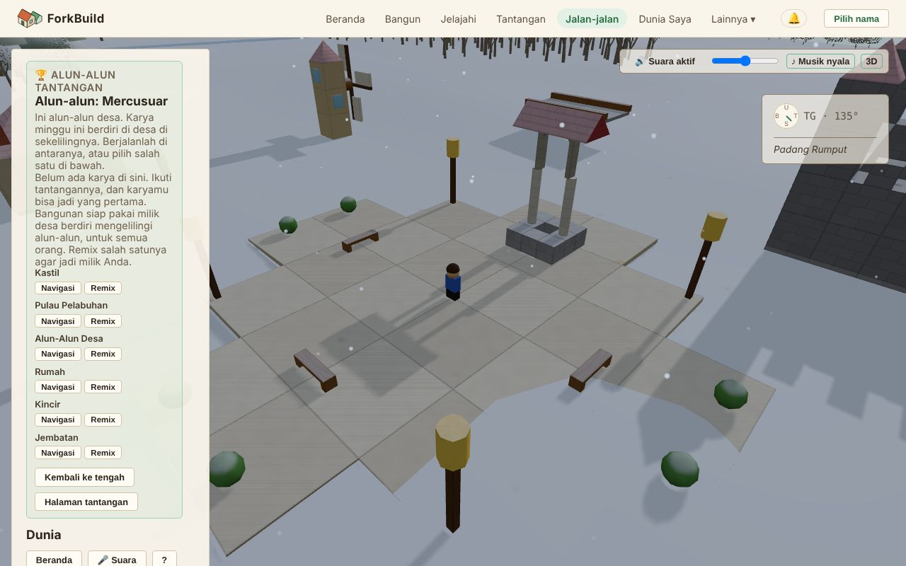

<!-- translation-of: docs/user/03-WorldView.md source-hash: a51a7c2c7ea79eeb -->
# 03 — Tampilan Dunia

<!-- languages -->
[English](../03-WorldView.md) · [Deutsch](../de/03-WorldView.md) · [Español](../es/03-WorldView.md) · [Français](../fr/03-WorldView.md) · **Bahasa Indonesia** · [日本語](../ja/03-WorldView.md) · [한국어](../ko/03-WorldView.md) · [Português (Brasil)](../pt-BR/03-WorldView.md)
<!-- /languages -->

Tampilan Dunia adalah dunia 3D bersama tempat **setiap bangunan yang
diterbitkan berdiri berdampingan**. Anda berjalan atau terbang berkeliling,
menemukan sesuatu, melihat apa yang dibangun orang lain, dan mengajak
teman.

Anda tidak membangun di sini: tempatnya di Editor. Saat Anda ingin mengubah
sesuatu yang Anda temukan, **Edit Salinan** membuka salinan Anda sendiri di
Editor (lihat [Edit Salinan](#edit-salinan--membawa-sesuatu-ke-editor)).
Perubahan yang dibuat Tampilan Dunia hanyalah label, bukan balok: memberi
nama [Penanda](#penanda--menandai-tempat-yang-layak-diingat) dan wilayah,
serta meninggalkan hewan yang dilepaskan di Dunia sebagai hiasan dengan
**G** (lihat
[Avatar & Kehadiran](06-AvatarsAndPresence.md#menghiasi-dunia-dengan-hewan)).

**Versi singkatnya:**

| Untuk… | Lakukan ini |
|---|---|
| Datang ke sini | **Jalan-jalan** di bilah atas, atau **Jelajahi** pada bangunan mana pun |
| Berjalan | `W` `A` `S` `D` untuk bergerak, `Shift` untuk berlari, `Spasi` untuk melompat (di ponsel, joystick) |
| Melihat-lihat | Seret untuk memutar kamera, gulir untuk zoom |
| Mengubah apa yang Anda lihat | **Edit Salinan** membuka salinan Anda sendiri di Editor |
| Memulai bangunan tepat di sini | **Bangun di sini** |
| Mengajak teman | **Jalan di sini bersamaku** membuat tautan untuk dikirim kepada mereka |
| Mematikan atau menyalakan suara | Tombol **Suara**, atau `M` |

Semua kontrol tercantum di [Referensi Kontrol](ControlsReference.md). Alat
jaringan di balik Dunia punya halamannya sendiri:
[Tampilan Dunia: Alat Lanjutan](WorldViewAdvancedTools.md).

## Membuka Tampilan Dunia


*Tampilan Dunia di alun-alun tantangan: panel samping di kiri, avatar Anda di alun-alun, serta suara dan kompas di kanan atas.*

Ada dua cara masuk:

- **Jalan-jalan** di bilah atas membuka Tampilan Dunia di alun-alun
  tantangan minggu ini. Anda tidak perlu punya bangunan sendiri.
  Alun-alunnya adalah alun-alun desa: enam bangunan siap pakai berdiri
  mengelilinginya, siap di-remix, dan karya minggu ini berdiri tepat di
  luarnya (lihat
  [Alun-alun tantangan](04-PublishingAndForking.md#alun-alun-tantangan)).
- Di halaman **Jelajahi**, **Jelajahi** pada bangunan mana pun membawa Anda
  tepat ke sebelahnya. Membuka tautan ke sebuah Dunia juga begitu.

Bangunan yang
[dikirim orang lain kepada semua orang](04-PublishingAndForking.md#siapa-yang-bisa-menemukannya)
berdiri di tempat pembuatnya meletakkannya: masing-masing di tempatnya
sendiri, dengan ruang di sekelilingnya, di seluruh daratan yang luas (lihat
[Tempat bangunan berdiri](04-PublishingAndForking.md#tempat-bangunan-berdiri)).

## Tampilan pengunjung, dan Lanjutan

Tampilan Dunia terbuka sebagai tampilan pengunjung. Hal yang ingin Anda
lakukan ada di bilah di bagian bawah Dunia: **Bangun di sini**, **Jalan di
sini bersamaku**, dan, jika bangunannya bukan milik Anda, **Edit Salinan**.

Panel samping menampilkan nama bangunan dan siapa pembuatnya, lalu ke mana
Anda bisa pergi dan apa yang ada di sekitar Anda. Di ponsel, panel mulai
dalam keadaan tertutup agar Dunia memenuhi layar; **Panel** membukanya. Di
alun-alun, ponsel menampilkan satu baris saja, **Alun-alun: …** beserta
jumlah bangunan di sana; ketuk untuk membuka panel. Siapa yang digambar,
apakah tombol menggerakkan avatar Anda, dan pilihan kamera ada di
**Pengaturan avatar**.

Di bagian bawah panel, **Tampilkan alat lanjutan** menambahkan alat untuk
jaringan di balik Dunia: koordinat, memeriksa balok, penempatan,
Perjumpaan Dunia, dan lainnya. Semuanya dijelaskan di halaman tersendiri,
[Tampilan Dunia: Alat Lanjutan](WorldViewAdvancedTools.md). Pilihan ini
diingat di perangkat ini dan tidak mengubah apa pun bagi orang lain. Semua
yang ada di halaman ini berfungsi dengan atau tanpanya.

## Terbang berkeliling

- **Seret kiri**: memutar kamera
- **Seret kanan**: menggeser kamera ke samping
- **Gulir**: memperbesar dan memperkecil
- **Beranda** (tombol keyboard, atau tombol di panel): kembali ke Dunia
  Anda sendiri (lihat [Orientasi dan Lokasi](#orientasi-dan-lokasi))

Untuk menjalankan avatar Anda, lihat
[Menjalankan avatar Anda](06-AvatarsAndPresence.md#menjalankan-avatar-anda).

Dunia di sekitar **dimuat dan dilepas dengan sendirinya** saat Anda
bergerak. Panel samping dibaca dari atas ke bawah:

1. apa yang sedang Anda lihat (bagian kepala);
2. ke mana Anda bisa pergi: **Beranda**, **Lokasi**, dan tab **Jelajahi**,
   **Peta**, serta **Tempat**;
3. apa yang ada di sekitar Anda (**Di Sekitar**);
4. alat Anda sendiri: **Cari** dan **Avatar**.

Di bagian bawah, **Dunia yang Terlihat** mencantumkan Dunia lain yang
dimuat di sekitar Anda, dan **Dunia di Sekitar** mencantumkan Dunia yang
bisa Anda datangi dengan sekali klik.

Arahkan penunjuk ke sesuatu di Dunia, dan kartu kecil di kanan bawah
tampilan memberi tahu apa itu.

### Apa yang ada di sekitar Anda

**Daratannya** sama bagi semua orang. Rumput, pantai, batu, hutan,
ladang, danau, sungai, dan laut mengikuti bentuk tanah. Daratan di tengah
selalu kering; sekitar seribu satuan ke luar, Anda sampai di pantai,
tempat tanah menurun ke laut dalam.

**Air.** Danau beriak tertiup angin dan laut berayun dengan
ombak yang pelan. Sungai mengalir menuruni lereng di alurnya, lebih deras di
tanah yang lebih curam. Sungai bermula dari mata air yang menggelegak di kaki dataran
tinggi, mengalir menuruni tanah tercuram dalam riam-riam kecil, dan
sesekali berakhir di kolam yang tenang. Buih muncul di tempat ombak mencapai pantai dan
di tempat sungai melewati jeram. Avatar Anda mengarungi danau, laut, atau
sungai dan melambat saat air
naik. Begitu air lebih dalam dari setengah tingginya, ia berenang, naik turun mengikuti ombak (lihat
[Berenang dan menyelam](06-AvatarsAndPresence.md#berenang-dan-menyelam)).
Menyelamlah, dan Anda melihat rumput laut dan kawanan ikan kecil.

**Pohon dan hewan.** Hutan berisi pohon jarum di tempat yang lebih lembap
dan pohon berdaun lebar di tempat yang lebih kering, dengan semak di tepi
padang rumput. Rusa tinggal di hutan dan kelinci di padang rumput. Pohon
tidak pernah bergerak. Hewan berjalan pelan di dekat tempatnya sendiri,
berhenti untuk merumput, dan sesekali mendongak. Dekati seekor, dan ia
menoleh untuk memperhatikan Anda (kecuali Anda tepat di belakangnya); rusa
yang sedang merumput mengangkat kepala, kelinci duduk tegak. Mereka tidak
pernah lari atau berpindah karena Anda, dan orang lain melihat hewan itu
memperhatikan *mereka*. Hewan menghalangi jalan Anda saat berjalan kaki,
seperti pohon.

Siapa pun yang melihat tempat yang sama pada saat yang sama melihat
daratan, ikan, pohon, dan hewan yang sama. Tidak ada yang bisa diedit.

**Penghuni** adalah orang yang tinggal di sebuah Dunia. Mereka berjalan di
sekitar rumahnya, mengitari bangunan alih-alih menembusnya, dan menoleh
untuk menyapa Anda; ajak bicara salah satunya, dan ia menceritakan apa yang
ada di sekitar. Tidak seperti hewan, mereka bagian dari Dunia itu sendiri:
pembuatnya yang menambahkan mereka. Rumah siap pakai datang dengan satu
penghuni di dekat pintu depan, termasuk yang di sekeliling alun-alun
tantangan. Di bangunan Anda sendiri, **R** menghapus satu. Lihat
[Penghuni](06-AvatarsAndPresence.md#penghuni).

**Bangunan samar yang tembus pandang** adalah bangunan yang diumumkan orang
lain di dekat Anda dan belum diterima perangkat ini. Bangunan itu hilang
lagi saat Anda berjalan menjauh. Lihat
[Bangunan yang Diklaim](WorldViewAdvancedTools.md#bangunan-yang-diklaim--bangunan-orang-lain-di-tempat-yang-dinyatakan-penerbitnya).

### Di dalam bangunan

Masuklah lewat pintu dan bagian bangunan di atas kepala Anda dipotong,
sehingga Anda melihat ruangan tempat Anda berdiri, bukan dinding di
belakang Anda: atapnya dan semua yang lebih tinggi dari kepala Anda, hanya
untuk bangunan itu, sementara dinding tetap berdiri sampai sedikit di atas
tinggi Anda. Saat kamera mengikuti Anda, atau dalam **Orang Ketiga**, kamera
ikut masuk, di belakang dan di atas Anda sambil memandang ke bawah ke dalam
ruangan, dan naik alih-alih menembus dinding jika ada dinding tepat di
belakang Anda. **Pandangan Burung** memandang lurus ke bawah ke dalam
ruangan; **Orang Pertama** melihatnya lewat mata Anda sendiri, tanpa ada
yang dipotong. Melangkahlah keluar lagi dan seluruh bangunan digambar
kembali. Hanya yang digambar yang berubah: atapnya tetap ada, bagi semua
orang dan untuk berjalan.

## Siang dan malam

Langit di atas Tampilan Dunia berganti dari siang ke malam dan kembali
setiap 40 menit: senja yang hangat, malam biru yang diterangi bulan, fajar
merah muda, lalu siang lagi. Langit mengikuti jam, jadi semua orang di
sebuah bangunan melihat langit yang sama pada saat yang sama. Setelah gelap,
jendela kaca bersinar seperti diterangi lampu dan **Lentera** menyala dengan
warnanya sendiri, sehingga mercusuar menunjukkan jalan pulang dan desa
tampak berpenghuni; burung-burung diam dan jangkrik mengambil alih. Malam
tidak pernah terlalu gelap untuk menemukan jalan. Hanya Tampilan Dunia yang
mengenal malam: Editor, gambar bangunan, dan pratinjau tautan selalu terang
siang hari.

Matahari terbit di timur, melintasi langit selatan, dan terbenam di barat,
berwarna jingga di dekat cakrawala; setelah ia terbenam, bulan menempuh
jalan yang sama sepanjang malam. Cahaya pada bangunan datang dari yang
sedang di langit, jadi dinding yang menghadap timur mendapat cahaya pagi dan
yang menghadap barat cahaya sore.

Matahari dan bulan menimbulkan bayangan: bayangan Anda, pepohonan, hewan,
dan setiap bangunan, panjang di pagi dan sore hari, pendek di tengah hari,
dan lebih samar di bawah cahaya bulan. Bayangan jatuh dalam jarak sekitar 45
meter dari Anda, dan memudar sejenak saat matahari menyerahkan langit kepada
bulan dan sebaliknya. Bayangan lebih membebani ponsel daripada komputer,
jadi mula-mula menyala bila memakai tetikus dan mati di ponsel atau tablet;
centang atau hapus centang **Bayangan** di bagian bawah panel untuk
mengubahnya di perangkat ini.

Pohon tumbuh seperti di alam: cemara dengan lingkaran dahan yang terkulai di
hutan paling basah, pohon berdaun lebar dengan dahan bercabang dan tajuk
membulat di tempat yang lebih kering, serta semak rendah yang bengkok di
tepi padang rumput. Dari dekat Anda melihat setiap dahan dan daun; pohon
bergoyang tertiup angin, lebih kencang saat badai mendekat, dan menimbulkan
bayangan berbintik. Di kejauhan pohon menjadi bentuk yang lebih sederhana,
agar seluruh hutan tetap lancar dijelajahi. Di ponsel atau tablet, pohon
mula-mula lebih sederhana; centang **Pohon terperinci**, tepat di bawah
**Bayangan**, untuk melihat setiap daun di perangkat ini.

Pada malam hari, bintang-bintang muncul saat senja makin gelap, dengan Bima
Sakti melintang di antaranya, lalu memudar lagi saat fajar. Seluruh langit
berbintang berputar perlahan mengelilingi satu titik tinggi di utara, sehingga
bintang terbit di timur dan terbenam di barat bersama bulan, dan semua orang
melihat bintang yang sama pada saat yang sama.

Bulan melewati fase-fasenya, satu fase setiap malam: dari bulan baru yang
gelap, sabit tipis, bulan separuh, dan bulan cembung hingga bulan purnama,
lalu kembali lagi, setiap delapan hari Tampilan Dunia (sedikit lebih dari
lima jam). Bulan yang sedang membesar terang di sisi baratnya, bulan yang
sedang mengecil di sisi timurnya. Fase bulan juga mengubah malam: saat bulan
purnama malam sedikit lebih terang dan bayangan lebih tegas; sekitar bulan
baru cahayanya lebih lembut, langit lebih biru pekat, dan bintang serta Bima
Sakti bersinar paling terang. Seperti bagian langit lainnya, semua orang
melihat bulan yang sama pada saat yang sama, dan tidak pernah terlalu gelap
sampai bangunan sulit dilihat.

Awan datang dan pergi, sama bagi semua orang pada saat yang sama.
Biasanya beberapa awan putih melintas; sesekali langit berawan, dan kadang
menjadi kelabu dan mendung, dengan cahaya yang lebih lembut dan bayangan
yang lebih samar. Tidak pernah segelap itu sampai bangunan sulit dilihat.

Sesekali langit mendung membawa hujan, beberapa menit setiap kalinya. Anda
melihatnya turun di sekitar Anda dan lingkaran yang menyebar di tempat
tetesannya jatuh ke danau, laut, atau sungai, dan Anda mendengarnya,
sementara burung dan serangga terdiam. Masuklah ke dalam bangunan dan Anda
tetap kering: Anda mendengar hujan berderai di atap dan melihatnya tetap
turun di luar. Saat hujan, tanah dan bangunan menjadi lebih gelap dan
berkilau, lalu mengering dalam beberapa menit setelah hujan reda. Hujan paling deras kadang membawa badai yang lembut: sesekali kilat menerangi langit dengan lembut, dan beberapa detik kemudian guntur bergemuruh di kejauhan. Jika perangkat Anda diatur untuk mengurangi gerakan, kilat tidak berkedip. Hujan hanya untuk dilihat dan
didengar: sungai tidak meluap, dan Anda tetap berjalan secepat biasa.

Jika Anda lebih suka selalu siang, centang **Selalu siang** di bagian bawah
panel, tepat di atas **Bayangan**. Langit pun tetap
cerah. Pilihan ini diingat di perangkat ini dan tidak mengubah apa pun bagi orang lain.

## Musim

Dunia melewati empat musim, masing-masing delapan hari World View (sedikit
lebih dari lima jam), satu untuk setiap putaran bulan:

- **Musim semi**: pohon-pohon berbunga merah muda dan putih lalu berdaun baru
  yang hijau muda; bunga liar menghiasi rumput, dan kelopak bunga melayang
  turun di antara pepohonan.
- **Musim panas**: semuanya hijau dan rimbun, buah matang di beberapa pohon,
  dan ladang menjadi keemasan.
- **Musim gugur**: daun berubah merah, oranye, dan kuning, setiap pohon pada
  waktunya sendiri, lalu berguguran di sekitar Anda sampai pohon gundul; ladang
  dipanen.
- **Musim dingin**: pohon-pohon gundul, rumput kusam, dan saat langit mendung
  turun salju, bukan hujan. Salju mengendap berupa bercak yang lama-lama
  menjadi hamparan putih, menutupi atap dan puncak pohon (tidak pernah dinding,
  dan tidak pernah di dalam bangunan tempat Anda berdiri), lalu mencair di musim
  semi. Burung lebih jarang berkicau, dan serangga menghilang.

Daratan berubah sedikit demi sedikit setiap hari, bukan sekaligus, dan semua
orang melihat musim yang sama pada saat yang sama. Pohon jarum tetap hijau
sepanjang tahun. Untuk tetap memakai satu musim di perangkat Anda, pilih di
**Musim** di bagian bawah panel, tepat di bawah **Pohon terperinci**; **Tahun
dunia** kembali mengikuti dunia. Dengan **Selalu siang** menyala, musim tetap
berganti, di bawah langit cerah.

Matahari juga mengikuti musim. Di musim panas ia naik tinggi dan siang
panjang; di musim dingin ia tetap rendah, membentuk bayangan panjang, dan
malam datang lebih cepat. Di puncak musim dingin danau membeku cukup keras
untuk diseberangi dengan berjalan (laut dan sungai tidak pernah); selama es
masih terbentuk, atau mulai pecah di akhir musim dingin, es tidak akan
menahan Anda. Semua orang melihat es yang sama pada saat yang sama, musim apa
pun yang mereka pilih. Salju berderak di bawah kaki dan es berbunyi tak, dan
saat berjalan di salju avatar Anda meninggalkan jejak kaki yang memudar
setelah semenit. Hanya Anda yang melihat jejak kaki Anda.

## Suara

**Kontrol**, di kanan atas tampilan (kanan bawah di ponsel):

- **Suara**, atau `M`: mematikan atau menyalakan semua suara.
- Penggeser: volume. Di ponsel atau tablet, gunakan tombol volume
  perangkat.
- **♪ Musik**: mematikan atau menyalakan musik saja.
- **3D**: beralih antara suara 3D dan **Stereo** biasa.

Suara mulai dengan klik, ketukan, atau tekanan tombol pertama Anda
(browser mengharuskannya) dan berhenti sementara saat tab tersembunyi.
Pilihan ini diingat di perangkat ini, di Tampilan Dunia dan Editor.

**Yang Anda dengar:**

- **Daratan di sekitar Anda**: angin di tanah tinggi berbatu, kicau burung
  di hutan, jangkrik di ladang, air beriak di danau, sungai yang mengalir.
  Pohon berdesir atau mendesah ditiup angin, makin keras makin dekat.
  Suara-suara itu berbaur saat Anda berjalan dari satu jenis daratan ke
  jenis lain.
- **Avatar Anda**: langkah yang berubah sesuai tanah (rumput, daun, pasir,
  batu, air, balok), desir saat melompat, dan bunyi gedebuk saat mendarat.
- **Kendaraan**: roda atau pembakar balon udara, makin keras saat Anda
  melaju; bunyi saat naik dan turun; dan rem yang berdecit saat Anda
  berhenti mendadak.
- **Hewan dan penghuni**: rusa mendengus dan kelinci menghentakkan kaki
  saat mendongak atau terkejut; menangkap dan melepaskan hewan punya
  suaranya sendiri. Penghuni bergumam riang saat menyapa Anda dan
  bergumam pelan saat berbicara. Semua orang mendengar rusa yang sama
  mendongak pada saat yang sama.
- **Orang lain**: langkah, lompatan, dan kendaraan mereka, dari tempat
  mereka berada, selama Anda bisa melihat mereka. Sembunyikan avatar lain,
  dan mereka diam. Kendaraan terdengar hingga 40 m, hanya tiga yang
  terdekat.
- **Perubahan Anda sendiri**: memberi nama penanda atau wilayah, menambah
  atau menghapus penghuni, menghias dengan hewan, serta urungkan dan
  ulangi berbunyi singkat seperti di Editor. Perubahan orang lain tidak
  bersuara.

Suara datang dari tempatnya: depan atau belakang, atas atau bawah, kiri
atau kanan, dan ikut berputar saat kamera berputar. Headphone membantu.
**Stereo** hanya memutar kiri dan kanan, yang mungkin lebih cocok untuk
perangkat lambat atau speaker.

**Musik** diputar pelan di bawahnya: lagu lembut yang dikarang browser
Anda sambil berjalan, hangat di siang hari dan lebih lambat setelah gelap,
dengan jeda hening di antara lagu. Musiknya tidak pernah sama dua kali.

Semua suara dibuat di browser Anda: tidak ada yang diunduh dan tidak ada
yang dikirim. Browser orang lain membuat suara langkah Anda dari apa yang
sudah mereka lihat saat Anda berjalan.

## Orientasi dan Lokasi

**Kompas** melayang di kanan atas tampilan. Kompas menunjukkan utara,
timur, selatan, dan barat, arah hadap Anda dalam derajat, serta titik-titik
kecil untuk bangunan, orang, dan penanda di sekitar. Arahkan penunjuk ke
sebuah titik untuk melihat namanya, atau baca daftar di bawah kompas, yang
juga menyebut tempat Anda berada. Kompas hanya menunjukkan; ia tidak
pernah menggerakkan kamera.

Sederet tombol di bagian atas panel membantu Anda berkeliling:

- **Beranda** membawa Anda, kamera dan avatar, kembali ke Dunia Anda
  sendiri: yang sedang Anda buka, atau yang terakhir Anda lihat. Anda
  mendarat tepat di sebelahnya, sejauh apa pun Anda berkelana. Jika Anda
  belum pernah ke Dunia milik sendiri, Beranda membawa Anda ke tengah peta.
- **Lokasi** mencantumkan setiap tempat yang sejauh ini dikenal Tampilan
  Dunia, dikelompokkan menjadi **Dunia**, **Struktur**, **Penanda**, dan
  **Tempat**. **Fokus** pada sebuah baris memindahkan kamera ke sana, dan
  tidak lebih.
- **👥 N daring** menghitung siapa yang ada di sini; klik untuk melihat
  anggota Dunia. Jika Dunia punya lobi publik, tombol **Lobi** menyusul.
- **?** menampilkan kontrol kamera dan berjalan; klik lagi untuk
  menyembunyikannya.

**Notifikasi** adalah tombol 🔔 di kepala aplikasi, di samping nama Anda
(atau **Pilih nama**), jadi ada di setiap halaman. Tombol ini membuka
**Riwayat Notifikasi** Anda, yang terbaru di atas. Anda mendapat
notifikasi saat:

- seseorang mengomentari bangunan yang Anda terbitkan (lihat
  [Komentar](09-PublicationsAndEvidence.md#komentar));
- seseorang yang Anda ikuti menerbitkan sesuatu yang baru (lihat
  [Mengikuti orang](07-PeerConnectionsAndFriends.md#mengikuti-orang));
- seseorang me-remix salah satu bangunan Anda (lihat
  [Jumlah remix](04-PublishingAndForking.md#jumlah-remix));
- seseorang, setelah Anda, menerbitkan bangunan yang sangat mirip dengan
  salah satu bangunan Anda (lihat
  [Bangunan mirip yang diterbitkan lebih dulu](04-PublishingAndForking.md#bangunan-mirip-yang-diterbitkan-lebih-dulu)).

Setiap notifikasi menyebut apa yang terjadi dan kapan. **Jelajahi**
membawa Anda ke Dunia bangunan itu. Ini daftar sederhana, bukan kotak
masuk: tidak ada yang ditandai sudah dibaca, tidak ada yang ditutup, dan
tombolnya tidak menampilkan angka. Daftar dimuat saat Anda membukanya;
**Muat Ulang** memuatnya lagi. Daftar ini milik nama Anda, bukan Dunia yang
sedang Anda buka.

### Notifikasi di perangkat ini

Di bagian atas panel, **Beri tahu saya di perangkat ini** membuat
perangkat Anda menampilkan notifikasi ini sendiri, seperti aplikasi lain.
Browser meminta izin Anda; **Matikan** menghentikannya.

Notifikasi muncul saat ForkBuild terbuka tetapi tidak di depan: di tab
lain, atau sebagai [aplikasi terpasang](01-GettingStarted.md#memasang-forkbuild)
di latar belakang. Mengeklik salah satunya membuka ForkBuild di bangunan
itu. Tidak ada yang dikirim ke mana pun untuk ini, jadi ForkBuild yang
tertutup tidak menampilkan apa-apa; yang datang sementara itu ada di
daftar lain kali. Hanya beberapa yang muncul sekaligus; sisanya menunggu
di daftar. Jika browser memblokirnya, panel memberi tahu: izinkan
notifikasi ForkBuild di pengaturan situs browser.

### Katakan ke mana pergi (suara)

Tekan `V`, atau **🎤 Suara** di samping **Beranda**, lalu katakan ke mana
pergi atau apa yang harus dilakukan. Tekan `V` (atau **Berhenti**) setelah
selesai:

- *bawa aku ke kincir tua*, atau cukup nama sebuah tempat: kamera pergi ke
  sana, seperti **Fokus** di **Lokasi**. Tempat mana pun di **Lokasi** bisa
  disebut, dan di plaza tantangan juga bangunannya.
- *pulang*: sama dengan **Beranda**.
- *orang pertama*, *orang ketiga*, *pandangan burung*, *kamera bebas*:
  tampilan kamera di panel Avatar.
- *matikan suara*, *nyalakan suara*.
- *urungkan*, *ulangi*: seperti `Ctrl+Z` dan `Ctrl+Y`.
- *bicara*: sama dengan `T` di samping penghuni.

Selain itu, ditawarkan ke panduan dengan **Tanyakan ke panduan**. Suara di
sini sama dengan di Editor (lihat
[Ucapkan perintah](02-TheEditor.md#ucapkan-perintah-suara)): dinyalakan
sekali untuk keduanya, dipahami di perangkat Anda, dan Dunia tetap bergerak
selama ia mencari tahu apa yang Anda ucapkan.

### Jelajahi, Peta, dan Tempat — tiga cara menelusuri, tidak pernah sekaligus

Di bawah tombol-tombol itu ada tiga tab. Hanya satu yang terbuka, dan
berganti tab hanya mengubah isi panel.

- **Jelajahi** (bawaan) menampilkan siapa yang ada di sini dan beberapa
  tempat untuk dikunjungi, lalu **Di Sekitar**: **Tempat**, **Penanda**,
  dan **Orang** di sekitar Anda, masing-masing dengan jaraknya dan tombol
  **Pergi**. Kelompok yang kosong disembunyikan. Klik judul kelompok untuk
  melipat atau membukanya; Tampilan Dunia mengingat mana yang Anda biarkan
  terbuka. Alat lanjutan menambahkan tiga kelompok lagi (lihat
  [Tampilan Dunia: Alat Lanjutan](WorldViewAdvancedTools.md)).
- **Peta** menampilkan [Peta Dunia](#peta-dunia).
- **Tempat** mencantumkan [tempat geografis](#tempat-geografis).

### Info — apa yang sedang saya lihat?

Di samping sebagian besar tombol **Pergi**, di Di Sekitar dan di
**Lokasi**, ada tombol **Info**. **Pergi** memindahkan kamera Anda ke sana.
**Info** menceritakan tempat itu tanpa berpindah: apa itu, seberapa jauh,
dan di tempat bernama mana ia berada ("Anda berada di Desa Willow") atau
di dekat mana ("Anda berada di dekat Desa Kawahara").

Dari panel Info Anda dapat:

- **Pergi**: pergi ke sana;
- **Tampilkan di Peta**: melihatnya di Peta Dunia;
- **Nama** (untuk tempat bernama): melihat apa sebutan orang untuknya,
  atau menerbitkan nama;
- **Edit Salinan**: membuka salinan Anda sendiri di Editor (lihat di
  bawah).

### Edit Salinan — membawa sesuatu ke Editor

**Edit Salinan** adalah cara mengubah sesuatu yang Anda temukan di
Tampilan Dunia. Ia membuat salinan mandiri bangunan itu milik Anda sendiri
dan membukanya di Editor, siap dibangun lebih lanjut. Aslinya tidak pernah
disentuh.

Anda menemukannya:

- di bilah bagian bawah Dunia, saat bangunan yang Anda kunjungi bukan milik
  Anda: ia menyalin seluruh bangunan;
- di panel **Info** untuk wilayah, penanda, atau struktur yang
  ditempatkan;
- dengan alat lanjutan, saat Anda mengeklik balok, tanah kosong, atau
  struktur yang ditempatkan (lihat
  [Memeriksa balok](WorldViewAdvancedTools.md#memeriksa-balok--atau-struktur-yang-ditempatkan)).

Apa yang disalin bergantung pada apa yang Anda pilih:

- Untuk **penanda**, **wilayah**, **balok**, atau **tanah kosong**, Anda
  mendapat Dunia tempat semua itu berada.
- Untuk **struktur yang ditempatkan**, Anda mendapat struktur itu, bukan
  Dunia tempatnya berdiri.

ForkBuild memberi tahu Anda begitu salinan siap (lihat
[Penerbitan & Remix](04-PublishingAndForking.md)). Jika salinan tidak bisa
dibuat, dialog **Tidak bisa membuat salinan** menjelaskan alasannya,
biasanya karena lisensi bangunan tidak mengizinkan salinan atau bangunan
belum bisa diambil, dan **Kembali ke bangunan** mengembalikan Anda ke
tempat semula (lihat
[Saat remix tidak dapat diselesaikan](04-PublishingAndForking.md#saat-remix-tidak-dapat-diselesaikan)).

**Tempat geografis** dan **orang** tidak punya Edit Salinan. Tempat
geografis terdiri dari wilayah milik beberapa orang, jadi tidak ada satu
bangunan untuk disalin; buka salah satu wilayahnya saja.

Edit Salinan sama dengan **Remix** di Jelajahi dan di halaman pembuat,
dengan aturan lisensi yang sama (lihat
[Remix: jadikan milik Anda](04-PublishingAndForking.md#remix-jadikan-milik-anda)).
Semua hal lain di Tampilan Dunia, seperti Cari, kompas, Peta, dan Info,
hanya melihat.

### Bangun di sini — memulai bangunan untuk tempat ini

**Bangun di sini**, di samping **Beranda**, memulai bangunan baru yang
kosong di Editor untuk tempat avatar Anda berdiri (atau, saat terbang,
tempat di bawah kamera). Editor menyebut untuk Dunia mana bangunan itu.

Saat Anda menerbitkannya, bangunan berdiri tepat di tempat itu, bukan di
lahan kosong yang dipilih ForkBuild. **Lihat ke sana** membawa Anda kembali
untuk melihatnya. **Lupakan tempat ini**, di Editor, membiarkan ForkBuild
menempatkannya seperti biasa.

Tempat itu hanya catatan Anda sendiri, disimpan di perangkat ini dan di
cadangannya. Ia tidak mengklaim lahan, dan orang lain juga boleh membangun
di sana (lihat
[Mengapa dua bangunan bisa berada di tempat yang sama?](WorldViewAdvancedTools.md#mengapa-dua-bangunan-bisa-berada-di-tempat-yang-sama)).

### Jalan di sini bersamaku — membawa teman ke Dunia ini

**Jalan di sini bersamaku**, di samping **Bangun di sini**, membuat tautan
yang membawa teman ke Dunia tempat Anda berada, untuk berjalan-jalan
bersama. Kirimkan dengan cara apa pun, atau biarkan mereka memindai kode
QR-nya dengan ponsel.

Teman yang membukanya memilih nama jika belum punya (masing-masing
berjalan dengan avatarnya sendiri), mengeklik **Bergabung**, lalu tiba di
Dunia ini. Kalian saling melihat berjalan. Dialog menampilkan siapa yang
sedang dalam perjalanan dan siapa yang sudah tiba.

- Dunia harus diterbitkan dulu: ForkBuild teman Anda memeriksa tanda tangan
  dan bangunannya, seperti untuk tautan yang dibagikan, dan menyimpan
  salinannya.
- Tautan berlaku 30 menit bagi siapa pun yang membukanya, selama Anda tetap
  di Tampilan Dunia. Menutup dialog tidak menghentikannya; **Hentikan
  tautan** yang menghentikannya. Yang sudah bergabung tetap terhubung.
- Bergabung menghubungkan kedua perangkat secara langsung, seperti undangan
  di **Rekan**. Masing-masing dapat melihat alamat IP yang lain, dan avatar
  kalian tampil sesuai izin **Visibilitas Kehadiran** masing-masing (lihat
  [Siapa yang dapat melihat Anda](06-AvatarsAndPresence.md#siapa-yang-dapat-melihat-anda-dua-pengaturan-terpisah)).
  Tidak ada yang menjadi rekan dikenal atau teman kecuali Anda memilihnya.
- Perlu server pertemuan. Situs resmi punya satu; salinan yang Anda
  jalankan sendiri perlu server sendiri (lihat
  [Koneksi Rekan & Teman](07-PeerConnectionsAndFriends.md)).

### Alun-alun tantangan

**Jelajahi alun-alun** di halaman tantangan mingguan, atau **Jalan-jalan**
di bilah atas, membuka Tampilan Dunia di alun-alun desa: berlantai batu,
dengan sumur, bangku, dan tiang lampu, serta enam bangunan siap pakai di
sekelilingnya.

Alun-alun dan bangunan siap pakai adalah bagian dari Dunia, seperti bukit
dan pohonnya. Semuanya ada di sana untuk semua orang, dan bukan milik
siapa pun. Karya minggu ini berdiri tepat di luarnya, dan hanya karya
minggu itu: buka alun-alun minggu lalu dan Anda melihat karya minggu lalu.
Sebuah panel mencantumkan karya minggu
ini dan bangunan siap pakai (lihat
[Alun-alun tantangan](04-PublishingAndForking.md#alun-alun-tantangan)).
Tidak ada pohon yang tumbuh di sekeliling alun-alun, dan tidak ada
**Bangun di sini** di atasnya.

### Penanda — menandai tempat yang layak diingat

**Penanda** adalah titik bernama yang Anda letakkan di sebuah Dunia,
seperti "Jembatan Tua" atau "Pemandangan Indah", dengan deskripsi jika
mau. Penanda diletakkan tepat di tempat avatar Anda berdiri.

Jika Anda bisa mengedit Dunia tempat Anda berada, bagian Penanda di
**Lokasi** punya tombol **+ Tambah Penanda**. Beri judul, dan deskripsi
jika mau, lalu klik **Tempatkan di Sini**. Penanda langsung muncul bagi
Anda, dan sesaat kemudian bagi semua orang lain yang mengedit Dunia yang
sama: di kompas, di **Lokasi**, dan sebagai tujuan.

Penanda milik Dunia, bukan milik Anda. Siapa pun yang bisa mengedit Dunia
bisa mengganti nama, mengubah, atau menghapus penanda mana pun, siapa pun
pembuatnya.

### Peta Dunia

Tab **Peta** menampilkan Dunia dari atas: tempat bernama, penanda,
bangunan, orang-orang di sini, dan penanda untuk Anda. Tab ini menampilkan
semua yang sejauh ini dikenal Tampilan Dunia, sekaligus.

- Gulir, atau gunakan **+** dan **−**, untuk zoom.
- Seret ruang kosong untuk menggeser peta.
- Klik tempat atau orang untuk memindahkan kamera Anda ke sana.

Melihat peta tidak pernah mengubah apa pun.

### Tempat geografis

**Tempat geografis** adalah area yang dinamai atau dideskripsikan sebagai
wilayah oleh beberapa orang, masing-masing sendiri-sendiri, dan ternyata
kurang lebih tanah yang sama. Tab **Tempat** mencantumkan yang sejauh ini
ditemukan Tampilan Dunia.

Klik salah satunya untuk melihat berapa deskripsi dan Dunia yang
dicakupnya, **Nama dari Komunitas**-nya, serta **Pergi ke Tempat** dan
**Tampilkan di Peta**. **← Kembali** (atau Escape) kembali ke daftar. Jika
Anda berganti tab lalu kembali, Anda menemukan layar yang sama dengan yang
Anda tinggalkan.

**Nama dari Komunitas** sebuah tempat menampilkan nama-nama teratasnya;
**Nama lainnya** menampilkan daftar lengkap berperingkat. Di bawahnya Anda
dapat menerbitkan nama sendiri. Semua hal lain (deskripsi lain tempat itu,
riwayat lengkap nama, impor dan ekspor) dilipat di bawah **Lainnya**.

Menerbitkan nama memberi tahu orang-orang yang terhubung dengan Anda, sama
seperti mengklaim bahwa Anda membuat sebuah bangunan. Untuk melihat setiap
nama dan klaim yang pernah diterbitkan atau diketahui perangkat ini, lihat
[Publikasi & Bukti Eksternal](09-PublicationsAndEvidence.md).

## Dunia Saya — dunia yang benar-benar pernah Anda kunjungi

**Dunia Saya**, di bilah atas, mencantumkan setiap Dunia yang pernah Anda
masuki di perangkat ini, yang terbaru di atas, dengan judul, pembuat, dan
jumlah bangunan serta penandanya. **Lanjutkan Menjelajah** membawa Anda
masuk lagi. Hanya perangkat ini yang menyimpan daftarnya, dan tidak ada
orang lain yang melihatnya.

Belum ke mana-mana? **Buka Jelajahi** untuk menemukan Dunia atau mulai dari
bangunan siap pakai.

**Bangunan yang Anda bantu buat** mencantumkan bangunan yang mencantumkan
nama Anda saat Anda membangun bersama teman dengan **Bangun bersamaku**
(lihat [Editor](02-TheEditor.md#bangun-bersamaku-membangun-bersama-secara-langsung)).
Masing-masing menampilkan judulnya dan **bersama** nama teman Anda, yang
membuka halamannya. Tertulis **Belum diterbitkan** sampai teman Anda
menerbitkannya; setelah itu judulnya membuka Dunianya. Perangkat Anda yang
lain juga mencantumkannya, begitu terhubung dengan perangkat ini. Bagian
ini hanya muncul jika ada isinya.

## Menemukan dunia

Ada dua cara mencari sesuatu, masing-masing menjawab pertanyaan yang
berbeda.

### Cari — "publikasi mana yang cocok dengan ini?"

**Cari** mencari **judul atau pembuat** di semua yang diterbitkan, bukan
hanya yang dimuat di sekitar Anda. Ketik kata lalu klik **Cari**. Setiap
hasil menunjukkan letaknya (📍); klik **Fokus** untuk terbang ke sana.

Sebuah hasil mungkin menyebut posisinya **posisi bawaan**: pembuatnya tidak
pernah memilih tempat, jadi ForkBuild menampilkannya di suatu tempat.
Dengan alat lanjutan, Anda juga bisa mencari berdasarkan posisi (lihat
[Tampilan Dunia: Alat Lanjutan](WorldViewAdvancedTools.md)); hasilnya lalu
menunjukkan seberapa jauh (📏).

### Jelajahi di Sini / Ada Apa di Sini? — "apa yang ada di sekitar saya sekarang?"

Dua tombol ini, di bagian atas **Di Sekitar** pada Jelajahi, melihat
**di sekitar tempat kamera Anda berada**. Anda tidak perlu judul atau
koordinat.

- **Jelajahi di Sini** melihat area yang luas. Anda bisa melebarkan atau
  menyempitkannya sesudahnya.
- **Ada Apa di Sini?** hanya melihat tepat di tempat Anda.

Keduanya membuka dialog **Jelajahi Lokasi**:

```
📍 Pusat: 100.0, 50.0, 250.0
⭕ Radius: 25 Satuan Dunia

Menampilkan 3 dari 3 bangunan yang dapat ditemukan

📍 City Hall            📏 4,2 Satuan Dunia
oleh alice
[Fokus] [Pilih] [Periksa]
```

Setiap hasil punya tiga tombol:

| Tombol | Fungsinya |
|---|---|
| **Fokus** | Terbang ke sana dan menjadikannya bangunan yang dikenai perubahan Anda berikutnya |
| **Pilih** | Menjadikannya bangunan yang dikenai perubahan Anda berikutnya, tanpa berpindah |
| **Periksa** | Menampilkan judul, pembuat, status, posisi, dan pemiliknya, tanpa berpindah |

Dialog itu sendiri tidak pernah memindahkan, mengubah, atau menerbitkan
apa pun.

## Tampilan Dunia hanya dapat dilihat — membangun dilakukan di Editor

Mengeklik, menyeret, atau menekan tombol di Tampilan Dunia tidak pernah
mengubah balok. Tidak ada alat membangun di sini. Untuk membangun di atas
sesuatu, gunakan
**[Edit Salinan](#edit-salinan--membawa-sesuatu-ke-editor)** dan lanjutkan
di [Editor](02-TheEditor.md). Satu-satunya perubahan yang dibuat Tampilan
Dunia adalah label yang disebut di awal halaman ini.

## Melihat kolaborator lain

Saat ada orang lain di Dunia yang sama:

- **Anda melihat mereka**: avatar mereka, dengan nama dan apa yang sedang
  mereka lakukan ("**Bob — sedang menjelajah di sekitar**").
- **Anda melihat perubahan mereka saat itu juga**: penanda, nama, salinan
  baru milik mereka.
- **Daftar aktivitas singkat** di panel menunjukkan apa yang baru berubah,
  bahkan di luar pandangan. Daftar ini hanya disimpan selama Anda di sini.

Melihat orang tidak pernah mengubah apa pun dengan sendirinya. Hanya
perubahan nyata yang mengubah: yang dibuat di Editor, atau salah satu label
yang diizinkan Tampilan Dunia.

## Menyimpan dan menerbitkan di sini juga

Saat Anda mengerjakan sebuah bangunan, bagian kepala punya **Simpan**,
**Terbitkan**, dan **Edit Metadata**, jadi Anda bisa menyimpan dan
membagikannya tanpa pergi. Baris status menyebut yang mana:
**🔒 Diterbitkan** atau **✎ Mengedit salinan Anda**.

Bangunan yang diterbitkan tidak pernah berubah. Jika bangunan tempat Anda
berada sudah diterbitkan, perubahan pertama Anda di sini (detailnya,
penanda atau wilayah, atau hewan sebagai hiasan) membuat salinan Anda
sendiri, berjudul *"Remix dari &lt;nama asli&gt;"*. Pemberitahuan singkat
memberi tahu Anda ("Salinan Anda sendiri yang dapat diedit telah dibuat —
"…" tidak berubah"). Aturan lisensinya sama seperti untuk remix mana pun
(lihat
[Penerbitan & Remix](04-PublishingAndForking.md#remix-jadikan-milik-anda)).

## Riwayat — melihat pratinjau dan memulihkan keadaan sebelumnya

Setiap perubahan yang Anda buat di sini, seperti menambah, mengganti nama,
atau menghapus penanda atau wilayah, disimpan di riwayat bangunan. Klik
**Riwayat** di bagian kepala untuk melihat daftar bernomor beserta
waktunya, seperti:

```
1. Buat Penanda “Old Bridge”
2. Perbarui Wilayah “Willow Village”
3. Hapus Penanda
```

Langkah yang sudah Anda urungkan ditandai **diurungkan**. Mengeklik sebuah
langkah hanya memilihnya; tidak ada yang berubah sampai Anda menekan
tombol:

- **Pratinjau** menampilkan Dunia seperti *tepat setelah* langkah itu, di
  samping yang sekarang, tanpa mengubah apa pun. **Batalkan Pratinjau**
  kembali.
- **Pulihkan** kembali ke langkah itu. Ia tidak bertanya dulu, tetapi
  perubahannya dibiarkan belum disimpan, jadi Anda masih bisa memilih
  apakah akan menyimpannya.
- **Tutup** menutup daftar.

## Apa selanjutnya?

Siap membagikan apa yang Anda buat, atau me-remix karya orang lain?
Lanjutkan ke **[Penerbitan & Remix](04-PublishingAndForking.md)**. Untuk
alat jaringan di balik Dunia, lihat
**[Tampilan Dunia: Alat Lanjutan](WorldViewAdvancedTools.md)**.
