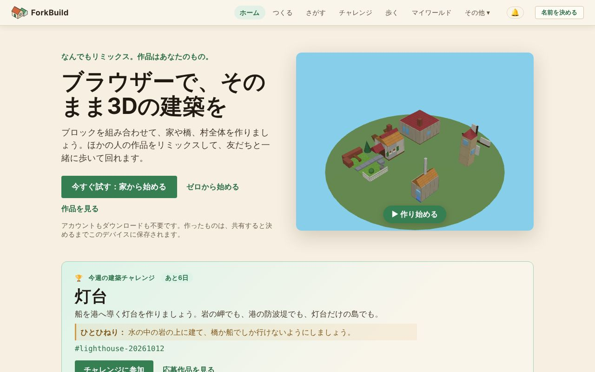

<!-- translation-of: docs/user/01-GettingStarted.md source-hash: 8aee537086ae6864 -->
# 01 — はじめに

<!-- languages -->
[English](../01-GettingStarted.md) · [Deutsch](../de/01-GettingStarted.md) · [Español](../es/01-GettingStarted.md) · [Français](../fr/01-GettingStarted.md) · [Bahasa Indonesia](../id/01-GettingStarted.md) · **日本語** · [한국어](../ko/01-GettingStarted.md) · [Português (Brasil)](../pt-BR/01-GettingStarted.md)
<!-- /languages -->

ようこそ！このガイドでは、「アプリを開いたところ」から「何か作れた」
までを、5 分ほどで案内します。始めるのにアカウントもダウンロードも名前も
いりません。共有すると決めるまで、すべてはあなたのデバイスに残ります。

**手短に言うと：**

1. **ホーム** 画面で **今すぐ試す：家から始める** をクリックします。
2. **屋根を選ぶ** をクリックしてから家をクリックすると、屋根がのります。
3. **公開** をクリックします。名前がもう提案されていて、リミックスと
   **みんなが見つけられる** もオンになったシートが一枚開きます。好きなら
   自分の名前を入力して、**…として公開** をクリックします。
4. **中に入ってみる** をクリックすると、ワールドの中で自分の家を歩けます。

このページの残りでは、それぞれの手順と、空き地から始める方法を説明します。

## ForkBuild を開く

*ホーム画面：上部のバー、3 つの始め方、今週の建築チャレンジ。*

ForkBuild は最新のウェブブラウザーならどれでも動きます。公開されている
サイトを開くと **ホーム** 画面が表示されます。（自分でコピーを動かす方法
は、このページの最後の [自分のコピーを動かす](#自分のコピーを動かす) を
参照してください。）

**ホーム** 画面では、小さな村が 3D でゆっくり回っていて、始め方が 3 つ
あります。

- **今すぐ試す：家から始める** は、できあがった家を自分用のコピーとして
  エディターで開き、すぐに変えられます
  （[今すぐ試す](02-TheEditor.md#今すぐ試す仕上げる家) を参照）。
- **ゼロから始める** は、空き地のエディターを開きます。
- **作品を見る** は、みんなが公開した作品が並ぶ **さがす** を開きます。

**できあがった作品から始める** の各カード（城、港の島、村の広場、家、
製粉所、橋）も、同じようにその作品の自分用のコピーを開きます。自分で
選ぶまで、何も公開されず、どこにも送られません。

ホームには **今週の建築チャレンジ** も表示されます。作るテーマと
**チャレンジに参加** があります
（[毎週の建築チャレンジ](04-PublishingAndForking.md#毎週の建築チャレンジ)を参照）。
作品を公開すると、**あなたのスタンプ** も表示されます。だれかに
リミックスされたときの **リミックスされた**、週替わりチャレンジに参加
したときの **チャレンジャー**、100 個以上のブロックを使った作品の
**大きな建築家** など、自分の作品についての事実です。このデバイスで
計算され、あなたにだけ表示されます。ほまれであって、点数や順位では
ありません。

## 画面の見方

上部のバーは常に表示されています。

`ForkBuild  ホーム  つくる  さがす  チャレンジ  歩く  マイワールド  その他 ▾  🔔  名前を決める`

| メニュー | 開くもの |
|---|---|
| **ホーム** | 最初に表示されるページ |
| **つくる** | 作品を作るエディター（[エディター](02-TheEditor.md) を参照） |
| **さがす** | みんなが公開した作品。開く、リミックスする、訪れることができます（[公開とリミックス](04-PublishingAndForking.md#さがす) を参照） |
| **チャレンジ** | 今週の建築チャレンジとその応募作品（[毎週の建築チャレンジ](04-PublishingAndForking.md#毎週の建築チャレンジ) を参照） |
| **歩く** | 今週のチャレンジの広場でワールドビューを開き、村の広場を囲むその週の応募作品の間を歩けます（[ワールドビュー](03-WorldView.md) を参照） |
| **マイワールド** | このデバイスで訪れたワールド（[マイワールド](03-WorldView.md#マイワールド--実際に訪れたワールド) を参照） |
| **🔔** | 通知。コメント、リミックス、フォローしている人の新しい作品（[方向と場所](03-WorldView.md#方向と場所) を参照） |
| **名前を決める** | 公開や散歩に使う名前を決めます。名前を決めると、ここにその名前が表示されます（[名前を決める](#名前を決める) を参照） |

**その他** を開くと、残りが 4 つのグループで表示されます。スマートフォン
では **メニュー** にすべてが一度に表示されます。

- **あなた**
  - **マイアバター** — ワールドビューで他の人からどう見えるか。
    [アバターと在席状況](06-AvatarsAndPresence.md) を参照
  - **マイアイデンティティ** — このデバイスに保存されている名前
    （アイデンティティ）。[名前とアイデンティティ](05-IdentityAndLogin.md) を参照
  - **あなたのデータ** — すべてを 1 つのファイルにバックアップしたり、
    別のデバイスにコピーしたりします。[あなたのデータ](13-YourData.md) を参照
- **人**
  - **ピア** — 接続中の人、知っている人、友達。
    [ピア接続と友達](07-PeerConnectionsAndFriends.md) を参照
  - **フォロー中** — 新しい作品を知らせてもらう人。
    [人をフォローする](07-PeerConnectionsAndFriends.md#人をフォローする) を参照
  - **会話** — ダイレクトメッセージ。
    [チャットと会話](08-ChatAndConversations.md) を参照
- **詳細** — 作って共有するだけなら必要ありません
  - **公開物** — 署名された作者の主張や地名の主張、それらの保存先と
    告知先、そして（*試験的*）外部証拠。
    [公開物と外部証拠](09-PublicationsAndEvidence.md) を参照
  - **ネットワーク設定** — ゲートウェイ、リレー、プロバイダー、ピア接続
    用サーバー。[ネットワーク設定](10-NetworkSettings.md) を参照
- **アプリ**
  - **言語** — このデバイスで ForkBuild を表示する言語。自分で選ぶまでは
    ブラウザーの言語に従います。保存するとページが再読み込みされるので、
    先に作業を保存してください。ForkBuild は英語、ドイツ語、スペイン語、
    フランス語、インドネシア語、日本語、韓国語、ブラジルポルトガル語で
    使えます。
  - **見た目** — **自動**、**ライト**、**ダーク** をメニューの中で
    直接選べます。自動はデバイスのライト／ダークモードに従います。
    ライトは昼の村、ダークは夜の同じ村です。すぐに切り替わり、この
    デバイスに保存されます。
  - **ヘルプ** — 自分の言葉で質問すると、このガイドから答えが返ります。
    ガイドはこの端末の上で読まれます。一度開けばオフラインでも使えます。
  - **ForkBuildについて** — バージョン情報とこのガイドへのリンク
  - **ForkBuild をインストール** — ブラウザーがインストールできる場合
    （[ForkBuild をインストールする](#forkbuild-をインストールする) を参照）

## 最初のブロックを置く

*ホームの家を開いたエディター：左に道具とビルドライブラリ、中央に作品、そして「はじめての作品」カード。*

はじめてエディターを開くと、3D ビューの隅に **はじめての作品** カードが
表示され、6 つのステップを案内し、済んだものからチェックを付けます。
最後のステップは、公開した作品の中に歩いて入ることです。
[はじめての作品](02-TheEditor.md#はじめての作品) をご覧ください。

1. 上部のバーで **つくる** をクリックします（またはホームで
   **ゼロから始める** をクリックします）。
2. 左のサイドバーで **配置** ツールが選ばれていることを確認します
   （`2` を押します）。
3. その下の **ビルドライブラリ** で **ブロック** タブを開き、ブロックを
   クリックします。たとえば **基本** の **キューブ** です。
4. マウスを 3D ビューに動かします。ブロックの半透明の **ゴースト** が
   グリッドに沿ってついてきます。
5. **クリック** して置きます。

おめでとうございます。最初のブロックが置けました！🎉

スマートフォンやタブレットでは、クリックの代わりにタップします。
[スマートフォンやタブレットで](02-TheEditor.md#スマートフォンやタブレットで) を参照してください。

### ブロックを積み上げる

地面の上だけに作る必要はありません。置いてあるブロックの **面** に
ポインターを合わせると、ゴーストがその面に吸い付きます。クリックすると
上に積んだり、横に付けたりできます。壁や塔や屋根はこうして作ります。

まちがえたら、`Ctrl+Z`（Mac では `Cmd+Z`）で元に戻せます。どの変更も
元に戻せます。

## 作業を保存する

**Ctrl+S** を押します（またはツールバーの **保存** をクリックします）。
**● 未保存の変更** の表示が **保存済み** に変わります。

作品はブラウザーに保存されるので、次に来たときもそこにあります。
編集中、ForkBuild は未保存の変更のクラッシュ復旧用コピーも保持していて、
保存する前にページが閉じた場合は復元を提案します。次にエディターを開くと、
バナーがその作品の名前と変更した時刻を示します。**復元** はその作品を変更
ごと開きます（変更を残すには保存してください）。**破棄** はコピーを捨て、
ほかにあれば次のコピーを提案します。一度も保存していない作品でも使えます。

> **コピーを残しましょう。** 作品はこのブラウザーの中にしかありません。
> サイトのブラウザーデータを消すと作品も消えるので、ときどき
> **その他 → あなたのデータ → ファイルにバックアップ** でバックアップ
> してください（[あなたのデータ](13-YourData.md) を参照）。

ブラウザーは、各サイトが保存できる量を、通常はディスクの一定の割合に
制限しています。ForkBuild の割り当てがいっぱいになると、保存と
クラッシュ復旧はその旨のメッセージを出して止まります。開いているものが
失われることはありません。ツールバーの **ファイル → エクスポート** を
使って、作品のコピーをファイルとして残してください。初めて保存すると
き、ブラウザーによっては ForkBuild がデータを永続的に保持してよいか
尋ねます。許可すると、ディスクの空きが少なくなったときにブラウザーが
データを消すことがなくなります。

## 名前を決める

作ったり保存したりするのに名前はいりません。名前が必要なのは
**公開** するとき（公開すると作品に署名され、本当にあなたのものだと
他の人が確かめられます）と、**友達と歩く** とき（友達にその名前で
見えます）です。

はじめて **公開** をクリックすると、ForkBuild は公開に使う名前を
たずねます。名前を入力して **…として公開** をクリックすると、この
デバイスに名前が作られ、作品が公開されます。（散歩のリンクも同じように
**…として歩く** でたずねます。）

名前はいつでも決められます。右上の **名前を決める** をクリックし、
名前を入力して **…として続ける** をクリックします。

ForkBuild にはパスワードもアカウントもありません。名前の裏には、この
デバイスに保存された暗号鍵があり、これを **アイデンティティ** と呼び
ます。鍵は、パスフレーズを追加するまではパスフレーズなしでこの
ブラウザーに保存されます。公開のあとエディターがそのことを知らせ、
**マイアイデンティティ** の **パスフレーズで保護** でいつでも追加
できます。すぐにパスフレーズを決めるには、名前のダイアログで代わりに
**今パスフレーズで守る** をクリックします。

> **パスフレーズはリセットできません。** パスフレーズはこのデバイス上で
> 鍵を暗号化します。ForkBuild を含め、だれも取り戻すことはできません。
> 忘れないものを選んでください。

名前を決めると、右上にその名前が表示されます。クリックすると
**マイアバター**、**マイアイデンティティ**、**あなたのデータ**、
**名前を切り替える** が出ます。**名前を切り替える** では、このブラウザー
にすでにある名前がすべて表示され（クリックするとその名前を使います）、
新しい名前を作ったり、**名前なしで続ける** を選んだりできます。そこで
新しい名前を作るときは、8 文字以上の **パスフレーズ** を 2 回入力します。
（省くには **パスフレーズなしで作成** にチェックを入れます。その場合、
鍵は暗号化されずにこのブラウザーに保存されます。）そのあと
**この名前を使う** をクリックします。

それ以降、公開したり他の人に送ったりするものは、すべてその名前で
署名されます。

**名前なしで公開する。** 公開で開くシートの **詳細** には
**名前なしで公開** があります。こうして公開した作品には作者も署名も
ないため、リンクがなく、他の人と共有できず、あとでみんなに送ることも
できません。自分の **さがす** にだけ置きたい場合を除き、名前を決めて
ください。

パスフレーズが守るもの、ロックとロック解除、アイデンティティの
バックアップについては、
[名前とアイデンティティ](05-IdentityAndLogin.md) で説明しています。

## ForkBuild をインストールする

ForkBuild はアプリとしてインストールできます。インストールすると、
ホーム画面、Dock、アプリ一覧から専用のウィンドウで開き、オフラインでも
動きます。ホーム画面（または **その他** の中）の **ForkBuild を
インストール** をクリックし、ブラウザーのダイアログで確定してください。
iPhone や iPad の Safari では、ボタンが代わりに方法を案内します。
**共有** をタップし、**ホーム画面に追加** を選んでください。ブラウザーが
アプリをインストールできない場合や、ForkBuild がすでにインストール
済みの場合、ボタンは表示されません。

- **オフライン。** 最初に ForkBuild を開いたとき、ブラウザーがその
  ファイルを保持するので、インストールしていてもいなくても、次からは
  接続なしで開けます。ホーム、エディター、保存した作品、既製の作品が
  使えます。ネットワークが必要なもの（作品や人を見つける、作品を送る、
  チャット、通話）は、オンラインに戻るまで待ちます。
- **アップデート。** 新しいバージョンが出ると、上部に **ForkBuild の
  新しいバージョンの準備ができました** と表示されます。**再読み込み** で
  開始するか、次に ForkBuild を開いたときに自動で開始します。
- **通知。** インストールした ForkBuild（またはバックグラウンドのタブで
  開いている ForkBuild）は、デバイスを通じて通知を表示できます。
  [このデバイスでの通知](03-WorldView.md#このデバイスでの通知) を参照してください。

## 次は？

- 作るための道具は **[エディター](02-TheEditor.md)** ですべて学べます。
- 共有する準備ができたら **[公開とリミックス](04-PublishingAndForking.md)** へ。
- ほかの人の作品の間を **[ワールドビュー](03-WorldView.md)** で歩きましょう。
- アバターを整えて人と出会うには
  **[アバターと在席状況](06-AvatarsAndPresence.md)** と
  **[ピア接続と友達](07-PeerConnectionsAndFriends.md)** をご覧ください。
- 困ったときは **[よくある質問](FAQ.md)** に、よくある疑問への答えが
  あります。
- 自分の言葉で聞くこともできます。**その他** の **ヘルプ** が、あなたの
  言語のこのガイドから答えます。一度開けばオフラインでも使えます。エディター
  では、コマンドパレット（`Ctrl/Cmd+K`）に質問を入力すると **ガイドに聞く**
  が出ます。

## 自分のコピーを動かす

*開発者や自分でホストする人向けです。ForkBuild を使うだけなら必要
ありません。*

自分でコピーを動かすには、フォルダーを HTTP で配信してください（たとえば
`python3 -m http.server 8000` を実行して <http://localhost:8000/> を
開きます）。`index.html` をディスクから直接開いても動きません。
ブラウザーは `file://` のページからモジュールを読み込まないためです。

- **人を見つける。** 既定のランデブーサーバーは公開サイトにしか応答
  しないので、自分のコピーではそれを使って人を見つけることはできません。
  代わりに招待で接続するか、自分のランデブーサーバーを用意してください
  （[ピア接続と友達](07-PeerConnectionsAndFriends.md) を参照）。
- **インストールとオフライン。** フォルダーから直接動かすコピーは
  インストールもオフライン動作もできません。`node scripts/build.mjs` で
  ビルドしたコピーはできます（[デプロイ](../../Deployment.md)（英語）を参照）。
- **翻訳。** 言語を追加したり改善したりするには、
  [Translating ForkBuild](../../Translating.md)（英語）を参照してください。
