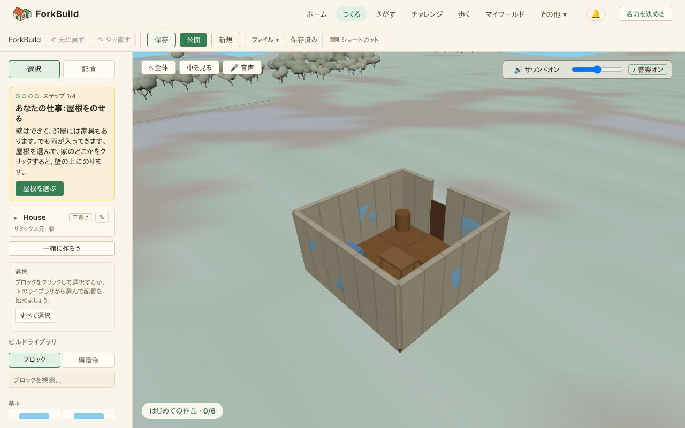

<!-- translation-of: docs/user/02-TheEditor.md source-hash: 080ab27533db83cb -->
# 02 — エディター

<!-- languages -->
[English](../02-TheEditor.md) · [Deutsch](../de/02-TheEditor.md) · [Español](../es/02-TheEditor.md) · [Français](../fr/02-TheEditor.md) · [Bahasa Indonesia](../id/02-TheEditor.md) · **日本語** · [한국어](../ko/02-TheEditor.md) · [Português (Brasil)](../pt-BR/02-TheEditor.md)
<!-- /languages -->

エディターは作品を作る場所です。このガイドでは、ツール、ブロックの選択と
変形、グループによる作品の整理について説明します。

## 画面の構成


*上にツールバー。左に道具、作品の名前、選択パネル、ビルドライブラリ。中央に 3D ビュー。*

```
┌─────────────────────────────────────────────────────────────┐
│ ツールバー: 保存 · 公開 · 新規 · エクスポート · インポート ·│
│             最近 · ⌨ ショートカット                         │
├──────────────────────┬──────────────────────────────────────┤
│ [選択 | 配置]        │                                      │
│ 作品タイトル       ✎  │                                      │
│ 選択                 │            3D ビューポート           │
│ ビルドライブラリ     │                                      │
│   [ブロック|構造物]  │                                      │
│                      │                                      │
└──────────────────────┴──────────────────────────────────────┘
```

- **ツールバー** — まず **保存**、**公開**、**新規**、次に **ファイル**
  （**エクスポート**、**3D モデル**、**インポート** のメニュー）。最近の
  ものを開き直し、**⌨ ショートカット** の一覧を開きます（`?` でも
  開きます）。
- **ツール** — **選択**（`1`）と **配置**（`2`）を切り替えます。ブロック
  や構造物を配置している間は **配置** がハイライトされたままになります。
- **作品タイトル** — 開いている作品の名前です。**✎** をクリック
  すると、タイトル、説明、ライセンスを編集できます。保存済みかどうかは
  ツールバーに表示されます。
  タイトルそのもの（**▸**）をクリックすると、ワールドビューと同じ
  **この作品について** パネルが開き、長い説明は **続きを読む** で
  読めます。**▾** で閉じ、エディターはどちらにしたかを覚えています。
- **選択** — 今の選択に対して使えるものだけを表示します。下の
  [選択パネル](#選択パネル) を参照してください。
- **ビルドライブラリ** — 検索欄と 2 つのタブがあります。名前の一部を
  入力するか、欲しいものを自分の言葉で入力してください。*川を渡りたい*
  で橋が、*寝る*でベッドが見つかります。ブロックや構造物を見つけるための
  言葉はアプリに入っているので、どこにも何も送られません。
  キーボードでは、検索欄で ↓ を押すと最初の結果に移り、矢印キーでブロックや構造物の間を移動し、
  Enter でクリックと同じように選べます。
  - **ブロック** — 配置ツールで置けるものすべてが、6 つのセクション
    （基本、構造、屋根と階段、開口部、装飾、自然）にタイルで並んでいます。
    ハーフキューブや丸ブロック、丸太から、切妻屋根や円錐屋根、家一軒を
    ひとつで覆う寄棟屋根（4x4、4x6、6x6）と長い切妻屋根 2x4、窓枠や丸窓、
    柵、ベンチ、茂み、松の木、入って過ごす部屋のための家具（テーブル、
    ベッド、暖炉、棚。装飾にあります）、そしてワールドビューで夜に灯る
    **ランタン**まで 59 種類あります（[昼と夜](03-WorldView.md#昼と夜)を参照）。
    クリックすると選択され（配置ツールに切り替わり）、色を選ぶための
    **色** の見本が表示されます — 下の [ブロックの色](#ブロックの色) を
    参照してください。
    **スロープ 45°**、**ゆるい斜面 2x1**、**階段**、**幅広の階段**、
    **筋交い 2x2** は片側に向かって上がります。
    逆向きにするには 2 回回転します（**R**、**R**）。筋交いと、それを
    180° 回転させたコピーを組み合わせると X 字になります。
  - **構造物** — 5 つのカテゴリー（住宅、農業、商業、公共、インフラ）に
    わたる 22 種類の既製の構造物と、より大きな **ショーケース** の作品 3 つ、
    自分の **マイ構造物** です。カードを
    クリックすると配置できます — 下の
    [構造物: 組み立て、リミックス、自分のライブラリ](#構造物-組み立てリミックス自分のライブラリ)
    を参照してください。

### 選択パネル

パネルは選択しているものに応じて変わるので、まだ何もできないボタンが
表示されることはありません。

- **何も選択していないとき** — 短いヒント、**すべて選択**、何かを
  コピーしたあとは **貼り付け**、そしてグループの一覧（クリックすると
  そのブロックを選択します）。
- **ブロックを選択しているとき** — 個数、位置、そして普段使う操作:
  **回転 ↻ / ↺**、**複製**、**削除**、**コピー**、**貼り付け**、**色**、
  **フォーカス**、**選択解除**。あまり使わない道具は、その下の 3 つの
  セクションに折りたたまれています。**正確な位置と回転**、
  **整列・等間隔配置・繰り返し**、**グループとブループリント** です。
- **構造物のインスタンスを選択しているとき** — 代わりに専用のカードが
  表示され、位置、回転、操作があります
  （[構造物のインスタンス](#構造物のインスタンス-生きた参照) を参照）。

> **ヒント:** どこでも `Ctrl/Cmd+K` を押すと **コマンドパレット** が
> 開きます。このガイドのすべての操作を名前で検索できる一覧です。

## 今すぐ試す：仕上げる家

**ホーム** の **今すぐ試す** は、まだ仕上がっていない自分の家を開きます。
壁は立ち、部屋には家具がありますが、屋根がありません。ツールの上にある
カードが、仕事を一つずつ伝えます（**ステップ 1/4**）。どのステップにも、
必要なブロックを選んで配置に切り替えるボタンがあります。

1. **屋根をのせる**：**屋根を選ぶ**（**寄棟屋根 6x6**）をクリックし、
   家のどこかをクリックすると、屋根が壁の上にのります。
2. **えんとつ**：**えんとつを選ぶ** をクリックし、家のどこかをクリック
   すると、暖炉の上で屋根を抜けて立ちます。
3. **戸口までの小道**：**石を選ぶ** をクリックし、家のどこかを四回
   クリックすると、石が戸口の踏み石から並びます。
4. **庭**：**しげみを選ぶ** をクリックし、家のまわりの好きな場所に四つ
   置きます。ビルドライブラリのしげみ、さく、芝生、岩、木、ランタンは
   どれも数えられます。

どのステップも、足したブロックを順番に関係なく数え、元に戻すと一つ前に
戻ります。仕事が開いている間、**はじめての作品** カードはたたまれて待つ
ので、説明はいつも一つだけです。四つのステップがすべて終わると、カードが
この家はもうあなたのものだと伝え、**公開する**（ツールバーの公開と同じで、
いつでも使えます）と、カードをしまう **続けて作る** が出ます。

ほかのできあがった作品（**ホーム** のカード、チャレンジのアイデア、エディターの
**新規** で選んだもの）は、代わりに **あなたの作品にしよう** のカードとともに
開きます。**木を選ぶ** をクリックし（木を選んで配置に切り替わります）、作品の
そばの地面をクリックします。あなたのものが何か入ると、カードは同じように
**公開する** を出します。スマートフォンではツールがたたまれているので、
カードは 3D ビューの上、タッチボタンの上に出ます。

## はじめての作品

あるデバイスではじめてエディターを開くと、3D ビューの左下に
**はじめての作品** カードが表示されます（スマートフォンでは、左上の小さな
**はじめての作品 · 0/6** ボタンにたたまれた状態で始まります。**今すぐ試す** の家の仕事が開いている間も、たたまれて待ちます）。6 つの
ステップが並び、次のステップのヒントが表示されます。

1. **ブロックを置く**
2. **ブロックを積む**：ブロックの上に別のブロックを置きます。
3. **自分のものを足す**：自分のブロックを一つずつ五つ置きます。
   ビルドライブラリから置いた構造物は数えられません。
4. **作品を保存する**
5. **公開してリンクを共有する**：公開してから **リンクをコピー** または
   **共有…** を使います。
6. **中に入ってみる**：公開で表示されるリンクの横（またはカード）にある
   **中に入ってみる** をクリックし、ワールドビューで作品のドアから中へ
   歩いて入ります（[中に入ってみる](04-PublishingAndForking.md#中に入ってみる)
   を参照）。

各ステップは、どの順番でも、やったときにチェックが付きます。元に戻すと
やり直しは数えません。6 つすべてが済むとカードがお祝いし、
**ほかの作品を見る** か **作り続ける** を選ぶと消えます。中に入るステップができる前に済んでいた場合は、もう
表示されません。**–** で小さな
ボタンにたたみ、**ガイドを隠す** でこのデバイスでは表示しなくなります。
もう一度表示するには、コマンドパレット（**Ctrl+K**）を開いて
**はじめての作品ガイド** を実行します。すでに保存した作品がある
デバイスでは、ガイドは隠れた状態で始まります。

## 2 つのツール

### 配置ツール（`2`）

パレットからブロックを選び、ビューポートにポインターを合わせ、クリック
して置きます。まだブロックを選んでいなければ、配置は **キューブ** で
始まるので、最初のクリックで必ず何かが置かれます。半透明のゴーストが、
ブロックがどこに置かれるかを正確に示します。置いてあるブロックの面に
ポインターを合わせると、積んだり付けたりできます。ほかのブロックの上に
置いたブロックは、下にあるいちばん高いブロックの上にのり、中に埋まり
ません。家の床のまん中に落とした屋根は壁の上にのり、2 本の柱に渡した
梁は柱の上にのります。

置くのはクリックだけです。動かさずに押して離してください。見回すための
ドラッグ（どのボタンでも）はカメラを動かすだけで何も置かないので、配置を
オンにしたまま作品を回して次の場所を探せます。

プレビューが赤い場所をクリックしても何も置かれません。エディターは何かが
じゃまだと伝え、低く小さなノック音を鳴らすので、別の場所を試すか向きを
変えればよいとわかります。

> **ヒント:** **Escape** を押すと選択ツールに戻ります。

### 選択ツール（`1`）

ブロックをクリックして選択し、移動、回転、削除します。形のあらましが
できたあとは、ほとんどの時間をここで過ごします。

## ブロックを選択する

ForkBuild では選択を細かく操作できます。

| 操作 | 結果 |
|---|---|
| ブロックを **クリック** | それを選択します（今の選択を置き換えます） |
| **Ctrl/Cmd + クリック** | そのブロックを選択に入れる / 外す |
| **Shift + クリック** | そのブロックを選択に追加します |
| **Shift + ドラッグ** | 箱を描き、中にあるものをすべて選択します |
| **Ctrl/Cmd + Shift + ドラッグ** | 範囲選択して、今の選択に *追加* します |
| **Ctrl/Cmd + A** | 作品のすべてのブロックを選択します |
| **Escape** | 選択を解除します |

> **なぜ大事か:** ブロック 1 つより大きなものを作るには、*たくさんの*
> ブロックを一度に扱う必要があります。Shift ドラッグの範囲選択は早めに
> 覚えましょう。壁をまるごとつかむいちばん速い方法です。

## 移動、回転、削除

ブロックを 1 つ以上選択した状態で:

| キー | 操作 |
|---|---|
| **矢印キー** | 左右 / 前後に少し動かす |
| **Page Up / Page Down** | 上 / 下に少し動かす |
| **R** | 時計回りに 90° 回転 |
| **Shift + R** | 反時計回りに 90° 回転 |
| **T** | 次の面に倒す |
| **Shift + T** | 逆に倒す |
| **Delete / Backspace** | 選択したブロックを削除 |

複数のブロックを選択すると、**共通の中心** を軸に回転するので、
ひとまとまりの部分がまるごと回ります。

**T** で、選択したブロックをその場で次の面に倒します。柱は寝かせて梁に、
壁は床に、斜面はひっくり返して張り出しになります。どのブロックも底の高さは
そのままで、倒す操作は 1 回で元に戻せます。4 回押すと元の向きに立ちます。
配置中は、**T** でこれから置くブロックを倒します。配置した構造物は回転は
できますが、倒すことはできません。古い ForkBuild（1.3.0 以前）では、
倒したブロックは立った向きで表示されます。

## ブロックの色

ブロックの種類ごとに既定の色がありますが、自分で選ぶこともできます。

- **置く前に** — ビルドライブラリの **ブロック** タブでブロックを選んだ
  ら、その **色** の見本をクリックして色を選びます。それ以降に置く
  ブロックはすべてその色になり、配置のゴーストもその色でプレビュー
  されます。別の種類のブロックを選ぶと、もう一度色を選ぶまで、その
  種類の既定の色に戻ります。
- **置いたあとに** — ブロックを 1 つ以上選択し、**選択** セクションの
  **色** の見本を使うと、まとめて色を変えられます。変更はどれも、ほかの
  編集と同じように元に戻せます（`Ctrl/Cmd+Z`）。構造物のインスタンスを
  選択しているときは見本は表示されません。構造物自体の作品を
  編集してください（下の
  [構造物のインスタンス](#構造物のインスタンス-生きた参照) を参照）。

**色** の見本の横には、よく合う **村の色**（しっくい、石、レンガ、屋根の赤、
オーク、葉、空など）が並んでいます。クリック 1 回で、次に置くブロックや
選択中のブロックの色になります。見本からは今までどおり好きな色を選べます。

ブロックの色は作品と一緒に保存され、公開や共有をすると一緒に届きます。

## 正確な変形: 数値入力、整列、繰り返し

選択パネルの折りたたまれたセクションでは、ギズモや上のキーに加えて、
選択をもっと正確に動かせます。

- **正確な位置と回転** — ドラッグする代わりに、X/Y/Z/回転の正確な値を
  入力します。**絶対**（値は選択の回転軸や向きの目標）か **オフセット**
  （値は差分として加えられる）を切り替え、**適用** を押します（または
  欄で `Enter`）。空の欄は「変更しない」という意味で、0 ではありません。
  **入力欄をリセット** は、選択に触れずに欄を空にします。
- **整列と等間隔配置**（**整列・等間隔配置・繰り返し** の中） — 選択
  全体の端や中心をワールドの軸で揃える 9 つのボタン（← 左 / X中央 /
  右 →、↓ 下 / Y中央 / 上 ↑、前 / Z中央 / 後ろ）と、均等に並べる 3 つの
  ボタン（X等間隔 / Y等間隔 / Z等間隔）です。整列には **2 個以上の
  ブロック**、等間隔配置には **3 個以上** の選択が必要です。
- **繰り返し**（同じく **整列・等間隔配置・繰り返し** の中） — 選択の
  コピーを、1 つの軸に沿って等間隔に **N** 個追加で作ります。どれか
  1 つでも衝突する場合は、コピーは 1 つも作られません。

どれも、ギズモのドラッグやキーボードでの微調整とまったく同じく
**1 回で元に戻せる操作** です。欄ごとの詳しい動作は
[操作リファレンス](ControlsReference.md#変形--数値パネルエディターのみ)
を参照してください。

選択パネルの **フォーカス** ボタンは、何も変えずに、選択したブロックに
カメラを合わせます。

> **衝突は止められます。** ギズモでドラッグしたりキーボードで少し
> 動かしたりすると、結果を選択外のすべてのブロックと照合します。離した
> ときにメンバーのどれかがそれらの上に重なる場合、移動全体は確定され
> ずにキャンセルされ、選択内のすべてのブロックがちょうど元の位置に
> 戻り、元に戻す履歴も増えません。自分の選択の *中* でブロックを
> 並べ替えること（回転で 2 つのブロックの位置を入れ替えるなど）は、
> 衝突として扱われません。

## コピー、貼り付け、複製

| キー | 操作 |
|---|---|
| **Ctrl/Cmd + C** | 選択したブロックをコピー |
| **Ctrl/Cmd + V** | 貼り付け（見えるように少しずらして置きます） |
| **Ctrl/Cmd + D** | 選択をその場で複製 — コピーと貼り付けを 1 回で |

コピーして貼り付けるのは、同じ要素を繰り返すのにぴったりです。窓を
1 つ作ったら、建物の正面にコピーして並べましょう。**複製** は同じことを
1 回の操作と 1 回の元に戻す操作で行い、クリップボードには触れません。
前に Ctrl+C したものは、別のものを複製したあとでもまだ貼り付けられます。
複製したものが新しい選択になるので、選択 → 複製 → ドラッグや微調整で
位置を合わせる、が自然な流れです。複製はどんな選択にも使えます。
ばらばらのブロック、グループ全体、1 つの
[構造物のインスタンス](#構造物のインスタンス-生きた参照) です。

## 元に戻す・やり直す

すべての変更が記録されるので、いつでも戻れます。

| キー | 操作 |
|---|---|
| **Ctrl/Cmd + Z** | 最後の操作を元に戻す |
| **Ctrl/Cmd + Y** *（または Ctrl/Cmd+Shift+Z）* | やり直す |

10 個のブロックを動かしても元に戻す操作は **1 回** に数えられるので、
大きな作品でも元に戻す操作が扱いやすいままです。

一緒に作っているあいだ（下の **一緒に作ろう**）は、元に戻すで取り消せるのは
自分の操作だけで、友だちの操作は取り消しません。取り消しはすべての画面で
同時に行われ、やり直すで元どおりにできます。自分の操作で作ったものを、
その後で友だちが変えていた場合（たとえば、あなたが置いたブロックを削除
していた場合）、その操作は飛ばされ、エディターがそのことを知らせます。
誰かが参加すると、全員の元に戻すはそこから始め直しになります。新しく
来た人は、それより前の操作を持っていないためです。

## グループ

グループを使うと、ブロックのまとまりに名前を付けて再利用できます。
「屋根」や「窓」などです。

**グループを作る:**
1. ブロックをいくつか選択します。
2. 選択パネルの **グループとブループリント** セクションを開いて
   **新しいグループ** をクリックし、**グループの名前を変更**（下記）で
   名前を付けます。

**グループを使う:** 一覧でグループの名前をクリックすると、そのグループ
（とそのブロック）が選択されます。一覧は、何も選択していないときは
選択パネルに、それ以外のときは **グループとブループリント** にあります。
次のボタンは、選択しているグループに対して働きます。

| ボタン | 動作 |
|---|---|
| **グループの名前を変更** | グループの名前を変えます |
| **グループを複製** | グループ *と* そのブロックをまるごとコピーします |
| **グループを削除** | グループを削除します（ブロック自体は残ります） |
| **グループに追加** | 今の選択をグループに追加します |
| **グループから外す** | 今の選択をグループから外します |

> **知っておくと便利:** グループを選択しても、そのブロックが選択される
> だけで、グループは変わりません。また、グループを削除しても *名前* が
> 消えるだけで、中のブロックは消えません。

## 構造物: 組み立て、リミックス、自分のライブラリ

ビルドライブラリの **構造物** タブ（上の [画面の構成](#画面の構成) を
参照）には、5 つのカテゴリーにわたる 22 種類の既製の構造物（家、納屋、
井戸、市場、水車小屋、橋など）、より大きな **ショーケース** の作品 3 つ
（城、港の島、村の広場）、そして作品から保存したものを集めた自分専用の
コレクションである **マイ構造物** があります。どれについても 3 つの違う
ことができ、それぞれ別の理由で役に立ちます。

- **配置**（カードをクリック） — 構造物のブロックを、今作業している
  作品にそのままコピーし、1 つの大きな作品の一部にします。
  普段使う操作です。
- **新しい作品としてリミックス**（カードの **⋮** メニュー） —
  その構造物の正確なコピーから始まる、まったく新しい、独立した
  作品を作ります。
- **マイ構造物にリミックス**（組み込みのカードのみ、**⋮** メニュー） —
  作品を一切使わずに、構造物を自分の **マイ構造物** に追加
  します。下の
  [マイ構造物](#マイ構造物-自分専用のブループリントライブラリ) を参照
  してください。
- **情報**（カードの **⋮** メニュー） — 構造物の名前、カテゴリー、
  ブロック数、占有範囲、高さ、出典、説明を読み取り専用で表示します。
- 自分の **保存した作品** を、コピーではなく生きた再利用できる
  参照である **構造物のインスタンス** として配置するには、ビルド
  ライブラリではなく、ツールバーの **最近** のドロップダウンを使います。
  下の [構造物のインスタンス](#構造物のインスタンス-生きた参照) を参照
  してください。

### 構造物を作品に配置する

**構造物** タブのカード（組み込みのものでも自分の **マイ構造物** でも）を
クリックすると、構造物全体の半透明のゴーストが表示され、ブロックを 1 つ
置くときとまったく同じように、地面の上でポインターについてきます。

1. ポインターを動かしてゴーストの位置を決めます。
2. `R` / `Shift+R` で 90° ずつ回転します。
3. クリックして配置します。構造物のすべてのブロックが、**1 回で元に戻せる操作** として作品に追加されます。
   構造物は同じ向きのまま手元に残るので、クリックするたびにもう 1 つ置けます。
   使われている位置ではゴーストが赤くなり、そこをクリックしても何も置かれず、
   エディターが何かがじゃまだと伝えます。
4. `Escape`（または選択ツール、タッチ画面では **やめる**）で配置をやめます。
   それ以上は何も追加されず、選択ツールになります。

ブロックの上面を指すと、構造物はそこに置かれ、その下でいちばん高いブロックの上にのります。
デッキの上の小屋や屋根の上の煙突のように、幅の広いブロックが壁の上にのるのと同じです。
地面やブロックの側面を指すと、地面に置かれます。

置かれたブロックは、その瞬間から作品の普通のブロックです。
手で置いたものと区別はなく、ほかのものと同じように自由に編集、選択、
グループ化、削除できます。構造物をいくつか配置すると、すばやく場面を
作れます。家をクリックして置き、納屋をクリックしてその横に置き、
井戸をクリックして庭に置く、という具合です。

### 構造物を新しい作品としてリミックスする

カードの **⋮** メニューを開いて **新しい作品としてリミックス** を
クリックすると、その構造物の正確なコピーから始まる、まったく新しい
自分の作品が作られます。まったく同じブロックで、このガイドのすべての
道具で編集でき、今開いているものに混ざるのではなく、独立した作品
になります。リミックスしてもライブラリ自体のコピーは変わりません。家を
10 回リミックスすれば、リミックスをクリックした瞬間から、それぞれが独立した
作品になります。

### マイ構造物: 自分専用のブループリントライブラリ

再利用する価値のあるものを作りましたか？それを構成するブロック（建物
全体でも一部分でも）を選択し、**ブループリントを作成** をクリックします。
ブロックを選択していれば選択パネルの **グループとブループリント**
セクションにあり、どんなときでもコマンドパレット（`Ctrl/Cmd+K`）から
使えます。小さなダイアログで **名前**、**カテゴリー**、任意の **説明** を
尋ねられ、保存しようとしているもののライブプレビューも表示されます。
**ブループリントを作成** をクリックすると、独自のローカルの原点に
正規化され、すぐに **マイ構造物** に保存されます。マイ構造物は、構造物
タブの一番下、組み込みのカテゴリーのすぐ下にある新しいセクションです。

何も選択せず、何も作らずに構造物がマイ構造物に入る方法がもう 1 つ
あります。**組み込み** のカードの **⋮** メニューを開いて
**マイ構造物にリミックス** をクリックします。そのままの状態で追加され
（作品は作られず、何も取り出されません）、ライブラリのほかの
項目と同じように、すぐに名前の変更、エクスポート、配置ができます。

**マイ構造物** の構造物は、組み込みのものとまったく同じように使えます
（クリックして今の作品に配置、または新しい作品として
リミックス）。さらに、**⋮** メニューに 2 つの操作が追加されます。

| 操作 | 動作 |
|---|---|
| **名前を変更** | 名前を変えます（カテゴリーと説明はそのまま） |
| **削除** | ライブラリから削除します |

**マイ構造物** が保存するのは *構造物そのもの*（名前とブロックの集まり）
だけです。削除しても、それを使ってすでに作ったものには一切影響しません。
すでに配置したりリミックスしたりした場所では、ブロックはそのまま残ります。
また、その場で編集されることもありません。保存した構造物が作るものを
変えたい場合は、作品に配置し、その作品を編集して、
もう一度 **ブループリントを作成** します（必要なら「Farmstead Deluxe」の
ような新しい名前で。元のものを置き換えるのではなく、マイ構造物の別の
項目になります）。

> **知っておくと便利:** マイ構造物はこのデバイスにあります。
> アイデンティティとは結び付いておらず、どこにも自動で同期されません。
> 別のデバイスに移したり誰かに渡したりする方法は、下の
> [ブループリントを共有する](#ブループリントを共有する-エクスポートとインポート)
> を参照してください。

### ブループリントを共有する: エクスポートとインポート

どの構造物も（組み込みのものでも自分のものでも）、共有の公開ワールドの
一部になることなく、持ち運べるファイルとしてデバイスの外に出せます。

- **ブループリントをエクスポート**（カードの **⋮** メニュー） — 小さな
  JSON ファイルとしてダウンロードします。その構造物の名前、カテゴリー、
  タグ、説明、ブロックを収めた、それだけで完結したスナップショットです。
- **ブループリントをインポート**（**マイ構造物** の見出しの横のボタン）
  — ブループリントのファイルを読み込み、自分のマイ構造物に新しい
  独立した項目として追加します。元の場所とは一切つながらない、独自の ID
  を持つ新しいコピーです。同じファイルを 2 回インポートすると、片方が
  もう片方を黙って上書きするのではなく、別々の 2 つの項目になります。
  形式が正しくないファイルや認識できないファイルは、壊れたものを黙って
  作るのではなく、説明付きで拒否されます。

これが、作品を友達に渡したり、自分の構造物を自分のデバイス間で持ち運んだり
する方法です。一方でエクスポートし、好きな方法でファイルを送り、もう
一方でインポートします。

**すべてエクスポート**（自分の構造物があるとき、
**ブループリントをインポート** の横） — マイ構造物のすべての構造物を、
それぞれの作者情報と系譜のクレームとともに 1 つのファイルでダウンロード
します。**ブループリントをインポート** はそのファイルも読み込み、すでに
マイ構造物にあるデザインは飛ばすので、2 回インポートしても重複しません。
ほかのものもすべてコピーを残すには、[あなたのデータ](13-YourData.md) を
使ってください。

### 作者であることを主張する

ブループリントの ID を持つ構造物（保存したもののほとんどが持っています）
には、**コミュニティによる作者情報** を付けることもできます。誰がその
デザインの作者だと主張したかの、署名された記録です。カードから構造物の
**情報** パネルを開くと、次のものがあります。

- **作者であることを主張** — 今のアイデンティティで、自分がその作者の
  1 人であるというクレームに署名します。何人でも、同じデザインについて
  それぞれ独立に主張でき、誰の主張もほかの人の主張を上書きしたり
  置き換えたりしません。
- **作者情報をエクスポート** / **ネットワークに公開** — 主張したら、
  そのクレームをファイルとして共有するか、接続しているピアに告知します。
  **ネットワークに公開** の後、パネルに **配信** が表示され、クレームを
  分散型ネットワークにも載せられます（[配信](Distribution.md) を参照）。
- **このデザインに再署名** — 2026 年 9 月 28 日より前に作られた
  クレームは、別のデザインでも真似できる古い種類のデザインの指紋を
  使っていたので、もう数えられず、パネルにはその件数が表示されます。
  そのうちの 1 つがあなたのもので、これが本当にあなたのデザインなら、
  このボタンでクレームにもう一度署名します。先にデザインを確認して
  ください。このボタンは、古い指紋を共有するどのデザインにも表示され
  ます。

これは任意で、構造物自体の配置、リミックス、共有とはまったく別のものです。
自分の名前をデザインに付けて、ほかの人がただ信じるのではなく、それぞれ
独立に確認できるようにしたい場面のためにあります。公開したクレームが
どうなるか、そこに独立した外部証拠をどう付けるかは、
[署名付き記録と外部証拠](09-PublicationsAndEvidence.md) を参照してください。

## 構造物のインスタンス: 生きた参照

配置（上記）は、構造物のブロックを作品に一度だけコピーします。
そうではなく、すでに作ったもの（ライブラリにあるものに限らず、保存
したどの作品でも）の、見るたびに元と同期している **生きた**
コピーがほしいこともあります。それが **構造物のインスタンス** です。
ブロックをコピーするのではなく元の作品を参照するので、あとで
元を編集すると、そのすべてのインスタンスが自動で更新されます。

1. ツールバーの **最近** のドロップダウンを開きます。（作品を
   1 つ以上保存すると表示されます。）
2. 保存した作品の横にある **配置** をクリックします。
   作品の名前をクリックすると、代わりにそれが開き、今開いている
   ものが置き換わります。
3. 地面にポインターを合わせ、`R` で回転し、クリックして置きます。
   ブロックを置くときとまったく同じです。

インスタンスはその作品の生きた *参照* で、ブロックのコピーでは
ありません。同じ作品を何回でも配置でき、あとで元の作品の
ブロックを編集すると、そのすべてのインスタンスが更新されます。選択
ツール（`1`）でインスタンスを選択すると、サイドバーに次のものが表示
されます。

| 操作 | 動作 |
|---|---|
| ビューポート内でドラッグ、または[ギズモ](InteractiveTransformGizmo.md) | ブロックと同じように移動 / 回転 |
| 矢印キー / Page Up / Page Down | 少し動かす |
| **X / Z / 回転 ° の欄に入力して適用** | 正確な位置と向きを設定します。高さ（地面のY）は常に地形に従い、指定する値ではありません |
| **回転 ↻ / ↺** | ちょうど 90° 回転 |
| **複製**（`Ctrl/Cmd+D`） | 同じ構造物のインスタンスをもう 1 つ配置 |
| **削除** | このインスタンスを取り除きます。元の作品には影響しません |
| **元の作品を編集** | 参照している作品そのものを開き、そのすべてのインスタンスの見た目を変えます |

配置した構造物の *中身* を編集するのは、常に元の作品の編集に
よってです。インスタンスのブロックを直接編集する方法はなく、だからこそ
すべてのインスタンスが同期したままになります。

## 作品のプロパティ

どの作品にも **タイトル**、任意の **説明**、**ライセンス**、そして
**ワールドに配置できる人** の設定があります。エディターのサイドバーの
上にある作品タイトルの横の **✎** ボタン（ワールドビューでは
**メタデータを編集** ボタン）で開く **作品のプロパティ** の
ダイアログで設定します。新しい作品はライセンスなしで始まるので、
ライセンスを選ぶまでほかの人はリミックスできません。説明は **さがす** の
カードに抜粋として表示され、そこで検索することもできます。ライセンスは、
ほかの人がリミックスしてよいか、どのようにしてよいかを決めます。各
ライセンスの意味は [公開とリミックス](04-PublishingAndForking.md) を参照
してください。

タイトルの下の **タイトルを提案** と **説明を提案** のボタンは、作品の
ブロックからアイデアを出します。ビルドライブラリの構造物、主な部品と色、
リミックスなら元の作品に足したもの（*納屋のある風車と穀物倉*）です。
**タイトルを提案** をもう一度押すと次のアイデアになります。提案された説明は、
空の説明ならそこに入り、書いてあればその後ろに付きます。このデバイスの上で
求めたただの提案なので、好きなように変えてください。

長い説明は、少し書式を付けると読みやすくなります。書式は作品情報
パネル、ワールドビューの場所ブラウザー、Steem と Blurt の投稿で表示されます。

| 書き方 | 結果 |
|---|---|
| 空行 | 新しい段落（単なる改行は改行のまま） |
| 行頭の `## 材料` | 見出し |
| 行頭の `- `（または `* `） | 箇条書きの項目 |
| `**語**` | **太字** |
| `*語*` | *斜体* |
| `\*`、`\#`、`\-` | その文字そのもの |

それ以外は書式になりません。リンク、画像、HTML はただのテキストのままです。
**さがす** のカードでは、説明の言葉が書式なしで 1 行に表示されます。

**タグ**は `japanese temple garden` のように作品が何かを表します。最大 5 個を
スペースかカンマで区切り、半角の小文字・数字・ハイフンで書きます（アクセント
は外され、`café` は `cafe` になります）。タグがない作品では、ダイアログが
タイトルと説明から提案したタグを欄に入れます。そのまま使うか、変更または
削除してください。欄の下のボタンで別の候補を追加できます。リミックスしても
タグは引き継がれます。Blurt の投稿では ForkBuild 自身のタグの後に並ぶので、
Blurt をタグで見ている人があなたの作品を見つけられます。

## サウンド

変更ごとに短い音が鳴るので、見なくても何が起きたかがわかります。
ブロックや構造物を置くとカチッ、取り除くとポン、移動はコツ、回転は
コツコツ、貼り付けや複製は短いピピピ、新しい色は明るいピン、グループ化は
2 つの音、地名を付けるとベル、元に戻すは下がる音、やり直すは上がる音、
保存すると小さな和音です。同じ作品で共同作業者が行った変更は
鳴りません。

音のオン・オフは、ビューの右上の **サウンド** ボタンか、`M` を押して
切り替えます（キーボードショートカットの一覧、`?` にも載っています）。
横のスライダーで音量を設定します。ワールドビューと共通の設定で、この
デバイスに記憶されます。ブラウザーの決まりにより、音は最初のクリックか
キー入力から鳴り始めます。

スマートフォンやタッチ画面では、作品のじゃまにならないよう、
サウンドは **中を見る** と **音声** の横の小さな 🔊 ボタンになります。
タップすると音と音楽のボタンが出ます。音量は端末の音量ボタンで調整してください。

組み立て中は、ワールドビューより少し軽快な音楽が静かに流れます。スライダーの横にある **♪ 音楽** ボタンでオン・オフを切り替えられます。ワールドビューと同じ設定です。

## 保存、公開、やり直し

- **保存**（`Ctrl+S`） — 作業をこのデバイスに残します。
- **公開** — みんなと共有します（[公開とリミックス](04-PublishingAndForking.md)
  を参照）。公開すると保存もされます。できあがった作品から始めて、まだ
  自分の手を何も加えていない作品では、一度だけ **作り続ける** か
  **このまま公開する** かを聞かれます。公開後のメッセージは 1 本の
  バーで、**中に入ってみる** と **リンクをコピー**、そして
  **ほかの共有のしかた** にリンクそのもの、**画像を保存**、**動画を作る**、
  **埋め込み**
  があります。公開に使った ID が作られたばかりのときは、その ID に
  パスフレーズを付けるようにというお知らせは次の公開まで待ちます。
- **新規** — 新しく始めます。**空き地** か、できあがった作品（城、港の島、
  村の広場、家、製粉所、橋）のどれかを自分用のコピーとして、全体が見える
  ように開きます。開いているものに保存していない変更があるときは、先に
  そう知らせます。残すには保存してください。
- **ファイル** — 次の 3 つが入ったメニューです。
  - **エクスポート** — 今の作品を JSON ファイルとしてダウンロードし、
    コピーを残したり別のデバイスに移したりします。ファイルは、ブロックを
    表として保存するコンパクトな形式です。
  - **3D モデル** — 作品をほかのソフト用の 3D モデルとしてダウンロード
    します（[3D モデルをダウンロードする](#3d-モデルをダウンロードする) を参照）。
  - **インポート** — エクスポートしたファイルを、独自の ID を持つ新しい
    作品として開きます。**保存** するまで何も保存されません。以前の
    バージョンでエクスポートしたファイルも開けます（読み込むときに変換
    されます）が、ForkBuild 1.0.0 以前では、このバージョンでエクスポート
    したファイルは開けません。
  自分が作った作品なら、**エクスポート** はファイルに署名するので、
  インポートする人はそこに書かれた名前とライセンスを信頼できます。
  自分の作品はそのままインポートされます。ほかの人の作品は、ライセンスが
  リミックスを認めていれば、作者をクレジットした自分のコピーとして
  開きます。認めていない場合や、作者の署名後にファイルが変更されている
  場合はインポートされません。ファイルにはエクスポートした時点の作品の
  ライセンスが入るので、作品を **All Rights Reserved** で公開したまま、
  相手が手を加えてよいコピーを渡すこともできます。**作品の
  プロパティ** で別のライセンスを選んでエクスポートし、あとで元に戻して
  ください。**最近** の **すべての作品をエクスポート** とその
  **インポート** も同じように動きます。
- **最近** — 前に保存したものを開き直します（最初に保存したあとに表示
  されます。作品の名前をクリックすると開きます）。作品を
  たくさん保存すると絞り込み欄が表示され、名前ですぐに目的のものに
  移動できます。各項目には **配置** ボタンもあり（
  [構造物のインスタンス](#構造物のインスタンス-生きた参照) を参照）、
  置き換える代わりに *今の* 作品に追加できます。一番下の
  **すべての作品をエクスポート** は、保存したすべての
  作品を 1 つのファイルでダウンロードします。**インポート** は
  それを読み込み、このデバイスにない作品を保存し（最近から
  開けます）、変わっていないものは飛ばし、別の版があるものは横に
  コピーを保存します。未保存の変更は含まれないので、先に保存して
  ください。

## 一緒に作ろう: ライブで一緒に作る

**一緒に作ろう**（サイドバーの作品名の下）は、友だちがこの作品をあなたと
同時に一緒に作れるリンクを作ります。好きな方法で送ってください。
スマートフォン向けに QR コードでも表示されます。開いた友だちは、まだなら
名前を選び（その人のブロックはその人の名前で追加されます）、**参加する** を
クリックすると、あなたの作品がその人のエディターで開きます。それ以降、
どちらかが置く、動かす、色を変える、削除するブロックは、すべて両方の
画面に表示されます。

- シーンの上の帯に、作っている人がそれぞれの色で表示され、相手がどこを
  指していて何を選択しているかも、その色でお互いに見えます。
- **元に戻す**（`Ctrl/Cmd + Z`）は、自分の最後の操作をすべての画面で
  取り消し、**やり直す** でもう一度行えます。友だちの操作を取り消すのは、
  その友だち自身です。
- 自分の作品である必要があります。自分で始めたものか、自分で作った
  コピーです。名前を選ぶ前に始めた作品は、友だちを招待したときに
  あなたのものになります。
- 最初の 30 分のあいだにリンクを開いた人なら誰でも、作品があなたの
  エディターで開いているあいだ参加できます。参加した人は全員、あなたが
  **終了** を押すか、別の作品を開くか、エディターを離れるまで作れます。
  帯の **リンク** で、リンクをもう一度表示できます。
- 友だちのエディターはそれぞれ自分のコピーを持ち、その人のデバイスに
  保存します。あなたが終了しても友だちはそれを持ち続けられますが、
  その後の変更はあなたに届きません。
  ブロックを 1 つも置かなかった友だちはクレジットされないので、その
  コピーはあなたの作品のままです。バックアップから復元すると、ほかの
  人の作品と同じく、作品のライセンスに従います。
- あなたの作品が取り込んだブロックを置いた人は全員、作品に記録されます。
  作品のパネルに **一緒に作った人** とその名前が表示され、公開すると、
  共有リンクと系譜にも、あなたの署名の下に表示されます。どの友だちの
  コピーにも同じ記録が表示されます。ほかの人がその作品から作ったコピーには、
  この記録は付きません。それは新しい作品です。
- 記録された名前や、共有された作品の作者を選ぶと、その人のページが開きます。
  そのアイデンティティが署名した作品と、ほかの人がその人を記録した作品が
  表示されます。系譜では、各作品のタイトルを選ぶとその作品が開き、作者と
  一緒に作った人の名前を選ぶとその人のページが開きます。**マイワールド** には
  **あなたが手伝った作品**、つまり友だちがあなたを記録した作品が並び、
  それぞれ公開されるとそのワールドが開きます。あなたの別のデバイスも、
  このデバイスと接続したあと（またはデータのコピーを受け取ったあと）は、
  これらを表示します。
- 参加すると、**ここで一緒に歩こう** と同じように 2 台のデバイスが直接
  つながります。お互いの IP アドレスが見えます。あなたが選ばない限り、
  誰も記憶したピアや友達にはなりません。ランデブーサーバーが必要です。
  公式サイトにはあります。

## 3D モデルをダウンロードする

ツールバーの **ファイル** にある **3D モデル** は、開いている作品を、ほかの 3D ソフトで
開けるファイルとしてダウンロードします。ファイルはこのデバイスで作られ、
何もアップロードされません。

- **glTF（.glb）** — カラーです。Blender、Windows の 3D ビューアー、
  Godot や Unity などのゲームエンジン、オンラインのモデルビューアーで
  開けます。ForkBuild の 1 単位は 1 メートルです。
- **3D プリント用（.stl）** — 単色で、1:100 のミリメートル単位（ドアの
  高さは 20 mm、立方体は 10 mm）、Z 軸が上でプリントベッドに置いた向き
  なので、スライサー（Cura、PrusaSlicer、Bambu Studio など）でそのまま
  印刷できます。大きくしたいときはスライサーで拡大してください。接したり
  重なったりしているブロックは別々の部品のままで、スライス時にスライサーが
  結合します。
- **OBJ（.obj）** — カラー（頂点カラー）で、古いソフト向けです。

各ブロックは ForkBuild での形と色をそのまま保ち、配置した構造物はこの
デバイスにあれば含まれます（ないものがあればメッセージで知らせます）。
どのファイルにも、作品名、作者、ライセンス、リミックス元が記録されます。
glTF では copyright と extras に、STL ではヘッダーに、OBJ ではコメントに
入ります。共有された作品のページでも、ライセンスがコピーを認めていれば
同じダウンロードができます（[リンクを開くと表示されるもの](04-PublishingAndForking.md#リンクを開くと表示されるもの)
を参照）。

## 建物を説明する

`I` を押すか、コマンドパレットで **建物を説明** を選ぶと、エディターが
建物の中身を伝えます。ブロックの数、だいたいの幅・奥行き・高さ、
建物の中にあるビルドライブラリの構造物、それ以外のブロックの中の窓・扉・
屋根・木などの部品、そして村の色の名前で表した主な色です。スクリーン
リーダーが読み上げ、**閉じる** を押すまで 3D ビューの上にも表示されるので、
カメラを回さずに建物を確かめられます。ブロックからこのデバイスの上で
求めるので、どこにも何も送られません。共有リンクや埋め込みの作品の絵にも、
スクリーンリーダー向けに同じ説明が付いています。

## 自分の言葉でコマンド

コマンドパレット（`Ctrl/Cmd+K`）に、*屋根を赤く塗って*、*窓を全部選択*、
*木を削除して* のように、したいことを自分の言葉で入力すると、最初の行
**あなたの言葉から** に、何をいくつのブロックにするかが出ます（*窓 4 個を
港の青に塗る*）。`Enter` を押すかクリックすると、元に戻せるひとつの操作で
実行されます。わかるのは、塗る・選ぶ・削除する、建物の部品（窓、扉、屋根、
階段、アーチ、柵、煙突、家具、ランタン、木、茂み、岩、芝生）、*全部*、
選択中のもの（*これ*）、そして名前や普段の言葉（*赤*、*濃い灰色*、*水色*）
で呼んだ村の色です。ForkBuild のどの言語でも、このデバイスの上で動きます。
ほかの入力は、これまでどおり操作を検索します。

## 声でコマンド（音声）

`V` を押すか、3D ビュー上部の **🎤 音声** を押して、したいことを話します。
*屋根を赤く塗って*、*窓を全部選択*、*木を削除して*、*元に戻す* などです。
話し終えたら `V`（または **停止**）を押します。ForkBuild は聞き取った言葉と
実行したことを伝え、元に戻せるひとつの操作で実行します。
[自分の言葉でコマンド](#自分の言葉でコマンド) と同じ依頼と、名前で呼んだ
操作がわかります。質問（*友だちを招待するには？*）なら **ガイドに聞く** が
出ます。

初めてのときは、音声をオンにすると何をダウンロードするかを説明します。
一度だけ約 70 MB で、小さな音声モデル（Whisper）を Hugging Face から、その
エンジンを jsDelivr から取得します。どちらもこのブラウザーに残るので、
その後はオフラインでも使えます。話した内容はこのデバイスで録音・聞き取り
され、どこにも送られません（[プライバシー](Privacy.md) を参照）。
**音声をオフにする** と **音声モデルを削除** は、コマンドのたびに音声パネル
に出ます。ForkBuild の表示言語を聞き取ります。

ワールドビューでも聞き取ります（[行き先を話す](03-WorldView.md#行き先を話す音声)
を参照）。音声モデルは裏で動くので、聞き取っている間もビューは止まらず、
両方のビューを行き来しても読み込んだままです。

## カメラの操作

- **ドラッグ** — シーンの周りを回転
- **スクロール** — ズームイン・アウト
- **Home** — カメラを既定の視点に戻す

作品は斜め上から見た、全体が収まる視点で開きます。

### 中を見る

ビューの左上（スマートフォンでは右上の **ツール** の下）にある
**中を見る** は、作品の 1 階より上を切り取ります。ワールドビューで中に
入ったときと同じで、壁は頭の高さくらいまで立ち、部屋は家具ごと上から
見えます。そのままいつもどおり作れます。クリックは切り取られた部分を
通り抜けます。**全体を表示** でまた全部が描かれます。何も取り除かれず、
変わるのは描かれ方だけです。

## スマートフォンやタブレットで

エディターはタッチで使えます。1 本指のドラッグで回転、
2 本指で平行移動、ピンチでズームします。タップで選択します。
配置は 2 回のタップで、1 回目で置く場所を確かめ、
そこをもう一度タップする（または **置く** を押す）と置かれます。
ドラッグでは決して選択や配置をしません。狭い画面では、
シーンの右上の **ツール** ボタンからサイドバーを開きます。
シーンの下のバーには **元に戻す**、**やり直す**、
**回転**、**倒す**、**削除**、**複数**（タップするたびにブロックを選択に加えたり外したりします）、
**範囲**（ドラッグして選択範囲を描きます。オフにするまでカメラは動きません）、
コマンドパレットを開く **その他** があります。
配置中は **削除**・**複数**・**範囲** の代わりに **置く** と **やめる** が表示され、
**やめる** で配置をやめます。スマートフォンではシーンの上のツールバーが横にスクロールするので、
**保存** と **公開** が先頭に（**← ワールドに戻る** があるときはその後に）並びます。
詳しくは[タッチ画面](ControlsReference.md#タッチ画面) を参照してください。
