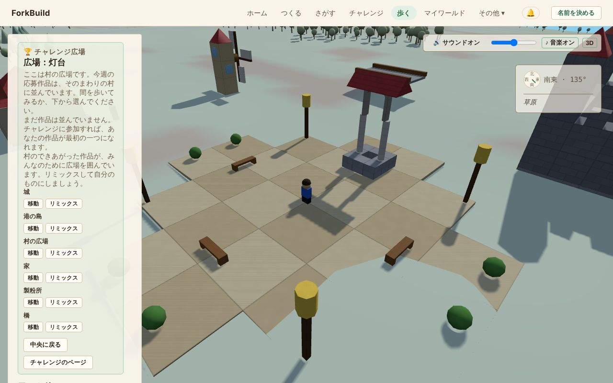

<!-- translation-of: docs/user/03-WorldView.md source-hash: 3be15df9efe58aef -->
# 03 — ワールドビュー

<!-- languages -->
[English](../03-WorldView.md) · [Deutsch](../de/03-WorldView.md) · [Español](../es/03-WorldView.md) · [Français](../fr/03-WorldView.md) · [Bahasa Indonesia](../id/03-WorldView.md) · **日本語** · [한국어](../ko/03-WorldView.md) · [Português (Brasil)](../pt-BR/03-WorldView.md)
<!-- /languages -->

ワールドビューは、**公開されたすべての作品が並んで建っている** 共有の 3D
ワールドです。歩いたり飛んだりして見て回り、ものを見つけ、ほかの人が
作ったものを眺め、友達を連れてくることができます。

ここでは作品を作りません。作るのはエディターです。見つけたものを
変えたくなったら、**コピーを編集** で自分のコピーがエディターに開きます
（[コピーを編集](#コピーを編集--エディターに持ち込む) を参照）。
ワールドビューで変えられるのはブロックではなくラベルだけです。
[ランドマーク](#ランドマーク--覚えておきたい場所に印を付ける) と地域に
名前を付けることと、放した動物を **G** でワールドの飾りとして残すこと
（[アバターと在席状況](06-AvatarsAndPresence.md#動物でワールドを飾る) を
参照）です。

**手短に言うと：**

| したいこと | 方法 |
|---|---|
| ここに来る | 上部のバーの **歩く**、または作品の **探索** |
| 歩く | `W` `A` `S` `D` で移動、`Shift` で走る、`Space` でジャンプ（スマートフォンではジョイスティック） |
| 見回す | ドラッグでカメラを回し、スクロールでズーム |
| 見ているものを変える | **コピーを編集** で自分のコピーがエディターに開きます |
| ちょうどここで作品を始める | **ここに建てる** |
| 友達を連れてくる | **ここで一緒に歩こう** で送るためのリンクを作ります |
| 音を消す・戻す | **サウンド** ボタン、または `M` |

すべての操作は [操作リファレンス](ControlsReference.md) にあります。
ワールドの裏にあるネットワークの道具には専用のページがあります：
[ワールドビュー：詳細ツール](WorldViewAdvancedTools.md)。

## ワールドビューを開く


*チャレンジの広場のワールドビュー：左にサイドパネル、広場にあなたのアバター、右上にサウンドとコンパス。*

入り方は 2 つあります：

- 上部のバーの **歩く** で、今週のチャレンジ広場でワールドビューが
  開きます。自分の作品はいりません。広場は村の広場で、6 つのできあがった
  作品が周りに立ち、リミックスを待っています。そのすぐ外側には、公開
  された作品が村を作っています
  （[チャレンジ広場](04-PublishingAndForking.md#チャレンジ広場) を参照）。
- **さがす** のページで、作品の **探索** を押すと、その作品のすぐ横に
  出ます。ワールドへのリンクを開いても同じです。

ほかの人が
[みんなに送った](04-PublishingAndForking.md#だれが見つけられますか)
作品は、作った人が置いた場所に立っています。リミックスはリミックス元の
横に、それ以外は広場を囲む村にあります。

## 訪問者の表示と詳細

ワールドビューは訪問者の表示で開きます。ここでしたいことは、ワールドの
下のバーにあります。**ここに建てる**、**ここで一緒に歩こう**、そして
作品が自分のものでなければ **コピーを編集** です。

サイドパネルには、作品の名前と作った人、次に行ける場所と周りにある
ものが並びます。スマートフォンでは、ワールドが画面いっぱいに見えるよう
パネルは閉じた状態で始まり、**パネル** で開きます。広場では、
スマートフォンには代わりに 1 行だけ、**広場：…** とそこに立つ作品の数が
表示され、タップするとパネルが開きます。誰を表示するか、キーでアバターを
動かすかどうか、カメラの選び方は **アバターの設定** にあります。

パネルのいちばん下の **詳細ツールを表示** で、ワールドの裏にある
ネットワークのための道具が加わります。座標、ブロックを調べること、配置、
ワールドでの出会いなどです。これらは専用のページ
[ワールドビュー：詳細ツール](WorldViewAdvancedTools.md) で説明して
います。この選択はこのデバイスに記憶され、ほかの人には何も変わりません。
このページの内容は、どちらでも同じように使えます。

## 飛び回る

- **左ドラッグ**：カメラを回す
- **右ドラッグ**：カメラを横にずらす
- **スクロール**：ズームイン・ズームアウト
- **ホーム**（キー、またはパネルのボタン）：自分のワールドに戻る
  （[方向と場所](#方向と場所) を参照）

アバターを歩かせるには、
[アバターを歩かせる](06-AvatarsAndPresence.md#アバターを歩かせる) を
参照してください。

近くのワールドは、動くにつれて **自動で読み込まれたり外れたり** します。
サイドパネルは上から下へ読みます：

1. いま見ているもの（ヘッダー）
2. 行ける場所：**ホーム**、**場所**、そして **探索**・**地図**・**地名**
   のタブ
3. 周りにあるもの（**近く**）
4. 自分の道具：**検索** と **アバター**

いちばん下の **表示中のワールド** には周りに読み込まれているほかの
ワールドが、**近くのワールド** には 1 クリックで飛んで行けるワールドが
並びます。

ワールドの中の何かにポインターを合わせると、ビューの右下の小さなカードに
それが何かが表示されます。

### 周りにあるもの

**土地** はみんな同じです。草地、浜、岩、森、畑、湖、川、海は、地面の
形に沿っています。中心の近くはいつも陸地で、千ほど外へ行くと海岸に出て、
地面は深い海へと下っていきます。

**水。** 湖はそよ風にさざ波を立て、海はゆっくりとうねります。
川は川床を坂に沿って流れ、地面が急なところほど速くなります。
川は高地のふもとのぷくぷくと湧く泉から流れ出し、いちばん急な斜面では小さな滝となって
段々に流れ落ち、ときには静かな池で終わります。
波が岸に届くところや、川が早瀬を流れるところには泡が立ちます。
アバターは湖や海、川に歩いて入り、水が深くなるほど遅くなります。
水が背の半分より深くなると、うねりに合わせて上下しながら泳ぎます
（[泳ぐ・潜る](06-AvatarsAndPresence.md#泳ぐ潜る) を参照）。潜ると、
海藻や小さな魚の群れが見えます。

**木と動物。** 森には、湿ったところに針葉樹、乾いたところに広葉樹が
生え、草原のふちには低木があります。シカは森に、ウサギは草原に住んで
います。木は決して動きません。動物は自分の場所の近くをゆっくり歩き、
立ち止まって草を食べ、ときどき顔を上げます。近づくと、こちらに顔を
向けます（すぐ後ろにいるときは別です）。草を食べているシカは顔を上げ、
ウサギは後ろ足で立ちます。あなたのせいで逃げたり場所を変えたりすることは
なく、ほかの人には、動物がその人のほうを見ているように見えます。歩いて
いるとき、動物は木と同じように行く手をふさぎます。

同じ時に同じ場所を見ている人は、同じ土地、魚、木、動物を見ます。どれも
編集できません。

**住人** はワールドに住む人です。家の周りを散歩し、建物を通り抜けずに
回り込み、振り向いてあいさつします。話しかけると、周りに何があるかを
教えてくれます。動物と違って、住人はワールドの一部で、作者が加えます。
できあがった家には玄関のそばに住人が 1 人いて、チャレンジ広場の周りの
家も同じです。自分の作品では、**R** で住人を取り除けます。
[住人](06-AvatarsAndPresence.md#住人) を参照してください。

**薄く透けた作品** は、ほかの人が近くに告知した作品で、このデバイスが
まだ受け入れていないものです。歩いて離れると、また消えます。
[主張された作品](WorldViewAdvancedTools.md#主張された作品--公開者が示す場所にある他の人の作品)
を参照してください。

### 作品の中で

ドアから入ると、頭より上の部分が切り取られ、背後の壁ではなく、立って
いる部屋が見えます。切り取られるのはその作品の屋根と頭より高いものすべて
で、その作品だけです。壁は背丈より少し上まで立ったままです。カメラが
あなたを追っているとき、または **三人称** では、カメラも中に入り、あなたの
後ろ上から部屋を見下ろします。すぐ後ろに壁があるときは、壁を通り抜けずに
上がります。**俯瞰** は部屋を真上から見下ろし、**一人称** は何も切り取らずに
自分の目で見ます。外に出ると、作品全体がまた描かれます。変わるのは描かれ方
だけで、屋根はみんなにとっても、歩くうえでもそこにあります。

## 昼と夜

ワールドビューの空は 40 分ごとに昼から夜へ、そしてまた昼へと移り変わります。
暖かな夕暮れ、月明かりの青い夜、薄紅色の夜明け、そしてまた昼。空は時計に
合わせて動くので、同じ作品のそばにいる人はみな、同じ瞬間に同じ空を見ます。
暗くなるとガラス窓にランプの灯りがともり、**ランタン** がそれぞれの色で
輝きます。灯台は港への道を示し、村には人の暮らしが感じられます。鳥は
静かになり、代わりにコオロギが鳴き始めます。夜でも道に迷うほど暗くは
なりません。夜があるのはワールドビューだけで、エディター、作品の画像、
リンクのプレビューはいつも昼の明るさです。

太陽は東から昇り、南の空を渡って西に沈みます。地平線の近くではオレンジ色に
なります。太陽が沈むと、月が夜のあいだ同じ道をたどります。建物を照らす光は
空にある方から届くので、東向きの壁は朝の光を、西向きの壁は夕方の光を受けます。

太陽と月は影を落とします。あなたの影、木々や動物、すべての作品の影が、朝と夕方には
長く、正午には短く、月明かりではうすく伸びます。影はあなたのまわり約 45 メートルに
落ち、太陽が空を月に渡すとき（その逆も）少しのあいだ消えます。影はコンピューターより
スマートフォンに負担がかかるため、マウスでは最初からオン、スマートフォンやタブレットでは
オフです。パネル下部の **影** のチェックで、この端末での設定を変えられます。

夜は夕暮れが深まるにつれて星が現れ、天の川がその間を横切り、夜明けにはまた消えて
いきます。星空全体は北の高いところにある一点を中心にゆっくり回るので、星は月と
いっしょに東から昇って西に沈み、だれもが同じ瞬間に同じ星を見ます。

雲は流れては消え、同じ瞬間にはだれにとっても同じ雲です。たいていは白い雲が
いくつか流れていくだけですが、ときどき空が曇り、ときには一面灰色の曇り空に
なって、光はやわらかく、影は淡くなります。建物が見えにくくなるほど暗くなる
ことはありません。

ときどき曇り空から雨が降り、そのたびに数分ほど続きます。まわりに降る雨が見え、
湖や海や川に雨粒が落ちたところには波紋が広がり、雨音が聞こえる間は鳥や虫が
静かになります。建物の中に入れば雨は降らず、屋根を打つ雨音が聞こえ、外では
雨が降り続いているのが見えます。雨は見て聞くためだけのもので、川の水かさは増えず、歩く速さも
変わりません。

いつも昼のままがよければ、パネルの下の方、**影** のすぐ上に
ある **常に昼** にチェックを入れてください。空もずっと晴れたままになります。この端末に記憶され、ほかの
人には何も影響しません。

## サウンド

**操作** はビューの右上（スマートフォンでは右下）にあります：

- **サウンド**、または `M`：すべての音のオン・オフ
- スライダー：音量。スマートフォンやタブレットでは、デバイスの音量ボタンを
  使います。
- **♪ 音楽**：音楽だけのオン・オフ
- **3D**：3D の音と普通の **ステレオ** の切り替え

音は最初のクリック、タップ、キー入力で始まり（ブラウザーの決まりです）、
タブが隠れている間は止まります。これらの選択はこのデバイスに記憶され、
ワールドビューとエディターの両方で使われます。

**聞こえるもの：**

- **周りの土地**：高い岩場の風、森の鳥の声、野原のコオロギ、湖の
  さざなみ、流れる川。木々は風にそよいだりざわめいたりし、近いほど
  大きく聞こえます。ある土地から別の土地へ歩くと、音が移り変わります。
- **あなたのアバター**：地面によって変わる足音（草、葉、砂、石、水、
  ブロック）、ジャンプの風切り音、着地のどすんという音
- **乗り物**：車輪や熱気球のバーナーの音。速くなるほど大きくなります。
  乗り降りの音や、急に止まったときのブレーキのきしみもあります。
- **動物と住人**：シカは顔を上げたり驚いたりすると鼻を鳴らし、ウサギは
  足を踏み鳴らします。捕まえるときと放すときにも音がします。住人は
  あいさつのときにハミングし、話すときにつぶやきます。同じシカが顔を
  上げるのを、みんなが同時に聞きます。
- **ほかの人**：その人がいる場所からの足音、ジャンプ、乗り物。見えて
  いる人の音だけが聞こえ、ほかのアバターを隠すと静かになります。乗り物は
  40 m まで、近い 3 台だけが聞こえます。
- **自分の変更**：ランドマークや地域に名前を付ける、住人を加える・
  取り除く、動物で飾る、元に戻す・やり直すと、エディターと同じ短い音が
  鳴ります。ほかの人の変更は音がしません。

音はそれがある方向から聞こえます。前か後ろ、上か下、左か右で、カメラを
回すと一緒に回ります。ヘッドホンがおすすめです。**ステレオ** は左右だけで
鳴らし、遅いデバイスやスピーカーに合うことがあります。

**音楽** は静かに流れます。ブラウザーがその場で作るやさしい曲で、昼は
あたたかく、暗くなるとゆっくり低くなり、曲の間には静かな時間があります。
同じ演奏は二度とありません。

音はすべてブラウザーの中で作られます。何もダウンロードせず、何も
送りません。ほかの人のブラウザーは、あなたが歩くのを見て、その場で
あなたの足音を作ります。

## 方向と場所

**コンパス** はビューの右上に浮かんでいます。東西南北、向いている方角の
角度、近くの作品・人・ランドマークを示す小さな点を表示します。点に
ポインターを合わせると名前が表示され、コンパスの下のリストでも読めます。
リストには、いまいる場所の名前も出ます。コンパスは表示するだけで、
カメラを動かすことはありません。

パネルの上のほうにあるボタンの列で移動できます：

- **ホーム** は、カメラとアバターを自分のワールドに戻します。開いている
  ワールド、または最後に見ていたワールドです。どれだけ遠くに行っても、
  そのすぐ横に着きます。まだ自分のワールドに行ったことがなければ、
  地図の中心に行きます。
- **場所** には、ワールドビューがこれまでに知っているすべての場所が、
  **ワールド**、**構造物**、**ランドマーク**、**地名** に分けて並びます。
  行の **フォーカス** はカメラをそこへ動かすだけです。
- **👥 N オンライン** は、ここにいる人数です。クリックするとワールドの
  メンバーが表示されます。ワールドに公開ロビーがあれば、その後ろに
  **ロビー** ボタンが続きます。
- **?** はカメラと歩く操作を表示し、もう一度クリックすると隠れます。

**通知** は、アプリのヘッダーの、あなたの名前（または **名前を決める**）の
横にある 🔔 ボタンなので、どのページにもあります。**通知の履歴** が
新しい順に開きます。通知が届くのは次のときです：

- あなたが公開した作品に誰かがコメントしたとき
  （[コメント](09-PublicationsAndEvidence.md#コメント) を参照）
- フォローしている人が新しいものを公開したとき
  （[人をフォローする](07-PeerConnectionsAndFriends.md#人をフォローする)
  を参照）
- 誰かがあなたの作品をリミックスしたとき
  （[リミックスの回数](04-PublishingAndForking.md#リミックスの回数) を
  参照）

それぞれ、何がいつ起きたかを示します。**探索** でその作品のワールドに
行けます。これは受信箱ではなく、ただの一覧です。既読にはならず、消す
こともできず、ボタンに数字も出ません。開いたときに読み込まれ、**更新** で
読み込み直します。この一覧はあなたの名前のもので、開いているワールドの
ものではありません。

### このデバイスでの通知

パネルの上の **このデバイスで通知する** で、ほかのアプリと同じように、
デバイス自身がこれらの通知を表示します。ブラウザーが許可を求めます。
**オフにする** で止まります。

通知が出るのは、ForkBuild が開いていて前面にないときです。別のタブや、
バックグラウンドの
[インストールしたアプリ](01-GettingStarted.md#forkbuild-をインストールする)
のときです。クリックすると、その作品で ForkBuild が開きます。そのために
どこにも何も送らないので、ForkBuild を閉じていると何も表示されません。
その間に届いたものは、次に一覧で見られます。一度に出るのは少しだけで、
残りは一覧で待ちます。ブラウザーがブロックしているときはパネルにそう
表示されるので、ブラウザーのサイト設定で ForkBuild の通知を許可して
ください。

### 探索、地図、地名 — 3 つの見方、同時には 1 つだけ

ボタンの下に 3 つのタブがあります。開けるのは 1 つだけで、切り替えても
パネルの表示が変わるだけです。

- **探索**（最初はこれ）には、ここにいる人と訪ねる場所がいくつか、
  そして **近く** が並びます。周りの **地名**、**ランドマーク**、**人** が、
  それぞれ距離と **移動** ボタン付きで表示されます。空のグループは
  隠れます。グループの見出しをクリックすると折りたたみ・展開でき、
  ワールドビューはどれを開いていたかを覚えています。詳細ツールでさらに
  3 つのグループが加わります
  （[ワールドビュー：詳細ツール](WorldViewAdvancedTools.md) を参照）。
- **地図** には [ワールドの地図](#ワールドの地図) が表示されます。
- **地名** には [地理的な場所](#地理的な場所) が並びます。

### 情報 — これは何？

近くや **場所** にあるたいていの **移動** ボタンの横に、**情報** ボタンが
あります。**移動** はカメラをそこへ動かします。**情報** は動かずにその
場所のことを教えてくれます。何か、どのくらい離れているか、どの名前の
場所の中にあるか（「柳の村にいます」）、または近くにあるか（「川原村の
近くにいます」）です。

情報パネルからできること：

- **移動**：そこへ行く
- **地図に表示**：ワールドの地図で見る
- **名前**（名前のある場所）：人々の呼び名を見る、または名前を公開する
- **コピーを編集**：自分のコピーをエディターで開く（下を参照）

### コピーを編集 — エディターに持ち込む

**コピーを編集** は、ワールドビューで見つけたものを変える方法です。作品の
独立した自分のコピーを作り、エディターで開くので、そのまま続きを作れます。
元の作品には決して手を加えません。

ある場所：

- ワールドの下のバー。訪ねている作品が自分のものでないとき。作品全体を
  コピーします。
- 地域、ランドマーク、配置された構造物の **情報** パネル
- 詳細ツールがオンのときに、ブロック、何もない地面、配置された構造物を
  クリックしたとき
  （[ブロックや配置された構造物を調べる](WorldViewAdvancedTools.md#ブロックや配置された構造物を調べる)
  を参照）

コピーされるものは、選んだものによって変わります：

- **ランドマーク**、**地域**、**ブロック**、**何もない地面** なら、
  それが属するワールドです。
- **配置された構造物** なら、その構造物です。置かれているワールドでは
  ありません。

コピーができるとすぐに ForkBuild が知らせます
（[公開とリミックス](04-PublishingAndForking.md) を参照）。コピーを
作れないときは、**コピーを作れません** のダイアログが理由を示します。
たいていは、作品のライセンスがコピーを認めていないか、作品をまだ
取得できないためです。**作品に戻る** で元の場所に戻ります
（[フォークが完了できないとき](04-PublishingAndForking.md#フォークが完了できないとき)
を参照）。

**地理的な場所** と **人** には、コピーを編集はありません。地理的な場所は
何人もの人の地域からできているので、コピーする 1 つの作品がありません。
代わりにその地域の 1 つを開いてください。

コピーを編集は、さがすや作者のページの **リミックス** と同じで、
ライセンスのルールも同じです
（[フォーク：自分のものにする](04-PublishingAndForking.md#フォーク-自分のものにする)
を参照）。ワールドビューのほかのもの、たとえば検索、コンパス、地図、
情報は、見るだけです。

### ここに建てる — この場所のために作品を始める

**ここに建てる** は **ホーム** の横にあり、アバターが立っている場所
（飛んでいるときはカメラの下の場所）のための新しい空の作品をエディターで
始めます。エディターには、どのワールドのためのものかが表示されます。

公開すると、作品は ForkBuild が選ぶ空いた区画ではなく、ちょうどその場所に
建ちます。**見に行く** で戻って眺められます。エディターの
**この場所を忘れる** で、ForkBuild がいつもどおりに置くようになります。

この場所はあなた自身のメモにすぎず、このデバイスとそのバックアップに
保存されます。土地を確保するわけではなく、ほかの人もそこに作れます
（[なぜ 2 つの作品が同じ場所にあるの？](WorldViewAdvancedTools.md#なぜ-2-つの作品が同じ場所にあるの)
を参照）。

### ここで一緒に歩こう — 友だちをこのワールドに招く

**ここで一緒に歩こう** は **ここに建てる** の横にあり、いまいるワールドに
友達を招いて一緒に歩くためのリンクを作ります。好きな方法で送るか、
スマートフォンで QR コードを読み取ってもらいます。

リンクを開いた友達は、まだなら名前を決め（それぞれ自分のアバターで
歩きます）、**参加する** をクリックすると、このワールドに着きます。
お互いに歩いている姿が見えます。ダイアログには、向かっている人と着いた
人が表示されます。

- 先にワールドを公開しておく必要があります。友達の ForkBuild は、共有
  リンクのときと同じように署名と作品を確かめ、コピーを保存します。
- リンクは、あなたがワールドビューにいる間、開いた人なら誰でも 30 分
  使えます。ダイアログを閉じても止まりません。**リンクを止める** で
  止まります。すでに参加した人は、どちらでもつながったままです。
- 参加すると、**ピア** の招待と同じように 2 台のデバイスが直接つながり
  ます。お互いの IP アドレスが見え、アバターはそれぞれの
  **在席状況の公開範囲** が許す範囲で表示されます
  （[誰に見えるか](06-AvatarsAndPresence.md#誰に見えるか-2-つの独立した設定)
  を参照）。あなたが選ばない限り、誰も既知のピアや友達にはなりません。
- 待ち合わせサーバーが必要です。公式サイトにはあります。自分で動かす
  コピーには自分のものが必要です
  （[ピア接続と友達](07-PeerConnectionsAndFriends.md) を参照）。

### チャレンジ広場

週のチャレンジのページの **広場を歩く**、または上部のバーの **歩く** で、
ワールドビューが村の広場で開きます。石畳で、井戸、ベンチ、街灯があり、
6 つのできあがった作品が周りに立っています。

広場とできあがった作品は、丘や木と同じようにワールドの一部です。
みんなのためにそこにあり、誰のものでもありません。公開された作品は
すぐ外側で村を作るので、あなたの家にもお隣さんができます。パネルには
その週の応募作品とできあがった作品が並びます
（[チャレンジ広場](04-PublishingAndForking.md#チャレンジ広場) を参照）。
広場の周りには木が生えず、広場には **ここに建てる** がありません。

### ランドマーク — 覚えておきたい場所に印を付ける

**ランドマーク** は、ワールドに置く名前付きの点です。「古い橋」や
「絶景」などで、説明を付けることもできます。アバターが立っている
ちょうどその場所に置かれます。

いるワールドを編集できるとき、**場所** のランドマークの部分に
**+ ランドマークを追加** ボタンがあります。タイトルと、必要なら説明を
入れて、**ここに置く** をクリックします。すぐにあなたに表示され、少し
あとで同じワールドを編集しているほかの人全員にも、コンパス、**場所**、
行き先として表示されます。

ランドマークはあなたのものではなく、ワールドのものです。ワールドを
編集できる人なら誰でも、作った人に関係なく、どのランドマークでも名前を
変えたり、内容を変えたり、取り除いたりできます。

### ワールドの地図

**地図** タブは、ワールドを上から見せます。名前のある場所、
ランドマーク、作品、ここにいる人、そしてあなたの印です。ワールドビューが
これまでに知っているものを、一度に全部表示します。

- スクロール、または **+** と **−** でズームします。
- 何もないところをドラッグすると、地図が動きます。
- 場所や人をクリックすると、カメラがそこへ動きます。

地図を見ても、何も変わりません。

### 地理的な場所

**地理的な場所** とは、何人もの人がそれぞれ地域として名前を付けたり
説明したりした場所で、ほぼ同じ土地だとわかったものです。**地名** タブには、
ワールドビューがこれまでに見つけたものが並びます。

1 つをクリックすると、いくつの説明とワールドにまたがっているか、
**コミュニティによる名前**、そして **この場所へ移動** と **地図に表示** が
表示されます。**← 戻る**（または Escape）で一覧に戻ります。タブを
切り替えて戻ってきても、離れたときと同じ画面に戻ります。

場所の **コミュニティによる名前** には上位の名前が表示され、
**さらに名前を表示** で順位付きの一覧全体が出ます。その下で、自分の
名前を公開できます。ほかのもの（その場所のほかの説明、名前の全履歴、
インポートとエクスポート）は **その他** の中にたたまれています。

名前を公開すると、作品を作ったと主張するときと同じように、つながって
いる人たちに伝わります。このデバイスが公開した、または知った名前と
主張をすべて見るには、
[公開物と外部証拠](09-PublicationsAndEvidence.md) を参照してください。

## マイワールド — 実際に訪れたワールド

上部のバーの **マイワールド** には、このデバイスで入ったことのある
ワールドが新しい順に、タイトル、作者、作品とランドマークの数とともに
並びます。**探索を続ける** でまた中に入れます。一覧はこのデバイスだけが
持ち、ほかの誰にも見えません。

まだどこにも行っていませんか？ **さがす** を開くと、ワールドを見つけたり、
できあがった作品から始めたりできます。

**あなたが手伝った作品** には、**一緒に作ろう** で一緒に作ったときに友達が
あなたの名前を載せた作品が並びます
（[エディター](02-TheEditor.md#一緒に作ろう-ライブで一緒に作る) を参照）。
それぞれにタイトルと、友達の名前付きの **と一緒に** が表示され、名前を
押すと友達のページが開きます。友達が公開するまでは
**まだ公開されていません** と表示され、公開されるとタイトルでその
ワールドが開きます。ほかのデバイスでも、このデバイスとつないだあとは
同じように並びます。この欄は、中身があるときだけ表示されます。

## ワールドを見つける

ものを探す方法は 2 つあり、それぞれ違う問いに答えます。

### 検索 — 「どの公開物が一致する？」

**検索** は、周りに読み込まれているものだけでなく、公開されたすべての
ものから **タイトルか作者** を探します。言葉を入力して **検索** を
クリックします。結果にはそれぞれ場所（📍）が表示され、**フォーカス** で
そこへ飛びます。

結果の位置が **既定の位置** だと表示されることがあります。作者が場所を
選ばなかったので、ForkBuild がある場所に表示しているということです。
詳細ツールを使うと、位置でも検索できます
（[ワールドビュー：詳細ツール](WorldViewAdvancedTools.md) を参照）。
そのときは、結果にどのくらい離れているか（📏）も表示されます。

### ここを探索 / ここに何がある？ — 「今の周りに何がある？」

探索の **近く** のいちばん上にあるこの 2 つのボタンは、
**カメラがいる場所の周り** を見ます。タイトルも座標もいりません。

- **ここを探索** は広い範囲を見ます。あとで範囲を広げたり狭めたり
  できます。
- **ここに何がある？** は、いる場所のすぐそばだけを見ます。

どちらも **場所を探索** ダイアログを開きます：

```
📍 中心: 100.0, 50.0, 250.0
⭕ 半径: 25ワールド単位

発見できる3件のドキュメントのうち3件を表示中

📍 City Hall            📏 4.2ワールド単位
by alice
[フォーカス] [選択] [調べる]
```

結果にはそれぞれ 3 つのボタンがあります：

| ボタン | すること |
|---|---|
| **フォーカス** | そこへ飛び、次の変更が適用される作品にします |
| **選択** | 動かずに、次の変更が適用される作品にします |
| **調べる** | 動かずに、タイトル、作者、状態、位置、所有者を表示します |

ダイアログ自体が、何かを動かしたり、変えたり、公開したりすることは
ありません。

## ワールドビューは読み取り専用 — 作るのはエディター

ワールドビューでクリックしても、ドラッグしても、キーを押しても、
ブロックは変わりません。ここに作るための道具はありません。何かをもとに
作るには、**[コピーを編集](#コピーを編集--エディターに持ち込む)** を使い、
[エディター](02-TheEditor.md) で続けます。ワールドビューがする変更は、
このページの最初に挙げたラベルだけです。

## 他の共同作業者を見る

同じワールドにほかの人がいるとき：

- **その人たちが見えます**：アバターが、名前としていることといっしょに
  表示されます（「**Bob — 近くを探索中**」）。
- **その人たちの変更がすぐに見えます**：ランドマーク、名前、その人自身の
  新しいコピーなど。
- **短いアクティビティの一覧** がパネルにあり、見えていないところで
  最近変わったことも表示します。ここにいる間だけ残ります。

人が見えるだけで何かが変わることはありません。変わるのは本当の変更が
あったときだけです。エディターでの変更か、ワールドビューで許されている
ラベルです。

## ここでも保存と公開

作品に取り組んでいるとき、ヘッダーには **保存**、**公開**、
**メタデータを編集** があるので、離れずに保存して共有できます。状態の行が、
どちらなのかを示します：**🔒 公開済み** か
**✎ 自分用のコピーを編集中** です。

公開された作品は変わることがありません。いる作品が公開済みなら、ここで
の最初の変更（作品の情報、ランドマークや地域、飾りの動物）で、
*「&lt;元の名前&gt;のフォーク」* というタイトルの自分のコピーが作られ
ます。短いお知らせ（「編集可能なあなた専用のコピーを作成しました —
「…」は変更されていません」）が表示されます。ライセンスのルールは
ほかのリミックスと同じです
（[公開とリミックス](04-PublishingAndForking.md#フォーク-自分のものにする)
を参照）。

## 履歴 — 以前の状態のプレビューと復元

ここでの変更、たとえばランドマークや地域の追加、名前の変更、削除は、
作品の履歴に残ります。ヘッダーの **履歴** をクリックすると、次のような
時刻付きの番号付き一覧が表示されます：

```
1. ランドマーク「Old Bridge」を作成
2. 地域「Willow Village」を更新
3. ランドマークを削除
```

元に戻した手順には **取り消し済み** と表示されます。手順をクリックしても
選ぶだけで、ボタンを押すまで何も変わりません：

- **プレビュー** は、その手順の *直後* のワールドを、今のワールドと
  並べて表示します。何も変わりません。**プレビューをキャンセル** で
  戻ります。
- **復元** は、その手順に戻ります。前もって確認はしませんが、変更は
  保存されていない状態になるので、保存するかどうかはまだ選べます。
- **閉じる** で一覧を閉じます。

## 次は？

作ったものを共有したり、ほかの人の作品をリミックスしたりしますか？
**[公開とリミックス](04-PublishingAndForking.md)** に進んでください。
ワールドの裏にあるネットワークの道具は
**[ワールドビュー：詳細ツール](WorldViewAdvancedTools.md)** にあります。
