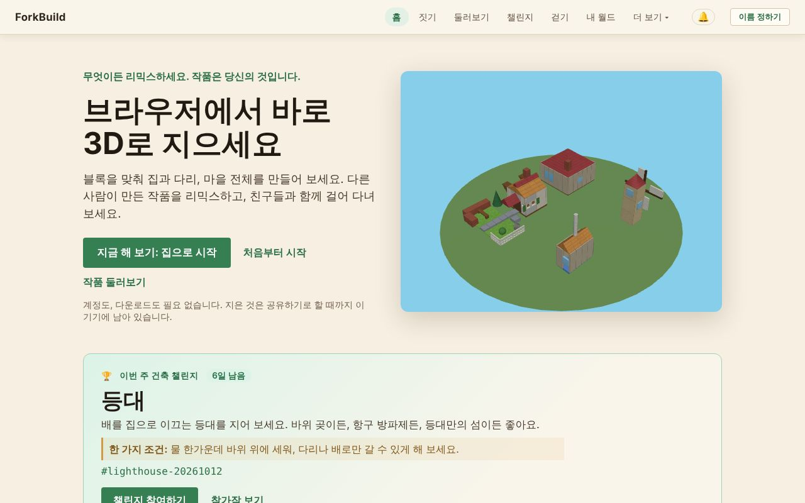
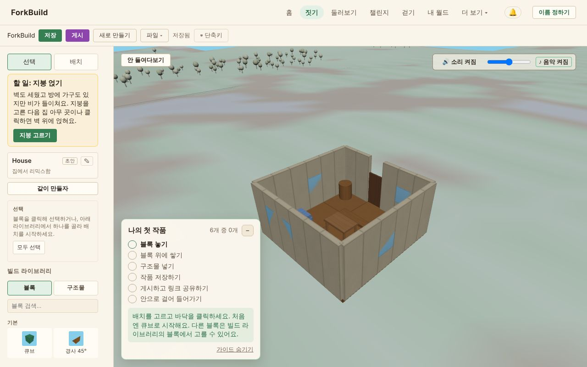

<!-- translation-of: docs/user/01-GettingStarted.md source-hash: 924941a6d98b2fef -->
# 01 — 시작하기

<!-- languages -->
[English](../01-GettingStarted.md) · [Deutsch](../de/01-GettingStarted.md) · [Español](../es/01-GettingStarted.md) · [Français](../fr/01-GettingStarted.md) · [Bahasa Indonesia](../id/01-GettingStarted.md) · [日本語](../ja/01-GettingStarted.md) · **한국어** · [Português (Brasil)](../pt-BR/01-GettingStarted.md)
<!-- /languages -->

환영합니다! 이 안내를 따라가면 “앱을 막 열었다”에서 “무언가를 지었다”까지
5분 정도면 갈 수 있습니다. 시작하는 데 계정도, 다운로드도, 이름도 필요
없습니다: 공유하기로 정할 때까지 모든 것이 내 기기에 남습니다.

**짧게 말하면:**

1. **홈** 화면에서 **지금 해 보기: 집으로 시작**을 클릭하세요.
2. **지붕 고르기**를 클릭한 다음 집을 클릭하세요: 지붕이 올라갑니다.
3. **게시**를 클릭하고 질문에 답하세요: 게시할 때 쓸 이름(**…(으)로 게시**
   클릭)과 **누가 찾을 수 있나요?**입니다.
4. **안으로 걸어 들어가기**를 클릭해 월드에서 내 집 안을 걸어 보세요.

이 페이지의 나머지 부분은 각 단계와, 빈 땅에서 시작하는 방법을
설명합니다.

## ForkBuild 열기

*홈 화면: 맨 위 막대, 시작하는 세 가지 방법, 이번 주 건축 챌린지.*

ForkBuild는 최신 웹 브라우저라면 어디서든 실행됩니다: 호스팅된 사이트를
열면 **홈** 화면이 나타납니다. (직접 사본을 실행하는 방법은 이 페이지 끝의
[내 사본 실행하기](#내-사본-실행하기)를 참고하세요.)

**홈** 화면에는 3D로 천천히 돌아가는 작은 마을이 보이고, 시작하는 방법이
세 가지 있습니다:

- **지금 해 보기: 집으로 시작**은 미리 지어진 집을 내 사본으로 에디터에서
  열어 바로 바꿀 수 있게 합니다([지금 해 보기](02-TheEditor.md#지금-해-보기-마무리할-집) 참고).
- **처음부터 시작**은 빈 땅에서 에디터를 엽니다.
- **작품 둘러보기**는 모두가 게시한 작품이 있는 **둘러보기**를 엽니다.

**미리 지어진 작품으로 시작** 아래의 각 카드(성, 항구 섬, 마을 광장, 집,
방앗간, 다리)도 같은 방식으로 그 작품의 내 사본을 엽니다. 직접 선택하기
전에는 아무것도 게시되거나 어디로도 전송되지 않습니다.

홈에는 **이번 주 건축 챌린지**도 보입니다. 지을 주제와 **챌린지
참여하기**가 있습니다([주간 건축 챌린지](04-PublishingAndForking.md#주간-건축-챌린지) 참고).
작품을 게시하고 나면 **내 스탬프**도 나타납니다. 누군가 내 작품을
리믹스했을 때의 **리믹스됨**, 주간 챌린지에 참가했을 때의 **도전자**,
블록 백 개 이상으로 지은 작품의 **큰 건축가**처럼 내 작품에 관한
사실입니다. 이 기기에서 계산되어 나에게만 보입니다. 점수나 순위가 아니라
인정입니다.

## 메뉴 알아보기

맨 위 막대는 항상 보입니다:

`ForkBuild  홈  짓기  둘러보기  챌린지  걷기  내 월드  더 보기 ▾  🔔  이름 정하기`

| 메뉴 | 여는 것 |
|---|---|
| **홈** | 첫 페이지 |
| **짓기** | 작품을 짓는 에디터([에디터](02-TheEditor.md) 참고) |
| **둘러보기** | 모두가 게시한 작품. 열거나, 리믹스하거나, 방문할 수 있습니다([게시와 리믹스](04-PublishingAndForking.md#둘러보기) 참고) |
| **챌린지** | 이번 주 건축 챌린지와 참가작([주간 건축 챌린지](04-PublishingAndForking.md#주간-건축-챌린지) 참고) |
| **걷기** | 이번 주 챌린지 광장에서 월드 보기를 열어, 마을 광장 둘레에 선 그 주의 출품작 사이를 걸어 봅니다([월드 보기](03-WorldView.md) 참고) |
| **내 월드** | 이 기기에서 가 본 월드([내 월드](03-WorldView.md#내-월드--실제로-가-본-월드) 참고) |
| **🔔** | 내 알림: 댓글, 리믹스, 내가 팔로우하는 사람의 새 작품([방향과 위치](03-WorldView.md#방향과-위치) 참고) |
| **이름 정하기** | 게시하고 걸을 때 쓸 이름을 정합니다. 이름이 생기면 여기에 그 이름이 보입니다([이름 정하기](#이름-정하기) 참고) |

**더 보기**는 나머지를 네 그룹으로 엽니다. 휴대폰에서는 **메뉴**가 모두를
한 번에 보여 줍니다.

- **나**
  - **내 아바타** — 월드 보기에서 다른 사람에게 내가 어떻게 보이는지,
    [아바타와 접속 상태](06-AvatarsAndPresence.md) 참고
  - **내 신원** — 이 기기에 저장된 이름(신원),
    [이름과 신원](05-IdentityAndLogin.md) 참고
  - **내 데이터** — 모든 것을 파일 하나로 백업하거나 다른 기기로 복사,
    [내 데이터](13-YourData.md) 참고
- **사람**
  - **피어** — 연결된 사람, 아는 사람, 친구,
    [피어 연결과 친구](07-PeerConnectionsAndFriends.md) 참고
  - **팔로잉** — 새 작품 소식을 받는 사람,
    [사람 팔로우하기](07-PeerConnectionsAndFriends.md#사람-팔로우하기) 참고
  - **대화** — 내 다이렉트 메시지,
    [채팅과 대화](08-ChatAndConversations.md) 참고
- **고급** — 짓고 공유하는 데는 필요 없습니다
  - **게시물** — 서명된 작성자 주장과 장소 이름 주장, 그것을 저장하고
    알릴 곳, 그리고 (*실험적*) 외부 증거,
    [게시물과 외부 증거](09-PublicationsAndEvidence.md) 참고
  - **네트워크 설정** — 게이트웨이, 릴레이, 제공자, 피어 연결용 서버,
    [네트워크 설정](10-NetworkSettings.md) 참고
- **앱**
  - **언어** — 이 기기에서 ForkBuild를 보여 주는 언어. 직접 고르기 전까지는
    브라우저의 언어를 따릅니다. 저장하면 페이지가 새로 고쳐지므로 먼저
    작업을 저장하세요. ForkBuild는 영어, 독일어, 스페인어, 프랑스어,
    인도네시아어, 일본어, 한국어, 브라질 포르투갈어로 쓸 수 있습니다.
  - **모양** — **자동**, **밝게**, **어둡게**를 메뉴에서 바로 고릅니다.
    자동은 기기의 밝은/어두운 모드를 따릅니다. 밝게는 낮의 마을, 어둡게는
    밤의 같은 마을입니다. 바로 바뀌고 이 기기에 저장됩니다.
  - **정보** — 버전 정보와 이 안내로 가는 링크
  - **ForkBuild 설치** — 브라우저가 설치할 수 있는 경우
    ([ForkBuild 설치하기](#forkbuild-설치하기) 참고)

## 첫 블록 놓기

*홈의 집을 연 에디터: 왼쪽에 도구와 빌드 라이브러리, 가운데에 작품, 그리고 나의 첫 작품 카드.*

에디터를 처음 열면 3D 보기 모서리의 **나의 첫 작품** 카드가 여섯 단계를
안내하고, 한 단계를 마칠 때마다 체크합니다. 마지막 단계는 게시한 내 작품
안으로 걸어 들어가는 것입니다.
[나의 첫 작품](02-TheEditor.md#나의-첫-작품)을 참고하세요.

1. 맨 위 막대에서 **짓기**를 클릭하세요(또는 홈에서 **처음부터 시작**).
2. 왼쪽 사이드바에서 **배치** 도구가 켜져 있는지 확인하세요(`2`를 누름).
3. 그 아래의 **빌드 라이브러리**에서 **블록** 탭을 열고 블록을
   클릭하세요 — 예를 들어 **기본** 아래의 **큐브**.
4. 마우스를 3D 보기로 옮기세요. 반투명한 블록 **유령**이 격자를 따라
   움직입니다.
5. **클릭**해서 놓으세요.

축하합니다 — 첫 블록을 지었습니다! 🎉

휴대폰이나 태블릿에서는 클릭 대신 탭하세요.
[휴대폰이나 태블릿에서](02-TheEditor.md#휴대폰이나-태블릿에서)를 참고하세요.

### 블록 쌓기

꼭 지면 위에만 지을 필요는 없습니다. 기존 블록의 **면** 위에 커서를 올리면
유령이 그 면에 달라붙습니다 — 클릭해서 위에 쌓거나 옆에 붙이세요. 이렇게
벽, 탑, 지붕을 짓습니다.

실수했나요? `Ctrl+Z`(Mac에서는 `Cmd+Z`)를 누르면 되돌릴 수 있습니다. 모든
변경은 되돌릴 수 있습니다.

## 작업 저장하기

**Ctrl+S**를 누르세요(또는 툴바에서 **저장**을 클릭). **● 저장하지 않은
변경 사항** 표시가 **저장됨**으로 바뀝니다.

작품은 브라우저에 저장되므로 다시 와도 그대로 있습니다. 편집하는 동안
ForkBuild는 저장하지 않은 변경 사항의 충돌 복구용 사본도 보관하며, 저장하기
전에 페이지가 닫히면 복원할지 묻습니다.

> **사본을 남겨 두세요.** 내 작품은 이 브라우저에만 있습니다. 사이트의
> 브라우저 데이터를 지우면 작품도 지워지니, 가끔
> **더 보기 → 내 데이터 → 파일로 백업**으로 백업하세요
> ([내 데이터](13-YourData.md) 참고).

브라우저는 사이트마다 저장할 수 있는 양을 보통 디스크의 일정 비율로
제한합니다. ForkBuild에 할당된 공간이 가득 차면 저장과 충돌 복구가 멈추고
그 사실을 알리는 메시지가 나타납니다. 열려 있는 것은 사라지지 않습니다.
툴바의 **파일 → 내보내기**로 작품 사본을 파일로 보관하세요. 처음 저장할 때
일부 브라우저는 ForkBuild가 데이터를 영구히 보관해도 되는지 묻습니다.
허용하면 디스크 공간이 부족해도 브라우저가 데이터를 지우지 않습니다.

## 이름 정하기

짓거나 저장하는 데는 이름이 필요 없습니다. 이름은 **게시**할 때(게시하면
작품에 서명해, 다른 사람이 정말 내 작품인지 확인할 수 있습니다)와
**친구와 걸을** 때(친구가 그 이름으로 나를 봅니다) 필요합니다.

처음 **게시**를 클릭하면 ForkBuild가 게시할 때 쓸 이름을 묻습니다. 이름을
입력하고 **…(으)로 게시**를 클릭하면 이 기기에 이름이 만들어지고 작품이
게시됩니다. (걷기 링크도 **…(으)로 걷기**로 똑같이 묻습니다.)

이름은 언제든 정할 수 있습니다: 오른쪽 위의 **이름 정하기**를 클릭하고
이름을 입력한 뒤 **…(으)로 계속하기**를 클릭하세요.

ForkBuild에는 비밀번호도 계정도 없습니다. 이름 뒤에는 이 기기에 저장된
암호 키가 있고, 이를 **신원**이라고 부릅니다. 키는 암호 문구를 추가할
때까지 암호 문구 없이 이 브라우저에 보관됩니다: 게시한 뒤 에디터가 그렇게
알려 주고, **내 신원**의 **암호 문구로 보호**로 언제든 추가할 수 있습니다.
바로 암호 문구를 정하려면 이름 대화 상자에서 대신 **지금 암호 문구로
보호하기**를 클릭하세요.

> **암호 문구는 재설정할 수 없습니다.** 암호 문구는 이 기기에서 키를
> 암호화하며, ForkBuild를 포함해 누구도 되찾을 수 없습니다. 잊지 않을
> 것으로 고르세요.

이름이 생기면 오른쪽 위 모서리에 그 이름이 보입니다. 클릭하면
**내 아바타**, **내 신원**, **내 데이터**, **이름 바꾸기**가 나옵니다.
**이름 바꾸기**는 이 브라우저에 이미 있는 이름을 모두 보여 주고(클릭하면
그 이름을 씁니다), 새 이름을 만들거나 **이름 없이 계속하기**로 이어 갑니다.
거기서 새 이름을 만들 때는 8자 이상의 **암호 문구**를 두 번 입력합니다.
(건너뛰려면 **암호 문구 없이 만들기**에 체크하세요. 그러면 키가 암호화되지
않은 채 이 브라우저에 저장됩니다.) 그런 다음 **이 이름 쓰기**를 클릭하세요.

그 뒤로 게시하거나 다른 사람에게 보내는 모든 것은 그 이름으로 서명됩니다.

**이름 없이 게시하기.** 게시가 여는 이름 대화 상자에는 **서명 없이 게시**도
있습니다. 그렇게 게시한 작품에는 작성자도 서명도 없어서, 링크를 받지
못하고, 다른 사람과 공유할 수 없으며, 나중에 모두에게 보낼 수도 없습니다.
내 **둘러보기**에만 두려는 것이 아니라면 이름을 정하세요.

암호 문구가 보호하는 것, 잠그기와 잠금 해제, 신원 백업은
[이름과 신원](05-IdentityAndLogin.md)에서 다룹니다.

## ForkBuild 설치하기

ForkBuild는 앱으로 설치할 수 있습니다. 그러면 홈 화면, Dock, 앱 목록에서
자기 창으로 열리고, 연결 없이도 동작합니다. 홈 화면(또는 **더 보기** 아래)의
**ForkBuild 설치**를 클릭한 다음 브라우저의 대화 상자에서 확인하세요.
iPhone이나 iPad의 Safari에서는 버튼이 대신 방법을 알려 줍니다:
**공유**를 누른 다음 **홈 화면에 추가**를 누르세요. 브라우저가 앱을 설치할
수 없거나 ForkBuild가 이미 설치되어 있으면 버튼이 나오지 않습니다.

- **오프라인.** ForkBuild를 처음 열 때 브라우저가 파일을 보관하므로,
  설치했든 안 했든 다음부터는 연결 없이도 열립니다. 홈, 에디터, 저장한
  작품과 기성 작품이 모두 동작합니다. 네트워크가 필요한 것(작품과 사람
  찾기, 작품 보내기, 채팅과 통화)은 다시 온라인이 될 때까지 기다립니다.
- **업데이트.** 새 버전이 나오면 맨 위에 **ForkBuild의 새 버전이
  준비되었습니다**가 표시됩니다. **새로 고침**을 클릭하면 시작되고,
  아니면 다음에 ForkBuild를 열 때 저절로 시작됩니다.
- **알림.** 설치한 ForkBuild(또는 백그라운드 탭에서 열린 ForkBuild)는
  기기를 통해 알림을 보여 줄 수 있습니다.
  [이 기기에서 알림 받기](03-WorldView.md#이-기기에서-알림-받기)를 참고하세요.

## 다음은?

- 짓는 도구 전체는 **[에디터](02-TheEditor.md)**에서 배우세요.
- 공유할 준비가 되었다면 **[게시와 리믹스](04-PublishingAndForking.md)**로.
- **[월드 보기](03-WorldView.md)**에서 다른 사람들의 작품 사이를 걸어 보세요.
- 아바타를 꾸미고 사람을 만나려면
  **[아바타와 접속 상태](06-AvatarsAndPresence.md)**와
  **[피어 연결과 친구](07-PeerConnectionsAndFriends.md)**를 보세요.
- 막혔나요? **[자주 묻는 질문](FAQ.md)**에 흔한 질문의 답이 있습니다.
- 자기 말로 물어볼 수도 있습니다. **더 보기**의 **도움말**이 내 언어로 된
  이 가이드에서 답하며, 한 번 열면 오프라인에서도 동작합니다. 에디터에서는
  명령 팔레트(`Ctrl/Cmd+K`)에 질문을 입력하면 **가이드에 묻기**가 나옵니다.

## 내 사본 실행하기

*개발자와 직접 호스팅하는 사람을 위한 내용입니다. ForkBuild를 쓰는 데는
필요 없습니다.*

직접 사본을 실행하려면 폴더를 HTTP로 제공하세요(예:
`python3 -m http.server 8000`을 실행한 뒤 <http://localhost:8000/>을
엽니다). 디스크에서 `index.html`을 바로 열면 동작하지 않습니다. 브라우저가
`file://` 페이지에서는 모듈을 불러오지 않기 때문입니다.

- **사람 찾기.** 기본 랑데부 서버는 호스팅된 사이트만 지원하므로, 직접
  실행한 사본에서는 그 서버로 사람을 찾을 수 없습니다. 대신 초대로
  연결하거나, 직접 랑데부 서버를 마련하세요
  ([피어 연결과 친구](07-PeerConnectionsAndFriends.md) 참고).
- **설치와 오프라인.** 폴더에서 바로 실행하는 사본은 설치도 오프라인
  동작도 되지 않고, `node scripts/build.mjs`로 빌드한 사본은 됩니다
  ([배포](../../Deployment.md)(영어) 참고).
- **번역.** 언어를 추가하거나 다듬으려면
  [Translating ForkBuild](../../Translating.md)(영어)를 참고하세요.
