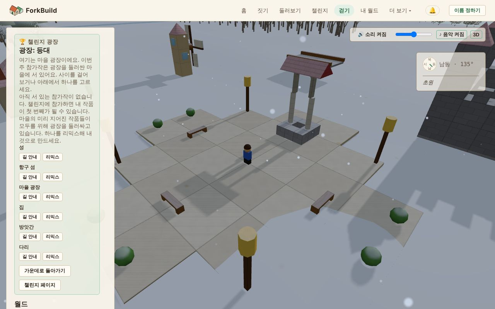

<!-- translation-of: docs/user/03-WorldView.md source-hash: ddd5e492a88450c7 -->
# 03 — 월드 보기

<!-- languages -->
[English](../03-WorldView.md) · [Deutsch](../de/03-WorldView.md) · [Español](../es/03-WorldView.md) · [Français](../fr/03-WorldView.md) · [Bahasa Indonesia](../id/03-WorldView.md) · [日本語](../ja/03-WorldView.md) · **한국어** · [Português (Brasil)](../pt-BR/03-WorldView.md)
<!-- /languages -->

월드 보기는 **게시된 모든 작품이 나란히 서 있는** 공유 3D 월드입니다.
걷거나 날아다니며 무언가를 찾고, 다른 사람이 지은 것을 구경하고, 친구를
데려올 수 있습니다.

여기서는 짓지 않습니다. 짓는 곳은 에디터입니다. 찾은 것을 바꾸고 싶으면
**사본 편집**이 내 사본을 에디터에서 엽니다
([사본 편집](#사본-편집--무언가를-에디터로-가져가기) 참고). 월드 보기가
바꾸는 것은 블록이 아니라 이름표뿐입니다.
[랜드마크](#랜드마크--기억할-만한-장소-표시하기)와 지역에 이름 붙이기,
그리고 놓아준 동물을 **G**로 월드에 장식으로 남기기입니다
([아바타와 접속 상태](06-AvatarsAndPresence.md#동물로-월드-장식하기) 참고).

**짧게 말하면:**

| 하고 싶은 것 | 방법 |
|---|---|
| 여기로 오기 | 맨 위 막대의 **걷기**, 또는 아무 작품의 **탐색** |
| 걷기 | `W` `A` `S` `D`로 이동, `Shift`로 달리기, `Space`로 점프(휴대폰에서는 조이스틱) |
| 둘러보기 | 드래그해서 카메라를 돌리고, 스크롤로 확대·축소 |
| 보고 있는 것 바꾸기 | **사본 편집**이 내 사본을 에디터에서 엽니다 |
| 바로 여기서 작품 시작하기 | **여기에 짓기** |
| 친구 데려오기 | **여기서 같이 걷자**가 보낼 링크를 만듭니다 |
| 소리 끄기·켜기 | **소리** 버튼, 또는 `M` |

모든 조작은 [조작 참조](ControlsReference.md)에 있습니다. 월드 뒤의
네트워크 도구는 따로 페이지가 있습니다:
[월드 보기: 고급 도구](WorldViewAdvancedTools.md).

## 월드 보기 열기


*챌린지 광장의 월드 보기: 왼쪽에 사이드 패널, 광장에 내 아바타, 오른쪽 위에 소리와 나침반.*

들어가는 방법은 두 가지입니다:

- 맨 위 막대의 **걷기**는 이번 주 챌린지 광장에서 월드 보기를 엽니다. 내
  작품이 없어도 됩니다. 광장은 마을 광장입니다. 미리 지어진 작품 여섯 개가
  둘레에 서서 리믹스를 기다리고, 그 바로 바깥에는 그 주의 출품작이
  섭니다([챌린지 광장](04-PublishingAndForking.md#챌린지-광장) 참고).
- **둘러보기** 페이지에서 아무 작품의 **탐색**을 누르면 그 작품 바로 옆에
  나타납니다. 월드 링크를 열어도 마찬가지입니다.

다른 사람이
[모두에게 보낸](04-PublishingAndForking.md#누가-찾을-수-있나요) 작품은
만든 사람이 놓은 자리에 서 있습니다. 저마다 둘레에 여유가 있는 제 자리에,
넓은 땅 곳곳에 섭니다([작품이 서는 자리](04-PublishingAndForking.md#작품이-서는-자리)
참고).

## 방문자 보기와 고급

월드 보기는 방문자 보기로 열립니다. 여기서 하려는 일은 월드 아래쪽 막대에
있습니다. **여기에 짓기**, **여기서 같이 걷자**, 그리고 내 작품이 아니면
**사본 편집**입니다.

사이드 패널에는 작품 이름과 만든 사람, 그다음 갈 수 있는 곳과 주변에
있는 것이 나옵니다. 휴대폰에서는 월드가 화면을 가득 채우도록 패널이 닫힌
채로 시작하며, **패널**로 엽니다. 광장에서는 휴대폰에 대신 한 줄,
**광장: …** 표시와 그곳에 선 작품 수가 나오며, 누르면 패널이 열립니다. 누구를
그릴지, 키로 내 아바타를 움직일지, 카메라 선택은 **아바타 설정**에
있습니다.

패널 맨 아래의 **고급 도구 보기**는 월드 뒤의 네트워크를 위한 도구를
더합니다. 좌표, 블록 살펴보기, 배치, 월드 조우 등입니다. 이것들은 따로
[월드 보기: 고급 도구](WorldViewAdvancedTools.md) 페이지에서 설명합니다.
이 선택은 이 기기에 기억되며 다른 사람에게는 아무것도 바뀌지 않습니다. 이
페이지의 내용은 어느 쪽이든 똑같이 쓸 수 있습니다.

## 날아다니기

- **왼쪽 드래그**: 카메라 돌리기
- **오른쪽 드래그**: 카메라를 옆으로 옮기기
- **스크롤**: 확대·축소
- **홈**(키, 또는 패널의 버튼): 내 월드로 돌아가기
  ([방향과 위치](#방향과-위치) 참고)

아바타를 걷게 하려면
[아바타 걷게 하기](06-AvatarsAndPresence.md#아바타-걷게-하기)를 보세요.

주변 월드는 움직이는 동안 **저절로 불러와지고 빠집니다**. 사이드 패널은
위에서 아래로 읽습니다:

1. 지금 보고 있는 것(헤더)
2. 갈 수 있는 곳: **홈**, **위치**, 그리고 **탐색**, **지도**, **장소** 탭
3. 주변에 있는 것(**주변**)
4. 내 도구: **검색**과 **아바타**

맨 아래의 **보이는 월드**에는 주변에 불러온 다른 월드가, **주변 월드**에는
한 번 클릭으로 날아갈 수 있는 월드가 나옵니다.

월드 안의 무언가를 가리키면, 보기 오른쪽 아래의 작은 카드가 그것이
무엇인지 알려 줍니다.

### 주변에 있는 것

**땅**은 모두에게 똑같습니다. 풀밭, 해변, 바위, 숲, 밭, 호수, 강, 바다는
땅의 모양을 따릅니다. 가운데 땅은 늘 말라 있고, 천 단위쯤 나가면 해안에
닿으며 땅이 깊은 바다로 내려갑니다.

**물.** 호수는 바람에 잔물결이 일고, 바다는 느린 너울로 출렁입니다.
강은 물길을 따라 비탈을 흐르고, 땅이 가파를수록 빨라집니다.
강은 고지대 기슭의 보글보글 솟는 샘에서 흘러나와, 가장 가파른 땅에서는 작은 폭포가 되어
계단처럼 흘러내리고, 때로는 잔잔한 연못에서 끝납니다.
파도가 물가에 닿는 곳과 강이 여울을 지나는 곳에는 거품이 입니다.
아바타는 호수나 바다, 강에 걸어 들어가고, 물이 깊어질수록 느려집니다.
물이 키의 절반보다 깊으면 너울을 따라 오르내리며 헤엄칩니다
([수영과 잠수](06-AvatarsAndPresence.md#수영과-잠수) 참고). 잠수하면
해초와 작은 물고기 떼가 보입니다.

**나무와 동물.** 숲에는 습한 곳에 침엽수, 마른 곳에 활엽수가 자라고,
풀밭 가장자리에는 덤불이 있습니다. 사슴은 숲에, 토끼는 풀밭에 삽니다.
나무는 절대 움직이지 않습니다. 동물은 자기 자리 근처를 천천히 거닐다가
멈춰서 풀을 뜯고, 가끔 고개를 듭니다. 가까이 가면 고개를 돌려 나를
봅니다(바로 뒤에 있을 때는 빼고). 풀을 뜯던 사슴은 고개를 들고, 토끼는
뒷발로 앉습니다. 나 때문에 달아나거나 자리를 옮기지는 않으며, 다른
사람에게는 동물이 *그 사람*을 보는 것으로 보입니다. 걸어 다닐 때 동물은
나무처럼 길을 막습니다.

같은 때 같은 곳을 보는 사람은 모두 같은 땅, 물고기, 나무, 동물을 봅니다.
어느 것도 편집할 수 없습니다.

**주민**은 월드에 사는 사람입니다. 집 둘레를 산책하고, 건물을 뚫고 가지
않고 돌아가며, 돌아서서 인사합니다. 말을 걸면 주변에 무엇이 있는지
알려 줍니다. 동물과 달리 주민은 월드의 일부이며, 작가가 넣습니다. 미리
지어진 집에는 현관 옆에 주민이 한 명 있고, 챌린지 광장 둘레의 집도
마찬가지입니다. 내 작품에서는 **R**로 주민을 뺄 수 있습니다.
[주민](06-AvatarsAndPresence.md#주민)을 보세요.

**밤이 되면** 월드가 조용해집니다. 동물은 제자리로 돌아가 아침까지 엎드려 쉬고, 가까이 다가가면 일어나 나를 지켜봅니다. 주민은 해 질 녘에 집으로 걸어가 새벽까지 집에 머뭅니다.

**흐릿하고 비치는 작품**은 다른 사람이 근처에 공지했지만 이 기기가 아직
받아들이지 않은 작품입니다. 걸어서 멀어지면 다시 사라집니다.
[주장된 작품](WorldViewAdvancedTools.md#주장된-작품--게시자가-서-있다고-말하는-곳의-다른-사람-작품)을
보세요.

### 작품 안에서

문으로 들어가면 머리 위의 작품이 잘려 나가, 뒤쪽 벽이 아니라 서 있는 방이
보입니다. 잘리는 것은 그 작품의 지붕과 머리보다 높은 모든 것이며, 그 작품만
해당합니다. 벽은 키보다 조금 높은 곳까지 그대로 서 있습니다. 카메라가 나를
따라가거나 **3인칭**일 때는 카메라도 함께 들어와, 내 뒤 위쪽에서 방을 내려다보고,
바로 뒤에 벽이 있으면 벽을 뚫지 않고 올라갑니다. **조감도**는 방을 바로 위에서
내려다보고, **1인칭**은 아무것도 자르지 않고 내 눈으로 봅니다. 다시 밖으로
나오면 작품 전체가 다시 그려집니다. 바뀌는 것은 그려지는 것뿐이며, 지붕은 모두에게,
그리고 걷는 데에도 그대로 있습니다.

## 낮과 밤

월드 보기의 하늘은 40분마다 낮에서 밤으로, 다시 낮으로 바뀝니다. 따스한
해 질 녘, 달빛이 비치는 푸른 밤, 분홍빛 새벽, 그리고 다시 낮이 옵니다.
하늘은 시계를 따르므로, 같은 작품 곁에 있는 모든 사람이 같은 순간에 같은
하늘을 봅니다. 어두워지면 유리창에 등불 빛이 비치고 **랜턴**이 저마다의
색으로 빛나서, 등대는 항구로 가는 길을 비추고 마을은 사람이 사는 곳처럼
보입니다. 새들은 조용해지고 귀뚜라미가 울기 시작합니다. 밤이라도 길을
찾지 못할 만큼 어둡지는 않습니다. 밤은 월드 보기에만 있습니다. 편집기,
작품 그림, 링크 미리 보기는 언제나 한낮입니다.

해는 동쪽에서 떠서 남쪽 하늘을 가로질러 서쪽으로 지고, 지평선 가까이에서는
주황빛을 띱니다. 해가 지면 달이 밤새 같은 길을 따라갑니다. 건물에 비치는
빛은 하늘에 떠 있는 쪽에서 오므로, 동쪽을 향한 벽은 아침 빛을, 서쪽을 향한
벽은 저녁 빛을 받습니다.

해와 달은 그림자를 드리웁니다. 나의 그림자, 나무와 동물, 모든 작품의 그림자가
아침저녁에는 길고 한낮에는 짧으며 달빛 아래에서는 흐립니다. 그림자는 내 주변 약
45미터 안에 생기고, 해가 하늘을 달에게 넘겨줄 때(그 반대도) 잠시 사라집니다.
그림자는 컴퓨터보다 휴대폰에 부담이 크므로 마우스를 쓰면 처음부터 켜져 있고 휴대폰이나
태블릿에서는 꺼져 있습니다. 패널 아래쪽의 **그림자**를 선택하거나 해제해 이 기기에서
바꿀 수 있습니다.

나무는 자연에서처럼 자랍니다. 가장 습한 숲에는 처진 가지가 층층이 돌려난 전나무와
가문비나무가, 더 건조한 곳에는 갈라지는 큰 가지와 둥근 수관을 가진 활엽수가, 초원
가장자리에는 낮고 구부러진 덤불이 자랍니다. 가까이에서는 가지와 잎 하나하나가 보이고,
바람에 흔들리며(폭풍이 다가오면 더 크게) 얼룩진 그림자를 드리웁니다. 멀리 있는
나무는 더 단순한 모양이 되어 숲 전체를 걸어도 부드럽게 움직입니다. 휴대폰이나
태블릿에서는 처음에 더 단순한 나무로 보입니다. 이 기기에서 잎 하나하나까지 보려면
**그림자** 바로 아래의 **자세한 나무**를 선택하세요.

밤에는 땅거미가 짙어지면서 별이 나타나고, 은하수가 그 사이를 가로지르며, 새벽이
되면 다시 사라집니다. 별이 뜬 하늘 전체가 북쪽 높은 곳의 한 점을 중심으로 천천히
돌기 때문에, 별은 달과 함께 동쪽에서 떠서 서쪽으로 지고, 모두가 같은 순간에 같은
별을 봅니다.

달은 하룻밤에 한 단계씩 모양이 바뀝니다. 어두운 삭에서 가는 초승달, 반달,
볼록한 달을 거쳐 보름달이 되고, 다시 돌아갑니다. 월드 보기의 8일(5시간 남짓)마다
한 바퀴입니다. 차오르는 달은 서쪽이, 기우는 달은 동쪽이 밝습니다. 달의 모양은
밤도 바꿉니다. 보름달이 뜬 밤은 조금 더 밝고 그림자가 또렷하며, 삭 무렵에는 빛이
부드럽고 하늘이 더 짙은 파란색이 되고 별과 은하수가 가장 밝게 빛납니다. 하늘의
다른 부분처럼 모두가 같은 순간에 같은 달을 보며, 작품이 잘 안 보일 만큼 어두워지는
일은 없습니다.

구름은 오가며, 같은 순간에는 누구에게나 같은 구름입니다. 대개는 흰 구름
몇 점이 지나가고, 가끔 하늘이 흐려지며, 때로는 잿빛으로 잔뜩 흐려져 빛이
부드러워지고 그림자가 옅어집니다. 건물이 잘 안 보일 만큼 어두워지지는
않습니다.

가끔 흐린 하늘에서 비가 내리며, 한 번에 몇 분 동안 이어집니다. 주위에
내리는 비가 보이고, 빗방울이 호수나 바다, 강에 떨어지는 곳마다 동그란
물결이 퍼지며, 빗소리가 들리는 동안 새와 벌레는 조용해집니다. 건물 안에
들어가면 비를 맞지 않고, 지붕을 두드리는 빗소리가 들리며 밖에는 비가 계속
내리는 것이 보입니다. 비가 오면 땅과 건물이 짙어지며 반짝이고, 비가 그치면
몇 분에 걸쳐 마릅니다. 가장 거센 소나기는 가끔 잔잔한 뇌우가 됩니다. 이따금 번개가 하늘을 부드럽게 밝히고, 몇 초 뒤 멀리서 천둥이 우르릉거립니다. 기기에서 동작 줄이기를 켜 두었다면 번개가 번쩍이지 않습니다. 비는 보고
듣기 위한 것일 뿐이어서 강물이 불어나지 않고, 걷는 속도도 그대로입니다.

항상 낮이었으면 한다면 패널 아래쪽, **그림자** 바로 위에 있는
**항상 낮**을 선택하세요. 하늘도 늘 맑게 유지됩니다. 이 기기에 기억되며 다른 사람에게는 아무것도
바뀌지 않습니다.

## 계절

세계는 네 계절을 지나갑니다. 계절마다 World View의 8일(5시간 남짓), 달이 한 번
차고 기우는 동안 이어집니다:

- **봄**: 나무에 분홍색과 흰색 꽃이 피고 연한 초록 새잎이 돋습니다. 풀밭에는
  들꽃이 점점이 피고, 나무 사이로 꽃잎이 흩날립니다.
- **여름**: 온통 푸르고 무성해지며, 어떤 나무에는 열매가 익고 밭은 황금빛으로
  물듭니다.
- **가을**: 잎이 나무마다 제때에 빨강, 주황, 노랑으로 물들고, 주위로 떨어지며
  나무가 앙상해집니다. 밭은 추수를 마칩니다.
- **겨울**: 나무는 앙상하고 풀은 빛이 바래며, 하늘이 흐려지면 비 대신 눈이
  내립니다. 눈은 군데군데 쌓이다가 하얀 눈밭이 되고, 지붕과 나무 위에 쌓이며
  (벽이나 지금 서 있는 건물 안에는 쌓이지 않습니다) 봄이 되면 녹습니다. 새는 덜
  울고 벌레 소리는 사라집니다.

풍경은 한꺼번에가 아니라 날마다 조금씩 바뀌며, 모두가 같은 순간에 같은 계절을
봅니다. 침엽수는 일 년 내내 푸릅니다. 이 기기에서 한 계절로 유지하려면 패널
아래쪽, **자세한 나무** 바로 아래의 **계절**에서 고르세요. **세계의 한 해**를 고르면
다시 세계를 따라갑니다. **항상 낮**을 켜도 계절은 맑은 하늘 아래에서 계속
바뀝니다.

해도 계절을 따릅니다. 여름에는 높이 떠서 낮이 길고, 겨울에는 낮게 머물며
긴 그림자를 드리우고 밤이 일찍 옵니다. 한겨울에는 호수가 걸어서 건널 수
있을 만큼 단단히 얼어붙습니다(바다와 강은 얼지 않습니다). 얼음이 아직
얼고 있거나 겨울 끝에 깨지기 시작할 때는 올라설 수 없습니다. 어떤 계절을
고르든 모두가 같은 순간에 같은 얼음을 봅니다. 눈은 발밑에서 뽀드득
소리를 내고 얼음은 딱딱 소리를 내며, 눈 위를 걸으면 아바타의 발자국이
남았다가 1분쯤 지나면 사라집니다. 발자국은 나만 볼 수 있습니다.

## 소리

**조작**은 보기의 오른쪽 위(휴대폰에서는 오른쪽 아래)에 있습니다:

- **소리** 또는 `M`: 모든 소리 끄기·켜기
- 슬라이더: 음량. 휴대폰이나 태블릿에서는 기기의 음량 버튼을 쓰세요.
- **♪ 음악**: 음악만 끄기·켜기
- **3D**: 3D 소리와 일반 **스테레오** 사이 전환

소리는 첫 클릭, 탭, 키 입력에서 시작하고(브라우저의 규칙입니다), 탭이
숨겨져 있는 동안 멈춥니다. 이 선택은 이 기기에 기억되며 월드 보기와
에디터 모두에 쓰입니다.

**들리는 것:**

- **주변의 땅**: 높은 바위 지대의 바람, 숲의 새소리, 들판의 귀뚜라미,
  호숫가의 찰랑이는 물, 흐르는 강. 나무는 바람에 바스락대거나 쏴쏴
  소리를 내며, 가까울수록 크게 들립니다. 한 땅에서 다른 땅으로 걸어가면
  소리가 자연스럽게 바뀝니다.
- **내 아바타**: 땅에 따라 바뀌는 발소리(풀, 잎, 모래, 돌, 물, 블록),
  점프할 때 휙 하는 소리, 내려앉을 때 쿵 하는 소리
- **탈것**: 바퀴나 열기구 버너 소리가 빨라질수록 커지고, 타고 내릴 때
  소리가 나며, 갑자기 멈추면 브레이크가 끽 소리를 냅니다.
- **동물과 주민**: 사슴은 고개를 들거나 놀라면 콧김을 뿜고, 토끼는 발을
  구릅니다. 잡을 때와 놓아줄 때도 소리가 납니다. 주민은 인사할 때
  흥얼거리고, 말할 때 중얼거립니다. 모두가 같은 사슴이 고개를 드는
  소리를 같은 순간에 듣습니다.
- **다른 사람**: 그 사람이 있는 곳에서 나는 발소리, 점프, 탈것 소리.
  보이는 사람의 소리만 들리며, 다른 아바타를 숨기면 조용해집니다.
  탈것은 40m까지, 가장 가까운 세 대만 들립니다.
- **내 변경**: 랜드마크나 지역에 이름 붙이기, 주민 넣기·빼기, 동물로
  장식하기, 실행 취소와 다시 실행은 에디터와 같은 짧은 소리가 납니다.
  다른 사람의 변경은 소리가 나지 않습니다.

소리는 그것이 있는 방향에서 들립니다. 앞이나 뒤, 위나 아래, 왼쪽이나
오른쪽이며, 카메라를 돌리면 함께 돕니다. 헤드폰을 쓰면 좋습니다.
**스테레오**는 왼쪽과 오른쪽으로만 들려주며, 느린 기기나 스피커에 더 맞을
수 있습니다.

**음악**은 그 아래에서 조용히 흐릅니다. 브라우저가 즉석에서 만드는
부드러운 곡으로, 낮에는 따뜻하고 어두워지면 느려지며, 곡 사이에 조용한
틈이 있습니다. 같은 연주는 두 번 나오지 않습니다.

모든 소리는 브라우저 안에서 만들어집니다. 아무것도 내려받지 않고,
아무것도 보내지 않습니다. 다른 사람의 브라우저는 내가 걷는 모습을 보고
내 발소리를 만들어 냅니다.

## 방향과 위치

**나침반**은 보기의 오른쪽 위에 떠 있습니다. 동서남북, 바라보는 방향의
각도, 근처의 작품·사람·랜드마크를 나타내는 작은 점을 보여 줍니다. 점을
가리키면 이름이 나오고, 나침반 아래 목록에서도 읽을 수 있습니다. 목록에는
지금 있는 장소의 이름도 나옵니다. 나침반은 보여 주기만 하며 카메라를
움직이지 않습니다.

패널 위쪽의 버튼 줄로 돌아다닐 수 있습니다:

- **홈**은 카메라와 아바타를 내 월드로 데려갑니다. 열어 둔 월드, 또는
  마지막으로 본 월드입니다. 얼마나 멀리 갔든 그 바로 옆에 도착합니다.
  아직 내 월드에 가 본 적이 없으면 지도 가운데로 갑니다.
- **위치**에는 월드 보기가 지금까지 아는 모든 장소가 **월드**,
  **구조물**, **랜드마크**, **장소**로 나뉘어 나옵니다. 줄의 **초점**은
  카메라를 그곳으로 옮길 뿐입니다.
- **👥 N 온라인**은 여기 있는 사람 수입니다. 클릭하면 월드의 멤버가
  나옵니다. 월드에 공개 로비가 있으면 **로비** 버튼이 뒤따릅니다.
- **?** 버튼은 카메라와 걷기 조작을 보여 주고, 다시 클릭하면 숨깁니다.

**알림**은 앱 헤더에서 내 이름(또는 **이름 정하기**) 옆에 있는 🔔
버튼이므로 모든 페이지에 있습니다. **알림 기록**이 최신순으로 열립니다.
알림은 다음과 같을 때 옵니다:

- 누군가 내가 게시한 작품에 댓글을 달았을 때
  ([댓글](09-PublicationsAndEvidence.md#댓글) 참고)
- 내가 팔로우하는 사람이 새것을 게시했을 때
  ([사람 팔로우하기](07-PeerConnectionsAndFriends.md#사람-팔로우하기)
  참고)
- 누군가 내 작품을 리믹스했을 때
  ([리믹스 횟수](04-PublishingAndForking.md#리믹스-횟수) 참고)
- 내 작품보다 나중에 누군가 그것과 아주 비슷한 작품을 게시했을 때
  ([먼저 게시된 비슷한 작품](04-PublishingAndForking.md#먼저-게시된-비슷한-작품) 참고)

각 알림은 무슨 일이 언제 있었는지 알려 줍니다. **탐색**은 그 작품의
월드로 데려갑니다. 받은편지함이 아니라 단순한 목록입니다. 읽음 표시도,
지우기도 없고, 버튼에 숫자도 나오지 않습니다. 열 때 불러오며,
**새로 고침**으로 다시 불러옵니다. 이 목록은 열어 둔 월드가 아니라 내
이름에 속합니다.

### 이 기기에서 알림 받기

패널 위쪽의 **이 기기에서 알림 받기**를 켜면, 다른 앱처럼 기기가 직접 이
알림을 보여 줍니다. 브라우저가 허락을 묻고, **끄기**로 멈춥니다.

알림은 ForkBuild가 열려 있지만 앞에 있지 않을 때 나옵니다. 다른 탭에
있거나, 백그라운드의
[설치한 앱](01-GettingStarted.md#forkbuild-설치하기)일 때입니다. 알림을
클릭하면 그 작품에서 ForkBuild가 열립니다. 이를 위해 어디에도 아무것도
보내지 않으므로, ForkBuild가 닫혀 있으면 아무것도 나오지 않습니다. 그동안
온 것은 다음에 목록에서 볼 수 있습니다. 한 번에 몇 개만 나오고, 나머지는
목록에서 기다립니다. 브라우저가 막고 있으면 패널이 알려 주니, 브라우저의
사이트 설정에서 ForkBuild 알림을 허용하세요.

### 갈 곳 말하기 (음성)

`V`를 누르거나 **홈** 옆의 **🎤 음성**을 누르고 갈 곳이나 할 일을 말하세요.
다 말했으면 `V`(또는 **중지**)를 누릅니다.

- *오래된 물레방아로 데려가 줘*, 또는 장소 이름만: **위치**의 **초점**처럼
  카메라가 그곳으로 갑니다. **위치**에 있는 장소는 모두, 챌린지 광장에서는
  그 건물도 이름으로 부를 수 있습니다.
- *홈으로*: **홈**과 같습니다.
- *1인칭*, *3인칭*, *조감도*, *자유 카메라*: 아바타 패널의 카메라 보기입니다.
- *음소거*, *음소거 해제*.
- *실행 취소*, *다시 실행*: `Ctrl+Z`, `Ctrl+Y`와 같습니다.
- *말 걸기*: 주민 곁에서 `T`를 누르는 것과 같습니다.

그 밖의 말은 **가이드에 묻기**로 가이드에 물어볼 수 있습니다. 여기서의 음성은
편집기와 같습니다([음성 명령](02-TheEditor.md#음성-명령-음성) 참고). 한 번
켜면 둘 다에서 쓰고, 이 기기에서 알아들으며, 말한 내용을 알아내는 동안에도
월드는 계속 움직입니다.

### 탐색, 지도, 장소 — 둘러보는 세 가지 방법, 동시에는 하나만

버튼 아래에 탭이 세 개 있습니다. 하나만 열리며, 바꿔도 패널에 보이는 것만
바뀝니다.

- **탐색**(기본)은 여기 있는 사람과 가 볼 만한 곳 몇 군데를 보여 주고,
  이어서 **주변**을 보여 줍니다. 주변의 **장소**, **랜드마크**, **사람**이
  각각 거리와 **이동** 버튼과 함께 나옵니다. 빈 묶음은 숨겨집니다. 묶음
  제목을 클릭하면 접거나 펼치며, 월드 보기는 어느 것을 열어 두었는지
  기억합니다. 고급 도구는 묶음 세 개를 더합니다
  ([월드 보기: 고급 도구](WorldViewAdvancedTools.md) 참고).
- **지도**는 [월드 지도](#월드-지도)를 보여 줍니다.
- **장소**는 [지리적 장소](#지리적-장소) 목록입니다.

### 정보 — 내가 보고 있는 것은 무엇인가요?

주변과 **위치**에 있는 대부분의 **이동** 버튼 옆에 **정보** 버튼이
있습니다. **이동**은 카메라를 그곳으로 옮깁니다. **정보**는 움직이지 않고
그 장소를 알려 줍니다. 무엇인지, 얼마나 떨어져 있는지, 어느 이름 붙은
장소 안에 있는지(“버드나무 마을에 있습니다”) 또는 가까이 있는지
(“가와하라 마을 근처에 있습니다”)입니다.

정보 패널에서 할 수 있는 것:

- **이동**: 그곳으로 가기
- **지도에 표시**: 월드 지도에서 보기
- **이름**(이름 붙은 장소): 사람들이 부르는 이름 보기, 또는 이름 게시하기
- **사본 편집**: 내 사본을 에디터에서 열기(아래 참고)

### 사본 편집 — 무언가를 에디터로 가져가기

**사본 편집**은 월드 보기에서 찾은 것을 바꾸는 방법입니다. 작품의 독립된
내 사본을 만들어 에디터에서 열어 주므로 바로 이어서 지을 수 있습니다.
원본은 절대 건드리지 않습니다.

있는 곳:

- 월드 아래쪽 막대. 방문 중인 작품이 내 것이 아닐 때이며, 작품 전체를
  복사합니다.
- 지역, 랜드마크, 배치된 구조물의 **정보** 패널
- 고급 도구를 켰을 때 블록, 빈 땅, 배치된 구조물을 클릭하면 나오는 곳
  ([블록 살펴보기](WorldViewAdvancedTools.md#블록--또는-배치된-구조물--살펴보기)
  참고)

무엇이 복사되는지는 고른 것에 따라 다릅니다:

- **랜드마크**, **지역**, **블록**, **빈 땅**이면 그것이 속한 월드입니다.
- **배치된 구조물**이면 그 구조물이며, 그것이 서 있는 월드가 아닙니다.

사본이 준비되면 ForkBuild가 바로 알려 줍니다
([게시와 리믹스](04-PublishingAndForking.md) 참고). 사본을 만들 수 없으면
**사본을 만들 수 없습니다** 대화 상자가 이유를 알려 줍니다. 대개 작품의
라이선스가 사본을 허락하지 않거나 작품을 아직 가져올 수 없기 때문입니다.
**작품으로 돌아가기**로 있던 곳으로 돌아갑니다
([리믹스를 완료할 수 없을 때](04-PublishingAndForking.md#리믹스를-완료할-수-없을-때)
참고).

**지리적 장소**와 **사람**에는 사본 편집이 없습니다. 지리적 장소는 여러
사람의 지역으로 이루어져 있어 복사할 작품이 하나가 아닙니다. 대신 그
지역 중 하나를 여세요.

사본 편집은 둘러보기와 작가 페이지의 **리믹스**와 같으며, 라이선스 규칙도
같습니다([리믹스: 내 것으로 만들기](04-PublishingAndForking.md#리믹스-내-것으로-만들기)
참고). 월드 보기의 다른 모든 것, 예를 들어 검색, 나침반, 지도, 정보는
보기만 합니다.

### 여기에 짓기 — 이 자리를 위한 작품 시작하기

**홈** 옆의 **여기에 짓기**는 아바타가 서 있는 자리(날고 있을 때는 카메라
아래 자리)를 위한 비어 있는 새 작품을 에디터에서 시작합니다. 에디터에
어느 월드를 위한 것인지 나옵니다.

게시하면 작품은 ForkBuild가 고르는 빈 땅이 아니라 바로 그 자리에 섭니다.
**보러 가기**로 돌아와서 볼 수 있습니다. 에디터의 **이 자리 잊기**를
누르면 ForkBuild가 평소처럼 배치합니다.

이 자리는 내 메모일 뿐이며, 이 기기와 그 백업에 저장됩니다. 땅을
차지하지 않으며, 다른 사람도 거기에 지을 수 있습니다
([왜 두 작품이 같은 자리에 있을 수 있나요?](WorldViewAdvancedTools.md#왜-두-작품이-같은-자리에-있을-수-있나요)
참고).

### 여기서 같이 걷자 — 친구를 이 월드로 부르기

**여기에 짓기** 옆의 **여기서 같이 걷자**는 지금 있는 월드로 친구를 불러
함께 걷는 링크를 만듭니다. 원하는 방법으로 보내거나, 휴대폰으로 QR
코드를 찍게 하세요.

링크를 연 친구는 아직 이름이 없으면 이름을 정하고(각자 자기 아바타로
걷습니다), **참가하기**를 클릭해 이 월드에 도착합니다. 서로 걷는 모습이
보입니다. 대화 상자에 오는 중인 사람과 도착한 사람이 나옵니다.

- 월드를 먼저 게시해야 합니다. 친구의 ForkBuild는 공유 링크 때처럼
  서명과 작품을 확인하고 사본을 보관합니다.
- 링크는 내가 월드 보기에 있는 동안, 연 사람 누구에게나 30분 동안
  쓸 수 있습니다. 대화 상자를 닫아도 멈추지 않으며, **링크 중지**로
  멈춥니다. 이미 참가한 사람은 어느 쪽이든 연결된 채로 남습니다.
- 참가하면 **피어**의 초대처럼 두 기기가 직접 연결됩니다. 서로의 IP
  주소가 보이고, 아바타는 각자의 **접속 상태 공개 범위**가 허락하는
  만큼 보입니다
  ([나를 볼 수 있는 사람](06-AvatarsAndPresence.md#나를-볼-수-있는-사람-서로-독립된-두-설정)
  참고). 내가 고르지 않는 한 누구도 알려진 피어나 친구가 되지 않습니다.
- 만남 서버가 필요합니다. 공식 사이트에는 있고, 직접 운영하는 사본에는
  자체 서버가 필요합니다
  ([피어 연결과 친구](07-PeerConnectionsAndFriends.md) 참고).

### 챌린지 광장

주간 챌린지 페이지의 **광장 걷기**, 또는 맨 위 막대의 **걷기**는 마을
광장에서 월드 보기를 엽니다. 돌로 포장되어 있고 우물, 벤치, 가로등이
있으며, 미리 지어진 작품 여섯 개가 둘레에 있습니다.

광장과 미리 지어진 작품은 언덕과 나무처럼 월드의 일부입니다. 모두를 위해
그곳에 있으며 누구의 것도 아닙니다. 그 바로 바깥에는 그 주의 출품작이,
그것도 그 주의 것만 섭니다. 지난주 광장을 열면 지난주 출품작이 보입니다.
패널에 이번 주 출품작과 미리 지어진
작품이 나옵니다([챌린지 광장](04-PublishingAndForking.md#챌린지-광장)
참고). 광장 둘레에는 나무가 자라지 않으며, 광장 위에는 **여기에 짓기**가
없습니다.

### 랜드마크 — 기억할 만한 장소 표시하기

**랜드마크**는 월드에 놓는 이름 붙은 지점입니다. “오래된 다리”나 “멋진
경치” 같은 것이며, 원하면 설명도 붙입니다. 아바타가 서 있는 바로 그
자리에 놓입니다.

있는 월드를 편집할 수 있으면 **위치**의 랜드마크 부분에
**+ 랜드마크 추가** 버튼이 있습니다. 제목과, 원하면 설명을 넣고
**여기에 놓기**를 클릭하세요. 바로 나에게 나타나고, 잠시 뒤 같은 월드를
편집하는 다른 모든 사람에게도 나침반, **위치**, 갈 곳으로 나타납니다.

랜드마크는 내 것이 아니라 월드의 것입니다. 월드를 편집할 수 있는 사람은
누가 만들었든 어떤 랜드마크든 이름을 바꾸거나, 내용을 바꾸거나, 뺄 수
있습니다.

### 월드 지도

**지도** 탭은 월드를 위에서 보여 줍니다. 이름 붙은 장소, 랜드마크, 작품,
여기 있는 사람들, 그리고 내 표시입니다. 월드 보기가 지금까지 아는 모든
것을 한 번에 보여 줍니다.

- 스크롤하거나 **+**, **−** 버튼으로 확대·축소합니다.
- 빈 곳을 드래그해 지도를 옮깁니다.
- 장소나 사람을 클릭하면 카메라가 그곳으로 갑니다.

지도를 봐도 아무것도 바뀌지 않습니다.

### 지리적 장소

**지리적 장소**는 여러 사람이 각자 지역으로 이름 붙이거나 설명한 곳
가운데, 거의 같은 땅으로 밝혀진 곳입니다. **장소** 탭에는 월드 보기가
지금까지 찾은 것이 나옵니다.

하나를 클릭하면 설명과 월드가 몇 개에 걸쳐 있는지, **커뮤니티 이름**,
그리고 **장소로 이동**과 **지도에 표시**가 나옵니다. **← 뒤로**(또는
Escape)로 목록으로 돌아갑니다. 탭을 바꿨다가 돌아와도 떠났던 화면이
그대로 있습니다.

장소의 **커뮤니티 이름**에는 상위 이름이 나오고, **이름 더 보기**로 순위가
매겨진 전체 목록을 봅니다. 그 아래에서 내 이름을 게시할 수 있습니다. 나머지
(그 장소의 다른 설명, 이름의 전체 기록, 가져오기와 내보내기)는
**더 보기** 안에 접혀 있습니다.

이름을 게시하면 작품을 만들었다고 주장할 때처럼, 나와 연결된 사람들에게
알려집니다. 이 기기가 게시했거나 알게 된 모든 이름과 주장을 보려면
[게시물과 외부 증거](09-PublicationsAndEvidence.md)를 보세요.

## 내 월드 — 실제로 가 본 월드

맨 위 막대의 **내 월드**에는 이 기기에서 들어가 본 모든 월드가 최신순으로,
제목, 작가, 작품과 랜드마크 수와 함께 나옵니다. **계속 탐색하기**로 다시
들어갑니다. 목록은 이 기기만 가지고 있으며, 다른 누구도 볼 수 없습니다.

아직 아무 데도 가지 않았나요? **둘러보기** 링크를 누르면 월드를 찾거나 미리
지어진 작품에서 시작할 수 있습니다.

**내가 도운 작품**에는 **같이 만들자**로 함께 지을 때 친구가 내 이름을
올린 작품이 나옵니다
([에디터](02-TheEditor.md#같이-만들자-실시간으로-함께-만들기) 참고).
각각 제목과 친구 이름이 들어간 **님과 함께**가 나오며, 이름을 누르면
친구의 페이지가 열립니다. 친구가 게시하기 전까지는 **아직 공개되지 않음**이
나오고, 게시하면 제목이 그 월드를 엽니다. 다른 기기도 이 기기와 연결하면
똑같이 나옵니다. 이 칸은 내용이 있을 때만 나타납니다.

## 월드 찾기

무언가를 찾는 방법은 두 가지이며, 각각 다른 질문에 답합니다.

### 검색 — “어떤 게시물이 일치하나요?”

**검색**은 주변에 불러온 것만이 아니라 게시된 모든 것에서 **제목이나
작가**를 찾습니다. 단어를 입력하고 **찾기**를 클릭하세요. 결과마다 위치
(📍)가 나오며, **초점**으로 그곳에 날아갑니다.

결과의 위치가 **기본 위치**라고 나올 수 있습니다. 작가가 자리를 고르지
않아서 ForkBuild가 한 자리에 보여 주는 것입니다. 고급 도구를 쓰면 위치로도
검색할 수 있으며([월드 보기: 고급 도구](WorldViewAdvancedTools.md) 참고),
그때는 결과에 얼마나 떨어져 있는지(📏)도 나옵니다.

### 여기 탐색 / 여기 무엇이 있나요? — “지금 내 주변에는 무엇이 있나요?”

탐색의 **주변** 맨 위에 있는 이 두 버튼은 **카메라가 있는 곳 주변**을
봅니다. 제목도 좌표도 필요 없습니다.

- **여기 탐색**은 넓은 범위를 봅니다. 나중에 범위를 넓히거나 좁힐 수
  있습니다.
- **여기 무엇이 있나요?** 버튼은 내가 있는 바로 그곳만 봅니다.

둘 다 **위치 탐색** 대화 상자를 엽니다:

```
📍 중심: 100.0, 50.0, 250.0
⭕ 반경: 25 월드 단위

찾을 수 있는 작품 3개 중 3개 표시

📍 시청            📏 4.2 월드 단위 떨어짐
alice 님 작성
[초점] [선택] [살펴보기]
```

결과마다 버튼이 세 개 있습니다:

| 버튼 | 하는 일 |
|---|---|
| **초점** | 그곳으로 날아가고, 다음 변경이 적용될 작품으로 만듭니다 |
| **선택** | 움직이지 않고, 다음 변경이 적용될 작품으로 만듭니다 |
| **살펴보기** | 움직이지 않고 제목, 작가, 상태, 위치, 소유자를 보여 줍니다 |

대화 상자 자체는 아무것도 옮기거나, 바꾸거나, 게시하지 않습니다.

## 월드 보기는 읽기 전용입니다 — 짓기는 에디터에서

월드 보기에서 클릭하거나, 드래그하거나, 키를 눌러도 블록은 바뀌지
않습니다. 여기에는 짓는 도구가 없습니다. 무언가를 바탕으로 지으려면
**[사본 편집](#사본-편집--무언가를-에디터로-가져가기)** 기능을 쓰고
[에디터](02-TheEditor.md)에서 이어 가세요. 월드 보기가 하는 변경은 이
페이지 맨 앞에 적은 이름표뿐입니다.

## 다른 협업자 보기

같은 월드에 다른 사람이 있을 때:

- **그 사람들이 보입니다**: 아바타가 이름, 하고 있는 일과 함께 나옵니다
  (“**Bob — 근처를 탐색 중**”).
- **그 사람들의 변경이 바로 보입니다**: 랜드마크, 이름, 그 사람의 새
  사본 같은 것입니다.
- **짧은 활동 목록**이 패널에 있어, 보이지 않는 곳에서 최근 바뀐 것도
  보여 줍니다. 여기 있는 동안만 남습니다.

사람이 보이는 것만으로는 아무것도 바뀌지 않습니다. 진짜 변경만이 바꿉니다.
에디터에서 한 변경, 또는 월드 보기가 허락하는 이름표입니다.

## 여기서도 저장하고 게시하기

작품을 작업 중일 때 헤더에 **저장**, **게시**, **메타데이터 편집**이 있어,
떠나지 않고 저장하고 공유할 수 있습니다. 상태 줄이 어느 쪽인지 알려
줍니다: **🔒 게시됨** 또는 **✎ 내 사본 편집 중**.

게시된 작품은 절대 바뀌지 않습니다. 지금 있는 작품이 게시된 것이라면,
여기서 하는 첫 변경(작품 정보, 랜드마크나 지역, 장식용 동물)이
*“&lt;원래 이름&gt;의 리믹스”*라는 제목의 내 사본을 만듭니다. 짧은
알림(“수정 가능한 사본을 만들었습니다 — …은(는) 바뀌지 않았습니다”)이
알려 줍니다. 라이선스 규칙은 다른 리믹스와 같습니다
([게시와 리믹스](04-PublishingAndForking.md#리믹스-내-것으로-만들기) 참고).

## 기록 — 이전 상태 미리 보기와 복원

여기서 하는 변경, 예를 들어 랜드마크나 지역 추가, 이름 바꾸기, 빼기는
작품의 기록에 남습니다. 헤더의 **기록**을 클릭하면 다음과 같이 시간이
붙은 번호 목록이 나옵니다:

```
1. 랜드마크 “옛 다리” 만들기
2. 지역 “버드나무 마을” 업데이트
3. 랜드마크 제거
```

실행 취소한 단계에는 **실행 취소됨** 표시가 붙습니다. 단계를 클릭하면
고르기만 하며, 버튼을 누르기 전까지는 아무것도 바뀌지 않습니다:

- **미리보기**는 그 단계 *바로 뒤*의 월드를 지금 월드 옆에 보여 줍니다.
  아무것도 바뀌지 않습니다. **미리 보기 취소**로 돌아갑니다.
- **복원**은 그 단계로 돌아갑니다. 미리 묻지 않지만, 변경은 저장되지
  않은 상태로 남으므로 저장할지 아직 고를 수 있습니다.
- **닫기**는 목록을 닫습니다.

## 다음은?

만든 것을 공유하거나 다른 사람의 작품을 리믹스하고 싶나요?
**[게시와 리믹스](04-PublishingAndForking.md)** 페이지로 넘어가세요. 월드 뒤의
네트워크 도구는 **[월드 보기: 고급 도구](WorldViewAdvancedTools.md)** 페이지에
있습니다.
