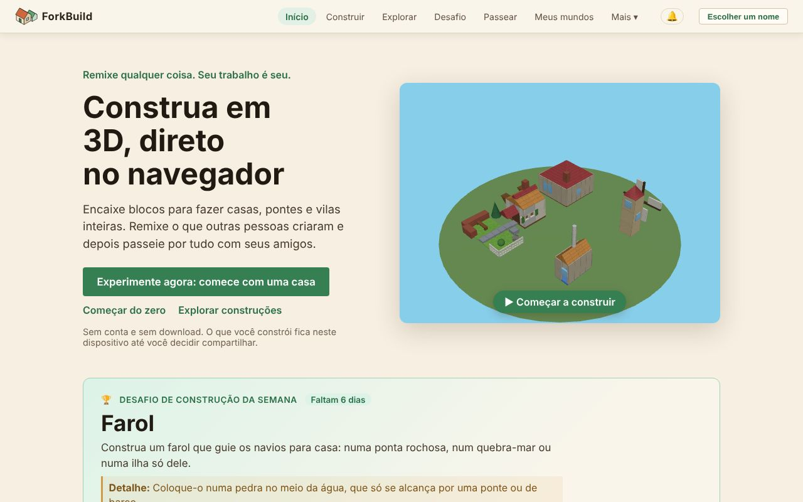
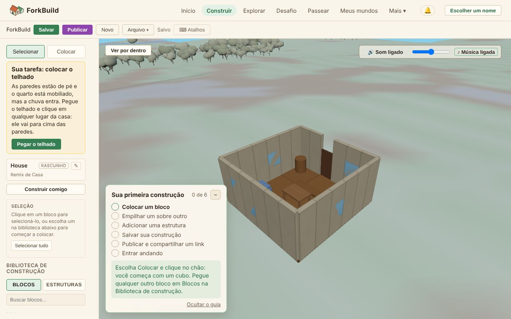

<!-- translation-of: docs/user/01-GettingStarted.md source-hash: 7ea2df22c95dd572 -->
# 01 — Primeiros passos

<!-- languages -->
[English](../01-GettingStarted.md) · [Deutsch](../de/01-GettingStarted.md) · [Español](../es/01-GettingStarted.md) · [Français](../fr/01-GettingStarted.md) · [Bahasa Indonesia](../id/01-GettingStarted.md) · [日本語](../ja/01-GettingStarted.md) · [한국어](../ko/01-GettingStarted.md) · **Português (Brasil)**
<!-- /languages -->

Boas-vindas! Este guia leva você de "acabei de abrir o aplicativo" a
"construí alguma coisa" em uns cinco minutos. Você não precisa de conta,
download nem nome para começar: tudo fica no seu dispositivo até você
decidir compartilhar.

**A versão curta:**

1. Na tela **Início**, clique em **Experimente agora: comece com uma casa**.
2. Termine a casa em quatro passos curtos: clique em **Pegar o telhado** e
   depois na casa; depois uma chaminé, um caminho até a porta e um jardim,
   cada um com o seu botão **Pegar**.
3. Clique em **Publicar**. Abre-se uma folha com um nome já sugerido, e com
   o remix e **Todo mundo pode encontrá-la** já ligados: digite o seu próprio
   nome se quiser e clique em **Publicar como …**.
4. Clique em **Entrar andando** para andar pela sua casa no Mundo.

O resto desta página explica cada parte, e como começar num terreno vazio.

## Abrindo o ForkBuild

*A tela Início: a barra superior, os três jeitos de começar e o desafio de construção da semana.*

O ForkBuild roda em qualquer navegador moderno: abra o site hospedado e
você chega à tela **Início**. (Para rodar uma cópia sua, veja
[Rodando sua própria cópia](#rodando-sua-própria-cópia) no fim desta
página.)

A tela **Início** mostra uma pequena vila girando em 3D e oferece três
jeitos de começar:

- **Experimente agora: comece com uma casa** abre uma casa pronta no
  Editor como cópia sua, pronta para mudar (veja
  [Experimente agora](02-TheEditor.md#experimente-agora-uma-casa-para-terminar)).
- **Começar do zero** abre o Editor num terreno vazio.
- **Explorar construções** abre o **Explorar**, onde estão as construções
  publicadas de todo mundo.

Clicar no próprio vilarejo que gira (**Começar a construir**) faz o mesmo que
**Experimente agora**.

Quando este dispositivo tem uma construção salva, o Início começa com **Que
bom ver você de novo**: **Continuar construindo** abre no Editor a construção
que você alterou por último e, enquanto você não tiver publicado nenhuma,
lembra você de publicar. **Participar do desafio da semana** aparece até você
participar do desafio desta semana, e **Minhas construções** abre a sua
própria página quando você tiver um nome.

Em **Comece com uma construção pronta**, cada cartão (um castelo, uma ilha
com porto, uma praça de vila, uma casa, um moinho e uma ponte) abre do mesmo
jeito uma cópia sua daquela construção. Nada é publicado nem enviado para
lugar nenhum até você decidir.

O Início também mostra o **Desafio de construção da semana**: um tema para
construir, com **Participar do desafio** (veja
[O desafio de construção semanal](04-PublishingAndForking.md#o-desafio-de-construção-semanal)).
Depois que você publica construções, ele mostra também **Seus selos**:
fatos sobre as suas construções, como **Remixada** quando alguém fez um
remix de uma delas, **Desafiante** quando você participou de um desafio
semanal ou **Grande construtor** por uma construção com cem blocos ou
mais. Eles são calculados neste dispositivo e mostrados só para você:
reconhecimento, nunca pontos ou ranking.

## Orientando-se

A barra no alto está sempre visível:

`ForkBuild  Início  Construir  Explorar  Desafio  Passear  Meus mundos  Mais ▾  🔔  Escolher um nome`

| Menu | O que abre |
|---|---|
| **Início** | A página inicial |
| **Construir** | O Editor, onde você constrói (veja [O Editor](02-TheEditor.md)) |
| **Explorar** | As construções publicadas de todo mundo, para abrir, remixar ou visitar (veja [Publicar e remixar](04-PublishingAndForking.md#explorar)) |
| **Desafio** | O desafio de construção desta semana e suas participações (veja [O desafio de construção semanal](04-PublishingAndForking.md#o-desafio-de-construção-semanal)) |
| **Passear** | A Visão do mundo na praça do desafio desta semana, para passear entre as participações da semana em volta da praça da vila (veja [Visão do mundo](03-WorldView.md)) |
| **Meus mundos** | Os Mundos que você visitou neste dispositivo (veja [Meus mundos](03-WorldView.md#meus-mundos--os-mundos-em-que-você-realmente-esteve)) |
| **🔔** | Suas notificações: comentários, remixes e construções novas de quem você segue (veja [Orientação e locais](03-WorldView.md#orientação-e-locais)) |
| **Escolher um nome** | Escolher o nome com que você publica e passeia; quando você tem um, ele aparece aqui no lugar (veja [Escolhendo um nome](#escolhendo-um-nome)) |

**Mais** abre o resto, em quatro grupos. No celular, **Menu** mostra todos
de uma vez.

- **Você**
  - **Meu avatar** — como os outros veem você na Visão do mundo, veja
    [Avatares e presença](06-AvatarsAndPresence.md)
  - **Minhas identidades** — os nomes (identidades) guardados neste
    dispositivo, veja [Seu nome e sua identidade](05-IdentityAndLogin.md)
  - **Seus dados** — fazer backup de tudo num arquivo, ou copiar para outro
    dispositivo, veja [Seus dados](13-YourData.md)
- **Pessoas**
  - **Pares** — as pessoas com quem você está conectado, que você conhece
    ou de quem é amigo, veja
    [Conexões entre pares e amigos](07-PeerConnectionsAndFriends.md)
  - **Seguindo** — as pessoas cujas construções novas chegam até você, veja
    [Seguindo pessoas](07-PeerConnectionsAndFriends.md#seguindo-pessoas)
  - **Conversas** — suas mensagens diretas, veja
    [Conversas](08-ChatAndConversations.md)
- **Avançado** — você não precisa disso para construir e compartilhar
  - **Registros assinados** — declarações assinadas de autoria e de nomes de
    lugares, onde guardá-las e anunciá-las, e (*experimental*) suas
    evidências externas, veja
    [Registros assinados e evidências externas](09-PublicationsAndEvidence.md)
  - **Configurações de rede** — gateways, relays, provedores e servidores
    de conexão entre pares, veja
    [Configurações de rede](10-NetworkSettings.md)
- **Aplicativo**
  - **Idioma** — o idioma em que o ForkBuild aparece neste dispositivo.
    Segue os idiomas do seu navegador até você escolher um; salvar
    recarrega a página, então salve seu trabalho antes. O ForkBuild existe
    em inglês, alemão, espanhol, francês, indonésio (Bahasa Indonesia),
    japonês, coreano e português do Brasil.
  - **Aparência** — **Auto**, **Clara** ou **Escura**, direto no menu.
    Auto segue o modo claro ou escuro do seu dispositivo; Clara é a vila
    de dia, Escura a mesma vila à noite. Muda na hora e fica guardada
    neste dispositivo.
  - **Ajuda** — faça uma pergunta com suas próprias palavras e receba a
    resposta deste guia, lido no seu dispositivo. Depois de aberta, funciona
    também offline.
  - **Sobre** — informações da versão e um link para este guia
  - **Instalar o ForkBuild** — onde o navegador consegue instalá-lo (veja
    [Instalando o ForkBuild](#instalando-o-forkbuild))

## Colocando seu primeiro bloco

*O Editor com a casa do Início aberta: suas ferramentas e a Biblioteca de construção à esquerda, a construção no meio e o cartão Sua primeira construção.*

Na primeira vez que você abre o Editor, um cartão **Sua primeira
construção** no canto da visão 3D guia você por seis passos e marca cada
um assim que você o faz; o último é entrar andando na sua construção
publicada. Veja
[Sua primeira construção](02-TheEditor.md#sua-primeira-construção).

1. Clique em **Construir** na barra superior (ou em **Começar do zero** no
   Início).
2. Na barra lateral esquerda, confira se a ferramenta **Colocar** está ativa
   (pressione `2`).
3. Na **Biblioteca de construção** logo abaixo, abra a guia **Blocos** e
   clique em um bloco — por exemplo, **Cubo** em **Básicos**.
4. Leve o mouse até a visão 3D. Um **fantasma** translúcido do bloco
   acompanha a grade.
5. **Clique** para colocá-lo.

Parabéns — você construiu seu primeiro bloco! 🎉

No celular ou tablet, toque em vez de clicar; veja
[Em um celular ou tablet](02-TheEditor.md#em-um-celular-ou-tablet).

### Empilhando blocos

Você não precisa construir só no chão. Passe o mouse sobre uma **face** de
um bloco existente e o fantasma se encaixa nela — clique para empilhar por
cima ou prender na lateral. É assim que se constroem paredes, torres e
telhados.

Errou? Pressione `Ctrl+Z` (`Cmd+Z` no Mac) para desfazer. Toda mudança pode
ser desfeita.

## Salvando seu trabalho

Pressione **Ctrl+S** (ou clique em **Salvar** na barra de ferramentas). O
indicador **● Alterações não salvas** vira **Salvo**.

Sua construção fica guardada no navegador, então continua lá quando você
volta. Enquanto você edita, o ForkBuild também guarda uma cópia de
recuperação das alterações não salvas, e oferece restaurá-la se a página
fechar antes de você salvar: na próxima vez que você abrir o Editor, um
aviso diz o nome da construção e quando ela mudou. **Recuperar** abre essa
construção com as alterações (salve-a para mantê-las); **Descartar** joga a
cópia fora e oferece a próxima, se houver. Isso funciona também para uma
construção que você nunca salvou.

> **Guarde uma cópia.** Suas construções vivem só neste navegador. Apagar
> os dados do navegador para o site apaga as construções, então faça backup
> de vez em quando com **Mais → Seus dados → Fazer backup em um arquivo**
> (veja [Seus dados](13-YourData.md)).

Os navegadores limitam quanto cada site pode guardar, normalmente a uma
parte do disco. Se a parte do ForkBuild encher, o salvamento e a
recuperação param com uma mensagem avisando; nada do que você tem aberto se
perde. Use **Arquivo → Exportar** na barra de ferramentas para guardar uma
cópia da construção em arquivo. Na primeira vez que você salva, alguns
navegadores perguntam se o ForkBuild pode guardar seus dados de forma
permanente; permitir evita que o navegador os apague quando falta espaço
no disco.

## Escolhendo um nome

Você não precisa de nome para construir ou salvar. Precisa de um para
**publicar**, porque publicar assina sua construção para que outras
pessoas possam conferir que ela é mesmo sua, e para **passear com amigos**,
para que vejam você com esse nome.

Na primeira vez que você clica em **Publicar**, o ForkBuild pede um nome
para publicar. Digite um e clique em **Publicar como …**: um nome é criado
neste dispositivo, e sua construção é publicada. (Um link de passeio
pergunta do mesmo jeito, com **Passear como …**.)

Você também pode escolher um nome a qualquer momento: clique em **Escolher
um nome** no canto superior direito, digite um e clique em **Continuar como
…**.

O ForkBuild não tem senhas nem contas. Por trás do seu nome há uma chave
criptográfica guardada neste dispositivo, chamada **identidade**. A chave
fica neste navegador sem frase secreta até você adicionar uma: o Editor
lembra você depois de publicar, e **Proteger com frase secreta** em
**Minhas identidades** adiciona uma a qualquer momento. Para escolher uma
frase secreta logo de cara, clique em **Protegê-la agora com uma frase
secreta** na caixa de diálogo do nome.

> **Frase secreta não tem redefinição.** Ela criptografa sua chave neste
> dispositivo, e ninguém, nem o ForkBuild, consegue recuperá-la. Escolha
> uma que você vá guardar.

Quando você tem um nome, o canto superior direito o mostra. Clique nele
para **Meu avatar**, **Minhas identidades**, **Seus dados** e **Trocar de
nome**, que lista todos os nomes que este navegador já tem (clique em um
para usá-lo), cria um novo ou segue com **Seguir sem nome**. Criar um nome
novo ali também pede uma **frase secreta** de pelo menos 8 caracteres,
duas vezes. (Para pular, marque **Criar sem frase secreta**; a chave fica
então guardada sem criptografia neste navegador.) Depois clique em **Usar
este nome**.

Tudo o que você publica, ou envia a outras pessoas, passa a ser assinado
com esse nome.

**Publicar sem nome.** Na folha que Publicar abre, **Avançado** tem
**Publicar sem nome**. Uma construção publicada assim não tem autor
nem assinatura: não ganha link, não pode ser compartilhada com outras
pessoas e não pode ser enviada a todo mundo depois. Use um nome, a não
ser que você só a queira no seu próprio **Explorar**.

O que uma frase secreta protege, bloquear e desbloquear, e fazer backup da
sua identidade estão em [Seu nome e sua identidade](05-IdentityAndLogin.md).

## Instalando o ForkBuild

O ForkBuild pode ser instalado como aplicativo: ele passa a abrir pela tela
inicial, pelo dock ou pela lista de aplicativos, numa janela própria, e
funciona sem internet. Clique em **Instalar o ForkBuild** na tela Início
(ou em **Mais**) e confirme na caixa de diálogo do navegador. No Safari do
iPhone ou iPad, o botão explica como fazer: toque em **Compartilhar** e
depois em **Adicionar à Tela de Início**. Onde o navegador não instala
aplicativos, ou o ForkBuild já está instalado, o botão não aparece.

- **Sem internet.** Na primeira vez que você abre o ForkBuild, o navegador
  guarda os arquivos dele, então ele abre de novo sem conexão, instalado ou
  não: Início, o Editor e suas construções salvas e as prontas funcionam. O
  que precisa da rede (encontrar construções e pessoas, enviar construções,
  chat e chamadas) espera você voltar a ficar online.
- **Atualizações.** Quando sai uma versão nova, uma linha no alto diz
  **Uma nova versão do ForkBuild está pronta**; clique em **Recarregar**
  para iniciá-la, ou ela começa sozinha na próxima vez que você abrir o
  ForkBuild.
- **Notificações.** Um ForkBuild instalado (ou aberto numa aba em segundo
  plano) pode mostrar suas notificações pelo seu dispositivo; veja
  [Notificações neste dispositivo](03-WorldView.md#notificações-neste-dispositivo).

## E agora?

- Aprenda todas as ferramentas de construção em
  **[O Editor](02-TheEditor.md)**.
- Pronto para compartilhar? Vá para
  **[Publicar e remixar](04-PublishingAndForking.md)**.
- Passeie entre as construções de outras pessoas na
  **[Visão do mundo](03-WorldView.md)**.
- Configure seu avatar e conheça pessoas em
  **[Avatares e presença](06-AvatarsAndPresence.md)** e
  **[Conexões entre pares e amigos](07-PeerConnectionsAndFriends.md)**.
- Travou? As **[Perguntas frequentes](FAQ.md)** respondem às dúvidas mais
  comuns.
- Ou pergunte com suas palavras: **Ajuda**, em **Mais**, responde com este
  guia no seu idioma e, depois de aberta, funciona também sem conexão. No
  Editor, uma pergunta digitada na paleta de comandos (`Ctrl/Cmd+K`)
  oferece **Perguntar ao guia**.

## Rodando sua própria cópia

*Para desenvolvedores e quem hospeda a própria cópia; você não precisa
disso para usar o ForkBuild.*

Para rodar uma cópia sua, sirva a pasta por HTTP (por exemplo,
`python3 -m http.server 8000` e depois abra <http://localhost:8000/>).
Abrir o `index.html` direto do disco não funciona, porque os navegadores
não carregam os módulos dele a partir de uma página `file://`.

- **Encontrar pessoas.** O servidor de encontro padrão só atende o site
  hospedado, então uma cópia sua não consegue usá-lo para encontrar
  pessoas; conecte-se por convites ou monte seu próprio servidor de
  encontro (veja
  [Conexões entre pares e amigos](07-PeerConnectionsAndFriends.md)).
- **Instalar e usar sem internet.** Uma cópia que você roda direto da pasta
  não instala nem funciona sem internet; uma construída com
  `node scripts/build.mjs` sim (veja [Implantação](../../Deployment.md)
  (em inglês)).
- **Traduções.** Para adicionar ou melhorar um idioma, veja
  [Translating ForkBuild](../../Translating.md) (em inglês).
