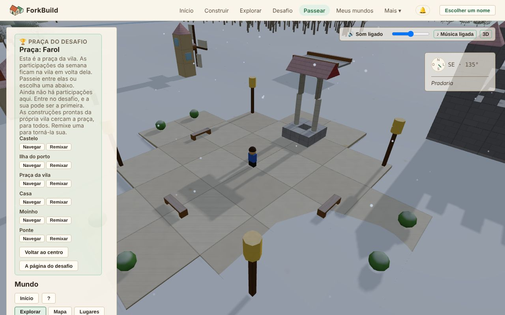

<!-- translation-of: docs/user/03-WorldView.md source-hash: 3b35ccdb4d528c27 -->
# 03 — Visão do mundo

<!-- languages -->
[English](../03-WorldView.md) · [Deutsch](../de/03-WorldView.md) · [Español](../es/03-WorldView.md) · [Français](../fr/03-WorldView.md) · [Bahasa Indonesia](../id/03-WorldView.md) · [日本語](../ja/03-WorldView.md) · [한국어](../ko/03-WorldView.md) · **Português (Brasil)**
<!-- /languages -->

A Visão do mundo é o mundo 3D compartilhado onde **todas as construções
publicadas ficam lado a lado**. Você anda ou voa por ele, encontra coisas,
olha o que outras pessoas construíram e traz seus amigos.

Aqui você não constrói: para isso existe o Editor. Quando quiser mudar
algo que encontrou, **Editar uma cópia** abre uma cópia sua no Editor (veja
[Editar uma cópia](#editar-uma-cópia--levando-algo-para-o-editor)). As
únicas mudanças que a Visão do mundo faz são rótulos, não blocos: dar nome
a [Marcos](#marcos--marcando-um-lugar-que-vale-lembrar) e regiões, e deixar
no Mundo, como decoração, um animal solto, com **G** (veja
[Avatares e presença](06-AvatarsAndPresence.md#decorando-um-mundo-com-um-animal)).

**A versão curta:**

| Para… | Faça isto |
|---|---|
| Chegar aqui | **Passear** na barra superior, ou **Explorar** em qualquer construção |
| Andar | `W` `A` `S` `D` para se mover, `Shift` para correr, `Espaço` para pular (no celular, o joystick) |
| Olhar em volta | Arraste para girar a câmera, role para o zoom |
| Mudar o que você vê | **Editar uma cópia** abre uma cópia sua no Editor |
| Começar uma construção bem aqui | **Construir aqui** |
| Trazer amigos | **Passear aqui comigo** cria um link para enviar a eles |
| Silenciar ou ligar o som | O botão **Som**, ou `M` |

Todos os controles estão na [Referência de controles](ControlsReference.md).
As ferramentas de rede por trás do Mundo têm sua própria página:
[Visão do mundo: ferramentas avançadas](WorldViewAdvancedTools.md).

## Abrindo a Visão do mundo


*A Visão do mundo na praça do desafio: o painel lateral à esquerda, seu avatar na praça, e o som e a bússola no canto superior direito.*

Há dois jeitos de entrar:

- **Passear** na barra superior abre a Visão do mundo na praça do desafio
  desta semana. Você não precisa de uma construção sua. A praça é a praça
  da vila: as seis construções prontas ficam em volta dela, prontas para
  remixar, e logo do lado de fora ficam as participações da semana
  (veja [A praça do desafio](04-PublishingAndForking.md#a-praça-do-desafio)).
- Na página **Explorar**, **Explorar** em qualquer construção leva você
  bem ao lado dela. Abrir o link de um Mundo faz o mesmo.

As construções que outras pessoas
[enviaram para todos](04-PublishingAndForking.md#quem-pode-encontrá-la)
ficam onde quem as fez as colocou: cada uma num lugar só dela, com espaço
em volta, por uma terra ampla (veja
[Onde uma construção fica](04-PublishingAndForking.md#onde-uma-construção-fica)).

## Uma visão de visitante, e Avançado

A Visão do mundo abre como visão de visitante. O que você veio fazer fica
numa barra na parte de baixo do Mundo: **Construir aqui**, **Passear aqui
comigo** e, quando a construção não é sua, **Editar uma cópia**.

O painel lateral mostra o nome da construção e quem a fez, depois para
onde você pode ir e o que há em volta. No celular, o painel começa fechado
para o Mundo ocupar a tela; **Painel** o abre. Na praça, o celular mostra
em vez disso uma linha, **Praça: …** com quantas construções há ali;
toque nela para abrir o painel. Quem aparece, se as teclas movem seu
avatar e as escolhas de câmera ficam em **Configurações do avatar**.

No fim do painel, **Mostrar ferramentas avançadas** acrescenta as
ferramentas para as redes por trás do Mundo: coordenadas, inspecionar
blocos, posicionamentos, Encontros no Mundo e mais. Elas estão em uma
página própria,
[Visão do mundo: ferramentas avançadas](WorldViewAdvancedTools.md). A
escolha fica guardada neste dispositivo e não muda nada para mais ninguém.
Tudo nesta página funciona com ou sem elas.

## Voando por aí

- **Arrastar com o botão esquerdo**: girar a câmera
- **Arrastar com o botão direito**: deslizar a câmera para o lado
- **Rolar**: aproximar e afastar
- **Início** (a tecla, ou o botão do painel): voltar para o seu próprio
  Mundo (veja [Orientação e locais](#orientação-e-locais))

Para andar com seu avatar, veja
[Caminhando com seu avatar](06-AvatarsAndPresence.md#caminhando-com-seu-avatar).

Os Mundos próximos **carregam e descarregam sozinhos** conforme você se
move. O painel lateral se lê de cima para baixo:

1. o que você está olhando (o cabeçalho);
2. para onde você pode ir: **Início**, **Locais** e as abas **Explorar**,
   **Mapa** e **Lugares**;
3. o que há em volta (**Por perto**);
4. suas próprias ferramentas: **Buscar** e **Avatar**.

No fim, **Mundos à vista** lista os outros Mundos carregados em volta de
você, e **Mundos próximos** os que você pode visitar com um clique.

Aponte para algo no Mundo e um cartãozinho no canto inferior direito da
visão diz o que é.

### O que há em volta

**O terreno** é o mesmo para todos. Grama, praias, rocha, floresta,
campos, lagos, rios e o mar seguem a forma do chão. O terreno do centro
está sempre seco; a umas mil unidades você chega a uma costa, onde o chão
desce para o mar fundo.

**Água.** Os lagos ondulam com a brisa e o mar balança num
marulho lento. Os rios correm morro abaixo pelo leito, mais rápido onde o
terreno é mais íngreme. Nascem em fontes borbulhantes ao pé das terras
altas, descem o terreno mais íngreme em pequenas cascatas e às vezes
terminam numa lagoa tranquila. Forma-se espuma onde as ondas chegam à margem e
onde um rio passa por corredeiras. Seu avatar entra andando num lago, no
mar ou num rio e fica mais lento
conforme a água sobe. Quando a água é mais funda que metade da altura dele,
ele nada, subindo e descendo com o marulho (veja
[Nadar e mergulhar](06-AvatarsAndPresence.md#nadar-e-mergulhar)). Mergulhe
e você vê algas e pequenos cardumes de peixes.

**Árvores e animais.** A floresta tem coníferas onde é mais úmido e
árvores de folhas largas onde é mais seco, com arbustos na beira dos
campos. Cervos vivem na floresta e coelhos nos campos. As árvores nunca se
mexem. Os animais andam devagar perto do próprio lugar, param para pastar
e levantam a cabeça de vez em quando. Chegue perto e um deles vira a
cabeça para olhar você (a não ser que você esteja bem atrás); um cervo que
pasta levanta a cabeça, um coelho fica sentado nas patas de trás. Eles
nunca fogem nem mudam de lugar por sua causa, e as outras pessoas veem os
animais olhando para *elas*. Os animais bloqueiam seu caminho a pé, como
as árvores.

Todos que olham o mesmo lugar no mesmo momento veem o mesmo terreno, os
mesmos peixes, árvores e animais. Nada disso pode ser editado.

Os **moradores** são pessoas que vivem num Mundo. Passeiam em volta de
casa, contornam os prédios em vez de atravessá-los e se viram para
cumprimentar você; fale com um e ele conta o que há por perto. Ao
contrário dos animais, eles fazem parte do Mundo: quem o fez os coloca.
As casas prontas vêm com um morador perto da porta, inclusive as que ficam
em volta da praça do desafio. Na sua própria construção, **R** remove um.
Veja [Moradores](06-AvatarsAndPresence.md#moradores).

**Construções fracas e transparentes** são construções que outras pessoas
anunciaram perto de você e que este dispositivo não aceitou. Elas somem de
novo quando você segue em frente. Veja
[Construções declaradas](WorldViewAdvancedTools.md#construções-declaradas--construções-de-outras-pessoas-onde-os-editores-dizem-que-elas-ficam).

### Dentro de uma construção

Entre por uma porta e a construção acima da sua cabeça é cortada, para você
ver o cômodo onde está em vez da parede atrás de você: o telhado e tudo o
que fica mais alto que a sua cabeça, só daquela construção, enquanto as
paredes ficam de pé até um pouco acima da sua altura. Com a câmera seguindo
você, ou em **Terceira pessoa**, a câmera entra também, atrás e acima de
você, olhando para dentro do cômodo, e sobe em vez de atravessar uma parede
quando há uma logo atrás de você. **Vista aérea** olha direto para baixo
dentro do cômodo; **Primeira pessoa** o vê pelos seus próprios olhos, sem
cortar nada. Saia de novo e a construção inteira volta a ser desenhada. Só
muda o que é desenhado: o telhado continua lá, para todo mundo e para
andar.

## Dia e noite

O céu da Visão do mundo passa do dia para a noite e volta a cada 40
minutos: um entardecer quente, uma noite azul e enluarada, um amanhecer
rosado e depois o dia de novo. Ele segue o relógio, então todo mundo que
está numa construção vê o mesmo céu no mesmo momento. Quando escurece, as
janelas de vidro brilham com luz de lâmpada e as **Lanternas** acendem na
própria cor, de modo que um farol mostra o caminho até o porto e uma vila
parece habitada; os pássaros se calam e os grilos assumem. A noite nunca
fica escura demais para você encontrar o caminho. Só a Visão do mundo tem
noite: o Editor, as imagens das construções e as prévias de links estão
sempre em pleno dia.

O sol nasce no leste, atravessa o céu do sul e se põe no oeste, alaranjado
perto do horizonte; depois que ele se põe, a lua faz o mesmo caminho durante
a noite. A luz sobre as construções vem de quem estiver no céu, então as
paredes voltadas para o leste pegam a manhã e as voltadas para o oeste, a
tarde.

O sol e a lua projetam sombras: a sua, a das árvores, a dos animais e a de
cada construção, longas de manhã e à tarde, curtas ao meio-dia e mais fracas
ao luar. Elas caem a cerca de 45 metros ao seu redor e somem por um instante
enquanto o sol passa o céu para a lua e vice-versa. Sombras pesam mais num
celular do que num computador, então começam ligadas com mouse e desligadas
em celular ou tablet; marque ou desmarque **Sombras** no fim do painel para
mudar isso neste dispositivo.

As árvores crescem como na natureza: abetos com verticilos de galhos
pendentes nas florestas mais úmidas, árvores de folhas largas com galhos que
se bifurcam e copas arredondadas onde é mais seco, e um mato baixo e
retorcido nas bordas do campo. De perto você vê cada galho e cada folha;
elas balançam ao vento, mais quando uma tempestade se aproxima, e projetam
sombras salpicadas. Mais longe, viram formas mais simples, para que até uma
floresta inteira continue fluida. Em um celular ou tablet as árvores começam
mais simples; marque **Árvores detalhadas**, logo abaixo de **Sombras**,
para ver cada folha neste dispositivo.

À noite, conforme o crepúsculo escurece, as estrelas aparecem, com a Via
Láctea atravessando o céu, e somem de novo ao amanhecer. Todo o céu estrelado
gira devagar em torno de um ponto alto no norte, então as estrelas nascem no
leste e se põem no oeste junto com a lua, e todos veem as mesmas estrelas no
mesmo momento.

A lua passa por suas fases, uma por noite: de uma lua nova escura a um fino
crescente, uma meia-lua e uma lua gibosa até a lua cheia, e de volta, a cada
oito dias da Visão do mundo (pouco mais de cinco horas). Uma lua crescente é
iluminada do lado oeste, e uma minguante do lado leste. A fase também muda a
noite: na lua cheia a noite fica um pouco mais clara e as sombras mais
nítidas; perto da lua nova a luz é mais suave, o céu de um azul mais
profundo, e as estrelas e a Via Láctea brilham mais. Como o resto do céu,
todos veem a mesma lua no mesmo momento, e nunca fica tão escuro a ponto de
as construções ficarem difíceis de ver.

As nuvens vêm e vão, as mesmas para todos no mesmo momento. Quase sempre
passam algumas nuvens brancas; de vez em quando o céu fica nublado, e às
vezes fica cinzento e encoberto, com luz mais suave e sombras mais fracas.
Nunca fica tão escuro a ponto de as construções ficarem difíceis de ver.

De vez em quando um céu encoberto traz chuva, por alguns minutos de cada
vez. Você a vê cair ao seu redor e anéis se espalharem onde as gotas caem num
lago, no mar ou num rio, e a ouve, enquanto os pássaros e os insetos se
calam. Se você entrar numa construção, lá dentro não chove: você ouve a
chuva tamborilar no telhado e a vê continuar caindo lá fora. Na chuva, o
chão e as construções escurecem e brilham, e secam em alguns minutos depois
que ela para. Os aguaceiros mais fortes às vezes trazem uma tempestade suave: de vez em quando um relâmpago ilumina de leve o céu, e alguns segundos depois um trovão ronca ao longe. Se o seu dispositivo pede menos movimento, os relâmpagos não piscam. A chuva é só
para ver e ouvir: os rios não sobem e você anda tão
rápido quanto antes.

Se você preferir que seja sempre dia, marque **Sempre de dia** no fim do
painel, logo acima de **Sombras**. O céu também fica
limpo. A escolha fica lembrada neste dispositivo e não muda nada para mais ninguém.

## Estações

O mundo passa por quatro estações, cada uma com oito dias do World View (pouco
mais de cinco horas), uma para cada volta da lua:

- **Primavera**: as árvores florescem em rosa e branco e ganham folhas novas
  de um verde claro; flores silvestres pontilham a grama, e pétalas caem entre
  as árvores.
- **Verão**: tudo fica verde e viçoso, frutas amadurecem em algumas árvores e
  os campos ficam dourados.
- **Outono**: as folhas ficam vermelhas, laranjas e amarelas, cada árvore no
  seu tempo, e caem ao seu redor enquanto as árvores ficam nuas; os campos são
  colhidos.
- **Inverno**: as árvores ficam nuas, a grama perde a cor e, quando o céu
  fecha, neva em vez de chover. A neve se acumula em manchas que se juntam num
  manto branco, cobre telhados e copas (nunca as paredes, nem o interior da
  construção onde você está) e derrete na primavera. Os pássaros cantam menos
  e os insetos somem.

A paisagem muda um pouco a cada dia, e não de uma vez, e todos veem a mesma
estação no mesmo momento. As coníferas continuam verdes o ano todo. Para manter
uma estação no seu dispositivo, escolha-a em **Estação**, perto do fim do painel,
logo abaixo de **Árvores detalhadas**; **O ano do mundo** volta a seguir o mundo.
Com **Sempre de dia** ligado, as estações continuam mudando, sob um céu limpo.

O sol também acompanha as estações. No verão ele sobe alto e os dias são
longos; no inverno fica baixo, projeta sombras longas e a noite chega mais
cedo. No auge do inverno os lagos congelam o bastante para atravessá-los a
pé (o mar e os rios nunca); enquanto o gelo ainda se forma, ou se quebra no
fim do inverno, ele não aguenta você. Todos veem o mesmo gelo no mesmo
momento, seja qual for a estação que mantêm. A neve range sob os pés e o
gelo estala, e andando na neve seu avatar deixa pegadas que somem depois de
um minuto. Só você vê suas pegadas.

## Som

**Controles**, no canto superior direito da visão (inferior direito no
celular):

- **Som**, ou `M`: ligar ou desligar todo o som.
- O controle deslizante: o volume. No celular ou tablet, use os botões de
  volume do aparelho.
- **♪ Música**: ligar ou desligar só a música.
- **3D**: alternar entre som 3D e **Estéreo** simples.

O som começa no seu primeiro clique, toque ou tecla (os navegadores
exigem isso) e pausa enquanto a aba está escondida. Essas escolhas ficam
guardadas neste dispositivo, na Visão do mundo e no Editor.

**O que você ouve:**

- **O terreno em volta**: vento no alto das rochas, pássaros na floresta,
  grilos nos campos, água batendo na beira do lago, um rio correndo. As
  árvores farfalham ou suspiram ao vento, mais alto quanto mais perto. Os
  sons se misturam quando você passa de um tipo de terreno para outro.
- **Seu avatar**: passos que mudam com o chão (grama, folhas, areia,
  pedra, água, blocos), um sopro ao pular e uma batida ao cair.
- **Veículos**: rodas ou o queimador de um balão, mais alto conforme você
  acelera; sons ao subir e descer; e freios que chiam quando você para de
  repente.
- **Animais e moradores**: um cervo bufa e um coelho bate o pé quando
  levanta a cabeça ou se assusta; pegar e soltar um tem som próprio. Os
  moradores cantarolam ao cumprimentar você e murmuram ao falar. Todo
  mundo ouve o mesmo cervo levantar a cabeça no mesmo momento.
- **Outras pessoas**: os passos, pulos e veículos delas, de onde elas
  estão, enquanto você puder vê-las. Esconda os outros avatares e elas
  ficam em silêncio. Os veículos são ouvidos a até 40 m, só os três mais
  próximos.
- **Suas próprias mudanças**: dar nome a um marco ou região, adicionar ou
  remover um morador, decorar com um animal, e desfazer e refazer fazem o
  mesmo som curto que no Editor. As mudanças dos outros não fazem som.

Os sons vêm de onde estão: na frente ou atrás, em cima ou embaixo, à
esquerda ou à direita, e giram quando você gira a câmera. Fones de ouvido
ajudam. **Estéreo** toca só esquerda e direita, o que pode combinar melhor
com um aparelho lento ou com caixas de som.

A **música** toca baixinho por baixo: uma melodia tranquila que o seu
navegador inventa na hora, calorosa de dia e mais lenta depois que
escurece, com pausas de silêncio entre as músicas. Ela nunca toca igual
duas vezes.

Todo o som é criado no seu navegador: nada é baixado e nada é enviado. Os
navegadores das outras pessoas criam o som dos seus passos a partir do que
já veem você andando.

## Orientação e locais

A **bússola** flutua no canto superior direito da visão. Ela mostra norte,
leste, sul e oeste, para onde você está virado em graus e pontinhos para
construções, pessoas e marcos por perto. Aponte para um ponto para ver o
nome, ou leia a lista embaixo da bússola, que também diz o lugar onde você
está. A bússola só mostra; ela nunca move a câmera.

Uma fileira de botões no alto do painel ajuda você a se locomover:

- **Início** leva você, câmera e avatar, de volta ao seu próprio Mundo: o
  que está aberto, ou o último que você olhou. Você chega bem ao lado, por
  mais longe que tenha ido. Se ainda não esteve num Mundo seu, Início leva
  você ao centro do mapa.
- **Locais** lista todos os lugares que a Visão do mundo conhece até
  agora, agrupados em **Mundo**, **Estruturas**, **Marcos** e **Lugares**.
  **Focar** numa linha move a câmera até lá, e nada mais.
- **👥 N on-line** conta quem está aqui; clique para ver os membros do
  Mundo. Se o Mundo tem uma sala pública, vem em seguida um botão **Sala**.
- **?** mostra os controles de câmera e de andar; clique de novo para
  escondê-los.

**Notificações** é o botão 🔔 no cabeçalho do app, ao lado do seu nome (ou
de **Escolher um nome**), então está em todas as páginas. Ele abre o seu
**Histórico de notificações**, o mais recente primeiro. Você recebe uma
notificação quando:

- alguém comenta uma construção que você publicou (veja
  [Comentários](09-PublicationsAndEvidence.md#comentários));
- alguém que você segue publica algo novo (veja
  [Seguindo pessoas](07-PeerConnectionsAndFriends.md#seguindo-pessoas));
- alguém remixa uma das suas construções (veja
  [Contagem de remixes](04-PublishingAndForking.md#contagem-de-remixes)).

Cada uma diz o que aconteceu e quando. **Explorar** leva você ao Mundo
daquela construção. É uma lista simples, não uma caixa de entrada: nada é
marcado como lido, nada é dispensado e o botão não mostra número. Ela
carrega quando você a abre; **Atualizar** carrega de novo. Ela pertence ao
seu nome, não ao Mundo que está aberto.

### Notificações neste dispositivo

No alto do painel, **Avisar neste dispositivo** deixa o seu aparelho
mostrar essas notificações por conta própria, como qualquer app. O
navegador pede permissão; **Desativar** para.

Elas aparecem enquanto o ForkBuild está aberto mas não na frente: em
outra aba, ou como [app instalado](01-GettingStarted.md#instalando-o-forkbuild)
em segundo plano. Clicar numa abre o ForkBuild naquela construção. Nada é
enviado para lugar nenhum para isso, então um ForkBuild fechado não mostra
nada; o que chegou nesse meio-tempo está na lista da próxima vez. Só
algumas aparecem de uma vez; o resto espera na lista. Se o navegador as
bloquear, o painel avisa: permita as notificações do ForkBuild nas
configurações do site no navegador.

### Explorar, Mapa e Lugares — três jeitos de navegar, nunca ao mesmo tempo

Embaixo dos botões há três abas. Só uma fica aberta, e trocar de aba só
muda o que o painel mostra.

- **Explorar** (o padrão) mostra quem está aqui e alguns lugares para
  visitar, e depois **Por perto**: **Lugares**, **Marcos** e **Pessoas** em
  volta de você, cada um com a distância e um botão **Ir**. Grupos vazios
  ficam escondidos. Clique no título de um grupo para recolher ou abrir;
  a Visão do mundo lembra quais você deixou abertos. As ferramentas
  avançadas acrescentam mais três grupos (veja
  [Visão do mundo: ferramentas avançadas](WorldViewAdvancedTools.md)).
- **Mapa** mostra o [Mapa do mundo](#o-mapa-do-mundo).
- **Lugares** lista os [lugares geográficos](#lugares-geográficos).

### Informações — o que estou vendo?

Ao lado da maioria dos botões **Ir**, em Por perto e em **Locais**, há um
botão **Informações**. **Ir** move a sua câmera até lá. **Informações**
conta sobre o lugar sem sair do lugar: o que é, a que distância está e em
que lugar com nome ele fica ("Você está em Vila dos Salgueiros") ou perto
de qual ("Você está perto de Vila Kawahara").

No painel de informações você pode:

- **Ir**: viajar até lá;
- **Mostrar no mapa**: vê-lo no Mapa do mundo;
- **Nomes** (para um lugar com nome): ver como as pessoas o chamam, ou
  publicar um nome;
- **Editar uma cópia**: abrir uma cópia sua no Editor (veja abaixo).

### Editar uma cópia — levando algo para o Editor

**Editar uma cópia** é o jeito de mudar algo que você encontrou na Visão
do mundo. Ela faz uma cópia independente sua da construção e a abre no
Editor, pronta para continuar. O original nunca é tocado.

Você a encontra:

- na barra da parte de baixo do Mundo, quando a construção que você está
  visitando não é sua: ela copia a construção inteira;
- no painel **Informações** de uma região, um marco ou uma estrutura
  posicionada;
- com as ferramentas avançadas, ao clicar num bloco, num chão vazio ou
  numa estrutura posicionada (veja
  [Inspecionando um bloco](WorldViewAdvancedTools.md#inspecionando-um-bloco--ou-uma-estrutura-posicionada)).

O que é copiado depende do que você escolheu:

- Para um **marco**, uma **região**, um **bloco** ou **chão vazio**, você
  recebe o Mundo ao qual pertencem.
- Para uma **estrutura posicionada**, você recebe essa estrutura, não o
  Mundo onde ela está.

O ForkBuild avisa assim que a sua cópia fica pronta (veja
[Publicar e remixar](04-PublishingAndForking.md)). Se a cópia não puder
ser feita, um diálogo **Não dá para fazer uma cópia** diz por quê, em
geral porque a licença da construção não permite cópias ou porque a
construção ainda não pode ser obtida, e **Voltar à construção** leva você
de volta para onde estava (veja
[Quando um remix não pode ser concluído](04-PublishingAndForking.md#quando-um-remix-não-pode-ser-concluído)).

Um **lugar geográfico** e uma **pessoa** não têm Editar uma cópia. Um
lugar geográfico é feito das regiões de várias pessoas, então não existe
uma única construção para copiar; abra uma das regiões dele.

Editar uma cópia é o mesmo que **Remixar** em Explorar e na página de um
autor, com as mesmas regras de licença (veja
[Remixar: torne a sua](04-PublishingAndForking.md#remixar-torne-a-sua)).
Todo o resto na Visão do mundo, como Buscar, a bússola, o Mapa e
Informações, só olha.

### Construir aqui — começar uma construção para este lugar

**Construir aqui**, ao lado de **Início**, começa no Editor uma construção
nova e vazia para o lugar onde o seu avatar está (ou, voando, o lugar
embaixo da câmera). O Editor diz para qual Mundo ela é.

Quando você a publica, a construção fica bem naquele lugar, em vez de num
terreno livre que o ForkBuild escolhe. **Ir ver** traz você de volta para
olhar. **Esquecer este lugar**, no Editor, deixa o ForkBuild posicioná-la
como de costume.

O lugar é só uma anotação sua, guardada neste dispositivo e nos backups
dele. Não reserva o terreno, e outras pessoas também podem construir ali
(veja
[Por que duas construções podem ficar no mesmo ponto?](WorldViewAdvancedTools.md#por-que-duas-construções-podem-ficar-no-mesmo-ponto)).

### Passear aqui comigo — trazer amigos para este Mundo

**Passear aqui comigo**, ao lado de **Construir aqui**, cria um link que
traz seus amigos para o Mundo onde você está, para passear juntos. Mande
como quiser, ou deixe que leiam o QR code com o celular.

Um amigo que abre o link escolhe um nome se ainda não tiver (cada um anda
com o próprio avatar), clica em **Entrar** e chega a este Mundo. Vocês se
veem andando. O diálogo mostra quem está a caminho e quem já chegou.

- O Mundo precisa estar publicado antes: o ForkBuild do seu amigo confere
  a assinatura e a construção, como num link compartilhado, e guarda uma
  cópia.
- O link funciona por 30 minutos para quem abrir, enquanto você ficar na
  Visão do mundo. Fechar o diálogo não o interrompe; **Parar o link**
  interrompe. Quem já entrou continua conectado de qualquer jeito.
- Entrar conecta os dois aparelhos diretamente, como um convite em
  **Pares**. Cada um vê o endereço IP do outro, e os avatares aparecem
  conforme a **Visibilidade da presença** de cada um permite (veja
  [Quem pode ver você](06-AvatarsAndPresence.md#quem-pode-ver-você-duas-configurações-independentes)).
  Ninguém vira um par conhecido ou amigo a não ser que você escolha.
- É preciso um servidor de encontro. O site oficial tem um; uma cópia que
  você mesmo roda precisa do seu (veja
  [Conexões com pares e amigos](07-PeerConnectionsAndFriends.md)).

### A praça do desafio

**Passear pela praça** na página de um desafio da semana, ou **Passear**
na barra superior, abre a Visão do mundo na praça da vila: calçada, com um
poço, bancos e postes de luz, e as seis construções prontas em volta.

A praça e as construções prontas fazem parte do Mundo, como os morros e
as árvores. Estão ali para todos, e não são de ninguém. As participações
da semana ficam logo do lado de fora, e só as daquela semana: abra a praça
da semana passada e você vê as participações da semana passada. Um painel lista as participações da semana e as
construções prontas (veja
[A praça do desafio](04-PublishingAndForking.md#a-praça-do-desafio)).
Nenhuma árvore cresce em volta da praça, e nela não há **Construir aqui**.

### Marcos — marcando um lugar que vale lembrar

Um **marco** é um ponto com nome que você coloca num Mundo, como "Ponte
velha" ou "Bela vista", com uma descrição se quiser. Ele fica exatamente
onde o seu avatar está.

Quando você pode editar o Mundo onde está, a parte de Marcos de
**Locais** tem um botão **+ Adicionar marco**. Dê um título, e uma
descrição se quiser, e clique em **Posicionar aqui**. Ele aparece na hora
para você e, instantes depois, para todos que editam o mesmo Mundo: na
bússola, em **Locais** e como lugar para ir.

Os marcos pertencem ao Mundo, não a você. Qualquer pessoa que pode editar
o Mundo pode renomear, mudar ou remover qualquer marco, seja quem for que
o fez.

### O Mapa do mundo

A aba **Mapa** mostra o Mundo de cima: lugares com nome, marcos,
construções, as pessoas que estão aqui e um marcador para você. Ela mostra
tudo o que a Visão do mundo conhece até agora, de uma vez.

- Role, ou use **+** e **−**, para o zoom.
- Arraste um espaço vazio para mover o mapa.
- Clique num lugar ou numa pessoa para mover a sua câmera até lá.

Olhar o mapa nunca muda nada.

### Lugares geográficos

Um **lugar geográfico** é uma área que várias pessoas nomearam ou
descreveram como região, cada uma por conta própria, e que acaba sendo
mais ou menos o mesmo terreno. A aba **Lugares** lista os que a Visão do
mundo encontrou até agora.

Clique num deles para ver quantas descrições e Mundos ele abrange, os
**Nomes da comunidade** dele, e **Ir ao lugar** e **Mostrar no mapa**.
**← Voltar** (ou Escape) volta para a lista. Se você trocar de aba e
voltar, encontra a mesma tela que deixou.

Os **Nomes da comunidade** de um lugar mostram os nomes principais;
**Mais nomes** mostra a lista completa em ordem. Embaixo você pode
publicar um nome seu. Todo o resto (outras descrições do lugar, o
histórico completo de nomes, importar e exportar) fica recolhido em
**Mais**.

Publicar um nome avisa as pessoas com quem você está conectado, do mesmo
jeito que declarar que você fez uma construção. Para ver todos os nomes e
declarações que este dispositivo publicou ou conheceu, veja
[Publicações e evidências externas](09-PublicationsAndEvidence.md).

## Meus mundos — os Mundos em que você realmente esteve

**Meus mundos**, na barra superior, lista todos os Mundos em que você
esteve neste dispositivo, o mais recente primeiro, com título, autor e
quantas construções e marcos tem. **Continuar explorando** leva você de
volta para dentro. Só este dispositivo guarda a lista, e ninguém mais a
vê.

Ainda não foi a lugar nenhum? **Abra o Explorar** para encontrar um Mundo
ou começar de uma construção pronta.

**Construções que você ajudou a fazer** lista as construções em que um
amigo deu crédito a você quando construíram juntos com **Construir comigo**
(veja [O Editor](02-TheEditor.md#construir-comigo-construir-juntos-ao-vivo)).
Cada uma mostra o título e **com** o nome do seu amigo, que abre a página
dele. Mostra **Ainda não publicada** até seu amigo publicar; aí o título
abre o Mundo dela. Seus outros dispositivos também as listam, depois de
conectados a este. A seção só aparece quando tem algo.

## Encontrando mundos

Há dois jeitos de procurar algo, cada um respondendo a uma pergunta
diferente.

### Buscar — "quais publicações correspondem a isto?"

**Buscar** procura um **título ou autor** em tudo o que foi publicado,
não só no que está carregado em volta de você. Digite uma palavra e
clique em **Buscar**. Cada resultado mostra onde está (📍); clique em
**Focar** para voar até lá.

Um resultado pode dizer que sua posição é uma **posição padrão**: o autor
nunca escolheu um lugar, então o ForkBuild a mostra em algum. Com as
ferramentas avançadas, você também pode buscar por posição (veja
[Visão do mundo: ferramentas avançadas](WorldViewAdvancedTools.md)); os
resultados então mostram a que distância estão (📏).

### Explorar aqui / O que há aqui? — "o que há ao meu redor agora?"

Esses dois botões, no alto de **Por perto** em Explorar, olham **em volta
de onde está a sua câmera**. Você não precisa de título nem de
coordenadas.

- **Explorar aqui** olha uma área ampla. Depois você pode ampliá-la ou
  reduzi-la.
- **O que há aqui?** olha só bem onde você está.

Os dois abrem o diálogo **Explorar local**:

```
📍 Centro: 100.0, 50.0, 250.0
⭕ Raio: 25 unidades do Mundo

Mostrando 3 de 3 construções que podem ser encontradas

📍 Prefeitura           📏 A 4,2 unidades do Mundo
de alice
[Focar] [Selecionar] [Inspecionar]
```

Cada resultado tem três botões:

| Botão | O que faz |
|---|---|
| **Focar** | Voa até lá e faz dela a construção em que a sua próxima mudança se aplica |
| **Selecionar** | Faz dela a construção em que a sua próxima mudança se aplica, sem sair do lugar |
| **Inspecionar** | Mostra título, autor, status, posição e dono, sem sair do lugar |

O diálogo em si nunca move, muda ou publica nada.

## A Visão do mundo é somente leitura — construir é no Editor

Clicar, arrastar ou apertar uma tecla na Visão do mundo nunca muda um
bloco. Aqui não há ferramentas de construção. Para construir em cima de
algo, use **[Editar uma cópia](#editar-uma-cópia--levando-algo-para-o-editor)**
e continue no [Editor](02-TheEditor.md). As únicas mudanças que a Visão do
mundo faz são os rótulos citados no começo desta página.

## Vendo outros colaboradores

Quando há outras pessoas no mesmo Mundo:

- **Você as vê**: os avatares delas, com o nome e o que estão fazendo
  ("**Bob — explorando por perto**").
- **Você vê as mudanças delas na hora**: um marco, um nome, uma nova
  cópia delas.
- **Uma lista curta de atividade** no painel mostra o que mudou há pouco,
  mesmo fora da sua vista. Ela só fica guardada enquanto você está aqui.

Ver pessoas nunca muda nada por si só. Só uma mudança de verdade muda:
uma feita no Editor, ou um dos rótulos que a Visão do mundo permite.

## Salvar e publicar aqui também

Quando você está trabalhando numa construção, o cabeçalho tem **Salvar**,
**Publicar** e **Editar metadados**, então você pode salvá-la e
compartilhá-la sem sair. A linha de status diz qual é: **🔒 Publicado** ou
**✎ Editando sua cópia**.

Uma construção publicada nunca muda. Se a construção em que você está foi
publicada, a sua primeira mudança aqui (os dados dela, um marco ou região,
ou um animal como decoração) cria uma cópia sua, com o título
*"Remix de &lt;nome original&gt;"*. Um aviso curto informa isso ("Sua
própria cópia editável foi criada; … não muda"). Valem as mesmas regras de
licença de qualquer remix (veja
[Publicar e remixar](04-PublishingAndForking.md#remixar-torne-a-sua)).

## Histórico — visualizar e restaurar estados anteriores

Cada mudança que você faz aqui, como adicionar, renomear ou remover um
marco ou região, fica no histórico da construção. Clique em **Histórico**
no cabeçalho para ver uma lista numerada com horários, assim:

```
1. Adicionar marco “Ponte velha”
2. Renomear região “Vila dos Salgueiros”
3. Remover marco “Vista linda”
```

Os passos que você desfez aparecem marcados como **Desfeito**. Clicar num
passo só o escolhe; nada muda até você apertar um botão:

- **Prévia** mostra o Mundo como estava *logo depois* daquele passo, ao
  lado do atual, sem mudar nada. **Cancelar prévia** volta.
- **Restaurar** volta para aquele passo. Não pergunta antes, mas deixa a
  mudança sem salvar, então você ainda pode escolher se quer salvar.
- **Fechar** fecha a lista.

## E agora?

Pronto para compartilhar o que você fez, ou para remixar o trabalho de
outra pessoa? Continue em
**[Publicar e remixar](04-PublishingAndForking.md)**. Para as ferramentas
de rede por trás do Mundo, veja
**[Visão do mundo: ferramentas avançadas](WorldViewAdvancedTools.md)**.
