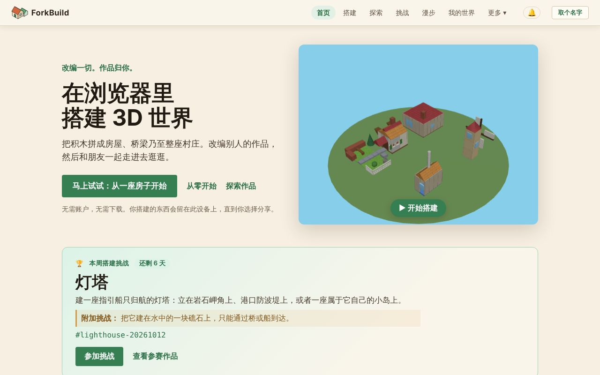
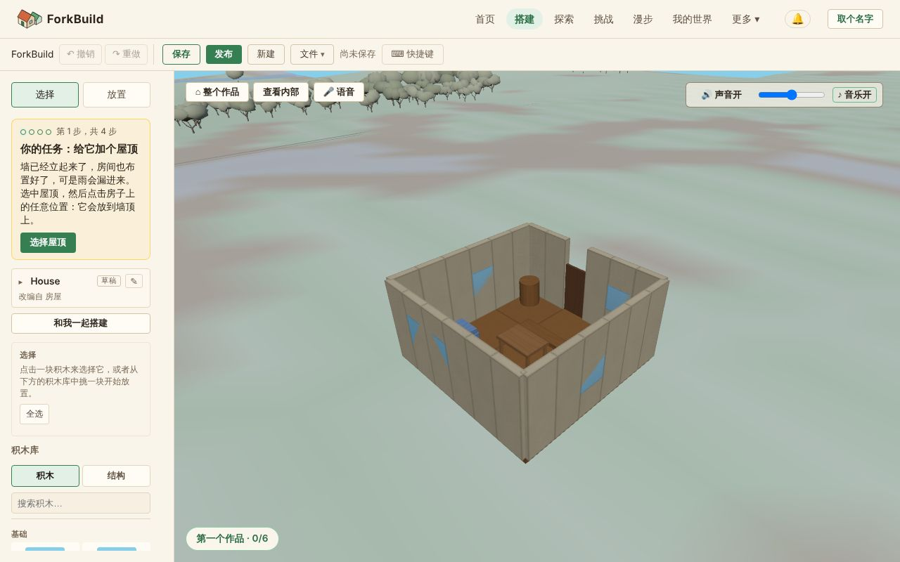

<!-- translation-of: docs/user/01-GettingStarted.md source-hash: 7ea2df22c95dd572 -->
# 01 — 入门

<!-- languages -->
[English](../01-GettingStarted.md) · [Deutsch](../de/01-GettingStarted.md) · [Español](../es/01-GettingStarted.md) · [Français](../fr/01-GettingStarted.md) · [Bahasa Indonesia](../id/01-GettingStarted.md) · [日本語](../ja/01-GettingStarted.md) · [한국어](../ko/01-GettingStarted.md) · [Português (Brasil)](../pt-BR/01-GettingStarted.md) · **中文（简体）**
<!-- /languages -->

欢迎！这份指南会带你在大约五分钟内，从“刚打开应用”到“我搭出了东西”。
开始时不需要账户、不需要下载，也不需要名字：在你选择分享之前，一切都保存在你的设备上。

**简要版：**

1. 在**首页**上，点击**马上试试：从一座房子开始**。
2. 用四个简短的步骤完成这座房子：点击**选择屋顶**，然后点击房子；接着是烟囱、
   通往门口的小路和花园，每一步都有自己的**选择**按钮。
3. 点击**发布**。会打开一个面板，里面已经推荐了一个名字，并且“允许他人改编”和
   **所有人都能找到**都已打开：如果愿意可以输入你自己的名字，然后点击**以 … 的身份发布**。
4. 点击**走进去**，在世界中走进你的房子。

本页其余部分会逐一解释每个环节，以及如何改为从一块空地开始。

## 打开 ForkBuild

*首页：顶栏、三个入口，以及本周的搭建挑战。*

ForkBuild 可以在任何新版网页浏览器中运行：打开托管的网站，你就会来到**首页**。
（如果想运行你自己的副本，请见本页末尾的[运行你自己的副本](#运行你自己的副本)。）

**首页**上有一座以 3D 方式旋转的小村庄，并提供三个入口：

- **马上试试：从一座房子开始**会在编辑器中把一座现成的房子作为你自己的副本打开，
  随时可以修改（见[马上试试](02-TheEditor.md#马上试试一座等你完成的房子)）。
- **从零开始**会在一块空地上打开编辑器。
- **探索作品**会打开**探索**，那里有所有人发布的作品。

点击旋转的村庄本身（**开始搭建**）与**马上试试**的效果相同。

当此设备上有已保存的作品时，首页会以**欢迎回来**打开：**继续搭建**会在编辑器中打开你最后修改的作品；
如果你还没有发布过作品，它会提醒你发布。在你参加本周挑战之前，会一直显示**参加本周挑战**；
有了名字之后，**我的作品**会打开你自己的搭建者页面。

在**从现成作品开始**下，每张卡片（城堡、港湾小岛、村庄广场、房屋、磨坊和桥）
都会以同样的方式打开该作品的个人副本。在你选择之前，不会发布或发送任何东西。

首页还会显示**本周搭建挑战**：一个搭建主题，以及**参加挑战**（见
[每周搭建挑战](04-PublishingAndForking.md#每周搭建挑战)）。
发布过作品后，它还会显示**你的印章**：关于你自己作品的事实，比如有人改编了你的作品时的**被改编**、
参加每周挑战时的**挑战者**，或者一个有一百块以上积木的作品对应的**大工程**。
它们在此设备上计算，只显示给你自己看：是认可，从来不是积分或排名。

## 熟悉界面

顶部的栏始终可见：

`ForkBuild  首页  搭建  探索  挑战  漫步  我的世界  更多 ▾  🔔  取个名字`

| 菜单 | 打开什么 |
|---|---|
| **首页** | 起始页 |
| **搭建** | 编辑器，你在这里搭建（见[编辑器](02-TheEditor.md)） |
| **探索** | 所有人发布的作品，可以打开、改编或参观（见[发布与改编](04-PublishingAndForking.md#探索)） |
| **挑战** | 本周搭建挑战及其参赛作品（见[每周搭建挑战](04-PublishingAndForking.md#每周搭建挑战)） |
| **漫步** | 本周挑战广场上的世界视图，可以在村庄广场周围的本周参赛作品之间漫步（见[世界视图](03-WorldView.md)） |
| **我的世界** | 你在此设备上访问过的世界（见[我的世界](03-WorldView.md#我的世界你真正去过的世界)） |
| **🔔** | 你的通知：评论、改编，以及你关注的人的新作品（见[方位与地点](03-WorldView.md#方位与地点)） |
| **取个名字** | 选择你发布和漫步时使用的名字；有了名字之后，这里会改为显示它（见[取个名字](#取个名字)） |

**更多**会打开其余内容，分为四组。在手机上，**菜单**会一次显示全部。

- **你**
  - **我的化身**——你在世界视图中如何出现在别人面前，见
    [化身与在线状态](06-AvatarsAndPresence.md)
  - **我的身份**——此设备上保存的名字（身份），见
    [你的名字与身份](05-IdentityAndLogin.md)
  - **你的数据**——把所有内容备份到一个文件，或复制到另一台设备，见
    [你的数据](13-YourData.md)
- **社区**
  - **对等节点**——与你连接、已知或是好友的人，见
    [对等连接与好友](07-PeerConnectionsAndFriends.md)
  - **关注**——你会收到其新作品消息的人，见
    [关注他人](07-PeerConnectionsAndFriends.md#关注他人)
  - **对话**——你的私信，见
    [聊天与对话](08-ChatAndConversations.md)
- **高级**——搭建和分享不需要这些
  - **签名记录**——签名的作者声明和地名提议、在哪里存储和公告它们，以及
    （*实验性*）它们的外部证据，见[签名记录与外部证据](09-PublicationsAndEvidence.md)
  - **网络设置**——网关、中继、服务，以及对等连接服务器，见
    [网络设置](10-NetworkSettings.md)
- **应用**
  - **语言**——ForkBuild 在此设备上显示的语言。在你选择之前，它会跟随浏览器的语言；
    保存会重新加载页面，所以请先保存你的作品。ForkBuild 提供英语、德语、西班牙语、
    法语、印度尼西亚语、日语、韩语、巴西葡萄牙语和简体中文。
  - **外观**——**自动**、**浅色**或**深色**，就在菜单里。“自动”跟随你设备的浅色或深色模式；
    “浅色”是白天的村庄，“深色”是入夜后的同一座村庄。更改立即生效，并保存在此设备上。
  - **帮助**——用你自己的话提问，从这份指南中得到答案，在你的设备上读取。
    打开过一次后离线也能用。
  - **关于**——版本信息和这份指南的链接
  - **安装 ForkBuild**——在浏览器可以安装它的地方显示（见
    [安装 ForkBuild](#安装-forkbuild)）

## 放置你的第一块积木

*打开了首页房子的编辑器：左边是你的工具和积木库，中间是作品，还有“你的第一个作品”卡片。*

第一次打开编辑器时，3D 视图角落里的**你的第一个作品**卡片会带你完成六个步骤，
每完成一步就打一个勾，最后一步是走进你已发布的作品；见
[你的第一个作品](02-TheEditor.md#你的第一个作品)。

1. 点击顶栏中的**搭建**（或首页上的**从零开始**）。
2. 在左侧边栏中，确保**放置**工具处于激活状态（按 `2`）。
3. 在它下方的**积木库**中，打开**积木**标签页，点击一块积木——例如**基础**下的**立方块**。
4. 把鼠标移到 3D 视图中。一个半透明的积木**预览**会沿着网格跟随。
5. **点击**来放置它。

恭喜——你搭下了第一块积木！🎉

在手机或平板上，用轻点代替点击；见
[在手机或平板上](02-TheEditor.md#在手机或平板上)。

### 堆叠积木

你不必只在地面上搭建。把鼠标悬停在已有积木的某个**面**上，预览就会吸附上去——
点击即可叠在上面，或者贴在侧面。墙、塔和屋顶就是这样搭起来的。

搭错了？按 `Ctrl+Z`（Mac 上为 `Cmd+Z`）撤销。每一次更改都可以撤销。

## 保存你的作品

按 **Ctrl+S**（或点击工具栏中的**保存**）。**● 有未保存的更改**提示会变成**已保存**。

你的作品保存在浏览器中，所以下次回来时它还在。编辑时，ForkBuild 还会为未保存的更改
保留一份崩溃恢复副本；如果页面在你保存之前关闭了，它会提出恢复：下次打开编辑器时，
一条横幅会说明是哪个作品、在什么时候修改的。**恢复**会连同这些更改打开该作品
（保存后才会保留它们）；**丢弃**会扔掉这份副本，如果还有下一份，就提供下一份。
对于从未保存过的作品，这也同样适用。

> **保留一份副本。** 你的作品只存在于这个浏览器中。清除浏览器中该网站的数据会删除它们，
> 所以请时不时用**更多 → 你的数据 → 备份到文件**备份它们（见
> [你的数据](13-YourData.md)）。

浏览器会限制每个网站可以存储多少数据，通常是磁盘的一部分。如果 ForkBuild 的份额用完了，
保存和崩溃恢复会停止，并显示提示；你打开的内容不会丢失。请使用工具栏中的
**文件 → 导出**，把作品保存为文件。第一次保存时，有些浏览器会询问 ForkBuild 是否可以永久保留数据；
允许后，浏览器就不会在磁盘空间不足时清除它。

## 取个名字

搭建或保存不需要名字。只有在**发布**时才需要，因为发布会为你的作品签名，
让别人可以确认它真的是你的；以及在**和朋友一起漫步**时需要，这样他们才能看到你的名字。

第一次点击**发布**时，ForkBuild 会请你取一个用于发布的名字。输入一个名字并点击
**以 … 的身份发布**：名字会在此设备上生成，你的作品也随之发布。
（漫步链接也会同样询问，按钮是**以 … 的身份漫步**。）

你也可以随时取名字：点击右上角的**取个名字**，输入一个名字，然后点击**以 … 的身份继续**。

ForkBuild 没有密码，也没有账户。你的名字背后是一把保存在此设备上的密码学密钥，叫作**身份**。
在你添加密码短语之前，这把密钥会以没有密码短语的形式保存在这个浏览器中：
发布后编辑器会提醒你，而**我的身份**中的**用密码短语保护**随时都能添加。
如果想马上设置密码短语，请在取名对话框中点击**现在就用密码短语保护它**。

> **密码短语无法重置。** 密码短语会在此设备上加密你的密钥，没有人（包括 ForkBuild）
> 能恢复它。请选择一个你记得住的。

有了名字后，右上角会显示它。点击它可以打开**我的化身**、**我的身份**、**你的数据**和
**切换名字**；“切换名字”会列出这个浏览器已有的所有名字（点击一个即可使用）、新建一个名字，
或者选择**不用名字继续**。在那里新建名字时，还会要求输入两次至少 8 个字符的**密码短语**。
（要跳过，请勾选**不设密码短语直接创建**；密钥将以未加密形式保存在这个浏览器中。）
然后点击**使用这个名字**。

之后你发布的一切，或发送给别人的一切，都会以那个名字签名。

**匿名发布。** 在“发布”打开的面板上，**高级**里有**匿名发布**。以这种方式发布的作品没有作者，
也没有签名，所以它不会有链接，不能分享给别人，以后也不能发送给所有人。
除非你只想让它出现在你自己的**探索**中，否则请使用名字。

密码短语保护什么、锁定和解锁，以及备份你的身份，都在
[你的名字与身份](05-IdentityAndLogin.md)中介绍。

## 安装 ForkBuild

ForkBuild 可以作为应用安装，这样它就能从主屏幕、程序坞或应用列表中以独立窗口打开，
而且没有网络也能用。点击首页上（或**更多**下）的**安装 ForkBuild**，然后在浏览器自己的对话框中确认。
在 iPhone 或 iPad 的 Safari 中，按钮会告诉你怎么做：轻点**分享**，然后选择**添加到主屏幕**。
在浏览器无法安装应用、或已经安装了 ForkBuild 的地方，不会显示这个按钮。

- **离线。** 第一次打开 ForkBuild 时，浏览器会保留它的文件，所以无论是否安装，
  没有网络时它也能再次打开：首页、编辑器、你保存的作品和现成作品都能用。
  任何需要网络的功能（寻找作品和人、发送作品、聊天和通话）会等你重新联网后再进行。
- **更新。** 有新版本时，顶部会出现一行**ForkBuild 的新版本已就绪**；点击**重新加载**即可启用，
  或者下次打开 ForkBuild 时它会自动启用。
- **通知。** 已安装的 ForkBuild（或在后台标签页中打开的 ForkBuild）可以通过你的设备显示通知；见
  [此设备上的通知](03-WorldView.md#此设备上的通知)。

## 接下来做什么？

- 在**[编辑器](02-TheEditor.md)**中学习完整的搭建工具箱。
- 准备好分享了？跳到**[发布与改编](04-PublishingAndForking.md)**。
- 在**[世界视图](03-WorldView.md)**中漫步于别人的作品之间。
- 在**[化身与在线状态](06-AvatarsAndPresence.md)**和
  **[对等连接与好友](07-PeerConnectionsAndFriends.md)**中设置你的化身并结识他人。
- 卡住了？**[常见问题](FAQ.md)**回答了人们最常问的问题。
- 或者用你自己的话提问：**更多**下的**帮助**会用你的语言从这份指南中给出答案，
  打开过一次后离线也能用。在编辑器中，在命令面板（`Ctrl/Cmd+K`）中输入问题会出现**询问指南**。

## 运行你自己的副本

*面向开发者和自托管者；使用 ForkBuild 并不需要这些。*

要运行你自己的副本，请通过 HTTP 提供这个文件夹（例如
`python3 -m http.server 8000`，然后打开 <http://localhost:8000/>）。
直接从磁盘打开 `index.html` 是不行的，因为浏览器不会从 `file://` 页面加载它的模块。

- **寻找他人。** 默认的会合服务器只为托管网站服务，所以你自己的副本无法用它寻找他人；
  请改用邀请来连接，或者设置你自己的会合服务器（见
  [对等连接与好友](07-PeerConnectionsAndFriends.md)）。
- **安装和离线使用。** 直接从文件夹运行的副本无法安装，也不能离线使用；
  用 `node scripts/build.mjs` 构建的副本可以（见 [Deployment](../../Deployment.md)（英文））。
- **翻译。** 要添加或改进一种语言，请见
  [Translating ForkBuild](../../Translating.md)（英文）。
