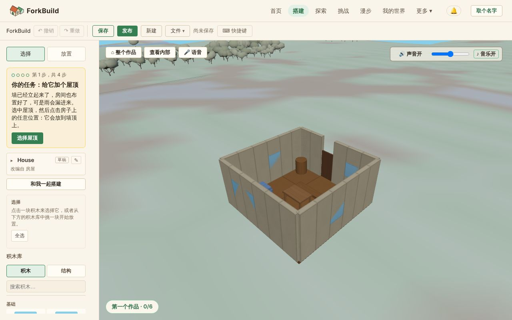

<!-- translation-of: docs/user/02-TheEditor.md source-hash: 97d2423119ec7afb -->
# 02 — 编辑器

<!-- languages -->
[English](../02-TheEditor.md) · [Deutsch](../de/02-TheEditor.md) · [Español](../es/02-TheEditor.md) · [Français](../fr/02-TheEditor.md) · [Bahasa Indonesia](../id/02-TheEditor.md) · [日本語](../ja/02-TheEditor.md) · [한국어](../ko/02-TheEditor.md) · [Português (Brasil)](../pt-BR/02-TheEditor.md) · **中文（简体）**
<!-- /languages -->

编辑器是你搭建的地方。这份指南介绍各种工具、如何选择和变换积木，以及如何用组来整理你的作品。

## 界面布局


*顶部是工具栏；左边是工具、作品名称、“选择”面板和积木库；中间是 3D 视图。*

```
┌─────────────────────────────────────────────────────────────┐
│ 工具栏：保存 · 发布 · 新建 · 导出 · 导入 · 最近 ·            │
│         ⌨ 快捷键                                            │
├──────────────────────┬──────────────────────────────────────┤
│ [选择 | 放置]         │                                      │
│ 作品标题          ✎  │                                      │
│ 选择                 │             3D 视口                  │
│ 积木库               │                                      │
│   [积木 | 结构]       │                                      │
│                      │                                      │
└──────────────────────┴──────────────────────────────────────┘
```

- **工具栏**——在电脑上，最前面是**撤销**和**重做**（触屏设备则在触控栏中），然后是**保存**、
  **发布**和**新建**，接着是**文件**菜单，其中有**导出**、**3D 模型**和**导入**；
  还可以重新打开最近的作品，以及打开 **⌨ 快捷键**浮层（也可按 `?`）。
- **工具**——在**选择**（`1`）和**放置**（`2`）之间切换。放置积木或结构时，**放置**会保持高亮。
  放置过程中再按**放置**（或 `2`），会保留你手上的东西。
  工具始终固定在侧边栏顶部，下面的内容可以滚动。
- **作品标题**——打开的作品的名称。点击 **✎** 可以编辑它的标题、描述和许可证。
  是否已保存显示在工具栏中。
  点击标题本身（**▸**）可以展开与世界视图中相同的**关于此作品**面板，长描述有**阅读全文**；
  **▾** 会再次收起，编辑器会记住你的选择。
- **选择**——只显示能作用于当前所选内容的操作；见下面的[“选择”面板](#选择面板)。
  在你放置东西时，它会让到一边，让积木库排在前面。
- **积木库**——一个搜索框和两个标签页。输入名称的一部分，或者用你自己的话说出需要什么：
  *我想过河*会找到桥，*睡觉*会找到床。每块积木和每个结构能被搜到的词语都随应用一起提供，
  所以不会发送任何东西。
  用键盘时，在搜索框中按下方向键会跳到找到的第一个东西，方向键在积木或结构之间移动，
  按 Enter 选中一个，与点击相同。
  滚动时，它的标签页和搜索框始终可见；点击**放置**会把积木库移到最上面。
  - **积木**——可以用放置工具放置的所有东西，以图块形式分为六个部分（基础、结构件、
    屋顶和楼梯、门窗、细节、自然）：共五十九种，从半高立方块、圆形积木和原木，
    到人字屋顶和圆锥屋顶、整块覆盖一座房子的四坡屋顶（4x4、4x6 和 6x6）以及长长的 2x4 人字屋顶，
    还有窗框和圆窗、栅栏、长椅、灌木和松树、供你走进去的房间使用的家具
    （在“细节”中有桌子、床、火炉和架子），以及在世界视图中会在夜里亮起来的**灯笼**
    （见[白天与黑夜](03-WorldView.md#白天与黑夜)）。
    小的积木在图片中看起来也小（**立方块**看起来比**方块 2x2**小），每块积木的尺寸写在名称下面：
    以网格单位表示的宽 × 深 × 高（**半高立方块**是 1×1×½）。
    点击一块即可选中它（并切换到放置工具）；随后会出现一个**颜色**色块用于选择颜色——见下面的
    [积木颜色](#积木颜色)。
    **45° 斜坡**、**缓坡 2x1**、**台阶**、**宽台阶**和**斜撑 2x2**会朝一侧升高；
    旋转两次（**R**、**R**）即可让它朝向另一边。一根斜撑和一根旋转了 180° 的副本可以组成一个叉形。
  - **结构**——二十二个现成的结构，分布在五个类别中（住宅、农业、商业、社区、基础设施），
    另有三个较大的**精选**作品，再加上你自己的**我的结构**。点击一张卡片即可放置它——见下面的
    [结构：组合、改编和你的个人库](#结构组合改编和你的个人库)。

### “选择”面板

这个面板会随所选内容而变化，所以它从不显示还不能起作用的按钮：

- **未选择任何东西**——一条简短提示、**全选**、复制过东西后的**粘贴**，以及你的组
  （点击一个组即可选中其中的积木）。
- **选中了积木**——数量、位置、一行**移动**按钮（向**左**、**右**、**前**、**后**、**上**或**下**一步，
  与方向键和 Page Up/Down 相同），以及日常操作：**向右转 ↻ / 向左转 ↺**、**复制一份**、
  **删除**、**复制**、**粘贴**、**给所选上色**、**聚焦**和**取消选择**。选中东西时，
  侧边栏会把这张卡片滚动到视野中，即使你正在积木库很下面的位置。较少用的工具收在下面的三个部分中：
  **精确位置和旋转**、**对齐、分布、重复**，以及**组和蓝图**。
- **选中了一个结构实例**——改为显示它自己的卡片，包括它的位置、旋转和操作（见
  [结构实例](#结构实例一个实时引用)）。

> **提示：** 在任何地方按 `Ctrl/Cmd+K` 都能打开**命令面板**——一个可搜索的列表，
> 包含本指南中的所有操作，可以按名称或你会用的词语查找：*颜色*会找到**给所选上色**，
> *音乐*会找到声音，*镜头*会找到**查看整个作品**，**保存**、**发布**、**导出**和各种工具也都在里面。

## 马上试试：一座等你完成的房子

首页的**马上试试**会打开一座属于你、但还没完成的房子：墙已经立起来了，房间也布置好了，
但还没有屋顶。工具上方的一张卡片会一步一步地给你任务（**第 1 步，共 4 步**），
每一步都有一个按钮，会选好需要的积木并切换到放置：

1. **给它加个屋顶**：点击**选择屋顶**（**四坡屋顶 6x6**），然后点击房子上的任意位置：
   屋顶会放到墙顶上。
2. **烟囱**：点击**选择烟囱**，然后点击房子上的任意位置：它会穿过火炉上方的屋顶。
3. **通往门口的小路**：点击**选择石头**，然后在房子上任意位置点击四次：石头会从门阶开始排开。
4. **花园**：点击**选择灌木**，然后在房子周围随意放四样东西。积木库中的灌木、栅栏、
   草坪、岩石、树或灯笼都算。

每一步都会统计你添加的积木，不限顺序，撤销会退回一步。任务进行时，**你的第一个作品**卡片会收起等待，
这样同一时间只有一套说明。四步全部完成后，卡片会说这座房子现在是你的了，并提供
**发布它**（与工具栏中的“发布”相同，你也可以随时使用）和**继续搭建**（会把卡片收起来）。

其他所有现成作品（首页的卡片、挑战中的创意，或在编辑器的**新建**下选择的作品）
打开时会显示**让它成为你的**卡片。点击**选择树**（它会选中一棵树并切换到放置），
然后点击作品旁边的地面。一旦其中有了你自己的东西，卡片就会以同样的方式提供**发布它**。
在手机上，这张卡片会浮在 3D 视图上方、触控按钮之上，因为那里的工具是收起来的。

## 你的第一个作品

第一次在某台设备上打开编辑器时，3D 视图左下角会有一张**你的第一个作品**卡片
（在手机上，它一开始收起成左上角一个小小的**第一个作品 · 0/6**按钮；当**马上试试**的房子任务进行中时，
它也会收起等待）。它列出六个步骤，并为下一步显示提示：

1. **放置一块积木**
2. **把一块叠到另一块上**：把一块积木放到另一块上面。
3. **加点你自己的东西**：一次一块，放五块你自己的积木。从积木库中放入的结构不算。
4. **保存你的作品**
5. **发布并分享链接**：发布，然后点击**复制链接**或**分享…**。
6. **走进去**：点击发布后显示的链接旁边（或卡片中）的**走进去**，在世界视图中从作品的门口走进去（见
   [走进去](04-PublishingAndForking.md#走进去)）。

每完成一步就会打一个勾，不限顺序；撤销和重做不算。六步全部完成后，卡片会庆祝一下，
并提供**看看其他作品**或**继续搭建**，然后消失；如果在“走进去”成为步骤之前就已经完成，它不会再出现。
**放置**开启时，卡片会缩小为下一步的提示，不挡住你正在搭建的东西；**+** 显示所有步骤，
回到**选择**时它会再次完整展开。
**–** 会把它收起成小按钮；**隐藏引导**会在此设备上永久隐藏它。要让它回来，
请打开命令面板（**Ctrl+K**）并运行**首次搭建引导**。已经有保存作品的设备一开始就会隐藏引导。

## 两种工具

### 放置工具（`2`）

从面板中挑一块积木，把鼠标移到视口中，点击即可放置。还没有挑选积木时，放置会从**立方块**开始，
所以第一次点击总会放下东西。一个半透明的预览会准确显示积木将落在哪里。
把鼠标悬停在已有积木的面上，即可堆叠或贴附。放在另一块积木上面的积木，会落在它下方最高的积木上，
而不是嵌进去：放在房子地板中间的屋顶会落在墙上，横跨两根木桩的横梁会落在木桩上。

只有点击才会放置：按下后不移动就松开。拖动来环顾四周（用任何按键）只会移动镜头，不会放置任何东西，
所以你可以一直开着放置，转动作品寻找下一个位置。

**Shift+拖动**可以摆成一排：按住 Shift，在第一块积木的位置按下，然后沿着地面或墙顶拖动。
预览会以积木的颜色和朝向显示整排积木，首尾相接；松开即可放置，撤销时算一步。
这一排会沿你拖得更远的方向延伸，高度与第一块积木相同。如果其中任何一个位置被占用，
预览会变红，什么都不会放置；拖动时按 **Escape** 可以放弃这一排。

在作品中的某块积木上 **Alt+点击**（Mac 上为 Option+点击）即可拾取它：
它的类型、颜色、朝向和倾斜会成为你接下来要放置的东西，并且放置会打开，
所以下一次点击就会放下一块一模一样的积木。在选择工具下也能用，在空地上不会拾取任何东西。
在触屏上，改为用手指在积木上按住半秒不动。

数字键 **3** 到 **9** 各保存一块你最近选过的积木，就像快捷栏：你选的第一块积木占 3，下一块占 4，
以此类推；正在使用的积木会保留自己的按键（第八块会占用最久没用的那块的按键）。
按键显示在积木库中积木图块的角落里；按下它就能选中那块积木，并打开放置。此设备会记住它们。

在预览为红色的地方点击不会放置任何东西：编辑器会说有东西挡着，并发出一声轻轻的低沉敲击声，
让你知道该换个位置或转动一下积木。

放置开启时，视图左上角的一个标签会显示点击将放下什么：它的图片、名称，如果是积木还有颜色。
点击这个标签可以在积木库中换一个（在手机上会打开抽屉），点击 **✕** 则停止放置。

> **提示：** 按 **Escape** 切换回选择工具。

### 选择工具（`1`）

点击积木来选中它们，然后移动、旋转或删除。等大致形状搭好之后，你大部分时间都会花在这里。

## 选择积木

ForkBuild 让你能精确控制选择：

| 操作 | 结果 |
|---|---|
| **点击**一块积木 | 选中它（替换当前选择） |
| **Ctrl/Cmd + 点击** | 把这块积木加入或移出选择 |
| **Shift + 点击** | 把这块积木加入选择 |
| **Shift + 拖动** | 画一个框——选中框内的所有东西 |
| **Ctrl/Cmd + Shift + 拖动** | 框选并*加入*当前选择 |
| **Ctrl/Cmd + A** | 选中作品中的每一块积木 |
| **Escape** | 清除选择 |

只有在不拖动就松开时，按下才会选择。用拖动来转动或平移镜头，无论从哪里开始，都不会改变选择；
点击空地会清除选择。

> **为什么这很重要：** 搭建任何比单块积木大的东西，都意味着要同时处理*许多*积木。
> 尽早学会 Shift+拖动框选——这是抓起一整面墙最快的方法。

## 移动、旋转和删除

选中一块或多块积木后：

| 按键 | 操作 |
|---|---|
| **方向键** | 向左/右/前/后微移 |
| **Page Up / Page Down** | 向上 / 下微移 |
| **R** | 顺时针旋转 90° |
| **Shift + R** | 逆时针旋转 90° |
| **T** | 倾斜：翻到下一个侧面 |
| **Shift + T** | 向另一个方向倾斜 |
| **Delete / Backspace** | 删除所选积木 |

选中多块积木时，它们会绕着**共同的中心**旋转，所以整个部分会作为一个整体转动。

**拖动一块已选中的积木**即可把整个选择沿地面移动，并吸附到网格，与操纵器中心的方块一样：
撤销时算一步，如果移动后会落在另一块积木上，就会退回原处。在它上面点击而不拖动，
只会选中那一块积木；在其他任何地方拖动则会转动镜头。

**T** 会把每块所选积木原地翻到下一个侧面：一根木桩会躺下变成横梁，一面墙会变成地板，
一个斜坡会倒过来变成悬挑。每块积木的底部保持在同一高度，倾斜在撤销时算一步。
按四次会让积木重新立正。放置时，**T** 会改为倾斜你将要放置的积木。已放置的结构可以旋转，但不能倾斜。
旧版本的 ForkBuild（1.3.0 及更早）会把倾斜的积木显示为直立的。

## 积木颜色

每种积木都有自己的默认颜色，但你可以选择自己的颜色：

- **放置之前**——在积木库的**积木**标签页中选中一块积木后，点击它的**新积木的颜色**色块，
  选一种颜色。从那以后你放置的每块积木都会使用它，放置预览也会显示这个颜色。
  换成另一种积木会恢复为该积木自己的默认颜色，直到你再次选择颜色。
- **放置之后**——选中一块或多块积木，使用**选择**部分中的**给所选上色**色块，一次性为它们全部重新上色。
  它打开时会显示积木当前的颜色，并标出它们属于哪种村庄配色。选中积木时，积木库中“新积木的颜色”
  会让到一边，所以视野中的颜色就是用来给它们上色的颜色；选中的积木会有蓝色轮廓，并保留它自己的颜色，
  让你看到你选了什么。每次更改都和其他编辑一样可以撤销（`Ctrl/Cmd+Z`）。
  选中结构实例时不提供这个色块——请改为编辑该结构自己的作品（见下面的
  [结构实例](#结构实例一个实时引用)）。

每个**颜色**色块旁边都有一排彼此搭配的**村庄配色**（灰泥、石灰、砖红、屋顶红、橡木、叶绿、天蓝等）：
点击一下即可选中一种，用于接下来的积木或所选内容。色块仍然允许你选择任何颜色。

积木的颜色会和作品一起保存，并在你发布或分享时随作品一起传递。

## 精确变换：数值输入、对齐和重复

“选择”面板中收起的部分提供了更精确的移动方式，与操纵器和上面的按键一起使用：

- **精确位置和旋转**——输入精确的 X/Y/Z/旋转数值，而不是拖动。切换**绝对值**
  （数值是所选内容轴心/朝向的目标）或**偏移**（数值作为增量叠加），然后按**应用**
  （或在输入框中按 `Enter`）。空的输入框表示“保持不变”，而不是零。**重置输入框**会清空输入框，
  不影响所选内容。
- **对齐与分布**（在**对齐、分布、重复**下）——九个按钮，用于让整个所选内容的边缘或中心
  沿某条世界轴对齐（左/中/右、底/中/顶、前/中/后），另有三个按钮用于均匀分布（X/Y/Z 均匀分布）。
  对齐需要选中 **2 块以上**积木；分布需要 **3 块以上**。
- **重复**（同样在**对齐、分布、重复**下）——沿一条轴、以相等间距再制作 **N** 个所选内容的副本。
  如果有任何副本会发生碰撞，就一个副本也不会制作。

这些操作都是**一步撤销**，与操纵器拖动或键盘微移完全一样——每个输入框的完整行为见
[操作参考](ControlsReference.md#变换--数值面板仅编辑器)。

“选择”面板中的**聚焦**按钮会让镜头对准所选积木，不改变任何东西。

> **碰撞会被阻止。** 拖动操纵器或用键盘微移时，会把结果与所选内容之外的每块积木进行检查。
> 如果松开后任何成员会压在其中一块上，整个移动都会被取消而不是确认——所选内容中的每块积木
> 都会弹回原来的位置，也不会新增撤销记录。在你*自己的*所选内容内部重新排列积木
> （比如用旋转交换两块积木的位置）从不被视为碰撞。

## 复制、粘贴和复制一份

| 按键 | 操作 |
|---|---|
| **Ctrl/Cmd + C** | 复制所选积木 |
| **Ctrl/Cmd + V** | 粘贴（稍微错开一点，以便你能看到） |
| **Ctrl/Cmd + D** | 原地复制一份所选内容——一步完成复制和粘贴 |

先复制再粘贴非常适合重复的元素——搭好一扇窗户，然后在整面墙上复制粘贴。
**复制一份**用一个动作、一步撤销完成同样的工作，而且不会改动你的剪贴板：
之前用 Ctrl+C 复制的内容仍然在那里，复制一份别的东西之后还可以粘贴。
复制出的副本会成为你新的选择，所以自然的流程是：选择 → 复制一份 → 拖动或微移到位。
“复制一份”适用于任何选择——散落的积木、一个完整的组，或者单个
[结构实例](#结构实例一个实时引用)。

## 撤销和重做

每一次更改都会被记录，所以你总能退回去：

| 按键 | 操作 |
|---|---|
| **Ctrl/Cmd + Z** | 撤销上一步操作 |
| **Ctrl/Cmd + Y** *（或 Ctrl/Cmd+Shift+Z）* | 重做 |

在电脑上，**撤销**和**重做**也是工具栏中最前面的两个按钮。把鼠标指向其中一个，
就能看到它会收回或放回哪一步（*撤销为 5 块积木重新上色*）。

移动十块积木算作**一步**撤销，所以即使是很大的作品，撤销也不会变得难以管理。

一起搭建时（**和我一起搭建**，见下文），撤销只会收回你自己的步骤，从不收回朋友的步骤，
而且在所有人的屏幕上同时生效；重做会把它们放回去。如果朋友在那之后修改了你那一步的结果
（比如删除了你放的积木），那一步就会被跳过，编辑器会提示你。有人加入时，每个人的撤销都会从那里重新开始：
新加入的人从来没有之前的那些步骤。

## 组

组可以让你给一批积木命名并重复使用——比如“屋顶”或“窗户”。

**创建组：**
1. 选中一些积木。
2. 打开“选择”面板的**组和蓝图**部分，点击**新建组**。会出现一个输入框请你命名，并推荐一个名字
   （*组 1*）；输入你的名字，然后按**建组**或 `Enter`。新的组会被选中，可以使用下面的按钮。

**使用组：**点击列表中某个组的名称即可选中它（以及它的积木）——未选择任何东西时，
列表在“选择”面板中；否则在**组和蓝图**中。以下按钮作用于当前选中的组：

| 按钮 | 作用 |
|---|---|
| **重命名组** | 在同一个输入框中更改组名（或在列表中双击它的名称） |
| **复制组** | 复制整个组*以及*其中的积木 |
| **删除组** | 删除组（积木本身会保留） |
| **加入组** | 把当前所选内容加入这个组 |
| **移出组** | 把当前所选内容移出这个组 |

> **须知：** 选中一个组只是选中它的积木——永远不会改变组。删除组也只会移除*标签*，
> 而不会删除其中的积木。

## 结构：组合、改编和你的个人库

积木库的**结构**标签页（见上面的[界面布局](#界面布局)）提供二十二个现成的结构——房屋、谷仓、
水井、集市、磨坊、桥等，分布在五个类别中——还有三个较大的**精选**作品（城堡、港湾小岛和村庄广场），
再加上**我的结构**，即你从作品中保存的任何东西的个人收藏。对其中任何一个，你都可以做三件不同的事，
它们各有用处：

- **放置**（点击卡片）——把结构的积木直接复制到你正在做的作品中，让它成为一个更大作品的一部分。
  这是日常操作。
- **改编为新作品**（在卡片的 **⋮** 菜单中）——开始一个全新的独立作品，一开始与该结构完全相同。
- **改编到“我的结构”**（仅内置卡片，在 **⋮** 菜单中）——把结构加入你自己的**我的结构**，
  完全不涉及任何作品。见下面的[我的结构](#我的结构你的个人蓝图库)。
- **信息**（在卡片的 **⋮** 菜单中）——只读查看结构的名称、类别、积木数量、占地、高度、来源和描述。
- 把你自己**已保存的作品**作为**结构实例**放置——一个实时、可重复使用的引用，而不是副本——
  要从工具栏的**最近**下拉菜单中放置，而不是从积木库。见下面的
  [结构实例](#结构实例一个实时引用)。

### 把结构放进你的作品

点击**结构**标签页中的任意卡片——内置的，或你自己**我的结构**中的——整个结构的半透明预览就会出现，
跟随你的指针在地面上移动，与放置单块积木完全一样：

1. 移动指针来摆放预览。
2. 按 `R` / `Shift+R` 以 90° 为单位旋转。
3. 点击放置——结构中的每块积木都会作为**一步撤销**加入你的作品。结构仍然在手上，保持同样的朝向，
   所以之后每次点击都会再放一个。被占用的位置会把预览染成红色；在那里点击不会放置任何东西，
   编辑器会提示有东西挡着。
4. `Escape`（或选择工具，或触屏上的**取消**）会停止放置——不会再添加任何东西，并切换到选择工具。

指向一块积木的顶部，结构就会改为放在那里，落在它下方最高的积木上：平台上的棚屋、屋顶上的烟囱，
就像宽积木落在墙上一样。指向地面或积木的侧面时，它会立在地面上。

你得到的积木从落下的那一刻起，就是你作品中的普通积木——与你手动放置的东西毫无区别，
可以像其他东西一样自由编辑、选择、编组或删除。放置几个结构是搭建场景的快捷方式：
点击房屋，放下；点击谷仓，放在旁边；点击水井，放在院子里。

### 把结构改编为新作品

打开卡片的 **⋮** 菜单，点击**改编为新作品**，即可开始一个属于你的全新作品，一开始与该结构完全相同——
完全相同的积木，可以用本指南中的每一种工具编辑，而且是一个独立的作品，而不是并入你当前打开的东西。
改编永远不会改变积木库自己的那一份：把房屋改编十次，从你点击“改编”的那一刻起，
每一个都是各自独立的作品。

### 我的结构：你的个人蓝图库

搭了值得重复使用的东西？选中组成它的积木（整座建筑，或者只是其中一部分），然后点击**创建蓝图**——
选中积木后，它在“选择”面板的**组和蓝图**部分中，命令面板（`Ctrl/Cmd+K`）中也始终有它。
一个小对话框会请你输入**名称**、**类别**和可选的**描述**，并实时预览你将要保存的内容；
点击**创建蓝图**，它就会以自己的局部原点为基准，立即保存到**我的结构**中——
这是结构标签页底部、紧接在内置类别下面的一个新部分。

还有第二种方式能让结构进入“我的结构”，不需要选择也不需要先搭建任何东西：打开任意**内置**卡片的 **⋮** 菜单
并点击**改编到“我的结构”**。它会原样加入——不创建作品，也不提取任何东西——所以可以马上
重命名、导出或放置，就像库中的其他条目一样。

**我的结构**中的结构与内置结构的用法完全相同——点击即可放进当前作品，或者“改编为新作品”——
它的 **⋮** 菜单中还多了两个操作：

| 操作 | 作用 |
|---|---|
| **重命名** | 更改它的名称（类别和描述保持不变） |
| **移除** | 从你的库中删除它；随后会在库顶部显示几秒钟的**撤销**，可以把它放回去 |

**我的结构**只保存*结构本身*——一个名称和一组积木。移除一个结构永远不会影响你已经用它搭建的东西：
你已经放置或改编它的每个地方都会原样保留那些积木。而且它从不原地编辑——如果你想改变已保存的结构
实际搭出来的样子，请把它放进一个作品、编辑那个作品，然后再次**创建蓝图**
（可以起个新名字，比如“豪华农庄”——它会成为“我的结构”中单独的新条目，而不是替换原来的那个）。

> **须知：** “我的结构”保存在此设备上。它不与你的身份绑定，也不会自动同步到任何地方——
> 关于如何把它转移到另一台设备或交给别人，请见下面的
> [分享蓝图](#分享蓝图导出和导入)。

### 分享蓝图：导出和导入

任何结构——内置的或你自己的——都可以作为可携带的文件离开它所在的设备，而不必成为共享的已发布世界的一部分：

- **导出蓝图**（在任意卡片的 **⋮** 菜单中）会把它下载为一个小的 JSON 文件——包含该结构的名称、
  类别、标签、描述和积木的独立快照。
- **导入蓝图**（**我的结构**标题旁边的按钮）会读回一个蓝图文件，并把它作为一个新的独立条目
  加入你自己的“我的结构”——一份拥有自己身份的全新副本，从不与它的来源相关联。
  同一个文件导入两次会得到两个独立的条目，而不是一个悄悄覆盖另一个。格式错误或无法识别的文件
  会被拒绝并给出说明，而不会悄悄生成损坏的东西。

这就是把作品交给朋友，或在你自己的设备之间携带结构的方法：在一边导出，用你喜欢的任何方式发送文件，
在另一边导入。

**全部导出**（有了你自己的结构后，在**导入蓝图**旁边）会把“我的结构”中的所有结构下载为一个文件，
每个结构都附带它的署名和来源声明。**导入蓝图**也能读取这个文件，并会跳过“我的结构”中已有的设计，
所以导入两次不会产生重复。如果还想保留其他所有内容的副本，请使用[你的数据](13-YourData.md)。

### 声明作者身份

拥有蓝图身份的结构（大多数已保存的结构都有）还可以带有**社区署名**——一份签名的记录，
说明谁声称设计了它。从卡片打开结构的**信息**面板，你会看到：

- **声明作者身份**——以你当前的身份签署一份声明，表明你是它的作者之一。
  几个人可以各自独立地声明同一个设计；任何人的声明都不会覆盖或取代别人的。
- **导出署名** / **发布到网络**——声明之后，可以把这份声明作为文件分享，或公告给已连接的对等节点。
  **发布到网络**之后，面板会提供**分发**，把声明也放到去中心化网络上（见
  [分发](Distribution.md)）。
- **为此设计重新签名**——2026 年 9 月 28 日之前做出的声明使用的是一种较旧的设计指纹，
  别的设计可以仿冒它，所以这些声明不再计入，面板会说明有多少条。如果其中一条是你的，
  而且这确实是你的设计，这个按钮会重新签署你的声明。请先检查设计：任何共享旧指纹的设计都会显示这个按钮。

这是可选的，而且与放置、改编或分享结构本身完全无关——它的存在是为了让你能以别人可以独立验证
（而不仅仅是相信）的方式，把你的名字附在一个设计上。关于发布后声明会怎样，以及如何为它附上独立的外部证据，
请见[签名记录与外部证据](09-PublicationsAndEvidence.md)。

## 结构实例：一个实时引用

放置（见上文）会把结构的积木一次性复制到你的作品中。但有时你想要的是你已经搭好的某样东西的**实时**副本——
任何已保存的作品，而不只是你库中的东西——每次查看时都与源头保持同步。这就是**结构实例**：
它引用源作品，而不是复制它的积木，所以以后编辑源作品时，它的每个实例都会自动更新。

1. 打开工具栏中的**最近**下拉菜单。（保存过至少一个作品后它才会出现。）
2. 在任意已保存作品旁边点击**放置**。点击作品名称则会打开它，替换你当前打开的内容。
3. 把鼠标移到地面上，按 `R` 旋转，点击放置——与放置积木完全一样。

实例是对那个作品的实时*引用*，而不是它积木的副本：同一个作品可以放置任意多次，以后编辑源作品的积木，
它的每个实例都会更新。用选择工具（`1`）选中一个实例，侧边栏会显示：

| 控件 | 作用 |
|---|---|
| 在视口中拖动，或使用[操纵器](InteractiveTransformGizmo.md) | 移动 / 旋转，与积木相同 |
| 方向键 / Page Up / Page Down | 微移 |
| **X / Z / 旋转 ° 输入框，然后点“应用”** | 设置精确的位置和朝向——高度（地面 Y）始终跟随地形，不是可以设置的目标 |
| **向右转 ↻ / 向左转 ↺** | 精确转动 90° |
| **复制一份**（`Ctrl/Cmd+D`） | 再放置一个相同结构的实例 |
| **删除** | 移除这个实例——源作品不受影响 |
| **编辑源作品** | 打开被引用的作品本身，改变它所有实例的外观 |

**向右转 ↻ / 向左转 ↺**、`R` 和**旋转 °**输入框只会在放得下的时候转动实例：
如果转动会撞到东西，它会保持原样，并发出声音和提示。（操纵器会把受阻的转动显示为红色并复原。）

编辑已放置结构的*内容*，总是通过编辑它的源作品来完成——无法直接编辑实例的积木，
正因如此，它的每个实例才能保持同步。

## 作品属性

每个作品都有一个**标题**、一个可选的**描述**、一个**许可证**，以及一个**谁可以把它放到世界中**的设置——
在**作品属性**对话框中设置它们，用编辑器侧边栏顶部作品标题旁的 **✎** 按钮打开
（在世界视图中则是**编辑元数据**按钮）。新作品一开始没有许可证，这意味着在你选择许可证之前，
其他人都不能改编它。描述会作为摘要显示在“探索”中它的卡片上，也可以在那里被搜索到；
许可证控制其他人是否可以以及如何改编它。每种许可证的含义请见
[发布与改编](04-PublishingAndForking.md)。

标题下方的**推荐标题**和**推荐描述**按钮会根据作品的积木提供建议：它用到的积木库结构、
主要部分和颜色，以及（如果是改编）它在原作品基础上增加了什么（*带谷仓的磨坊与粮仓*）。
再按一次**推荐标题**会给出下一个建议。推荐的描述会填入空的描述，或者接在你写的内容后面。
它们只是在你的设备上生成的建议；随你修改。

长描述稍加格式会更易读，**关于此作品**面板、世界视图的位置浏览器以及 Steem 和 Blurt 帖子都会显示这些格式：

| 写法 | 效果 |
|---|---|
| 空一行 | 新段落（单个换行仍然是换行） |
| 行首的 `## 材料` | 标题 |
| 行首的 `- `（或 `* `） | 项目符号列表项 |
| `**文字**` | **粗体** |
| `*文字*` | *斜体* |
| `\*`、`\#`、`\-` | 字符本身 |

其他都不是格式：链接、图片和 HTML 都保持为纯文本。“探索”中的卡片会把描述的文字显示在一行中，不带格式。

**标签**说明作品是什么，比如 `japanese temple garden`：最多 5 个，用空格或逗号分隔，
每个标签由小写字母、数字和连字符组成（重音会被去掉，所以 `café` 会变成 `cafe`）。
作品没有标签时，对话框会根据标题和描述在输入框中填入建议，你可以保留、修改或清除；
输入框下方的按钮可以添加其他建议。改编会保留原作的标签。Blurt 帖子会把它们列在 ForkBuild 自己的标签之后，
这样在 Blurt 上按标签浏览的人就能找到你的作品。

## 声音

你做的每一种更改都有自己的短音效，所以不用看就能听出发生了什么：放置积木或结构时“咔嗒”一声，
移除时“啵”的一声，移动时“嘀”一声，转动时“嘀嘀”两声，粘贴或复制一份时一串快速的哔哔声，
换新颜色时一声清脆的叮，编组时两个音符，为地点命名时一声铃响，撤销时一声下降的哔声，重做时一声上升的哔声，
保存时一个小和弦。合作者在同一作品中所做的更改是无声的。

用视图右上角的**声音**按钮或按 `M`（列在键盘快捷键浮层 `?` 中）关闭或打开声音；
旁边的滑块用来调节音量。这与世界视图中的设置相同，会记在此设备上。
按照浏览器的要求，声音会在你第一次点击或按键后才开始。

在手机或触屏上，“声音”是**查看内部**和**语音**旁边的小小的 🔊 按钮，以免挡住你的作品：
轻点它会显示声音和音乐按钮，音量请用设备自己的音量键调节。

搭建时会轻轻播放音乐，比世界视图中的稍微活泼一点。滑块旁边的 **♪ 音乐**按钮可以关闭或打开它；这与世界视图中的选择相同。

## 保存、发布、重新开始

- **保存**（`Ctrl+S`）——把你的作品保存在此设备上。在作品第一次保存之前，工具栏会显示**尚未保存**。
- **发布**——与所有人分享（见[发布与改编](04-PublishingAndForking.md)）。发布也会同时保存。
  从现成作品开始、但还没有任何你自己东西的作品，会被询问一次：**继续搭建**，还是**仍然发布**。
  之后的提示是一个横条：**走进去**和**复制链接**，**更多分享方式**中有链接本身、**保存图片**、
  **制作视频**和**嵌入**。如果你发布时使用的身份是刚创建的，添加密码短语的提醒会等到你下次发布时出现。
- **新建**——开始新的东西：一块**空地**，或者把某个现成作品（城堡、港湾小岛、村庄广场、房屋、
  磨坊和桥）作为你自己的副本打开，并显示完整全貌。如果当前打开的内容有未保存的更改，
  “新建”会先提示；如果想保留它们，请先保存。
- **文件**——一个菜单，里面还有三项：
  - **导出**——把当前作品下载为 JSON 文件，以便保留副本或转移到另一台设备。
    文件使用把积木存储为表格的紧凑格式。
  - **3D 模型**——把作品下载为 3D 模型，供其他软件使用（见[下载 3D 模型](#下载-3d-模型)）。
  - **导入**——把导出的文件作为一个拥有自己身份的新作品打开；在你**保存**之前不会保留任何东西。
    旧版本导出的文件仍然可以打开（加载时会转换），但 ForkBuild 1.0.0 及更早版本无法打开这个版本导出的文件。
  如果作品是你做的，**导出**会为文件签名，这样导入它的人就可以信任其中的名字和许可证。
  你自己的作品导入后还是它自己。别人的作品在其许可证允许改编时，会作为你自己的副本打开，并为对方署名；
  如果许可证不允许，或者文件在作者签名后被修改过，就不会被导入。别人的作品如果所在的文件上没有对方的签名
  （由他人转手的文件，或者作者在未登录名字时导出的文件），也不会被导入，因为任何人都可能写了它的许可证：
  请让作者为你导出，或者在它的发布页面上使用**编辑副本**。你和作者一起搭建的作品，
  只有从作者本人的导出中才会原样打开。没有注明作者、或注明作者是你的文件，会作为你的作品打开，
  但除非上面有你自己的签名，否则它的信息中会显示**从无法显示作者的文件导入**，
  在它的每一个副本上、以及它被发布的任何地方都是如此。文件携带的是导出时作品的许可证，
  所以你可以把作品以**保留所有权利**发布，同时仍然给某人一份可以在上面继续搭建的副本：
  在**作品属性**中选择另一个许可证，导出，然后再改回来。
  **最近**下的**导出所有作品**及其**导入**也是同样的方式。
- **最近**——重新打开你以前保存的东西（第一次保存后才会出现；点击作品名称即可打开）。
  保存的作品足够多时，会出现一个筛选框，让你按名称直接跳到某个作品。每个条目还有一个**放置**按钮——见
  [结构实例](#结构实例一个实时引用)——用于把它加入你*当前的*作品，而不是替换当前作品。
  底部的**导出所有作品**会把所有已保存的作品下载为一个文件；**导入**会读回它，
  保存此设备上没有的作品（从“最近”中打开它们），跳过此设备上已有且未改变的作品，
  并为此设备上有不同版本的作品在旁边另存一份副本。未保存的更改不包括在内，所以请先保存。

## 和我一起搭建：实时一起搭建

侧边栏中作品名称下方的**和我一起搭建**会生成一个链接，让朋友和你同时搭建这个作品。
用你喜欢的任何方式发送它；它也会显示为二维码，方便用手机扫描。打开链接的朋友如果还没有名字，
需要先取一个（他们的积木会以他们的名字加入），然后点击**加入**，你的作品就会在他们的编辑器中打开。
从那时起，你们任何一方放置、移动、重新上色或删除的每块积木，都会出现在两边的屏幕上。

- 视图上方的一个横条会显示谁在搭建，每个人有自己的颜色；你们每个人都能以对方的颜色
  看到对方指着哪里、选中了什么。
- **撤销**（`Ctrl/Cmd + Z`）会在所有屏幕上收回你自己的上一步，**重做**会把它放回去；
  朋友的步骤由他们自己撤销。
- 必须是你自己的作品：你开始的作品，或者你制作的副本。你在取名字之前开始的作品，
  会在你邀请朋友时成为你的作品。
- 在链接生成后 30 分钟内打开它的任何人都可以加入，前提是作品一直在你的编辑器中打开着。
  所有加入的人都可以一直搭建，直到你按下**停止**、打开另一个作品或离开编辑器。
  横条中的**链接**会再次显示链接。
- 每个朋友的编辑器都保留自己的副本，保存在他们的设备上。你停止后，他们可以保留它，
  但他们的更改不会再传给你。没有放过积木的朋友不会获得署名，所以他们的副本仍然是你的作品：
  从备份恢复时，它与其他人的作品一样遵循作品的许可证。
- 积木被你的作品收入的每个人都会在作品上获得署名：作品的面板会显示**合作搭建者**和他们的名字；
  你发布时，分享链接和家族树也会在你的签名下注明。每个朋友的副本显示同样的署名。
  别人从它制作的副本一开始没有这些署名；那是他们的新作品。
- 每个署名的名字以及分享作品的作者都会打开那个人的页面：其身份签名的作品，以及别人为其署名的作品。
  在家族树中，每个作品的标题会打开该作品，作者和合作搭建者的名字会打开他们的页面。
  **我的世界**会列出**你参与搭建的作品**，即朋友为你署名的作品，每个作品发布后都可以打开它的世界；
  你的其他设备在与这台设备连接过（或获得过你数据的副本）后也会列出它们。
- 加入会把你们两台设备直接连接起来，与**和我一起在这里漫步**相同：你们都能看到对方的 IP 地址。
  除非你选择，否则没有人会成为已知对等节点或好友。它需要会合服务器；官方网站有一个。

## 下载 3D 模型

工具栏**文件**下的 **3D 模型**会把当前打开的内容下载为其他 3D 软件可以打开的文件，
在此设备上生成（不会上传任何内容）：

- **glTF (.glb)**——彩色。可以在 Blender、Windows 3D 查看器、Godot 和 Unity 等游戏引擎
  以及在线模型查看器中打开。ForkBuild 的一个单位是一米。
- **用于 3D 打印 (.stl)**——单色，以毫米为单位、比例 1:100（一扇门高 20 毫米，一个立方块 10 毫米），
  Z 轴朝上并立在打印平台上，所以切片软件（Cura、PrusaSlicer、Bambu Studio……）
  打开后即可打印；如果想打印得更大，请在那里缩放。相互接触或重叠的积木保持为独立的部件，
  切片软件在切片时会把它们合并。
- **OBJ (.obj)**——彩色（以顶点颜色表示），适用于较旧的软件。

每块积木都保留它在 ForkBuild 中的确切形状和颜色；你放置的结构如果在此设备上，也会一并导出
（如果有缺失，提示会说明）。每个文件都注明作品、作者、许可证以及它改编自什么：
在 glTF 的版权和附加信息中、在 STL 文件头中，以及作为 OBJ 中的注释。
分享作品自己的页面在其许可证允许复制时，也会提供同样的下载（见
[链接会打开什么](04-PublishingAndForking.md#链接会打开什么)）。

## 描述作品

按 `I`，或在命令面板中选择**描述作品**，编辑器就会说出你的作品由什么组成：多少块积木、
大约多宽多深多高、其中有哪些积木库结构、其余积木中有哪些窗户、门、屋顶、树和其他部分，
以及它的主要颜色（以村庄配色命名）。屏幕阅读器会朗读它；它也会一直留在 3D 视图顶部，
直到你按下**关闭**——这是不用转动镜头就能检查作品的快捷方式。它在你的设备上根据积木计算，
所以不会发送任何东西。作品在分享链接和嵌入中的图片也为屏幕阅读器附带同样的描述。

## 用日常语言下命令

在命令面板（`Ctrl/Cmd+K`）中用你自己的话输入想做的事，比如*把屋顶涂成红色*、*选择所有窗户*、
*删除树*或*把它涂成浅蓝色*，第一行**根据你的描述**会说明它将做什么、作用于多少块积木：
*把 4 扇窗涂成港湾蓝*。按 `Enter` 或点击它，就会以可以撤销的一步完成。
它能理解上色、选择和删除；作品的各个部分（窗户、门、屋顶、楼梯、拱门、栅栏、烟囱、家具、灯笼、
树、灌木、岩石和草坪）、*所有*，或你选中的东西（*这个*、*这些*）；以及按村庄配色名称或日常说法
（*红色*、*深灰色*、*浅蓝色*）表示的颜色。它在 ForkBuild 支持的每种语言中都能用，在你的设备上运行；
你输入的其他内容会像以前一样搜索操作。

## 说出命令（语音）

按 `V`，或点击 3D 视图顶部的 **🎤 语音**，然后说出你想做的事：*把屋顶涂成红色*、*选择所有窗户*、
*删除树*、*撤销*。说完后按 `V`（或**停止**）；ForkBuild 会说出它听到了什么、做了什么，
以可以撤销的一步完成。它能理解与[用日常语言下命令](#用日常语言下命令)相同的请求，
以及任何按名称说出的操作。一个问题（*怎样邀请朋友？*）会出现**询问指南**。

语音从不发布、导出、导入、开始新作品或制作蓝图：一个听错的词绝不能把你的作品发送到任何地方，
或者做撤销无法收回的事。这些请手动完成。还有，请说出要做什么：*把屋顶涂成红色*，
而不只是*屋顶红色*。

第一次使用时，它会说明开启语音需要一次性下载什么，约 107 MB：来自 Hugging Face 的小型语音模型（Whisper）
和来自 jsDelivr 的引擎。它们保存在这个浏览器中，所以之后离线也能使用语音。你说的话在你的设备上录制和理解，
从不发送到任何地方（见[隐私](Privacy.md)）。任何命令之后，语音面板中都有**关闭语音**和**删除语音模型**。
它听的是 ForkBuild 当前显示的语言。

它对英语识别最好。在其他语言中，小型语音模型仍会听错许多命令，语音会在你开启之前说明这一点；
听错的命令通常不起作用，所以请再说一遍或手动操作。在德语、法语、印度尼西亚语、日语、韩语和葡萄牙语中，
会先把 ForkBuild 能理解的词语告诉模型，这能帮助它听对更多命令，但每次会多花一秒左右。
口头说出的命令，只有在你明确说出时（*把这个涂成红色*）才会作用于你选中的东西：
如果你说的部分被听错了，它什么也不会做，而不是给你的选择上色或删除它。

世界视图也能听（见[说出要去哪里](03-WorldView.md#说出要去哪里语音)）。语音模型在后台工作，
所以它聆听时视图从不卡顿；在两者之间切换时，它会一直保持加载。

## 镜头控制

- **拖动**——环绕场景
- **滚动**——放大和缩小
- **Home**，或视图左上角的 **⌂ 整个作品**——查看整个作品（作品为空时显示起始视角）。
  在命令面板中它是**查看整个作品**。

作品打开时从斜上方俯视，完整地框在画面中。镜头会停在地面稍上方，所以作品和你放置积木的地面都保持在视野中。

### 查看内部

视图左上方的**查看内部**（在手机上是右上方的**工具**下）会把作品一层以上的部分剖开，
就像你在世界视图中走进去时一样：墙只立到大约头部高度，房间连同家具从上方显示出来。
照常在里面搭建：点击会穿过被剖开的部分。**显示完整**会重新画出全部内容。不会删除任何东西；
只是画出的内容不同。

## 在手机或平板上

编辑器支持触控操作。单指拖动环绕，双指平移，双指捏合缩放。轻点会选中；放置需要轻点两次，
一次查看积木会放在哪里，再在它上面点一次（或点**放置**）把它放下。拖动从不选择或放置。
在窄屏上，侧边栏从场景右上角的**工具**按钮打开，作为一个覆盖视图下半部分的面板，
所以你选中的东西仍然在它上方可见；它的卡片排在最前面。场景底部的一个横条有
**撤销**、**重做**、**旋转**、**倾斜**、**删除**、**多选**（每次轻点会把一块积木加入或移出选择）、
**框选**（拖动画出选择框；在你关闭它之前镜头保持不动），以及打开命令面板的**更多**。
放置时，**放置**和**取消**会代替**删除**、**多选**和**框选**；**取消**会停止放置。
在手机上，场景上方的工具栏可以左右滚动，所以**保存**和**发布**排在最前面
（如果有**返回世界**，则在它之后）。详情请见[触屏](ControlsReference.md#触屏)。
