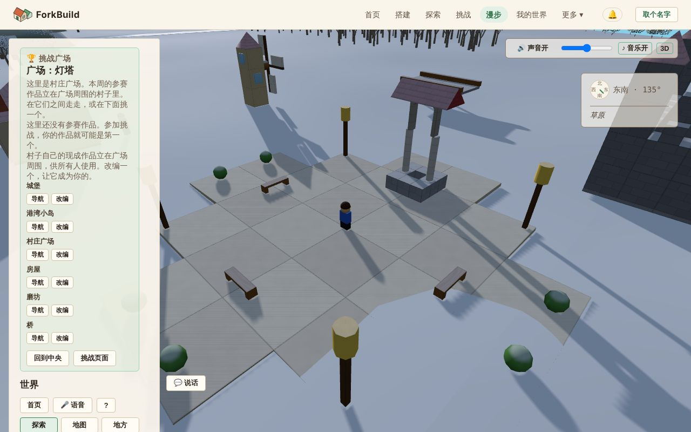

<!-- translation-of: docs/user/03-WorldView.md source-hash: a59df140c51bc42f -->
# 03 — 世界视图

<!-- languages -->
[English](../03-WorldView.md) · [Deutsch](../de/03-WorldView.md) · [Español](../es/03-WorldView.md) · [Français](../fr/03-WorldView.md) · [Bahasa Indonesia](../id/03-WorldView.md) · [日本語](../ja/03-WorldView.md) · [한국어](../ko/03-WorldView.md) · [Português (Brasil)](../pt-BR/03-WorldView.md) · **中文（简体）**
<!-- /languages -->

世界视图是一个共享的 3D 世界，**每个已发布的作品都并排立在这里**。你可以四处行走或飞行、
寻找东西、看看别人搭了什么，还可以带上朋友。

你不在这里搭建：编辑器是唯一用来搭建的地方。当你想修改你发现的东西时，**编辑副本**会在编辑器中
打开你自己的副本（见[编辑副本](#编辑副本把东西带进编辑器)）。世界视图所做的唯一更改是标签，而不是积木：
为[地标](#地标标记值得记住的地方)和区域命名，以及用 **G** 把放生的动物留在世界中（见
[化身与在线状态](06-AvatarsAndPresence.md#用动物装饰世界)）。

**简要版：**

| 想要…… | 这样做 |
|---|---|
| 来到这里 | 顶栏中的**漫步**，或任何作品上的**探索** |
| 行走 | `W` `A` `S` `D` 移动，`Shift` 奔跑，`空格`跳跃（在手机上用摇杆） |
| 环顾四周 | 拖动来转动镜头，滚动来缩放 |
| 修改你看到的东西 | **编辑副本**会在编辑器中打开你自己的副本 |
| 就在这里开始一个作品 | **在这里搭建** |
| 带上朋友 | **和我一起在这里漫步**会生成一个可以发给他们的链接 |
| 静音或取消静音 | **声音**按钮，或 `M` |

所有操作都列在[操作参考](ControlsReference.md)中。世界背后的网络工具有单独的页面：
[世界视图：高级工具](WorldViewAdvancedTools.md)。

## 打开世界视图


*挑战广场上的世界视图：左边是侧面板，广场上是你的化身，右上角是声音和指南针。*

有两种进入方式：

- 顶栏中的**漫步**会在本周挑战广场上打开世界视图。你不需要有自己的作品。
  广场就是村庄广场：六个现成作品立在它周围，可以改编，本周的参赛作品就立在稍外面一点（见
  [挑战广场](04-PublishingAndForking.md#挑战广场)）。
- 在**探索**页面上，任何作品上的**探索**会把你带到它旁边。打开一个世界的链接也是一样。
  如果作品不在此设备上（还没发布，或还没传到这里），面板会显示**这个作品不在这里**，
  并提供**探索作品**和**四处看看**，而且这个链接不会被加入**我的世界**。
  如果作品在你等待时传到了，世界视图会带你去那里。

被[发送给所有人](04-PublishingAndForking.md#谁能找到它)的作品，立在搭建者放置它们的地方：
每个作品在一片广阔的土地上都有自己的位置，周围留有空间（见
[作品立在哪里](04-PublishingAndForking.md#作品立在哪里)）。

## 访客视图与高级

世界视图以访客视图打开。你来这里要做的事放在世界底部的一个横条上：**在这里搭建**、
**和我一起在这里漫步**，以及在作品不是你的时候显示的**编辑副本**。

侧面板显示作品的名称和作者，然后是你可以去哪里、你周围有什么。在手机上，面板一开始是关闭的，
让世界填满屏幕；**面板**可以打开它。在广场上，手机改为显示一行**广场：……**以及那里立着多少个作品；
轻点它即可打开面板。显示谁、按键是否让你的化身行走以及镜头选项，都在**化身设置**下。

面板底部的**显示高级工具**会添加世界背后网络所用的工具：坐标、查看积木、放置、世界相遇等。
它们在单独的页面[世界视图：高级工具](WorldViewAdvancedTools.md)中介绍。
这个选择会记在此设备上，对其他人没有任何影响。本页的所有内容无论开不开都能用。

## 四处飞行

- **左键拖动**：转动镜头
- **右键拖动**：横向平移镜头
- **滚动**：放大和缩小
- **Home**（按键，或面板中的按钮）：回到你自己的世界（见[方位与地点](#方位与地点)）

如果想改为让你的化身行走，请见
[让你的化身行走](06-AvatarsAndPresence.md#让你的化身行走)。

你移动时，附近的世界会**自动加载和卸载**。侧面板从上到下依次是：

1. 你正在看的东西（标题部分）；
2. 你可以去哪里：**首页**、**地点**，以及**探索**、**地图**和**地方**标签页；
3. 你周围有什么（**附近**）；
4. 你自己的工具：**搜索**和**化身**。

底部的**视野中的世界**列出你周围加载的其他世界，**附近的世界**列出你点一下就能飞过去的世界。

把鼠标指向世界中的某样东西，视图右下角的一张小卡片就会说明它是什么。

### 你周围有什么

**土地**对每个人都一样。草地、海滩、岩石、森林、农田、湖泊、河流和大海都顺着地面的形状分布。
中心附近的土地总是干燥的；往外大约一千个单位就到了海岸，地面在那里倾斜着没入深海。

**水。** 湖面在微风中泛起涟漪，大海随着缓慢的涌浪起伏。河流沿着河床向下流，地势越陡流得越快。
它们发源于高地下方冒着泡的泉眼，在最陡的地方化作小小的瀑布跌落，偶尔汇成一个平静的池塘。
在海浪拍岸处和河水流过急流的地方会聚起泡沫。你的化身走进湖、海或河时会慢下来，水越深越慢。
水深超过它身高的一半时，它就会游泳，随着涌浪起伏（见
[游泳和潜水](06-AvatarsAndPresence.md#游泳和潜水)）。潜到水下，你会看到海藻和小鱼群。

**树木和动物。** 森林里较湿的地方长着针叶树，较干的地方长着阔叶树，草原边缘则是灌木丛。
鹿住在森林里，兔子住在草原上。树从不移动，但任何作品 15 米之内都不会长树：
每个作品都立在属于自己的林间空地上，所以它看起来是一个地方，而不是藏在树林里的一样东西，
你走近时就能看到它的门。
动物在自己的地盘附近慢慢游荡，停下来吃草，偶尔抬起头。走近时，一只动物会转过头来看你
（除非你就在它正后方）；吃草的鹿会抬起头，兔子会坐起来。它们从不会因为你而逃跑或移动，
其他人看到的是它们在看*他们*。步行时，动物会像树一样挡住你的路。有人搭建的地方，野生动物会避开：
如果一只动物的地盘上立着一个作品，它就会渐渐消失，并且在作品存在期间不会回来，
所以鹿永远不会在客厅里吃草。桥下或高高的地板下面有它们的空间。把作品拿走，动物就会回来。

同一时刻看着同一个地方的每个人，看到的土地、鱼、树和动物都相同。这些都不能编辑。

**居民**是住在世界中的人。他们在自己家附近散步，会绕着建筑走而不是穿墙而过，还会转身向你打招呼；
和他们交谈，他们会告诉你附近有什么。与动物不同，他们是世界的一部分：由世界的作者添加。
现成的房屋在前门边都有一位居民，包括挑战广场周围的那些。在你自己的作品中，**R** 可以移除一位。见
[居民](06-AvatarsAndPresence.md#居民)。

**夜里**，世界会安静下来。动物回到自己的地盘躺下，直到早晨；走近时，它会站起来看着你。
黄昏时居民会走回家，一直待到黎明。

**淡淡的、半透明的作品**是别人在你附近公告、但此设备尚未接受的作品。你继续往前走时它们会再次消失。见
[已声明的作品](WorldViewAdvancedTools.md#已声明的作品发布者说它们立在那里的他人作品)。

### 在作品内部

从门走进去，你头顶上方的作品部分就会被剖开，所以你看到的是你所站的房间，而不是你身后的墙：
只针对这个作品，它的屋顶以及比你头部更高的一切都会被剖开，而墙会立到比你稍高的位置。
当镜头跟随你，或者在**第三人称**下，镜头也会跟进来，在你后上方俯视房间；
如果你正后方有一面墙，镜头会升高而不是穿过墙。**鸟瞰**会直接向下俯视房间；
**第一人称**通过你自己的眼睛看，不剖开任何东西。走回外面，整个作品又会被完整画出来。
只是画出的内容变了：屋顶仍然在那里，对每个人都在，行走时也在。

## 白天与黑夜

世界视图上空每 40 分钟经历一次日夜交替：温暖的黄昏、蓝色的月夜、粉色的黎明，然后又是白天。
它跟随时钟运行，所以同一时刻在同一个作品处的每个人看到的天空都相同。天黑后，玻璃窗会透出灯光，
**灯笼**会发出各自颜色的光，所以灯塔会指引方向，村庄看起来有人居住；鸟儿安静下来，蟋蟀开始鸣叫。
夜晚从不会黑到让你找不到路。只有世界视图有夜晚：编辑器、作品图片和链接预览始终是白天。

加载 ForkBuild 后第一次打开世界视图时，无论几点，它都会以晴朗的晨光迎接你：
有一分钟天空晴朗、太阳高照，然后在接下来的一分钟里渐渐变成其他人看到的天空，包括夜晚、雨等一切。
如果已经有别人在那里，或者有人加入你，你们会立即一起看到共享的天空。

太阳从东方升起，划过南方的天空，在西方落下，靠近地平线时发出橙色的光；太阳落山后，
月亮在夜里沿着同样的路径运行。照在作品上的光来自正在天上的那一个，所以朝东的墙会迎来早晨，
朝西的墙会迎来傍晚。

太阳和月亮会投下阴影：你的、树的、动物的以及每个作品的，早晚长、中午短，月光下更淡。
阴影出现在你周围约 45 米以内，并在太阳和月亮交接天空时短暂消失。阴影对手机的开销比电脑大，
所以用鼠标时默认开启，在手机或平板上默认关闭；在面板底部勾选或取消勾选**阴影**，即可在此设备上更改。

树木像在野外一样生长：最湿润的森林里是枝条成轮生、下垂的冷杉和云杉，较干燥的地方是枝干舒展、
树冠浑圆的阔叶树，草原边缘则是低矮弯曲的灌木丛。近处你能看到每一根枝条和每一片叶子；
它们随风摇摆，暴风雨来临时摇得更厉害，并投下斑驳的树影。远处它们会变成较简单的形状，
所以即使穿过整片森林也很流畅。在手机或平板上，树一开始比较简单；勾选**阴影**下方的**精细树木**，
就能在此设备上看到每一片叶子。

夜里，随着暮色加深，星星出来了，银河横贯其间，黎明时又渐渐隐去。整个星空绕着北方高处的一个点缓缓转动，
所以星星和月亮一起从东方升起、在西方落下，每个人在同一时刻看到的星星都相同。

月亮有圆缺变化，每晚一个月相：从黑暗的新月，经过细细的蛾眉月、半月和凸月到满月，再变回去，
周期是世界视图中的八天（五个多小时）。上弦月亮的是西侧，下弦月亮的是东侧。月相也会改变夜晚：
满月时夜晚稍亮一些，阴影更清晰；新月前后光线更柔和，天空更深蓝，星星和银河最为明亮。
与天空的其他部分一样，每个人在同一时刻看到的月亮都相同，而且从不会黑到看不清作品。

云来云去，同一时刻对每个人都相同。大多数时候，天上飘着几朵白云；偶尔天空会转为多云，
有时会变得阴沉灰暗，光线更柔和，阴影更淡。从不会黑到看不清作品。

偶尔阴天会带来雨，每次下几分钟。你会看到雨落在你周围，雨滴落在湖、海或河上的地方荡开一圈圈涟漪，
你也会听到雨声，而鸟和昆虫会安静下来。走进一个作品里就不会淋雨：你会改为听到雨点敲打屋顶的声音，
看到外面仍在下雨。地面和作品在雨中会变暗并闪着光，雨停后几分钟内会慢慢变干
。最猛烈的暴雨有时会带来一场温和的雷雨：天空偶尔被闪电柔和地照亮，几秒钟后远处传来隆隆的雷声。
如果你的设备设置了减少动态效果，闪电就不会闪。雨只是用来看和听的：河水不会上涨，你走路的速度也不变。

如果你更希望一直是白天，请勾选面板底部、**阴影**正上方的**永远白天**。它也会让天空保持晴朗。
这个选择会记在此设备上，对其他人没有任何影响。

## 季节

世界依次经历四个季节，每季持续世界视图中的八天（五个多小时），月亮每转一圈就是一季。
如果某一周的[搭建挑战](04-PublishingAndForking.md#每周搭建挑战)属于某个季节（比如冬日小木屋），
世界就会对所有人从周一到下周一停留在那个季节，好让本周的参赛作品在那个季节里被看到；下个周一再继续变化。
各个季节是：

- **春**：树上开出粉色和白色的花，长出新鲜的浅绿色叶子；野花点缀着草地，花瓣在树间飘落。
- **夏**：一切郁郁葱葱，有些树上的果实成熟了，田野变成金黄色。
- **秋**：叶子变红、变橙、变黄，每棵树都有自己的节奏，叶子在你周围被风吹落，树渐渐变得光秃；田里的庄稼被收割。
- **冬**：树木光秃秃的，草色暗淡；天空转阴时会下雪而不是下雨。雪一片片积起来，渐渐变成白茫茫的一层，
  落在屋顶和树梢上（从不落在墙上，也从不落在你所站的作品内部），到春天融化。
  鸟儿唱得少了，昆虫也不见了。

土地每天都会变化一点，而不是一下子全变，每个人在同一时刻看到的季节都相同。针叶树一年四季常绿。
如果想在你的设备上固定一个季节，请在面板底部附近、**精细树木**正下方的**季节**下选择它；
**世界的四季**会再次跟随世界。开启**永远白天**时，季节仍然会变化，只是天空一直晴朗。

太阳也随季节变化。夏天它升得很高，白天很长；冬天它一直很低，投下长长的影子，夜晚来得更早。
隆冬时节，湖面会冻得结实到可以走过去（大海和河流从不结冰）；冰还在形成时，或在冬末开始破裂时，
它承受不住你。无论各自固定哪个季节，每个人在同一时刻看到的冰都相同。踩在雪上会嘎吱作响，
踩在冰上会嗒嗒响；走过雪地时，你的化身会留下脚印，一分钟后消失。只有你能看到自己的脚印。

## 声音

视图右上角（手机上是右下角）的**操作**：

- **声音**或 `M`：关闭或打开所有声音。
- 滑块：音量。在手机或平板上，请使用设备自己的音量键。
- **♪ 音乐**：单独关闭或打开音乐。
- **3D**：在 3D 声音和普通**立体声**之间切换。

按照浏览器的要求，声音会在你第一次点击、轻点或按键后才开始，并在标签页被隐藏时暂停。
这些选择会记在此设备上，世界视图和编辑器通用。

**你会听到什么：**

- **你周围的土地**：高处岩石地上的风声、森林里的鸟鸣、田野里的蟋蟀、湖水拍岸、河水流淌。
  树木在风中沙沙作响或轻声叹息，越近越响。从一种地形走到另一种时，声音会相互过渡。
- **你的化身**：随地面变化的脚步声（草地、落叶、沙子、石头、水、积木），跳跃时的呼呼声，落地时的咚的一声。
- **载具**：车轮声或热气球的燃烧器声，速度越快声音越大；上下载具的声音；急停时刹车的尖叫声。
- **动物和居民**：鹿抬头或受惊时会打响鼻，兔子会跺脚；捕捉和放生都有各自的声音。
  居民打招呼时会哼一声，说话时会喃喃低语。每个人在同一时刻听到同一头鹿抬头。
- **其他人**：只要你能看到他们，就能从他们所在的位置听到他们的脚步声、跳跃声和载具声。
  隐藏其他化身后，他们就会安静下来。载具在 40 米内可以听到，并且只听最近的三辆。
- **你自己的更改**：为地标或区域命名、添加或移除居民、用动物装饰，以及撤销和重做，
  都会发出与编辑器中相同的短音效。其他人的更改是无声的。

声音来自它们所在的位置：前方或后方、上方或下方、左边或右边，随着你转动镜头而转动。戴耳机效果更好。
**立体声**改为只播放普通的左右声道，可能更适合较慢的设备或扬声器。

**音乐**在下面轻轻播放：一段由你的浏览器即兴生成的柔和旋律，白天温暖，天黑后更舒缓，
曲子之间有安静的间歇。它从不会以完全相同的方式播放两次。

所有声音都在你的浏览器中生成：不下载任何东西，也不发送任何东西。其他人的浏览器会根据他们已经看到的
你走路的位置，生成你的脚步声。

## 方位与地点

**指南针**浮在视图右上方。它显示北、东、南、西，你面朝的方向（以度为单位），以及表示附近作品、
人和地标的小点。把鼠标指向一个小点可以看到它的名称，也可以读指南针下面的列表，那里还会说出你所在的地方。
指南针只用于显示；它从不移动镜头。

面板顶部附近的一排按钮可以帮你四处移动：

- **首页**会把你（镜头和化身）带回你自己的世界：你打开的那个，或者最后看过的那个。
  无论你走了多远，都会落在它的外面不远处。如果你还没去过自己的世界，“首页”会带你去地图中心。
- **地点**列出世界视图目前知道的每一个地方，分为**世界**、**结构**、**地标**和**地方**。
  某一行上的**聚焦**只会把镜头移到那里，不做别的。
- **👥 N 在线**统计这里有谁；点击它可以查看世界的成员。如果世界有公共大厅，后面还有一个**大厅**按钮。
- **?** 显示镜头和行走操作；再点一次即可隐藏。

**通知**是应用顶栏中你名字（或**取个名字**）旁边的 🔔 按钮，所以每个页面上都有。
它会打开你的**通知历史**，最新的排在最前面。在以下情况你会收到通知：

- 有人评论了你发布的作品（见[评论](09-PublicationsAndEvidence.md#评论)）；
- 你关注的人发布了新内容（见[关注他人](07-PeerConnectionsAndFriends.md#关注他人)）；
- 有人改编了你的某个作品（见[改编次数](04-PublishingAndForking.md#改编次数)）；
- 有人在你之后发布了一个看起来很像你某个作品的作品（见
  [较早发布的相似作品](04-PublishingAndForking.md#较早发布的相似作品)）。

每条通知都说明发生了什么以及何时发生。**探索**会带你去那个作品的世界。这只是一个简单的列表，
不是收件箱：不会标记已读，不能忽略，按钮上也没有计数。它在你打开时加载；点击**刷新**可以重新加载。
它属于你的名字，而不是你打开的世界。

### 此设备上的通知

面板顶部的**在此设备上通知我**可以让你的设备像任何应用一样自己显示这些通知。浏览器会请你允许；
**关闭**会停止通知。

它们会在 ForkBuild 打开但不在你眼前时出现：在另一个标签页中，或者作为在后台运行的
[已安装应用](01-GettingStarted.md#安装-forkbuild)。点击一条通知即可在那个作品处打开 ForkBuild。
这个功能不需要向任何地方发送任何东西，所以关闭的 ForkBuild 不会显示任何通知；这期间收到的内容
下次会出现在列表中。一次只会出现几条；其余的在列表中等着。如果浏览器阻止了通知，面板会说明：
请在浏览器的网站设置中允许 ForkBuild 的通知。

### 说出要去哪里（语音）

按 `V`，或点击**首页**旁边的 **🎤 语音**，说出要去哪里或要做什么。说完后按 `V`（或**停止**）：

- *带我去老磨坊*，或者只说一个地方的名字：镜头会去那里，与**地点**中的**聚焦**相同。
  可以说出**地点**中的任何地方，在挑战广场上还可以说出那里的作品。
- *回家*：与**首页**相同。
- *第一人称*、*第三人称*、*鸟瞰*、*自由镜头*：化身面板中的镜头视角。
- *关闭声音*、*打开声音*。
- *撤销*、*重做*：与 `Ctrl+Z` 和 `Ctrl+Y` 相同。
- *说话*：与在居民旁边按 `T` 相同。

其他任何内容都会通过**询问指南**交给指南。这里的语音与编辑器中的相同（见
[说出命令](02-TheEditor.md#说出命令语音)）：开启一次两边都能用，在你的设备上识别，
而且在它理解你说的话时，世界不会停下来。

### 探索、地图和地方：三种浏览方式，一次一种

按钮下方有三个标签页。一次只打开一个，切换只会改变面板显示的内容。

- **探索**（默认）显示这里有谁以及几个可以参观的地方，然后是**附近**：你周围的**地方**、**地标**和**人物**，
  每项都有距离和一个**前往**按钮。空的组会被隐藏。点击组的标题可以收起或展开它；
  世界视图会记住你把哪些组展开着。高级工具会再增加三个组（见
  [世界视图：高级工具](WorldViewAdvancedTools.md)）。
- **地图**显示[世界地图](#世界地图)。
- **地方**列出[地理位置](#地理位置)。

### 信息：我在看什么？

在“附近”和**地点**中，大多数**前往**按钮旁边都有一个**信息**按钮。**前往**会把镜头移过去。
**信息**会告诉你关于这个地方的情况而不移动：它是什么、有多远，以及它在哪个命名地点之内
（“你在柳村”）或附近（“你在川原村附近”）。

在信息面板中，你可以：

- **前往**：去那里；
- **在地图上显示**：在世界地图上查看它；
- **名称**（针对命名地点）：看看大家怎么称呼它，或者发布一个名称；
- **编辑副本**：在编辑器中打开你自己的副本（见下文）。

### 编辑副本：把东西带进编辑器

**编辑副本**是修改你在世界视图中发现的东西的方法。它会为作品制作一份你自己的独立副本，
并在编辑器中打开，随时可以在上面继续搭建。原作永远不会被改动。

你可以在这些地方找到它：

- 当你参观的作品不是你的时候，在世界底部的横条上：它会复制整个作品；
- 在区域、地标或已放置结构的**信息**面板上；
- 开启高级工具后，点击一块积木、空地或已放置的结构时（见
  [查看积木](WorldViewAdvancedTools.md#查看积木或已放置的结构)）。

复制什么取决于你选了什么：

- 对于**地标**、**区域**、**积木**或**空地**，你会得到它们所属的世界。
- 对于**已放置的结构**，你会得到那个结构，而不是它所在的世界。

副本准备好的那一刻，ForkBuild 会告诉你（见[发布与改编](04-PublishingAndForking.md)）。
如果无法制作副本，**无法创建副本**对话框会说明原因——通常是因为作品的许可证不允许复制，
或者暂时还获取不到作品——**返回作品**会把你带回原处（见
[改编无法完成时](04-PublishingAndForking.md#改编无法完成时)）。

**地理位置**和**人物**没有“编辑副本”。地理位置由好几个人的区域组成，所以没有单一的作品可以复制；
请改为打开它的某个区域。

“编辑副本”与“探索”和作者页面上的**改编**相同，遵循相同的许可证规则（见
[改编：让它成为你的](04-PublishingAndForking.md#改编让它成为你的)）。
世界视图中的其他一切，比如搜索、指南针、地图和信息，都只是查看。

### 在这里搭建：为这个位置开始一个作品

**首页**旁边的**在这里搭建**会在编辑器中为你的化身所站的位置（飞行时则是镜头下方的位置）
开始一个新的空作品。编辑器会说明它是为哪个世界准备的。

发布后，作品会立在那个位置上，而不是 ForkBuild 挑选的空地上。**去看看**会把你带回去查看。
编辑器中的**忘记这个位置**会让 ForkBuild 照常放置它。

这个位置只是你自己的备注，保存在此设备及其备份中。它并不认领这片土地，其他人也可以在那里搭建（见
[为什么两个作品可以在同一个位置？](WorldViewAdvancedTools.md#为什么两个作品可以在同一个位置)）。

### 和我一起在这里漫步：把朋友带进这个世界

**在这里搭建**旁边的**和我一起在这里漫步**会生成一个链接，把朋友带进你所在的世界，一起四处走走。
用你喜欢的任何方式发送它，或者让他们用手机扫描它的二维码。

打开链接的朋友如果还没有名字，需要先取一个（他们会以自己的化身漫步），然后点击**加入**，就会来到这个世界。
你们能看到彼此在四处走动。对话框会列出谁正在赶来、谁已经到了。

- 世界必须先发布：朋友的 ForkBuild 会像对待分享链接一样检查它的签名和作品，并保留一份副本。
- 只要你留在世界视图中，链接在 30 分钟内对任何打开它的人都有效。两个朋友同时打开时都能进来：
  第二个到的人会等几秒钟排到下一个位置，而不会被告知链接已失效。关闭对话框后链接仍然有效；
  **停止链接**会终止它。无论哪种情况，已经加入的朋友都会保持连接。
- 加入会把你们两台设备直接连接起来，就像**对等节点**中的邀请一样。你们都能看到对方的 IP 地址，
  化身会按照双方各自的**在线可见性**显示（见
  [谁能看到你](06-AvatarsAndPresence.md#谁能看到你两个独立的设置)）。
  除非你选择，否则没有人会成为已知对等节点或好友。
- 它需要会合服务器。官方网站有一个；你自己运行的副本需要它自己的（见
  [对等连接与好友](07-PeerConnectionsAndFriends.md)）。

### 挑战广场

本周挑战页面上的**逛逛广场**，或顶栏中的**漫步**，会在村庄广场上打开世界视图：铺着石板，
有一口井、长椅和路灯，六个现成作品立在周围。

广场和现成作品是世界的一部分，就像它的山丘和树木一样。它们为所有人立在那里，不属于任何人。
本周的参赛作品立在稍外面一点，而且只有本周的：打开上周的广场，你看到的是上周的参赛作品。
一个面板会列出本周的参赛作品和现成作品（见
[挑战广场](04-PublishingAndForking.md#挑战广场)）。广场周围不长树，广场上也没有**在这里搭建**。

### 地标：标记值得记住的地方

**地标**是你放在世界中的一个命名地点，比如“老桥”或“美景”，可以附带描述。它会准确放在你的化身所站的位置。

当你可以编辑所在的世界时，**地点**的地标部分会有一个 **+ 添加地标**按钮。给它一个标题，
如果愿意再加上描述，然后点击**放在这里**。它会立即为你出现，片刻之后也会为编辑同一个世界的其他人出现：
在指南针上、在**地点**中，以及作为可以前往的地方。

地标属于世界，而不属于你。任何能编辑这个世界的人都可以重命名、修改或移除任何地标，无论是谁创建的。

### 世界地图

**地图**标签页从上方显示世界：命名的地点、地标、作品、这里的人，以及代表你的标记。
它一次显示世界视图目前知道的一切。

- 滚动，或使用 **+** 和 **−** 缩放。
- 拖动空白处移动地图。
- 点击一个地点或人物，把镜头移过去。

查看地图永远不会改变任何东西。

### 地理位置

**地理位置**是一个区域：有好几个人各自把它命名或描述为一个区域，而结果大致是同一片土地。
**地方**标签页列出世界视图目前找到的这类地点。

点击一个，可以看到它跨越多少个描述和世界、它的**社区命名**，以及**前往该地**和**在地图上显示**。
**← 返回**（或 Escape）会回到列表。如果你切换标签页再回来，会看到你离开时的同一个页面。

一个地方的**社区命名**显示它排名靠前的几个名称；**更多名称**显示完整的排名列表。
在它们下面，你可以发布自己的名称。其他一切（这个地方的其他描述、名称的完整历史、导入和导出）都收在**更多**下。

发布名称会告诉与你连接的人，就像声明你搭了某个作品一样。要查看此设备发布过或听说过的每个名称和声明，请见
[签名记录与外部证据](09-PublicationsAndEvidence.md)。

## 我的世界：你真正去过的世界

顶栏中的**我的世界**列出你在此设备上进入过的每个世界，最新的排在最前面，并显示它的标题、作者，
以及它有多少作品和地标。**继续探索**会带你回去。只有此设备保存这个列表，其他人看不到。

还没去过任何地方？**打开“探索”**去找一个世界，或者从一个现成作品开始。

**你参与搭建的作品**列出朋友在你们用**和我一起搭建**一起搭建时为你署名的作品（见
[编辑器](02-TheEditor.md#和我一起搭建实时一起搭建)）。每一项显示它的标题，以及**与**你朋友的名字，
点击名字会打开对方的页面。在朋友发布之前，它显示**尚未发布**；发布后，它的标题会打开它的世界。
你的其他设备在与这台设备连接后也会列出它们。只有在有内容时才会显示这个部分。

## 寻找世界

有两种查找方式，各自回答不同的问题。

### 搜索：“哪些发布内容符合这个？”

**搜索**会在所有已发布的内容中查找**标题或作者**，而不只是你周围已加载的内容。输入一个词并点击**查找**。
每个结果都会显示它在哪里（📍）；点击**聚焦**即可飞过去。

结果可能会说它的位置是**默认位置**：它的作者从未选择位置，所以 ForkBuild 把它显示在一个默认位置上。
开启高级工具后，你还可以按位置搜索（见[世界视图：高级工具](WorldViewAdvancedTools.md)）；
这时结果会显示它们有多远（📏）。

### 探索这里 / 这里有什么？：“我周围现在有什么？”

这两个按钮在“探索”的**附近**顶部，会查看**你的镜头所在的任何地方**。你不需要标题或坐标。

- **探索这里**查看一大片区域。之后你可以扩大或缩小范围。
- **这里有什么？**只查看你所在的位置。

两者都会打开**探索位置**对话框：

```
📍 中心：100.0, 50.0, 250.0
⭕ 半径：25 世界单位

显示你能找到的 3 个作品中的 3 个

📍 市政厅               📏 距离 4.2 世界单位
作者：alice
[聚焦] [选择] [查看]
```

每个结果有三个按钮：

| 按钮 | 作用 |
|---|---|
| **聚焦** | 飞过去，并让它成为你下一次更改所作用的作品 |
| **选择** | 让它成为你下一次更改所作用的作品，但不移动 |
| **查看** | 显示它的标题、作者、状态、位置和所有者，但不移动 |

对话框本身从不移动、更改或发布任何东西。

## 世界视图是只读的：搭建在编辑器中进行

在世界视图中点击、拖动或按键，永远不会改变任何积木。这里没有搭建工具。要在某样东西上继续搭建，
请使用**[编辑副本](#编辑副本把东西带进编辑器)**，然后在[编辑器](02-TheEditor.md)中继续。
世界视图所做的唯一更改，就是本页开头列出的那些标签。

## 看到其他合作者

当其他人在同一个世界中时：

- **你能看到他们**：他们的化身，以及他们的名字和正在做的事（“**Bob——在附近探索**”）。
- **你能实时看到他们的更改**：一个地标、一个名称、他们自己的一个新副本。
- 面板中的**简短活动列表**显示最近有什么变化，即使不在视野中。它只在你在这里时保留。

看到别人本身永远不会改变任何东西。只有真正的更改才会：在编辑器中做的更改，或世界视图允许的某种标签。

## 这里也能保存和发布

当你在处理一个作品时，标题部分有**保存**、**发布**和**编辑元数据**，所以你不用离开就能保存和分享。
状态行会说明是哪一种：**🔒 已发布**或 **✎ 正在编辑你的副本**。

已发布的作品永远不会改变。如果你所在的作品已经发布，你在这里的第一次更改（它的详情、地标或区域，
或作为装饰留下的动物）会制作你自己的副本，标题为 *“&lt;原名称&gt;的改编”*。一条简短的提示会告诉你
（“已创建你自己的可编辑副本——……保持不变”）。与任何改编一样，适用相同的许可证规则（见
[发布与改编](04-PublishingAndForking.md#改编让它成为你的)）。

## 历史：预览和恢复之前的状态

你在这里做的每一次更改，比如添加、重命名或移除地标或区域，都会保存在作品的历史中。
点击标题部分的**历史**，可以看到一个带时间的编号列表，例如：

```
1. 添加地标“老桥”
2. 重命名区域“柳村”
3. 移除地标“美景”
```

已撤销的步骤会标记为**已撤销**。点击某一步只是选中它；在你按下按钮之前什么都不会改变：

- **预览**会在当前世界旁边显示该步骤*刚完成之后*的世界，而不改变任何东西。**取消预览**会返回。
- **恢复**会回到那一步。它不会先询问，但会让更改处于未保存状态，所以你仍然可以选择是否保存。
- **关闭**会关闭列表。

## 接下来做什么？

准备好分享你做的东西，或者改编别人的作品了吗？继续阅读**[发布与改编](04-PublishingAndForking.md)**。
关于世界背后的网络工具，请见**[世界视图：高级工具](WorldViewAdvancedTools.md)**。
